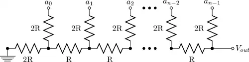
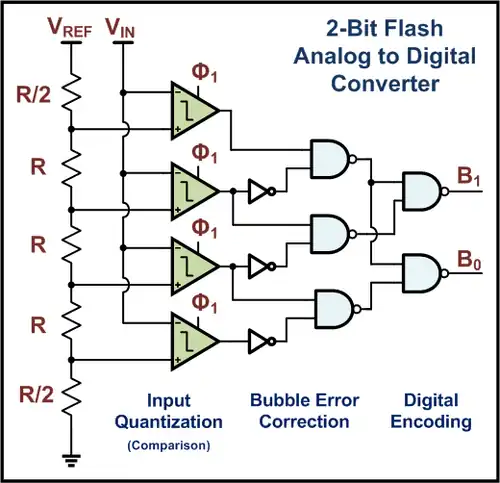
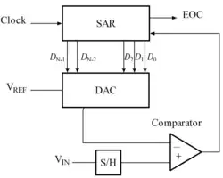

# 3.9 数模与模数转换

> **本章定位**：数模混合桥接选修，连接模拟信号链与数字系统。

> **前置知识**：**必需**：[1.33 信号与系统速成](../../01-基础与电路分析/电路原理/1.33-信号与系统速成.md)（采样与频谱）、[2.8 运算放大器](../../02-模拟与硬件工程/模拟电路/2.8-运算放大器.md)、[3.1 数制与编码](3.1-数制与编码.md)、[3.2 逻辑代数基础](3.2-逻辑代数基础.md)；**推荐**：[2.10 信号处理电路](../../02-模拟与硬件工程/模拟电路/2.10-信号处理电路.md)（滤波与信号调理）。

## 1. 模数转换基本概念

### 1.1 采样、量化与编码

模拟信号转换为数字信号需要经过三个步骤：

1. **采样（Sampling）**：在时间上对连续信号离散化，每隔一定时间 $T_s$ 采集一个样本值
2. **量化（Quantization）**：将采样得到的连续幅度值近似为有限个离散电平
3. **编码（Encoding）**：将量化后的电平用二进制代码表示

### 1.2 奈奎斯特采样定理

为了能从采样后的离散信号无失真地恢复原始模拟信号，采样频率必须满足：

$$f_s \ge 2f_{max}$$

其中 $f_s$ 为采样频率，$f_{max}$ 为模拟信号的最高频率分量。

实际应用中，通常取 $f_s = (2.5 \sim 5) f_{max}$。

### 1.3 量化误差

量化误差是量化过程中由于近似引入的误差，其范围为：

$$-\frac{LSB}{2} \le \epsilon \le \frac{LSB}{2}$$

其中 LSB 为最低有效位对应的电压值：

$$LSB = \frac{V_{ref}}{2^n}$$

$V_{ref}$ 为参考电压，$n$ 为 ADC 的分辨率位数。

### 1.4 采样定理的数学描述

奈奎斯特采样定理的数学表述：若模拟信号 $x(t)$ 的最高频率分量为 $f_{max}$，则采样频率 $f_s$ 必须满足：

$$f_s \geq 2f_{max}$$

否则会发生混叠（Aliasing），即高频信号折叠到低频区域，无法恢复原始信号。

**实用采样频率**：实际工程中通常取 $f_s = (3 \sim 5)f_{max}$，以留出足够的过渡带。

**抗混叠滤波器**：在ADC之前放置低通滤波器，滤除高于 $f_s/2$ 的频率分量。

## 2. DAC（数模转换器）

### 2.1 权电阻型 DAC

权电阻型 DAC 利用不同权重的电阻网络产生与二进制码对应的模拟电压。

**电路原理**：
- 每位二进制位对应一个电阻，阻值与 $2^{n-1-i}$ 成正比
- 通过运算放大器求和

**输出电压**：
$$V_{out} = -V_{ref} \cdot \frac{R_f}{R} \sum_{i=0}^{n-1} \frac{D_i}{2^{n-1-i}}$$

其中 $D_i$ 为第 $i$ 位的二进制值（0 或 1），$R_f$ 为反馈电阻。

**缺点**：电阻值范围大（$R$ 到 $2^{n-1}R$），精度难以保证。

### 2.2 R-2R 梯形网络型 DAC

R-2R 梯形网络型 DAC 只用两种阻值（R 和 2R），克服了权电阻型 DAC 的缺点。

**输出电压**：
$$V_{out} = -V_{ref} \cdot \frac{R_f}{R} \cdot \frac{D_{n-1}}{2^1} + \frac{D_{n-2}}{2^2} + ... + \frac{D_0}{2^n}$$

当 $R_f = R$ 时：
$$V_{out} = -V_{ref} \cdot \sum_{i=0}^{n-1} \frac{D_i}{2^{n-i}}$$

**优点**：
- 只用两种阻值（R 和 2R）
- 精度高，易于集成
- 速度较快

### 2.3 电流型 DAC

电流型 DAC 将二进制码转换为电流，再通过运算放大器转换为电压。

**特点**：
- 速度最快
- 适合高频应用
- 常用于视频和通信系统

### 2.4 DAC 主要性能指标

**分辨率**：DAC 能分辨的最小输出电压变化与满量程电压之比。

$$\text{分辨率} = \frac{1}{2^n - 1}$$

**转换精度**：实际输出电压与理想输出电压之间的最大偏差。

**建立时间**：从数字输入变化到输出稳定在最终值 ±1/2 LSB 范围内所需的时间。

**满量程误差**：实际满量程输出与理想满量程输出之间的偏差。

**积分非线性（INL）**：实际传输特性曲线与理想直线之间的最大偏差。

**微分非线性（DNL）**：相邻码之间实际步长与理想步长的最大偏差。

**信噪比（SNR）**：信号功率与噪声功率之比。

| 指标 | 定义 | 单位 |
|------|------|------|
| 分辨率 | 输入数字量的位数N，或最小输出电压 $V_{LSB}$ | 位（bit）或mV |
| 转换精度 | 实际输出与理想输出的偏差 | LSB或% |
| 建立时间 | 从输入变化到输出稳定在误差范围内的时间 | ns或μs |
| 积分非线性(INL) | 实际传输特性与理想直线的最大偏差 | LSB |
| 微分非线性(DNL) | 相邻码之间实际步长与理想步长的最大偏差 | LSB |
| 信噪比(SNR) | 信号功率与噪声功率之比 | dB |

### 2.5 电流舵型DAC

电流舵型DAC（Current-Steering DAC）由多个电流源组成，通过开关控制每个电流源是否连接到输出端。

**结构特点**：
- 二进制加权电流源阵列或单位电流源阵列
- 工作速度快（可达数GHz）
- 多用于高速通信系统（如DDS、任意波形发生器）
- 主要缺点是功耗较大、面积较大

## 3. ADC（模数转换器）

### 3.1 并联比较型 ADC（Flash ADC）

Flash ADC 是速度最快的 ADC 类型。

**工作原理**：
1. 参考电压 $V_{ref}$ 通过电阻分压产生 $2^n - 1$ 个比较阈值
2. $2^n - 1$ 个比较器同时将输入信号与各阈值比较
3. 比较器输出经编码器转换为二进制码

**特点**：
- 速度最快（一个时钟周期完成转换）
- 分辨率每增加 1 位，比较器数量翻倍（$2^n - 1$ 个）
- 功耗高，面积大
- 分辨率通常不超过 8 位

### 3.2 逐次逼近型 ADC（SAR ADC）

SAR ADC 在速度和精度之间取得良好平衡，是最常用的 ADC 类型。

**工作原理**：
1. SAR 寄存器先置为 100...0（最高位为 1）
2. DAC 将 SAR 值转换为模拟电压 $V_{DAC}$
3. 比较器比较 $V_{in}$ 和 $V_{DAC}$
4. 若 $V_{in} > V_{DAC}$，保留该位（1）；否则清零（0）
5. 对下一位重复上述过程，直到所有位确定

**转换时间**：
$$T_{conv} = n \times T_{clk}$$

其中 $n$ 为分辨率位数，$T_{clk}$ 为时钟周期。

**特点**：
- 速度适中（几 MHz 到几十 MHz）
- 分辨率适中（8 位到 16 位）
- 功耗低
- 面积小

### 3.3 双积分型 ADC

双积分型 ADC 通过两次积分实现模数转换，抗干扰能力强。

**工作原理**：
1. **第一阶段（采样阶段）**：对输入信号 $V_{in}$ 固定时间积分
2. **第二阶段（比较阶段）**：对参考电压 $-V_{ref}$ 反向积分，直到输出为 0
3. 积分时间与输入电压成正比

**输出电压**：
$$D = \frac{T_2}{T_1} \times 2^n = \frac{V_{in}}{V_{ref}} \times 2^n$$

**特点**：
- 精度高（可达 16-24 位）
- 抗工频干扰能力强
- 速度慢（几 ms 到几十 ms）
- 常用于数字万用表、精密测量仪器

### 3.4 Σ-Δ 型 ADC

Σ-Δ（Sigma-Delta）型 ADC 采用过采样和噪声整形技术，实现高精度模数转换。

**工作原理**：
1. 以远高于奈奎斯特频率的速率对输入信号采样（过采样）
2. 调制器对输入与反馈的差值进行积分（Σ-Δ 调制器将量化噪声推到高频段）
3. 量化器将积分结果转换为 1 位数字流
4. 数字抽取滤波器将高速 1 位流转换为低速多位数字输出（滤除高频噪声、降低采样率）

**特点**：
- 精度极高（可达 24 位以上）
- 线性度好
- 对模拟电路精度要求低（主要是数字处理）
- 转换速度较慢（适用于音频、传感器等低频应用）
- 成本低，易于集成

### 3.5 ADC 主要性能指标

**分辨率**：ADC 能分辨的最小输入电压变化：

$$LSB = \frac{V_{ref}}{2^n}$$

**转换速率**：ADC 每秒能完成的转换次数。

**信噪比（SNR）**：
$$SNR = 6.02n + 1.76 \text{ (dB)}$$

**有效位数（ENOB）**：
$$ENOB = \frac{SNR_{实际} - 1.76}{6.02}$$

**无杂散动态范围（SFDR）**：基波信号幅度与最大杂散分量幅度之比。

**积分非线性（INL）**：实际传输特性与理想直线的最大偏差。

**微分非线性（DNL）**：实际码宽与理想码宽（1 LSB）的最大偏差。

## 4. 采样保持电路

在 ADC 转换期间，为保证输入信号稳定，需要使用采样保持电路。

**基本结构**：
- 模拟开关（S）
- 保持电容（$C_H$）
- 输入缓冲放大器（$A_1$）
- 输出缓冲放大器（$A_2$）

**工作原理**：
1. **采样模式**：开关闭合，输入信号通过 $A_1$ 对 $C_H$ 充电，输出跟随输入
2. **保持模式**：开关断开，$C_H$ 保持充电电压，输出稳定在采样时刻的电压值

**关键参数**：
- **采集时间**：从采样模式切换到保持模式后，输出稳定到最终值所需时间
- **孔径时间**：保持命令发出到开关完全断开的时间
- **保持电压下降率**：由于漏电流导致保持电容电压下降的速率

## 5. ADC 与 DAC 的选择指南

| 应用场景 | 推荐 ADC/DAC 类型 |
|---------|-----------------|
| 高速数据采集 | Flash ADC |
| 中速高精度 | SAR ADC |
| 音频信号处理 | Σ-Δ ADC |
| 精密测量 | 双积分型 ADC / Σ-Δ ADC |
| 视频信号处理 | Flash ADC / 电流型 DAC |
| 通用控制 | SAR ADC / R-2R DAC |

## 本章要点

- 模数转换基本概念
- DAC（数模转换器）
- ADC（模数转换器）
- 采样保持电路
- ADC 与 DAC 的选择指南

## 自测清单

1. 「模数转换基本概念」要解决的核心问题是什么？关键结论或公式是什么？
2. 「DAC（数模转换器）」与上一节之间是什么关系？
3. 「ADC（模数转换器）」在什么场景下会用到？如果条件改变，结论会如何变化？
4. 能否不看正文，写出「采样保持电路」的关键流程或结构？
5. 「ADC 与 DAC 的选择指南」最容易混淆的点是什么？

---

**下一章**：[3.11 从逻辑门到单周期处理器](../计算机组成原理/3.11-从逻辑门到单周期处理器.md)
