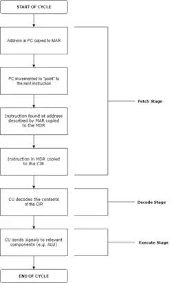
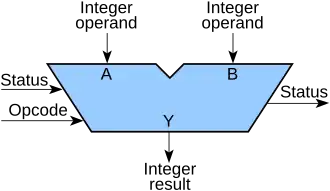
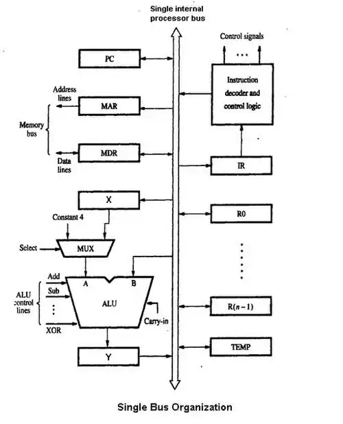

# 3.11 从逻辑门到单周期处理器

> **本章定位**：把数字电路模块组装成处理器，连接数字逻辑与计算机体系结构。

> **前置知识**：本节把[3.10 数字系统设计基础](../数字电路/3.10-数字系统设计基础.md)中的数据通路、控制单元与有限状态机方法应用到最大号的数字系统——处理器。

第 3 篇的数字电路部分（3.1–3.10）已经能设计数据通路和控制器，本章把它们组装成一台能运行程序的计算机。这是通往超标量 CPU（3.13–3.15）的第一步：**先造一台最简单的处理器**。

---

## 1. 从代码到电路：处理器的本质

处理器只是一个"读指令、做运算、写结果"的循环：

```c
while (1) {
    指令 = memory[PC];      // 取指
    PC = PC + 4;            // （默认）指向下一条指令
    执行指令;               // 译码 + 执行 + 写回
}
```

用数字电路的语言：**处理器 = 组合逻辑（译码/运算）+ 时序逻辑（PC、寄存器堆）+ 存储（指令/数据存储器）**。



*上图：经典的取指-译码-执行（指令周期）流程——处理器反复执行"取指、译码、执行、写回"的循环。*

## 2. 指令集：硬件与软件的契约

### 2.1 为什么先定指令集

ISA（Instruction Set Architecture）定义"处理器能做什么"，微架构决定"怎么做"。[3.15 现代CPU实现分析](../CPU设计/3.15-现代CPU实现分析.md)将对比 x86_64 与 AArch64 两大ISA；这里选用教学界标准 **RISC-V** 的最小子集，因为它足够简单又足够真实。

### 2.2 RV32I 最小核心子集

| 类型 | 指令示例 | 功能 |
|------|---------|------|
| 算术 | `add rd, rs1, rs2` | rd ← rs1 + rs2 |
| 算术立即数 | `addi rd, rs1, imm` | rd ← rs1 + imm |
| 访存-加载 | `lw rd, imm(rs1)` | rd ← Mem[rs1+imm] |
| 访存-存储 | `sw rs2, imm(rs1)` | Mem[rs1+imm] ← rs2 |
| 分支 | `beq rs1, rs2, label` | if (rs1==rs2) PC ← PC+偏移 |
| 跳转 | `jal rd, label` | rd ← PC+4; PC ← 目标 |

寄存器堆：32个32位通用寄存器（x0 恒为0——硬件接地即可实现，砍掉大量特例）。

### 2.3 指令编码：R型与I型

```
R型: | funct7 | rs2 | rs1 | funct3 | rd  | opcode |  （寄存器-寄存器运算）
     |  7bit  | 5b  | 5b  |  3bit  | 5b  |  7bit  |

I型: |    imm[11:0]    | rs1 | funct3 | rd  | opcode |  （立即数/加载）
     |      12bit       | 5b  |  3bit  | 5b  |  7bit  |
```

所有指令定长32位，字段位置固定——这正是 [3.13 §6.2 AArch64 解码优势](../CPU设计/3.13-超标量CPU微架构基础.md) 讨论"AArch64解码比x86_64简单"的原因。

## 3. 数据通路的部件级搭建

### 3.1 取指部件

```
PC寄存器 → 指令存储器地址端 → 指令存储器 → 指令字 Inst[31:0]
                                    ↑
PC更新: PC+4 或 分支目标（二选一，由多路选择器决定）
```

### 3.2 寄存器堆

两个读端口 + 一个写端口：

```
Inst[24:20] ──→ 读地址1 ─┐
                        ├─→ 寄存器堆 ──→ 读数据1 (rs1)
Inst[19:15] ──→ 读地址2 ─┘        ↑    ──→ 读数据2 (rs2)
                            写地址 ←── Inst[11:7] (rd)
                            写数据 ←── 结果多选器
                            写使能 ←── 控制器（RegWrite）
```

### 3.3 立即数生成器

I型立即数是 `Inst[31:20]` 符号扩展，不同指令类型的立即数位置不同，用一个多路选择器按指令类型拼接——这是典型的"组合逻辑做指令解析"。

### 3.4 ALU

3.1–3.10 设计过的算术逻辑单元，操作由 `ALUOp` 控制（加/减/与/或/比较）：

- R型：`rs1 OP rs2`
- I型：`rs1 OP imm`
- 访存：计算地址 `rs1 + imm`
- 分支：比较 `rs1 - rs2`，看零标志



*上图：ALU 是纯组合逻辑的黑盒，输入 A/B 与运算操作 OP，输出结果与标志位（零/进位/溢出等）。*

### 3.5 数据存储器接口

```
地址 ← ALU结果
写入数据 ← 读数据2 (rs2)
读/写 ← MemWrite / MemRead
输出 ← 加载的数据（写回寄存器堆的多选器来源之一）
```

## 4. 把部件连起来：完整单周期数据通路

```
        ┌──────────┐
        │ PC寄存器  │←──────────────────────────┐
        └────┬─────┘                             │
             ↓                                   │
      ┌────────────┐                             │
      │ 指令存储器  │                             │
      └────┬───────┘                             │
           │ Inst[31:0]                          │
           ↓                                     │
   ┌───────┴────────┐      ┌──────────┐          │
   │  寄存器堆(读)   │─────→│   ALU    │          │
   └───────┬────────┘      └────┬─────┘          │
           │                    ↓                │
           │          ┌─────────────────┐        │
           └─────────→│ 数据存储器 (读/写)│        │
           (写数据)    └────────┬────────┘        │
                               ↓                 │
                      ┌────────────────┐         │
                      │ 写回多路选择器   │         │
                      └───────┬────────┘         │
                              │ 写回寄存器堆       │
                              ↓                  │
              PC选择: [PC+4] vs [PC+立即数偏移] ──┘
                    (由分支是否成立控制)
```



*上图：单总线组织下的处理器数据通路——总线把指令存储器、寄存器堆、ALU、数据存储器连成一个整体，控制单元驱动各部件协同。*

**关键时序**：所有操作在**一个时钟周期内完成**——取指、译码、读寄存器、ALU、访存、写回全部串行完成，时钟周期必须容纳最慢路径（`lw` 指令）。

## 5. 控制器：单周期的大脑

控制器是纯组合逻辑：输入指令操作码，输出控制信号。

| 控制信号 | 作用 | add | lw | sw | beq |
|---------|------|-----|----|----|-----|
| RegWrite | 写寄存器堆 | 1 | 1 | 0 | 0 |
| ALUSrc | ALU第二操作数选寄存器/立即数 | 0 | 1 | 1 | 0 |
| MemRead | 读数据存储器 | 0 | 1 | 0 | 0 |
| MemWrite | 写数据存储器 | 0 | 0 | 1 | 0 |
| MemtoReg | 写回数据选ALU/存储器 | 0 | 1 | × | × |
| Branch | 允许分支目标进PC | 0 | 0 | 0 | 1 |
| ALUOp | ALU运算类型 | 加 | 加 | 加 | 减 |

本质上就是3.10节"控制单元设计"的真值表方法——只是输入从外设状态变成了指令编码。

## 6. 性能分析：单周期的瓶颈

$$
T_{\text{时钟}} \geq t_{\text{取指}} + t_{\text{读寄存器}} + t_{\text{ALU}} + t_{\text{访存}} + t_{\text{写回}}
$$

**问题**：`add` 不访存，却被 `lw` 的访存延迟拖累——**每条指令都按最慢指令的节奏运行**。

假设各段延迟（归一化）：

| 部件 | 延迟 |
|------|------|
| 取指 | 2 |
| 读寄存器 | 1 |
| ALU | 2 |
| 访存 | 4 |
| 写回 | 1 |

单周期时钟 = 10（全部相加）。但寄存器运算类指令实际只需要 2+1+2+1 = 6。**近一半的每个周期都被浪费**。

**解法**：把一条指令的执行切成多段，让不同指令的不同段同时进行——流水线。这正是下一节的内容，也是[3.15 现代CPU实现分析](../CPU设计/3.15-现代CPU实现分析.md)超标量设计的起点。

---

## 7. 本节要点

| 概念 | 一句话总结 |
|------|-----------|
| ISA | 软硬件契约，定义"做什么" |
| 数据通路 | PC + 寄存器堆 + ALU + 存储器的连线 |
| 控制器 | 操作码到控制信号的组合逻辑 |
| 单周期 | 一拍完成一条指令，时钟由最慢指令决定 |
| 瓶颈 | 快指令被慢指令拖累 → 引出流水线 |

下一节：[3.12 流水线处理器](3.12-流水线处理器.md)——把单周期切段重叠执行，并处理冒险问题。

## 本章要点

- 从代码到电路：处理器的本质
- 指令集：硬件与软件的契约
- 数据通路的部件级搭建
- 把部件连起来：完整单周期数据通路
- 控制器：单周期的大脑
- 性能分析：单周期的瓶颈

## 自测清单

1. 「从代码到电路：处理器的本质」要解决的核心问题是什么？关键结论或公式是什么？
2. 「指令集：硬件与软件的契约」与上一节之间是什么关系？
3. 「数据通路的部件级搭建」在什么场景下会用到？如果条件改变，结论会如何变化？
4. 能否不看正文，写出「把部件连起来：完整单周期数据通路」的关键流程或结构？
5. 「控制器：单周期的大脑」最容易混淆的点是什么？

---

**下一章**：[3.12 流水线处理器](3.12-流水线处理器.md)
