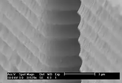

# 4.48 MEMS 基础（一）概述与工艺技术

> **本章定位**：微机电系统入门，覆盖工艺、力学、传感器/执行器、封装与设计流程。

> **前置知识**：[2.1 半导体物理基础](../../02-模拟与硬件工程/模拟电路/2.1-半导体物理基础.md)；[4.1 半导体工艺基础](../芯片设计/4.1-半导体工艺基础.md)。

> 本页为《MEMS 基础》系列第 1/4 页。

## 1. 引言

微机电系统（Micro-Electro-Mechanical Systems, MEMS）是将微型机械结构与电子电路集成在同一芯片上的系统级技术。如果说集成电路（IC）实现了"微型化的电子运算"，那么 MEMS 则在此基础上实现了"微型化的感知与执行"——通过在硅片上构建可动的机械结构（梁、膜、齿轮、悬臂等），实现对力、加速度、角速度、压力、声波、流体等物理量的传感与操控。

MEMS 的核心理念是**与 IC 工艺兼容**：利用半导体制造中的光刻、刻蚀、沉积等工艺，在硅片上批量制造微米尺度的机械结构，从而继承 IC 产业高精度、低成本、大批量的优势。从 1980 年代初期的压力传感器起步，到如今智能手机中动辄包含十数颗 MEMS 芯片（加速度计、陀螺仪、麦克风、气压计等），MEMS 已成为"超越摩尔"（More-than-Moore）路线的典范。

MEMS 技术横跨**机械学、流体力学、电磁学、材料科学和集成电路设计**等多学科领域，其设计流程涉及力学仿真、有限元分析、工艺仿真和电路设计的协同。本章将系统介绍 MEMS 的工艺技术、力学基础、传感器与执行器原理、RF MEMS、谐振器、封装和设计流程，为读者建立完整的 MEMS 知识体系。

---

## 2. MEMS概述

### 2.1 MEMS的定义

MEMS 是在微米至毫米尺度上，将**机械（可动）结构**、**传感器**、**执行器**和**信号处理电路**集成在同一芯片或同一封装内的微型系统。其特征包括：

| 特征 | 说明 |
|------|------|
| **微型化** | 特征尺寸在 1 μm ~ 1 mm 范围 |
| **可动机械结构** | 区别于纯电子 IC，MEMS 包含可运动的机械部件 |
| **与 IC 工艺兼容** | 采用半导体制造工艺，可批量生产 |
| **机电耦合** | 机械量与电学量之间相互转换（传感或执行） |
| **系统集成** | 传感器 + 执行器 + 信号处理 + 控制电路的集成 |

MEMS 的核心在于**机电转换**：传感器将机械量（力、位移、压力等）转换为电信号，执行器将电信号转换为机械运动。

### 2.2 MEMS与IC的关系

MEMS 与 IC 共享半导体制造工艺平台，但两者在设计理念上有本质差异：

| 维度 | IC（集成电路） | MEMS（微机电系统） |
|------|---------------|-------------------|
| **核心功能** | 电子信号处理 | 机械感知/执行 |
| **结构特点** | 固态，无可动部件 | 包含可动结构（梁、膜、齿轮等） |
| **设计方法** | EDA 自动化程度高 | 有限元（FEM）+ 电路协同仿真 |
| **工艺流程** | 标准化（前道/后道） | 非标准，需定制工艺模块 |
| **封装要求** | 电互连 + 保护 | 需考虑机械自由度、真空、气密性 |
| **可靠性** | 电学可靠性为主 | 电学 + 机械可靠性（疲劳、磨损、粘连） |
| **设计规则** | DRC 规则成熟 | 尚无统一 DRC，需工艺验证 |

**关键联系**：MEMS 器件需要信号读出与控制电路，因此 MEMS 与 IC 的集成（单芯片或系统级封装 SiP）是 MEMS 产品的关键发展方向。

### 2.3 MEMS应用领域

MEMS 已渗透到诸多领域，形成了多样化的产品生态：

| 应用领域 | 典型器件 | 应用场景 |
|---------|---------|---------|
| **惯性传感器** | 加速度计、陀螺仪 | 手机、汽车、无人机、游戏手柄 |
| **压力传感器** | 压阻式/电容式压力传感器 | 轮胎气压、血压计、工业过程控制 |
| **声学器件** | MEMS 麦克风 | 手机、助听器、智能音箱 |
| **微流体** | 微泵、微阀、微通道 | 生物医学分析、药物递送 |
| **RF MEMS** | 开关、可变电容、电感、谐振器 | 5G/6G 射频前端、可重构天线 |
| **BioMEMS** | 生物传感器、微针阵列、Lab-on-a-Chip | 基因测序、即时诊断（POCT） |
| **光学 MEMS** | DMD 微镜阵列、微扫描镜 | 投影仪、AR/VR、激光雷达 |
| **热学 MEMS** | 微热板、红外探测器 | 气体传感器、热成像 |
| **打印头** | 热泡喷墨打印头 | 喷墨打印机 |

### 2.4 MEMS市场规模与发展趋势

| 年份 | 全球 MEMS 市场规模 | 驱动力 |
|------|-------------------|--------|
| 2015 | ~120 亿美元 | 智能手机普及、汽车电子化 |
| 2020 | ~150 亿美元 | TWS 耳机、IoT 传感节点 |
| 2025 | ~200 亿美元（预估） | 5G 射频前端、自动驾驶、AR/VR |
| 2030 | ~300 亿美元（预估） | 智能感知无处不在、BioMEMS 崛起 |

**发展趋势**：

1. **多传感器融合**：单一封装内集成加速度计 + 陀螺仪 + 磁力计（9 轴 IMU）
2. **更高性能**：导航级陀螺仪（零偏稳定性 < 1°/h）、高精度气压计
3. **更小尺寸**：从 3×3 mm² 向 2×2 mm² 甚至更小演进
4. **更低功耗**：常开（Always-On）传感器功耗降至 μW 级
5. **压电 MEMS 兴起**：AlN/PZT 压电材料实现更低驱动电压、更高响应
6. **MEMS + AI**：边缘智能感知，传感器内嵌 AI 加速器

---

## 3. MEMS工艺技术

MEMS 工艺的核心任务是**在硅片上构建可动的三维机械结构**。与 IC 工艺的平面化加工不同，MEMS 需要形成悬空、空腔和可动部件，这就要求专门的微加工技术。

### 3.1 体硅微加工（Bulk Micromachining）

体硅微加工通过**选择性地去除硅衬底材料**来形成三维结构，是 MEMS 最早发展起来的加工技术。

#### 3.1.1 各向异性湿法腐蚀

单晶硅在不同晶面上的腐蚀速率差异极大，利用这一特性可实现高精度的三维结构：

| 腐蚀液 | 腐蚀速率比 $\frac{R(100)}{R(111)}$ | 特点 | 选择比 |
|--------|-------------------------------------|------|--------|
| **KOH**（氢氧化钾） | ~100:1 ~ 600:1 | 成本低、腐蚀速率快；金属不兼容 | SiO₂ 掩模选择比 ~200:1 |
| **TMAH**（四甲基氢氧化铵） | ~30:1 ~ 100:1 | 与 IC 兼容（无碱金属离子）；腐蚀速率较慢 | SiO₂ 掩模选择比 ~1000:1 |
| **EDP**（乙二胺邻苯二酚） | ~35:1 | 选择比高；有毒，逐步淘汰 | SiO₂/Si₃N₄ 掩模 |

**(100) 硅片的各向异性腐蚀特性**：

- 腐蚀沿 <100> 方向快速进行，<111> 方向几乎停止
- 形成 V 形槽或倒金字塔形空腔，侧壁为 {111} 面，与表面夹角为 54.74°
- V 形槽开口宽度 $W$ 与深度 $d$ 的关系：

$$W = d \cdot \sqrt{2} \cdot 2 = 2\sqrt{2} \cdot d$$

- 腐蚀停止技术：重掺杂硼（$p^{++}$，浓度 > $5 \times 10^{19}$ cm⁻³）可使腐蚀速率降低 50~100 倍，实现自停止腐蚀

#### 3.1.2 深反应离子刻蚀（DRIE）

DRIE 是体硅微加工中最重要的干法刻蚀技术，可实现**高深宽比（High Aspect Ratio）**的垂直结构。主流工艺为 **Bosch 工艺**（由 Robert Bosch 公司发明）：

**Bosch 工艺原理**——交替进行刻蚀与钝化：



*上图展示了 DRIE（Bosch 工艺）刻蚀出的高深宽比硅结构侧壁，周期性刻蚀-钝化过程会在侧壁留下明显的扇贝纹形貌。*

```
周期性循环：
  ┌─ 刻蚀步骤：SF₆ 等离子体，各向同性刻蚀硅（~10-15 秒）
  │                 ↕
  └─ 钝化步骤：C₄F₈ 等离子体，在侧壁沉积氟碳聚合物保护层（~7-10 秒）
```

**关键指标**：

| 参数 | 典型值 | 说明 |
|------|--------|------|
| **刻蚀速率** | 5~30 μm/min | 与刻蚀面积有关（Loading Effect） |
| **深宽比** | 10:1 ~ 30:1（典型），最高可达 50:1+ | 深度/宽度 |
| **侧壁垂直度** | 89° ~ 90°（±1°） | 侧壁倾角 |
| **侧壁粗糙度** | 0.1~0.5 μm（扇贝纹） | 刻蚀-钝化交替产生的波纹 |
| **均匀性** | ±2%~5%（6英寸片） | 片内均匀性 |

**扇贝纹（Scalloping）**：Bosch 工艺的固有特征，每个刻蚀-钝化周期在侧壁产生一个微小凹痕，深度约 50~200 nm。对光学应用和低损耗 RF MEMS 不利，可通过优化参数减小。

**刻蚀速率与面积的关系（Loading Effect）**：

$$R_{etch} = \frac{R_0}{1 + \alpha \cdot A_{exposed}}$$

其中 $R_0$ 为小面积刻蚀速率，$A_{exposed}$ 为暴露硅面积，$\alpha$ 为负载系数。

### 3.2 表面微加工（Surface Micromachining）

表面微加工在硅衬底表面逐层构建结构，通过**牺牲层技术**释放可动部件，不大量去除衬底材料。

#### 3.2.1 牺牲层技术（Sacrificial Layer）

表面微加工的基本流程：

```
1. 在衬底上沉积牺牲层材料（如 SiO₂，1~2 μm）
2. 光刻并刻蚀牺牲层，形成锚点（Anchor）窗口
3. 沉积结构层材料（如多晶硅，1~5 μm）
4. 光刻并刻蚀结构层，形成梁、膜等机械结构
5. 选择性腐蚀牺牲层，释放结构层（Release）
```

**关键材料组合**：

| 牺牲层 | 结构层 | 释放腐蚀液 | 特点 |
|--------|--------|-----------|------|
| SiO₂（LTO/PSG） | 多晶硅（Poly-Si） | HF（氢氟酸） | 最经典组合，SUMMiT 工艺 |
| 光刻胶（PR） | 金属（Au/Al） | 丙酮/O₂ 等离子体 | 简单快速，但结构层温度受限 |
| 聚酰亚胺 | 金属/氮化硅 | O₂ 等离子体 | 厚牺牲层 |
| Cu | 氮化硅/多晶硅 | FeCl₃/HNO₃ | 用于金属牺牲层工艺 |
| a-Si（非晶硅） | SiN（氮化硅） | XeF₂ 气相刻蚀 | 干法释放，避免粘连 |

#### 3.2.2 结构层释放与粘连问题

释放过程中，液体腐蚀液的表面张力会将悬空结构拉向衬底，导致**粘连（Stiction）**——这是表面微加工最致命的可靠性问题。

**粘连的物理机制**：

$$F_{capillary} = \frac{4\gamma A}{d^2}$$

其中 $\gamma$ 为液体表面张力（水：72 mN/m），$A$ 为结构面积，$d$ 为间隙。

**防粘连技术**：

| 方法 | 原理 | 效果 |
|------|------|------|
| **临界点干燥（CPD）** | 用 CO₂ 超临界干燥，消除液-气界面 | 最有效，但设备贵 |
| **升华干燥** | 用叔丁醇/对二氯苯升华干燥 | 简单，效果较好 |
| **自组装单分子层（SAM）** | OTS/FDS 涂覆降低表面能 | 长期有效 |
| **疏水涂层** | 氟碳聚合物涂层 | 工艺兼容性好 |
| **干法释放** | XeF₂ 气相刻蚀，全程无液体 | 根本避免毛细力 |
| **结构设计** | 增加支撑柱、减小米纳面积 | 辅助措施 |

### 3.3 LIGA工艺

LIGA（Lithographie, Galvanoformung, Abformung）是德语缩写，意为**光刻-电铸-注塑**，是一种可制造高深宽比金属微结构的工艺：

| 步骤 | 内容 | 说明 |
|------|------|------|
| **L——深度X射线光刻** | 同步辐射 X 射线曝光厚光刻胶（PMMA，厚度达 1 mm） | 深宽比可达 100:1 |
| **I——电铸** | 在光刻胶模具中电铸金属（Ni、Cu、Au） | 形成金属微结构 |
| **G——注塑** | 以金属结构为模具，注塑复制大批量零件 | 低成本批量生产 |

**LIGA 与硅基微加工对比**：

| 特性 | 硅基微加工 | LIGA |
|------|-----------|------|
| 材料 | 硅、多晶硅、氮化硅 | 金属（Ni/Cu/Au）、塑料 |
| 深宽比 | ~30:1（DRIE） | ~100:1 |
| 侧壁粗糙度 | 中（DRIE 有扇贝纹） | 极好（X 射线光刻） |
| 设备成本 | 中等 | 极高（需同步辐射光源） |
| 批量生产 | 晶圆级 | 模具注塑 |
| 典型应用 | 传感器、执行器 | 微齿轮、微连接器、微流体 |

**准 LIGA（UV-LIGA）**：用紫外光刻替代 X 射线光刻，使用厚胶（SU-8，厚度可达 500 μm），成本大幅降低但深宽比限制在 ~10:1。

### 3.4 键合技术

键合技术是将两片晶圆或芯片永久结合的工艺，在 MEMS 中用于形成封闭腔体、真空封装和圆片级封装。

| 键合方式 | 原理 | 温度 | 对准精度 | 特点 |
|---------|------|------|---------|------|
| **硅-硅直接键合（SDB）** | 表面活化后高温退火（>800°C），Si-O-Si 共价键 | >800°C | ±1 μm | 高强度，但温度高 |
| **阳极键合（Anodic Bonding）** | 硅片与硼硅玻璃（Pyrex 7740），加热+高压电场 | 300~450°C | ±5 μm | 简单可靠，广泛用于压力传感器 |
| **玻璃焊料键合（Glass Frit）** | 低熔点玻璃焊料（~430°C） | 400~450°C | ±10 μm | 容忍表面粗糙，气密性好 |
| **共晶键合** | Au-Si、Au-Sn 等低熔点共晶合金 | 280~400°C | ±2 μm | 导热导电，适合 RF MEMS |
| **聚合物键合** | BCB、聚酰亚胺等有机粘合剂 | 200~350°C | ±5 μm | 低温，但不气密 |
| **金属扩散键合** | Cu-Cu、Au-Au 热压扩散 | 250~400°C | ±1 μm | 气密，高可靠性 |

**阳极键合机理**：

在硅片与 Pyrex 玻璃间施加 500~1000 V 电压，加热至 300~400°C。玻璃中 Na⁺ 离子向阴极漂移，在界面处留下空间电荷区（耗尽层），产生强电场（~10⁶ V/cm），将硅与玻璃紧密吸附并通过化学键结合。

### 3.5 MEMS与CMOS集成工艺

将 MEMS 机械结构与 CMOS 电路集成在同一芯片上是实现高性能、低成本 MEMS 产品的关键路径：

| 集成方式 | 流程顺序 | 优点 | 缺点 | 代表 |
|---------|---------|------|------|------|
| **Pre-CMOS** | 先做 MEMS，再做 CMOS | MEMS 工艺灵活 | MEMS 结构可能被 CMOS 工艺损坏 | Sandia SUMMiT |
| **Intra-CMOS** | MEMS 与 CMOS 交叉进行 | 折中优化 | 流程极其复杂 | 未大规模应用 |
| **Post-CMOS** | 先做 CMOS，后做 MEMS | CMOS 工艺标准化 | MEMS 工艺受限于 CMOS 热预算（<450°C） | TI DMD、Analog Devices iMEMS |

**Post-CMOS 方案**是业界主流：先用标准 CMOS 代工完成电路，再在后道（BEOL）金属层间或开放区域加工 MEMS 结构，所有 MEMS 工艺步骤温度需控制在 450°C 以下以避免损坏 CMOS 器件。

### 3.6 工艺技术对比表

| 工艺技术 | 结构深度 | 深宽比 | 材料 | 典型结构 | 成本 |
|---------|---------|--------|------|---------|------|
| 各向异性湿法腐蚀 | 10~500 μm | 低（~1:1） | 单晶硅 | 膜片、V 形槽 | 低 |
| DRIE | 10~500 μm | 高（10:1~30:1） | 单晶硅 | 深槽、高柱、梳齿 | 中 |
| 表面微加工 | 0.5~10 μm | 中（~5:1） | 多晶硅、金属 | 悬臂梁、梳状驱动 | 中 |
| LIGA | 10~1000 μm | 极高（~100:1） | 金属、塑料 | 微齿轮、微模具 | 极高 |
| UV-LIGA | 10~500 μm | 中（~10:1） | SU-8、金属 | 微流体通道 | 中 |

---

## 本章要点

- 引言
- MEMS概述
- MEMS工艺技术

## 自测清单

1. 「引言」要解决的核心问题是什么？关键结论或公式是什么？
2. 「MEMS概述」与上一节之间是什么关系？
3. 「MEMS工艺技术」在什么场景下会用到？如果条件改变，结论会如何变化？
4. 能否不看正文，写出「MEMS的定义」的关键流程或结构？
5. 「MEMS与IC的关系」最容易混淆的点是什么？

---

**下一章**：[4.49 MEMS 基础（二）力学基础与传感器](4.49-MEMS-力学与传感器.md)
