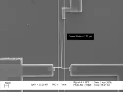
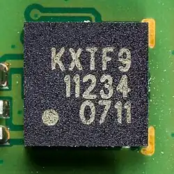
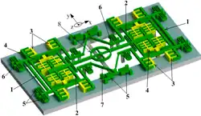

# 4.49 MEMS 基础（二）力学基础与传感器

> **前置知识**：本组为**方向选修**；学习本章必需 [4.48 MEMS 基础（一）](4.48-MEMS-概述与工艺.md)。

> 本页为《MEMS 基础》系列第 2/4 页。

## 1. MEMS力学基础

MEMS 器件的核心是可动的机械结构，其行为由弹性力学和动力学方程描述。理解力学基础是 MEMS 器件设计和仿真的前提。

### 1.1 弹性力学基础

#### 4.1.1 应力（Stress）与应变（Strain）

**应力** $\sigma$ 是单位面积上的内力：

$$\sigma = \frac{F}{A}$$

**应变** $\varepsilon$ 是相对变形量：

$$\varepsilon = \frac{\Delta L}{L_0}$$

对于各向同性弹性体，三维应力-应变关系由**广义胡克定律**描述：

$$\varepsilon_x = \frac{1}{E}[\sigma_x - \nu(\sigma_y + \sigma_z)]$$

$$\varepsilon_y = \frac{1}{E}[\sigma_y - \nu(\sigma_x + \sigma_z)]$$

$$\varepsilon_z = \frac{1}{E}[\sigma_z - \nu(\sigma_x + \sigma_y)]$$

#### 4.1.2 胡克定律

在单轴应力下，胡克定律为：

$$\sigma = E \cdot \varepsilon$$

其中 $E$ 为**杨氏模量（Young's Modulus）**，反映材料的刚度。

#### 4.1.3 MEMS常用材料力学参数

| 材料 | 杨氏模量 $E$ (GPa) | 泊松比 $\nu$ | 密度 $\rho$ (kg/m³) | 特征 |
|------|---------------------|-------------|---------------------|------|
| 单晶硅 <100> | 130 | 0.28 | 2330 | MEMS 最常用结构材料 |
| 单晶硅 <110> | 169 | 0.28 | 2330 | 各向异性 |
| 多晶硅 | ~160 | 0.22 | 2330 | 表面微加工常用 |
| 氮化硅 (Si₃N₄) | 250~320 | 0.27 | 3100 | 高刚度，低应力 |
| 二氧化硅 (SiO₂) | 70 | 0.17 | 2200 | 牺牲层/介质层 |
| 铝 (Al) | 70 | 0.35 | 2700 | 互连/反射镜 |
| 金 (Au) | 80 | 0.42 | 19300 | 高反射率/化学稳定 |
| 镍 (Ni) | 200 | 0.31 | 8900 | LIGA 结构 |
| PZT | 60~120 | 0.30 | 7600 | 压电材料 |
| AlN | 280~330 | 0.25 | 3260 | 压电材料 |

### 1.2 梁的弯曲理论

#### 4.2.1 欧拉-伯努利梁方程

MEMS 中最常用的结构是**梁**。欧拉-伯努利梁理论假设：梁的横截面在弯曲后保持平面且垂直于中性轴（适用于细长梁，$L/h > 10$）。

梁的挠度方程（四阶微分方程）：

$$EI\frac{d^4 w(x)}{dx^4} = q(x)$$

其中：
- $E$：杨氏模量
- $I$：截面惯性矩
- $w(x)$：挠度
- $q(x)$：分布载荷

矩形截面惯性矩：

$$I = \frac{bh^3}{12}$$

其中 $b$ 为梁宽，$h$ 为梁厚。

#### 4.2.2 悬臂梁挠度

一端固定、一端自由的悬臂梁，自由端施加集中力 $F$：



*图为 MEMS 悬臂梁的微结构示意，一端锚定于衬底、另一端自由悬空，是加速度计、AFM 探针等器件的基本力学结构。*

| 参数 | 公式 |
|------|------|
| 自由端挠度 | $w_{max} = \frac{FL^3}{3EI}$ |
| 自由端转角 | $\theta = \frac{FL^2}{2EI}$ |
| 等效弹簧常数 | $k = \frac{F}{w_{max}} = \frac{3EI}{L^3} = \frac{Ebh^3}{4L^3}$ |
| 固支端最大应力 | $\sigma_{max} = \frac{6FL}{bh^2}$ |
| 固支端弯矩 | $M_{max} = FL$ |

均匀分布载荷 $q$（单位长度力）下的悬臂梁：

$$w_{max} = \frac{qL^4}{8EI}$$

#### 4.2.3 固支梁（Double-Clamped Beam）挠度

两端固支梁，中点施加集中力 $F$：

| 参数 | 公式 |
|------|------|
| 中点挠度 | $w_{max} = \frac{FL^3}{192EI}$ |
| 等效弹簧常数 | $k = \frac{192EI}{L^3} = \frac{16Ebh^3}{L^3}$ |
| 固支端弯矩 | $M = \frac{FL}{8}$ |
| 中点弯矩 | $M = \frac{FL}{8}$ |
| 最大应力 | $\sigma_{max} = \frac{3FL}{2bh^2}$ |

**注意**：固支梁的弹簧常数是同等尺寸悬臂梁的 **64 倍**，因此固支结构更硬、更难驱动，但谐振频率更高。

#### 4.2.4 常见梁结构对比

| 梁类型 | 端部条件 | 弹簧常数 $k$ | 最大挠度（集中力 $F$） | 应用场景 |
|--------|---------|-------------|----------------------|---------|
| 悬臂梁 | 一端固支一端自由 | $3EI/L^3$ | $FL^3/(3EI)$ | AFM 探针、加速度计 |
| 固支梁 | 两端固支 | $192EI/L^3$ | $FL^3/(192EI)$ | 谐振器、滤波器 |
| 简支梁 | 两端简支 | $48EI/L^3$ | $FL^3/(48EI)$ | 桥式结构 |

### 1.3 谐振频率

#### 4.3.1 弹簧-质量系统

MEMS 的动态行为可用集总参数的弹簧-质量-阻尼系统描述：

$$m\ddot{x} + c\dot{x} + kx = F(t)$$

无阻尼固有频率：

$$f_0 = \frac{1}{2\pi}\sqrt{\frac{k}{m}}$$

阻尼系统的谐振频率：

$$f_d = f_0\sqrt{1 - \zeta^2}$$

其中 $\zeta = c/(2\sqrt{km})$ 为阻尼比。

品质因数 $Q$：

$$Q = \frac{1}{2\zeta} = \frac{\sqrt{km}}{c}$$

#### 4.3.2 悬臂梁的谐振频率

悬臂梁（均布质量 $m_b = \rho b h L$）的一阶固有频率：

$$f_1 = \frac{1}{2\pi}\cdot 1.875^2\sqrt{\frac{EI}{\rho A L^4}} = \frac{1}{2\pi}\cdot\frac{3.516}{L^2}\sqrt{\frac{EI}{\rho bh}}$$

等效弹簧-质量模型中，悬臂梁的有效质量约为总质量的 0.24 倍：

$$m_{eff} \approx 0.24 \cdot m_b = 0.24\rho bhL$$

因此：

$$f_1 = \frac{1}{2\pi}\sqrt{\frac{k}{m_{eff}}} = \frac{1}{2\pi}\sqrt{\frac{3EI/L^3}{0.24\rho bhL}} = \frac{1}{2\pi}\sqrt{\frac{Ebh^3}{0.96\rho bhL^4}}$$

#### 4.3.3 固支梁的谐振频率

固支梁的一阶固有频率：

$$f_1 = \frac{1}{2\pi}\cdot 4.730^2\sqrt{\frac{EI}{\rho A L^4}} = \frac{1}{2\pi}\cdot\frac{22.37}{L^2}\sqrt{\frac{EI}{\rho bh}}$$

比较可知，同等尺寸下固支梁的谐振频率约为悬臂梁的 **6.4 倍**。

#### 4.3.4 固有频率与模态

梁的各阶模态对应不同的振动形态，第 $n$ 阶固有频率：

$$f_n = \frac{(\beta_n L)^2}{2\pi L^2}\sqrt{\frac{EI}{\rho A}}$$

| 支撑条件 | $\beta_1 L$ | $\beta_2 L$ | $\beta_3 L$ |
|---------|-------------|-------------|-------------|
| 悬臂梁 | 1.875 | 4.694 | 7.855 |
| 固支梁 | 4.730 | 7.853 | 10.996 |
| 简支梁 | $\pi$ | $2\pi$ | $3\pi$ |

### 1.4 薄膜应力

MEMS 中的薄膜（多晶硅、氮化硅、金属等）在沉积后通常存在**残余应力**，对器件性能有重要影响。

#### 4.4.1 残余应力的来源

| 应力类型 | 来源 | 特征 |
|---------|------|------|
| **本征应力** | 沉积过程中的晶格失配、杂质、微观结构 | 与沉积条件密切相关 |
| **热失配应力** | 不同材料的热膨胀系数差异 | $\sigma_{th} = \frac{E_f}{1-\nu_f}(\alpha_s - \alpha_f)\Delta T$ |

**典型薄膜残余应力**：

| 薄膜 | 残余应力 (MPa) | 性质 |
|------|---------------|------|
| LPCVD 多晶硅（580°C） | -200 ~ +200 | 可通过退火调控 |
| LPCVD Si₃N₄（800°C） | +800 ~ +1200 | 强张应力 |
| PECVD Si₃N₄（300°C） | -200 ~ +400 | 可调控 |
| 溅射 Al | +50 ~ +200 | 张应力 |
| 蒸发 Au | +10 ~ +100 | 张应力 |

> 注：正值表示张应力（tensile，薄膜趋向收缩），负值表示压应力（compressive，薄膜趋向膨胀）

#### 4.4.2 残余应力对梁结构的影响

- **张应力**：使梁刚度增大（等效杨氏模量增大），谐振频率升高；过大张应力导致梁断裂
- **压应力**：使梁刚度减小，谐振频率降低；当压应力超过**欧拉临界屈曲应力**时梁发生屈曲：

$$\sigma_{cr} = \frac{\pi^2 E}{12}\left(\frac{h}{L}\right)^2 \cdot \frac{1}{1-\nu^2}$$

#### 4.4.3 应力消除与调控

- **退火**：高温退火（>900°C）释放多晶硅残余应力
- **掺硼/磷**：调控多晶硅应力（掺磷减小压应力）
- **沉积参数优化**：温度、压力、功率影响应力
- **多层复合**：交替沉积张/压应力层实现应力平衡
- **退火槽/波纹结构**：设计几何结构释放应力

---

## 2. MEMS传感器

MEMS 传感器是将物理量（加速度、角速度、压力、声波等）转换为电信号的微型器件。MEMS 传感器的核心优势在于**微型化、低成本、可批量制造和易于与电路集成**。

### 2.1 加速度计（Accelerometer）

#### 5.1.1 工作原理

MEMS 加速度计本质上是**质量块-弹簧-阻尼系统**：

$$m\ddot{x} + c\dot{x} + kx = ma_{ext}$$

其中 $a_{ext}$ 为外部加速度，$x$ 为质量块相对框架的位移。稳态时：

$$x = \frac{m}{k}a_{ext} = \frac{a_{ext}}{\omega_0^2}$$

因此，测量质量块的位移即可得到加速度。



*图为电容式加速度计的结构示意，中间的检测质量块通过弹性梁悬挂，并与固定电极构成差分电容，外部加速度使质量块发生位移从而改变电容。*

#### 5.1.2 差分电容检测

最常用的位移检测方式是**差分电容**。质量块作为中间极板，两侧固定电极形成电容 $C_1$ 和 $C_2$：

$$C_1 = \frac{\varepsilon_0 A}{d_0 - x}, \quad C_2 = \frac{\varepsilon_0 A}{d_0 + x}$$

差分输出：

$$\Delta C = C_1 - C_2 = \frac{2\varepsilon_0 A x}{d_0^2 - x^2} \approx \frac{2\varepsilon_0 A}{d_0^2}x \quad (x \ll d_0)$$

电容相对变化：

$$\frac{\Delta C}{C_0} \approx \frac{2x}{d_0}$$

其中 $C_0 = \varepsilon_0 A / d_0$ 为静态电容。

#### 5.1.3 加速度计指标

| 指标 | 定义 | 典型值（消费级） | 典型值（工业/导航级） |
|------|------|-----------------|---------------------|
| **量程** | 可测量的加速度范围 | ±2/4/8/16 g | ±0.5~100 g |
| **灵敏度** | 单位加速度的输出变化 | 0.1~1 mg/LSB | 1~10 μg/LSB |
| **带宽** | 可检测信号的频率范围 | 50~500 Hz | 10~5000 Hz |
| **噪声密度** | 单位√Hz的噪声等效加速度 | 100~400 μg/√Hz | 1~50 μg/√Hz |
| **零偏稳定性** | 零输入下输出的漂移 | 0.5~5 mg | 0.01~0.1 mg |
| **温度系数** | 灵敏度/零偏随温度的变化 | ±0.01%/°C | ±0.001%/°C |
| **非线性度** | 实际响应与理想线性的偏差 | ±0.5% FS | ±0.05% FS |

#### 5.1.4 三轴加速度计

单轴加速度计只能测量一个方向的加速度。三轴加速度计通过将三个正交方向的质量块-弹簧系统集成在同一芯片上实现：

- **三芯片堆叠方案**：三个单轴芯片正交组装（精度高，成本高）
- **单芯片方案**：在同一晶圆上设计三个正交方向的质量块，Z 轴利用翘翘板（seesaw）结构（成本低，占主流）
- **6 轴 IMU**：3 轴加速度计 + 3 轴陀螺仪单芯片集成

### 2.2 陀螺仪（Gyroscope）

#### 5.2.1 科里奥利效应原理

MEMS 陀螺仪基于**科里奥利力（Coriolis Force）**检测角速度。当一个质量块以速度 $v$ 在旋转坐标系（角速度 $\Omega$）中运动时，受到科里奥利力：

$$\vec{F}_c = -2m\vec{\Omega} \times \vec{v}$$

大小为：

$$F_c = 2m\Omega v \sin\theta$$

当 $\vec{\Omega} \perp \vec{v}$ 时取最大值 $F_c = 2m\Omega v$。

#### 5.2.2 振动陀螺仪结构

MEMS 陀螺仪几乎全部采用**振动式**结构。质量块沿驱动方向（Drive）持续振动，当芯片绕检测轴旋转时，科里奥利力使质量块在检测方向（Sense）产生振动，通过检测该振幅即可得到角速度。



*上图为音叉式振动陀螺仪的示意，通过两排质量块的镜像振动抵消共模误差，是 MEMS 陀螺仪的常用结构。*

```
驱动方向 (x): 质量块以 ωd 振动，x(t) = Xd·sin(ωd·t)
    ↕
检测方向 (y): 科里奥利力 Fc = 2m·Ω·ẋ = 2m·Ω·Xd·ωd·cos(ωd·t)
    ↕
检测方向位移: y(t) = Ys·cos(ωd·t) ∝ Ω
```

#### 5.2.3 驱动模态与检测模态

| 参数 | 驱动模态（Drive Mode） | 检测模态（Sense Mode） |
|------|----------------------|----------------------|
| **频率** | $f_d$（通常 10~30 kHz） | $f_s$（接近 $f_d$） |
| **运动** | 持续谐振（自激振荡或锁相驱动） | 科里奥利力驱动 |
| **阻尼** | 低阻尼（高 Q，Qd > 1000） | 可调阻尼 |
| **振幅** | 大（几 μm），提高灵敏度 | 小（nm 级），需高灵敏度检测 |

**模态匹配**：当 $f_s = f_d$ 时，检测模态谐振放大科里奥利力，灵敏度最大（放大 $Q_s$ 倍），但带宽极窄。工程上常使 $f_s$ 略高于 $f_d$（差 50~200 Hz），在灵敏度和带宽间折中。

#### 5.2.4 正交误差与消除

由于加工误差，驱动方向与检测方向不完全正交，导致驱动运动"泄漏"到检测方向，产生**正交误差**（Quadrature Error）。该误差与角速度信号有 90° 相位差，可通过：

1. **解调相位分离**：利用正交误差与科里奥利信号的相位差，通过同步解调分离
2. **力平衡补偿**：施加补偿力消除正交耦合
3. **结构优化**：对称设计、四质量块差分结构

### 2.3 压力传感器（Pressure Sensor）

#### 5.3.1 压阻式压力传感器

在硅膜片上布置压敏电阻，压力使膜片弯曲，电阻值发生变化：

**压阻效应**：

$$\frac{\Delta R}{R} = \pi_l \sigma_l + \pi_t \sigma_t$$

其中 $\pi_l$ 和 $\pi_t$ 分别为纵向和横向压阻系数，$\sigma_l$ 和 $\sigma_t$ 为纵向和横向应力。

**硅的压阻系数**（p 型扩散电阻，$\rho$ = 7.8 Ω·cm）：

| 晶面 | 方向 | $\pi_l$ (10⁻¹¹ Pa⁻¹) | $\pi_t$ (10⁻¹¹ Pa⁻¹) |
|------|------|----------------------|----------------------|
| (100) | <110> | -138.1 | +69.8 |
| (100) | <100> | -8.6 | -8.6 |
| (110) | <110> | -138.1 | +69.8 |
| (111) | 任意 | -55.6 | -55.6 |

**惠斯通电桥**：四个压敏电阻组成全桥，膜片弯曲时两个增大、两个减小：

$$V_{out} = V_s \cdot \frac{\Delta R}{R} = V_s \cdot (\pi_l \sigma_l + \pi_t \sigma_t)$$

灵敏度（压力 $P$ 与输出电压关系）：

$$S = \frac{V_{out}}{P} \approx \frac{V_s}{P}\cdot\frac{\Delta R}{R}$$

典型值：10~100 mV/V/bar

#### 5.3.2 电容式压力传感器

利用压力使膜片弯曲，改变膜片与固定极板间的电容：

$$C = \frac{\varepsilon_0 A}{d_0 - w(P)}$$

其中 $w(P)$ 为膜片中心挠度，与压力的关系（固支圆膜片，小挠度）：

$$w_0 = \frac{P a^4}{64D}, \quad D = \frac{Eh^3}{12(1-\nu^2)}$$

其中 $a$ 为膜片半径，$h$ 为膜片厚度，$D$ 为弯曲刚度。

#### 5.3.3 压阻式与电容式对比

| 特性 | 压阻式 | 电容式 |
|------|--------|--------|
| **灵敏度** | 中 | 高（~10×） |
| **温度系数** | 大（需补偿） | 小 |
| **功耗** | 较高（mA 级） | 低（μA 级） |
| **信号读出** | 简单（电压输出） | 需电容检测电路 |
| **尺寸** | 较大 | 较小 |
| **线性度** | 好 | 较差 |
| **典型应用** | 汽车轮胎气压、工业 | 手机气压计、医疗 |

### 2.4 麦克风（MEMS Microphone）

#### 5.4.1 电容式麦克风原理

MEMS 麦克风的核心是一个**可变电容**：声波使薄膜振动，改变膜与背极板之间的电容：

```
声波 → 薄膜（上极板，可动）→ 间距变化 → 电容变化 → 电信号
              ↕ d₀ + δd
        背极板（下极板，固定，带声学孔）
```

电容变化量：

$$\Delta C \approx C_0 \frac{\delta d}{d_0}$$

**两种工作模式**：

| 模式 | 原理 | 优势 | 典型产品 |
|------|------|------|---------|
| **驻极体（Electret）** | 背极板上永久驻存电荷，无需外部偏压 | 简单、低功耗 | 早期 MEMS 麦克风 |
| **外部偏压** | 施加直流偏压 $V_b$，$\Delta V = V_b \cdot \Delta C / C_0$ | 灵敏度高、一致性好 | 主流方案 |

#### 5.4.2 关键设计参数

| 参数 | 公式/说明 | 典型值 |
|------|----------|--------|
| **灵敏度** | $S = 20\log_{10}(V_{out}/P_{in})$ | -38 ~ -26 dBV/Pa |
| **信噪比（SNR）** | 信号与噪声之比 | 58~70 dB |
| **频率响应** | 可工作的声学频率范围 | 20 Hz ~ 20 kHz |
| **总谐波失真（THD）** | 大信号下的非线性 | < 1% @ 94 dB SPL |
| **膜片厚度** | 越薄灵敏度越高 | 0.5~2 μm |
| **膜片-背极板间距** | 影响电容和灵敏度 | 2~5 μm |

### 2.5 传感器对比表

| 传感器类型 | 检测原理 | 典型灵敏度 | 功耗 | 尺寸 | 主要应用 |
|-----------|---------|-----------|------|------|---------|
| 加速度计（电容式） | 差分电容 | ~1 mg/LSB | 0.1~3 mW | 2×2~3×3 mm² | 手机、汽车、IoT |
| 陀螺仪（振动式） | 科里奥利力+电容检测 | ~0.01°/s/LSB | 1~10 mW | 3×3~4×4 mm² | 手机、IMU、无人机 |
| 压力传感器（压阻式） | 压阻效应 | 10~100 mV/V/bar | 1~5 mW | 2×2~5×5 mm² | 汽车轮胎、工业 |
| 压力传感器（电容式） | 电容变化 | ~1 fF/Pa | 0.01~0.5 mW | 1×1~2×2 mm² | 手机气压计 |
| MEMS 麦克风 | 电容变化 | -38~-26 dBV/Pa | 0.1~0.5 mW | 3×4 mm² | 手机、智能音箱 |

---

## 本章要点

- MEMS力学基础
- MEMS传感器

## 自测清单

1. 「MEMS力学基础」要解决的核心问题是什么？关键结论或公式是什么？
2. 「MEMS传感器」与上一节之间是什么关系？
3. 「弹性力学基础」在什么场景下会用到？如果条件改变，结论会如何变化？
4. 能否不看正文，写出「梁的弯曲理论」的关键流程或结构？
5. 「谐振频率」最容易混淆的点是什么？

---

**下一章**：[4.50 MEMS 基础（三）执行器、RF MEMS 与谐振器](4.50-MEMS-执行器与谐振器.md)
