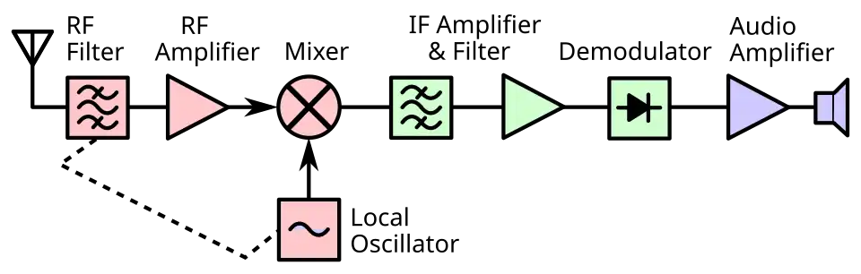
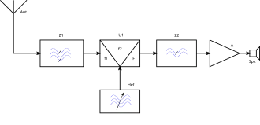

# 4.44 RFIC 设计（一）概述与接收机架构

> **本章定位**：把射频基础落到 CMOS 实现，学习 LNA、混频器、PA 与频率综合器。

> **前置知识**：[2.17–2.20 射频基础](../../02-模拟与硬件工程/射频与高频电路/2.17-传输线理论.md)；[4.31 PLL 模拟前端](../模拟IC设计/4.31-PLL模拟前端.md)。

> 本页为《RFIC 设计》系列第 1/4 页。

## 1. 引言

射频集成电路（Radio-Frequency Integrated Circuit, RFIC）是无线通信系统的核心硬件基石。从手机、Wi-Fi 路由器、蓝牙耳机到雷达、卫星通信、5G/6G 基站，几乎所有无线连接的背后都离不开 RFIC 的支撑。与基带数字电路和低频模拟电路相比，射频电路工作在数百 MHz 至数百 GHz 的频段，面临着**寄生效应显著、阻抗匹配严苛、噪声与线性度矛盾、功耗与效率折中**等多重独特挑战。

随着 CMOS 工艺特征尺寸不断缩小，晶体管的特征频率 $f_T$ 和最大振荡频率 $f_{max}$ 已突破数百 GHz，使得在硅基工艺上集成完整的射频收发机成为可能。然而，低电源电压、低击穿电压、有源器件噪声性能差、衬底损耗大等问题，又对 RFIC 设计者提出了新的要求。RFIC 设计本质上是**电路拓扑、电磁场、噪声与线性度、版图与封装**的多维度协同优化问题。

本章将系统介绍 RFIC 设计的核心概念、关键模块和设计方法，涵盖接收机与发射机架构、低噪声放大器（LNA）、混频器、射频功率放大器（PA）、频率综合器以及版图与设计流程等内容，为读者建立完整的 RFIC 设计知识体系。

---

## 2. RFIC设计概述

### 2.1 RFIC在无线通信系统中的地位

一个典型无线通信系统的硬件链路可划分为**射频前端**、**模拟基带**、**数据转换器（ADC/DAC）**、**数字基带**四个部分：

```
天线 ──→ [RF前端] ──→ [模拟基带] ──→ [ADC] ──→ [数字基带/DSP]
         LNA/混频器     滤波/VGA               
         ↑ 发射路径 ↓
天线 ←── [RF前端] ←── [模拟基带] ←── [DAC] ←── [数字基带/DSP]
         PA/上变频      滤波/VGA
```

RFIC 承担射频前端及部分模拟基带功能，是连接电磁波与数字世界的关键桥梁。其重要性体现在：

| 维度 | 说明 |
|------|------|
| **性能瓶颈** | 接收机灵敏度、发射机效率、频谱纯度等系统级指标主要由 RFIC 决定 |
| **功耗占比** | 移动终端中射频前端功耗可达总功耗的 20%~50%（含 PA） |
| **面积/成本** | 射频无源器件（电感、变压器）面积大，是芯片成本的重要组成 |
| **集成度驱动** | CMOS RFIC 推动了"单芯片无线电"（Single-Chip Radio）的实现 |

### 2.2 RFIC设计流程与挑战

RFIC 设计流程一般分为规格定义 → 系统架构 → 电路设计 → 仿真验证 → 版图 → 后仿真 → 流片 → 测试等阶段：

```
应用规格 → 链路预算 → 架构选型 → 模块划分 → 原理图设计
                                                     ↓
测试 ←─ 流片 ←─ 后仿真(EM+寄生) ←─ 版图 ←─ 前仿真 ←─┘
```

RFIC 设计面临的独特挑战：

| 挑战 | 描述 | 应对策略 |
|------|------|----------|
| **射频频率高** | GHz 级频率下寄生电容/电感显著，传输线效应不可忽略 | EM 仿真、共面波导/微带线建模 |
| **阻抗匹配** | 各级间需 50Ω 或共轭匹配以最大化功率传输 | Smith 圆图、L/π/T 网络 |
| **噪声** | 接收机灵敏度受 LNA 噪声系数限制 | 噪声匹配、低噪声拓扑 |
| **线性度** | 强干扰下产生交调失真，阻塞有用信号 | 线性化技术、高线性度拓扑 |
| **功耗** | 移动设备要求低功耗，PA 要求高效率 | 亚阈值设计、开关型 PA |
| **工艺限制** | CMOS 低电压、低击穿、衬底损耗 | cascode、变压器合成、SOI/GaAs |
| **寄生效应** | 互连、衬底耦合、键合线寄生严重影响性能 | 仔细版图、屏蔽、EM 仿真 |
| **测量困难** | GHz 频段下探针、校准、夹具引入误差 | SOLT/TRL 校准、片上测试 |

### 2.3 射频收发机架构概览

一个完整的射频收发机由接收机（RX）、发射机（TX）和频率综合器（LO）三部分组成：

```
        ┌───────────── 接收链路 (RX) ─────────────┐
天线 ──→ BAW/SAW滤波 ──→ LNA ──→ 下变频混频 ──→ 基带滤波/VGA ──→ ADC
                                                    ↑
                                    LO（频率综合器）
                                                    ↓
        ┌───────────── 发射链路 (TX) ─────────────┐
DAC ──→ 基带滤波/VGA ──→ 上变频混频 ──→ PA ──→ 双工器 ──→ 天线
```

后续章节将分别详细讨论接收机、发射机以及关键模块的设计。

---

## 3. RF接收机架构

接收机的核心任务是从空间中微弱的有用射频信号中**放大、下变频并过滤**出基带信号，同时抑制镜像、阻塞和噪声。不同架构在复杂度、集成度和性能之间做出不同折中。

### 3.1 超外差接收机（Superheterodyne）

超外差（Super-Heterodyne）架构由 Armstrong 于 1918 年提出，至今仍是高性能接收机的主流方案。其核心思想是**两级下变频**：先将射频信号变换到固定中频（IF），再变换到基带。



*图中红色为射频（RF）部分、绿色为中频（IF）部分、蓝色为音频部分；LO 与 RF 滤波器需同步调谐，直观展示了多级变频与镜像抑制的作用。*

```
天线 → RF滤波 → LNA → RF滤波 → 混频器₁ → IF滤波 → IF放大 → 混频器₂ → 基带
                              ↑                              ↑
                            LO₁=RF-IF                       LO₂=IF
```

#### 3.1.1 镜像频率问题

混频器是频率无关的乘法器，对位于 $f_{LO} \pm f_{IF}$ 的输入信号都会下变频到同一中频 $f_{IF}$。其中与有用信号关于 LO 对称的频率称为**镜像频率** $f_{IM}$：

$$
f_{RF} = f_{LO} + f_{IF} \quad \Rightarrow \quad f_{IM} = f_{LO} - f_{IF} = f_{RF} - 2f_{IF}
$$

镜像干扰必须由 RF 前端的**镜像抑制滤波器（IR Filter）** 在混频前滤除，否则将与有用信号叠加而无法分离。镜像抑制要求决定了 IR Filter 的 Q 值与插入损耗。

**镜像抑制比（IRR）**：

$$
IRR = 10\log\left[1 + \left(\frac{Q \cdot 2f_{IF}}{f_{RF}}\right)^2\right] \text{ (dB)}
$$

#### 3.1.2 中频（IF）选择

中频选择是超外差设计的核心折中：

| IF 选择 | 镜像距离 | IR 滤波器 | 信道选择性 | 说明 |
|---------|---------|-----------|------------|------|
| **高 IF**（>RF/2） | 远 | 容易实现 | 差（需高 Q SAW） | 镜像易抑制，但信道滤波难 |
| **低 IF**（~几 MHz） | 近 | 难（需高 Q RF 滤波器） | 好（可用低频滤波器） | 信道滤波容易，镜像抑制难 |
| **多级 IF** | — | 折中 | 折中 | 经典方案，但成本高 |

工程上常采用**多级变频**：第一高中频便于镜像抑制，第二低中频便于信道选择。例如某 GPS 接收机：RF = 1575.42 MHz → IF1 = 175.42 MHz → IF2 = 4.092 MHz。

### 3.2 零中频接收机（Zero-IF / Direct Conversion）

零中频（直接变频）架构将 RF 信号一次性下变频到基带，本地振荡频率等于载波频率：



*该框图展示零中频架构：RF 信号经 LNA 后直接与本振（LO）混频到基带，仅需一次变频，配合正交 I/Q 解调消除镜像问题。*

```
天线 → RF滤波 → LNA → I/Q混频器 → 低通滤波 → VGA → ADC
                       ↑
                   LO = fRF（正交）
```

为分离频谱重叠的正负频率分量，需采用**正交下变频**（I/Q 解调）：

$$
I(t) = LPF\left[r(t)\cos(\omega_{LO}t)\right], \quad Q(t) = LPF\left[-r(t)\sin(\omega_{LO}t)\right]
$$

#### 3.2.1 优势

| 优势 | 说明 |
|------|------|
| **无镜像问题** | 镜像即自身，I/Q 解调可分离正负频率 |
| **集成度高** | 信道滤波由低频低通滤波器实现，易片上集成 |
| **简单灵活** | 仅需一次变频，频段切换灵活 |
| **低成本** | 省去片外 SAW/中频器件 |

#### 3.2.2 挑战

| 挑战 | 机理 | 影响 | 缓解方法 |
|------|------|------|---------|
| **直流偏移（DC Offset）** | LO 自混频、强干扰自混频产生直流量 | 阻塞 VGA/ADC，恶化信噪比 | AC 耦合、直流校准、谐波混频 |
| **I/Q 失配** | I/Q 两路增益/相位不匹配 | 镜像抑制恶化，EVM 退化 | 校准、几何匹配、数字补偿 |
| **闪烁噪声（1/f）** | MOS 器件 1/f 噪声下变频到基带 | 灵敏度下降（尤其窄带信号） | 大器件、差分结构、谐波混频 |
| **偶阶失真** | 二阶非线性使干扰自混频到基带 | 产生基带干扰，恶化信噪比 | 差分电路、IP2 校准 |
| **LO 泄漏** | LO 通过衬底/寄生耦合到天线口 | 自干扰、DC 偏移 | 屏蔽、布局隔离、LO ≤ RF |

**I/Q 失配对镜像抑制的影响**：

设 I/Q 增益失配为 $\epsilon$，相位失配为 $\Delta\phi$，则镜像抑制比为：

$$
IRR = 10\log\left(\frac{(2+\epsilon)^2 + (\Delta\phi)^2}{\epsilon^2 + (\Delta\phi)^2}\right) \approx 10\log\left(\frac{4}{\epsilon^2 + (\Delta\phi)^2}\right) \text{ (dB)}
$$

例如要达到 40 dB IRR，要求 $\epsilon < 1\%$ 且 $\Delta\phi < 1^\circ$，对模拟电路而言相当苛刻。

### 3.3 低中频接收机（Low-IF）

低中频架构将中频选择在**信道带宽量级**（数百 kHz ~ 数 MHz），介于超外差与零中频之间：

```
天线 → RF滤波 → LNA → I/Q混频器 → 复数带通滤波 → ADC → 数字下变频
                       ↑
                   LO = RF ± IF
```

#### 3.3.1 折中方案

- **优点**：避开 1/f 噪声与 DC 偏移问题；可保留超外差的灵活性；信号仍位于低频，便于数字处理
- **缺点**：镜像位于邻近信道，需要复数（多相）滤波器实现镜像抑制；对 I/Q 失配依然敏感

#### 3.3.2 镜像抑制要求

低中频下镜像信号可能比有用信号强 50 dB 以上（邻近信道），需通过**复数带通滤波**和**I/Q 校准**实现 60~80 dB 镜像抑制：

- **复数滤波**：通过多相（Polyphase）滤波器对 I/Q 信号进行复数域滤波，选择性地抑制镜像
- **数字校准**：在数字域估计并补偿 I/Q 失配，可达到 >60 dB IRR

### 3.4 接收机架构对比

| 指标 | 超外差 | 零中频 | 低中频 |
|------|--------|--------|--------|
| **变频级数** | 多级 | 单级 | 单级 |
| **镜像抑制** | RF 滤波器 | I/Q 解调（自镜像） | 复数滤波 + I/Q |
| **中频处理** | 片外 SAW/晶体滤波 | 片上低通 | 片上复数带通/数字 |
| **DC 偏移** | 无 | 严重 | 轻微 |
| **1/f 噪声** | 无影响 | 严重 | 轻微 |
| **I/Q 失配敏感性** | 中 | 高 | 高 |
| **集成度** | 低 | 高 | 高 |
| **成本/面积** | 高 | 低 | 低 |
| **典型应用** | 高性能电台、雷达 | 手机、Wi-Fi | 蓝牙、ZigBee、FM |

工程上常根据应用场景、灵敏度要求、成本约束综合选择架构。

---

## 本章要点

- 引言
- RFIC设计概述
- RF接收机架构

## 自测清单

1. 「引言」要解决的核心问题是什么？关键结论或公式是什么？
2. 「RFIC设计概述」与上一节之间是什么关系？
3. 「RF接收机架构」在什么场景下会用到？如果条件改变，结论会如何变化？
4. 能否不看正文，写出「RFIC在无线通信系统中的地位」的关键流程或结构？
5. 「RFIC设计流程与挑战」最容易混淆的点是什么？

---

**下一章**：[4.45 RFIC 设计（二）LNA 与混频器](4.45-RFIC-LNA与混频器.md)
