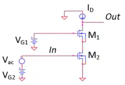
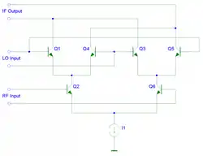
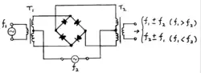

# 4.45 RFIC 设计（二）LNA 与混频器

> **前置知识**：必需 [2.17–2.20 射频基础](../../02-模拟与硬件工程/射频与高频电路/2.17-传输线理论.md)、[4.29–4.31 模拟 IC 设计](../模拟IC设计/4.29-运算放大器设计.md) 与 [4.44 RFIC 设计（一）](4.44-RFIC-概述与接收机.md)。

> 本页为《RFIC 设计》系列第 2/4 页。

## 1. 低噪声放大器（LNA）设计

LNA 是接收机的第一级有源电路，其噪声系数直接决定整机的灵敏度。LNA 的核心设计矛盾是：**输入匹配（50Ω） ↔ 噪声匹配 ↔ 功耗 ↔ 增益 ↔ 线性度**。

### 1.1 LNA设计指标

| 指标 | 定义 | 典型值 |
|------|------|--------|
| **噪声系数 NF** | 输入信噪比与输出信噪比之比 | 1.5~3 dB |
| **功率增益 $G_P$** | 输出与输入功率比 | 12~20 dB |
| **输入反射 $S_{11}$** | 输入端反射系数 | < -10 dB |
| **IIP3** | 三阶交调输入截点 | -10 ~ +5 dBm |
| **IIP2** | 二阶交调输入截点 | +20 ~ +50 dBm |
| **1dB 压缩点 $P_{1dB}$** | 增益下降 1dB 时的输入功率 | -20 ~ -5 dBm |
| **功耗** | 静态电流 × 电源电压 | 5~15 mW |
| **反向隔离 $S_{12}$** | LO 泄漏到天线的指标 | < -30 dB |
| **稳定性 $K$ 因子** | Rollet 稳定因子 | > 1 |

### 1.2 噪声系数理论

#### 4.2.1 Friis 级联噪声公式

对于多级级联系统，总噪声系数由 Friis 公式给出：

$$
F_{total} = F_1 + \frac{F_2 - 1}{G_1} + \frac{F_3 - 1}{G_1 G_2} + \cdots + \frac{F_n - 1}{\prod_{i=1}^{n-1} G_i}
$$

**结论**：第一级的噪声系数 $F_1$ 起主导作用，且其增益 $G_1$ 越大，后续各级噪声贡献越小。这就是 LNA 必须低噪声、足够增益的根本原因。

**例**：LNA NF=2 dB，G=15 dB；后级混频器 NF=10 dB。整链路 NF：

$$F = 10^{0.2} + \frac{10^{1}-1}{10^{1.5}} \approx 1.585 + 0.316 \approx 1.90 \Rightarrow NF \approx 2.79\text{ dB}$$

#### 4.2.2 最小噪声系数

MOS 管的两端口噪声参数（经典模型）：

$$
F_{min} = 1 + \frac{2}{\sqrt{5}}\frac{\omega}{\omega_T}\frac{\gamma}{\alpha}\sqrt{\delta\left(1 - |c|^2\right)}
$$

其中：
- $\omega_T = g_m / C_{gs}$ 为特征角频率
- $\gamma$ 为沟道热噪声系数（长沟道 2/3，短沟道 1~2）
- $\delta$ 为栅极感应噪声系数（~4/3）
- $c$ 为沟道噪声与栅极噪声相关系数
- $\alpha = g_m / g_{d0}$

最优源阻抗为：

$$
Y_{opt} = g_{opt} + j b_{opt}, \quad g_{opt} = \alpha\omega C_{gs}\sqrt{\frac{\delta}{5\gamma}(1-|c|^2)}
$$

任意源阻抗下的噪声系数：

$$
F = F_{min} + \frac{R_n}{G_s}\left|Y_s - Y_{opt}\right|^2
$$

其中 $R_n$ 为等效噪声电阻，反映对失配的敏感程度。

#### 4.2.3 噪声匹配与功率匹配的矛盾

- **功率匹配**：$Y_s = Y_{in}^*$，最大化功率传输
- **噪声匹配**：$Y_s = Y_{opt}$，最小化噪声系数

两者一般不重合，需要在拓扑上巧巧设计使其接近，或在指标上折中。

### 1.3 共源 LNA（源极电感负反馈）

**共源 LNA + 源极电感负反馈**是 RF CMOS LNA 最经典的拓扑，可在不消耗电压裕度的同时实现**实部输入阻抗**，从而同时达到功率匹配与噪声匹配。

#### 4.3.1 输入阻抗匹配

电路结构：输入管 $M_1$ 栅极接输入信号，栅极串联电感 $L_g$，源极接电感 $L_s$，漏极接谐振负载。

小信号输入阻抗（忽略 $C_{gd}$、$g_{ds}$）：

$$
Z_{in}(\omega) = j\omega L_g + j\omega L_s + \frac{1}{j\omega C_{gs}} + \omega_T L_s
$$

在谐振频率 $\omega_0$ 下，感抗与容抗抵消：

$$
\omega_0 = \frac{1}{\sqrt{(L_g + L_s)C_{gs}}}
$$

谐振时输入阻抗呈纯阻性：

$$
Z_{in}(\omega_0) = \omega_T L_s \approx \frac{g_m}{C_{gs}} L_s
$$

**设计方程**：令 $Z_{in} = R_s = 50\Omega$，得：

$$
L_s = \frac{R_s}{\omega_T}, \quad L_g = \frac{1}{\omega_0^2 C_{gs}} - L_s
$$

#### 4.3.2 噪声分析

在源极电感负反馈结构下，最优噪声匹配阻抗 $Z_{opt}$ 的实部恰好接近 $R_s$，可通过尺寸优化（即调整 $C_{gs}$ 和 $g_m$）使两者重合，达到**功率匹配 ≈ 噪声匹配**。

经典最优噪声系数（忽略栅极噪声）：

$$
NF_{min} \approx 1 + \frac{2}{\sqrt{5}}\frac{\omega_0}{\omega_T}\frac{\gamma}{\alpha}
$$

**功耗约束下的最优设计**（Lee 论证）：在给定功耗 $P_D$ 下，存在最优器件宽度 $W_{opt}$：

$$
W_{opt} \approx \frac{3}{2}\frac{1}{\omega_0 L C_{ox} R_s Q_{opt}}, \quad Q_{opt} \approx 3.5 \sim 5
$$

#### 4.3.3 优缺点

| 优点 | 缺点 |
|------|------|
| 同时实现功率与噪声匹配 | 需片上电感，面积大 |
| 输入阻抗实部可调 | 源极电感 Q 值影响 NF |
| 增益较高 | 单级增益受 cascode 限制 |
| 适合窄带应用 | 宽带匹配困难 |

### 1.4 Cascode LNA

在共源 LNA 的基础上增加共栅管 $M_2$，构成 **Cascode 结构**：



*共源共栅（Cascode）结构：上方共栅管 $M_2$ 屏蔽了下方共源管 $M_1$ 的 Miller 效应，从而提高增益、隔离度与稳定性。*

```
VDD ── 谐振负载 ── 漏极输出
                |
                M2（共栅）
                |
                M1（共源）── 源极电感 Ls
                |
               GND
输入 ── Lg ──→ M1栅极
```

#### 4.4.1 优势

| 优势 | 原理 |
|------|------|
| **增益提升** | $M_2$ 屏蔽 $M_1$ 的 Miller 效应，$C_{gd}$ 等效输入电容变小，提高增益带宽积 |
| **隔离度改善** | $M_2$ 隔离输出与输入，减小 LO 反向泄漏到天线，提高 $S_{12}$ |
| **稳定性提升** | 减小输入输出耦合，使 $K>1$ 更易满足 |
| **线性度改善** | $M_1$ 漏极电压摆幅小，减小 $M_1$ 的非线性 |

#### 4.4.2 设计注意

- $M_2$ 的尺寸约为 $M_1$ 的 0.5~1 倍，降低 $M_2$ 寄生电容对增益的影响
- $M_2$ 栅极需良好去耦（AC 地），否则引入增益损失
- Cascode 增加了一个 $V_{DS,sat}$ 电压裕度，对低压工艺（≤1.2V）不利

### 1.5 共栅 LNA

共栅 LNA 直接利用共栅管提供宽带实部输入阻抗，无需电感负反馈：

```
VDD ── 负载 ── 漏极输出
             |
             M1（共栅）
             |
       输入 ─┘（源极）
       偏置
```

#### 4.5.1 输入阻抗

$$
Z_{in} \approx \frac{1}{g_m + g_{mb}} \parallel \frac{1}{j\omega C_{gs}}
$$

若令 $g_m = 1/R_s = 20\text{ mS}$，则 $Z_{in} = 50\Omega$，实现宽带匹配。

#### 4.5.2 噪声性能

共栅 LNA 噪声系数（无 $g_{mb}$、忽略 $r_o$）：

$$
F \approx 1 + \frac{\gamma}{\alpha}\frac{1}{g_m R_s} = 1 + \frac{\gamma}{\alpha}
$$

长沟道下 $\gamma=2/3, \alpha=1$，得 $F \approx 1.67$（即 NF ≈ 2.2 dB）。比共源 LNA 略差，但**与频率无关**，适合超宽带应用。

#### 4.5.3 改进：电流复用技术

为改善 NF，可采用**电流复用（CG-CS）**结构：CG 提供匹配，CS 提供额外增益且不消耗额外电流；也可加 $g_m$-boosting（在栅极施加反向输入）将 NF 降至 1.5~1.8 dB。

### 1.6 LNA线性度分析

#### 4.6.1 IIP3（三阶交调）

LNA 非线性用幂级数展开：

$$
y(t) = a_1 x(t) + a_2 x^2(t) + a_3 x^3(t) + \cdots
$$

输入两等幅信号 $x(t) = A\cos(\omega_1 t) + A\cos(\omega_2 t)$，输出包含三阶交调分量 $\omega_{2\omega_1-\omega_2}$、$\omega_{2\omega_2-\omega_1}$：

$$
\text{IM3 功率} = \frac{9}{4}a_3^2 A^6, \quad \text{基波功率} = a_1^2 A^2
$$

令 IM3 = 基波，解得**输入截点 IIP3**：

$$
A_{IIP3} = \sqrt{\frac{4}{3}\left|\frac{a_1}{a_3}\right|}, \quad P_{IIP3} = \frac{A_{IIP3}^2}{2R_s}
$$

用 dBm 表示并联系输入功率 $P_{in}$ 与 IM3 功率：

$$
P_{IM3} = 3P_{in} - 2P_{IIP3}
$$

**级联 IIP3**：

$$
\frac{1}{P_{IIP3,total}^{2/3}} = \frac{1}{P_{IIP3,1}^{2/3}} + \frac{G_1^{2/3}}{P_{IIP3,2}^{2/3}} + \cdots
$$

#### 4.6.2 1dB 压缩点

增益压缩描述大信号下放大器线性范围：

$$
P_{1dB} \approx P_{IIP3} - 9.6\text{ dB}
$$

即两者通常相差约 10 dB，作为快速估算。

### 1.7 设计实例（5GHz WLAN LNA）

**设计规格**：

| 参数 | 目标 |
|------|------|
| 频率 | 5.15~5.85 GHz |
| NF | < 2.5 dB |
| 增益 | > 15 dB |
| $S_{11}$ | < -15 dB |
| IIP3 | > -5 dBm |
| 功耗 | < 8 mW（1.2V，6.7mA） |
| 工艺 | 65nm CMOS |

**设计要点**：

1. **拓扑**：Cascode 源极电感负反馈
2. **器件尺寸**：$W/L = 80\mu m/60nm$，$g_m \approx 20\text{ mS}$
3. **电感**：$L_s \approx 0.5\text{ nH}$（满足 $Z_{in}=50\Omega$），$L_g \approx 1.8\text{ nH}$
4. **负载**：$LC$ 谐振于 5.5 GHz，提供 8 dB 增益
5. **cascode 管**：尺寸 0.5×主管，栅极 AC 接地
6. **版图**：共中心对称布局，电感间距 > 3 倍线宽

**仿真结果**：NF=2.2 dB，Gain=16 dB，$S_{11}$=-18 dB，IIP3=+1 dBm，功耗=7.8 mW，满足规格。

---

## 2. 混频器（Mixer）设计

混频器是频率变换的核心模块，利用非线性或开关特性实现**两个信号的相乘**，从而完成上变频或下变频：

$$
v_{out}(t) = v_{RF}(t)\cdot v_{LO}(t) = \cos(\omega_{RF}t)\cos(\omega_{LO}t) = \frac{1}{2}\left[\cos(\omega_{RF}-\omega_{LO})t + \cos(\omega_{RF}+\omega_{LO})t\right]
$$

下变频取差频（$\omega_{IF}=\omega_{RF}-\omega_{LO}$），上变频取和频。

### 2.1 混频器指标

| 指标 | 定义 | 典型值 |
|------|------|--------|
| **转换增益 CG** | IF 输出与 RF 输入功率（或电压）之比 | 有源：5~15 dB；无源：-7~-4 dB |
| **噪声系数 NF**（SSB/DSB） | 单边带/双边带噪声系数 | SSB：10~15 dB |
| **IIP3** | 三阶交调截点 | -5 ~ +10 dBm |
| **IIP2** | 二阶交调截点 | +30 ~ +60 dBm |
| **端口隔离度** | LO-RF、LO-IF、RF-IF 隔离 | > 30 dB |
| **LO 泄漏** | LO 信号泄漏到 RF 端口 | < -50 dBm |
| **1dB 压缩点** | 线性度指标 | -10 ~ 0 dBm |
| **功耗** | 静态功耗 | 2~10 mW |

### 2.2 有源混频器

#### 5.2.1 单平衡吉尔伯特混频器

由跨导级 $M_1$（将 RF 电压转换为电流）和开关对 $M_2$-$M_3$（受 LO 控制切换电流路径）组成：



*吉尔伯特单元（Gilbert Cell）电路：核心思想是用跨导级将 RF 转换为电流，再由 LO 驱动的开关对完成电流路径的相乘切换，从而得到中频输出。*

```
         VDD
          |
       IF+  IF-
        |   |
       M3   M2
        |   |
        └┬──┬┘
         M1（跨导）
          |
        RF输入
```

- **优点**：可获得转换增益；隔离 LO 与 RF 端口
- **缺点**：LO-RF 隔离有限；存在 LO 到 IF 的馈通

#### 5.2.2 双平衡吉尔伯特混频器

将 RF 也用差分对 $M_{1a}$-$M_{1b}$ 处理，输出差分：

```
        VDD
         |
      IF+    IF-
       |      |
      M4 M3 M2 M5
       \ |   | /
        \ \ / /
         M1a M1b
          \   /
          RF差分
```

- **优点**：LO-IF、RF-IF 隔离更好；抑制 LO 偶阶分量；偶阶失真改善
- **缺点**：需要差分 LO 与 RF；功耗更大；噪声略高

#### 5.2.3 转换增益分析

设 LO 为理想方波（占空比 50%），其傅里叶展开：

$$
s(t) = \frac{4}{\pi}\sum_{n=1,3,5,\ldots}^{\infty}\frac{1}{n}\sin(n\omega_{LO}t)
$$

跨导级输出电流 $i_{RF}(t) = g_m v_{RF}(t)$ 被开关函数 $s(t)$ 调制，取基频成分：

$$
i_{IF}(t) = \frac{2}{\pi}g_m v_{RF}(t)
$$

转换电压增益（设负载电阻 $R_L$）：

$$
CG_V = \frac{2}{\pi}g_m R_L
$$

#### 5.2.4 噪声分析

吉尔伯特混频器的主要噪声来源：

| 噪声源 | 贡献 | 优化 |
|--------|------|------|
| 跨导管 $M_1$ 热噪声 | 直接被放大到输出 | 增大 $g_m$ |
| 开关对热噪声 | 1/f 噪声上变频到 IF | 大器件、改善 LO 波形 |
| 1/f 噪声（关键） | 直接位于基带，影响灵敏度 | 大尺寸开关管、谐波混频 |
| LO 相位噪声 | 转换为 IF 噪声 | 高质量 LO |

**SSB 噪声系数近似**：

$$
NF_{SSB} \approx 10\log\left(1 + \frac{\gamma}{\alpha}\frac{\pi^2}{4}\frac{1}{g_m R_s} + \cdots\right)
$$

### 2.3 无源混频器

无源混频器利用 MOS 管作为开关，无偏置电流，**线性度高、1/f 噪声低**。

#### 5.3.1 二极管环混频器

由 4 只或 8 只二极管组成环形（双平衡）结构，LO 信号驱动二极管导通切换。



*二极管双平衡（环形）混频器原理图：四个二极管的导通/截止由 LO 信号控制，利用其非线性实现 RF 与 LO 的相乘，完成频率变换。*

**优势**：极高带宽（>10 GHz）、高 IIP3（>20 dBm）；**缺点**：转换损耗 6~9 dB，需大 LO 功率（>+7 dBm）。

#### 5.3.2 MOS 无源混频器

由 4 只 MOS 管构成开关环，受 LO 大幅信号驱动工作在开关状态：

```
RF+ ── M1/M2 ── IF+
RF- ── M3/M4 ── IF-
        ↑ LO
```

**优势**：

- **高线性度**：无源工作，IIP3 > +15 dBm
- **低 1/f 噪声**：无偏置电流，1/f 噪声极低，适合零中频接收机
- **宽带**：频率上限仅由开关速度决定

**缺点**：

- 转换损耗 4~8 dB（需后级高增益 VGA 补偿）
- 需要大 LO 摆幅（接近电源电压）
- 端口间隔离依赖于 LO 时钟质量

**改进**：电流模无源混频器（在跨导级与开关之间引入虚拟电压，使跨导工作于电流模式），可显著改善线性度。

### 2.4 混频器线性度

#### 5.4.1 IIP3 分析

混频器的非线性来源：

1. **跨导级非线性**（有源混频器主导）：与 LNA 类似
2. **开关对非线性**：LO 非理想方波导致
3. **负载非线性**：大信号下电阻/电感饱和

有源混频器 IIP3 通常受限于跨导级：

$$
P_{IIP3} \propto \frac{V_{GS}-V_{TH}}{R_s}
$$

#### 5.4.2 偶阶失真（IIP2）

二阶非线性产生 DC 分量与二谐波，在零中频架构中尤为有害。**双平衡结构**本身可提供 40~60 dB IIP2，外加**校准**（数字估计并补偿失配）可达 >80 dBm。

### 2.5 设计实例（下变频混频器）

**规格**：5 GHz RF → 500 MHz IF，CG > 8 dB，NF < 12 dB，IIP3 > 0 dBm，功耗 < 6 mW。

**设计**：双平衡吉尔伯特拓扑；RF 跨导 $g_m = 8\text{ mS}$，$R_L = 1.5\text{ k}\Omega$，预期 CG ≈ $\frac{2}{\pi}\times 8 \times 1.5 \approx 7.6$ dB；开关管尺寸 $W/L = 40\mu m/60nm$；LO 摆幅 600 mVpp。仿真：CG=9.2 dB，NF=11.3 dB，IIP3=+3 dBm，功耗=5.4 mW。

---

## 本章要点

- 低噪声放大器（LNA）设计
- 混频器（Mixer）设计

## 自测清单

1. 「低噪声放大器（LNA）设计」要解决的核心问题是什么？关键结论或公式是什么？
2. 「混频器（Mixer）设计」与上一节之间是什么关系？
3. 「LNA设计指标」在什么场景下会用到？如果条件改变，结论会如何变化？
4. 能否不看正文，写出「噪声系数理论」的关键流程或结构？
5. 「共源 LNA（源极电感负反馈）」最容易混淆的点是什么？

---

**下一章**：[4.46 RFIC 设计（三）功率放大器与频率综合器](4.46-RFIC-功放与频综.md)
