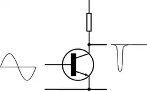

# 4.46 RFIC 设计（三）功率放大器与频率综合器

> **前置知识**：必需 [2.17–2.20 射频基础](../../02-模拟与硬件工程/射频与高频电路/2.17-传输线理论.md)、[4.29–4.31 模拟 IC 设计](../模拟IC设计/4.29-运算放大器设计.md) 与 [4.45 RFIC 设计（二）](4.45-RFIC-LNA与混频器.md)。

> 本页为《RFIC 设计》系列第 3/4 页。

## 1. 射频功率放大器（PA）设计

PA 是发射机的最后一级，将基带上变频后的射频信号放大到天线所需的功率水平。PA 的核心设计矛盾是**效率 ↔ 线性度 ↔ 输出功率**，并受限于晶体管的击穿电压和热性能。

### 1.1 PA设计指标

| 指标 | 定义 | 典型值 |
|------|------|--------|
| **饱和输出功率 $P_{sat}$** | 最大输出功率 | +20 ~ +35 dBm |
| **1dB 压缩点 $P_{1dB}$** | 线性范围标志 | $P_{sat}$ - 3 dB |
| **功率附加效率 PAE** | $(P_{out}-P_{in})/P_{DC}$ | 20%~70% |
| **漏极效率 $\eta_D$** | $P_{out}/P_{DC}$ | 30%~80% |
| **增益** | 输出/输入功率比 | 15~30 dB |
| **ACLR** | 相邻信道泄漏比 | < -45 dBc（WCDMA） |
| **EVM** | 误差向量幅度 | < 5%（OFDM） |
| **稳定性 $K$** | 无条件稳定 | > 1 |

### 1.2 PA分类

按导通角 $\theta$ 与工作状态分类：

| 类别 | 导通角 $\theta$ | 理论最大效率 | 线性度 | 适用 |
|------|----------------|-------------|--------|------|
| **Class A** | 360° | 50%（实际~25%） | 优 | 高线性、低功率 |
| **Class AB** | 180°~360° | 50%~78.5%（~50%） | 良 | 主流线性 PA |
| **Class B** | 180° | 78.5% | 中（交越失真） | 推挽 PA |
| **Class C** | <180° | >78.5%（接近100%） | 差（需调谐） | 恒包络（FM） |
| **Class D** | 开关 | >90% | 差 | 恒包络 |
| **Class E** | 开关 | >90% | 差 | 恒包络，调谐负载 |
| **Class F** | 开关 + 谐波调谐 | >80% | 差 | 高效率 |
| **Class F$^{-1}$** | 逆 F | >85% | 差 | 高效率 |

以 C 类放大器为例，其导通角小于 180°，工作于深度调谐状态，可获得高于 B 类的效率，但线性度较差：



*C 类（Class-C）放大器：晶体管只在信号峰值附近的短导通角内导通，配合调谐负载输出，牺牲线性度以换取更高效率，适合恒包络信号。*

#### 1.2.1 Class A 效率推导

设输出最大正弦摆幅为 $V_{DD}$，负载电阻 $R_L$，静态电流 $I_{DC} = V_{DD}/R_L$：

$$
P_{out,max} = \frac{V_{DD}^2}{2R_L}, \quad P_{DC} = \frac{V_{DD}^2}{R_L}
$$

$$
\eta_{A,max} = \frac{P_{out,max}}{P_{DC}} = 50\%
$$

实际中考虑到电压裕度与饱和，效率约 25~35%。

#### 1.2.2 Class B 推挽效率

推挽结构每管导通半周期，输出傅里叶基波电流为 $\frac{I_{max}}{2}$，直流为 $\frac{I_{max}}{\pi}$：

$$
P_{out} = \frac{V_{DD}I_{max}}{4}, \quad P_{DC} = \frac{V_{DD}I_{max}}{\pi}
$$

$$
\eta_{B,max} = \frac{\pi}{4} \approx 78.5\%
$$

#### 1.2.3 Class E 开关型 PA

利用开关管 + 谐振负载网络，使开关在零电压零导数下切换（ZVS/ZdVS），消除开关损耗，理论效率可达 100%。设计公式（简化）：

$$
R_{opt} = \frac{8}{\pi^2+4}\frac{V_{DD}^2}{P_{out}}, \quad L_{choke} \gg R_{opt}/\omega
$$

#### 1.2.4 Class F 谐波调谐

输出网络对基波负载、对二次谐波短路、对三次谐波开路，使漏极电压近似方波（含三次谐波），效率可达 88%。

### 1.3 PA设计考虑

#### 1.3.1 负载线匹配（Load-Line Matching）

为获得最大功率输出，PA 输出阻抗应满足**负载线匹配条件**：

$$
R_{opt} = \frac{V_{DD} - V_{knee}}{I_{max}/2}
$$

其中 $V_{knee}$ 为晶体管的膝电压（饱和压降）。该阻抗通常远低于 50Ω（典型 1~10Ω），需通过**输出匹配网络**（变压器、π网络、巴伦）将 $R_{opt}$ 变换到 50Ω 天线负载。

#### 1.3.2 稳定性

PA 高增益 + 强非线性易引发不稳定（振荡）：

- 加基极/栅极镇流电阻（增大稳定性，损失增益）
- 输入/输出端串联铁氧体珠或 RC 网络
- 中和电容（Neutralization）抵消 $C_{gd}$ 反馈
- 仿真 $K$ 因子和 $\mu$ 因子需 > 1

#### 1.3.3 热设计

PA 是芯片中功耗密度最高的模块：

$$
T_j = T_a + P_{diss}\cdot R_{\theta,JA}
$$

- $R_{\theta,JA}$ 为结到环境热阻
- 高温导致 $V_{TH}$ 漂移、$g_m$ 下降、寿命缩短（Arrhenius 定律：每升高 10°C，寿命减半）
- 措施：增大发射极面积、并联多指、合理分布散热、加散热过孔阵列

### 1.4 PA线性化技术

为提升线性 PA 在高效率工作点下的线性度，采用**线性化技术**：

| 技术 | 原理 | 优势 | 劣势 |
|------|------|------|------|
| **预失真（PD）** | 输入端施加反向非线性 | 简单、低功耗 | 带宽受限、对温度敏感 |
| **反馈法** | 检测输出并反馈 | 精度高 | 带宽受限、稳定性 |
| **前馈法** | 误差提取并相减 | 宽带、高线性 | 电路复杂、效率低 |
| **EER** | 包络与相位分离，包络调制电源 | 高效率 | 带宽受限、延迟匹配难 |
| **Doherty** | 主+辅 PA 协同 | 6dB 回退效率高 | 调谐复杂、带宽窄 |
| **数字预失真 DPD** | 数字域补偿非线性 | 灵活、精度高 | 需高速 DAC、复杂算法 |

#### 1.4.1 Doherty PA

由载波 PA（Class AB）和峰值 PA（Class C）组成，通过 $90°$ 相移合成网络并联：

```
         ┌── 载波PA (Class AB) ── 1/4λ ──┐
输入 ─────┤                                 ├──→ 输出
         └── 峰值PA (Class C) ─────────────┘
```

**优势**：在 6 dB 输出回退点仍保持高效率（约 60%），适合高峰均比（PAPR）信号如 OFDM。

#### 1.4.2 EER（Envelope Elimination and Restoration）

将 RF 信号分解为**相位**（限幅后的恒包络）和**包络**两路：

- 相位路径：驱动开关型 PA（Class E）
- 包络路径：调制 PA 电源电压 $V_{DD}$

PA 始终工作于高效率开关状态，线性由电源调制决定。挑战是包络带宽需为 RF 信号带宽的 3~5 倍。

### 1.5 CMOS PA 的挑战

| 挑战 | 原因 | 解决方案 |
|------|------|---------|
| **低击穿电压** | 深亚微米工艺 $V_{bk}$ ~1~2V | cascode、堆叠 FET、变压器合成 |
| **衬底损耗** | 低阻衬底耦合到地 | 高阻衬底、ESD 保护优化 |
| **低 $g_m$** | CMOS 跨导低 | 多级驱动、器件并联 |
| **无源器件 Q 低** | 片上电感 Q < 15 | 外置匹配、键合线电感 |
| **热阻高** | CMOS 衬底导热差 | 多指布局、散热过孔 |
| **1/f 噪声上变频** | 影响近载波相位噪声 | 大器件、差分结构 |

#### 1.5.1 变压器合成（Power Combining）

将多个低功率 PA 单元输出通过变压器合成，提高总输出功率并降低单管压力：

- **分布式有源变压器（DAT）**：多个 PA 单元环形排列，输出变压器合成
- **堆叠 FET**：多个低压晶体管串联承受高压，等效提升击穿电压
- **并联合成**：Wilkinson/分支线耦合器合成

### 1.6 设计实例（2.4GHz CMOS PA）

**规格**：2.4 GHz ISM 频段，$P_{out}$=+20 dBm，PAE>30%，增益>20 dB，1.2V CMOS 工艺。

**设计**：

1. **拓扑**：Class AB 两级 cascode（驱动级 + 功放级）
2. **堆叠**：功放级用 3 个 cascode 串联以承受 3.6V 摆幅
3. **输出合成**：分布式有源变压器，3 路合成
4. **阻抗变换**：$R_{opt} \approx 4\Omega$ → 50Ω，匝比 1:3.5
5. **稳定**：输入串联 5Ω 镇流电阻，栅极去耦
6. **线性化**：数字预失真 DPD，ACLR 由 -32 dBc 改善至 -48 dBc

**仿真结果**：$P_{sat}$=+22 dBm，$P_{1dB}$=+19 dBm，PAE=34%，Gain=24 dB，ACLR=-48 dBc（DPD）。

---

## 2. 射频频率综合器

频率综合器是 RF 收发机的"心脏"，为混频器提供精确、低噪声的本振（LO）信号。其相位噪声、杂散和锁定时间是 RF 系统性能的关键。

### 2.1 频率综合器在 RF 收发机中的角色

| 角色 | 说明 |
|------|------|
| **本振产生** | 为 RX/TX 混频器提供 LO，频率 = RF ± IF |
| **信道选择** | 通过改变分频比 N 切换通信信道 |
| **频段切换** | 覆盖多频段（如 2.4G/5G Wi-Fi） |
| **调制/解调** | 在锁相调制器中，LO 本身承载调制信息 |
| **时钟生成** | 为基带、ADC/DAC 提供同步时钟 |

### 2.2 整数 N 频率综合器

经典整数 N PLL 结构：

```
fref ──→ [PFD] ──→ [CP] ──→ [LF] ──→ [VCO] ──→ fout
          ↑                                  ↓
          └──────── [÷N] ←───────────────────┘
```

锁定时：

$$
f_{out} = N \cdot f_{ref}
$$

- **频率分辨率** = $f_{ref}$ = 信道间隔
- **优势**：结构简单、杂散可控
- **劣势**：分辨率受限（窄信道要求低 $f_{ref}$，恶化相位噪声）；锁定时间长

### 2.3 小数 N 频率综合器

通过让分频比在 N 与 N+1 之间**动态切换**，实现非整数（小数）分频：

$$
$$

其中 F 由 ΣΔ 调制器控制，平均分频比为 $N+F$。

#### 2.3.1 ΣΔ 调制小数分频

ΣΔ 调制器产生高速、过采样的 0/1 控制信号，控制分频器在 N 与 N+1 间切换：

- **优势**：将量化噪声**高阶噪声整形**到高频，环路滤波器滤除
- **典型结构**：3 阶 MASH（Multi-stAge noise SHaping）ΣΔ 调制器
- **分辨率**：取决于 ΣΔ 位宽，可达 Hz 级

输出相位噪声（ΣΔ 贡献）：

$$
\mathcal{L}_{\Sigma\Delta}(f) = \frac{(2\pi)^2}{12 f_{ref}}\cdot\left|H_{CL}(f)\right|^2 \cdot \left[2\sin\left(\frac{\pi f}{f_{ref}}\right)\right]^{2L}
$$

其中 $H_{CL}$ 是 PLL 闭环传递函数，$L$ 是 ΣΔ 调制器阶数。

#### 2.3.2 杂散问题

小数 N PLL 的主要杂散来源：

- **小数杂散**：F 接近简单分数（如 0.5）时，周期性切换产生杂散
- **ΣΔ 自杂散**：ΣΔ 内部状态周期性产生
- **减小方法**：扰乱 ΣΔ、加 dither、增大环路带宽远离散杂频

### 2.4 RF VCO 设计

VCO 详细设计已在 [4.31 PLL 模拟前端 §6（压控振荡器）](../模拟IC设计/4.31-PLL模拟前端.md) 覆盖，此处仅讨论 RF 应用要点。

#### 2.4.1 LC-VCO 调谐范围

RF VCO 通常采用 LC 谐振结构，调谐通过变容管实现：

$$
f_{osc} = \frac{1}{2\pi\sqrt{L(C_{fix}+C_{var}+C_{par})}}
$$

调谐范围（百分比）：

$$
TR = \frac{f_{max} - f_{min}}{f_{center}}\times 100\%
$$

宽频段应用（如 5G Wi-Fi 4.9~7.1 GHz）需要 TR > 40%，要求：
- 高 $C_{var}/C_{fix}$ 比
- 切换电容阵列（粗调）+ 变容管（细调）
- 优化谐振器 Q 值

#### 2.4.2 相位噪声要求

相位噪声由 Leeson 公式描述：

$$
\mathcal{L}(f_m) = 10\log\left[\frac{FkT}{P_{sig}}\left(1+\left(\frac{f_0}{2Q\cdot f_m}\right)^2\right)\left(1+\frac{f_c}{f_m}\right)\right]
$$

其中 $Q$ 是谐振器有载 Q 值，$P_{sig}$ 是谐振腔功率，$f_c$ 是 1/f 噪声转角频率。

**RF 系统的相位噪声要求示例**（GSM）：在 600 kHz 偏移处 < -133 dBc/Hz，对 VCO 设计要求极高。

#### 2.4.3 VCO 缓冲设计

VCO 输出需经缓冲器驱动混频器和分频器：

- **隔离**：防止负载变化牵引 VCO 频率（负载牵引）
- **电平转换**：将 VCO 摆幅转换为混频器/分频器所需电平
- **阻抗匹配**：提供 50Ω 或差分输出
- **典型结构**：源极跟随器、差分对、CMOS 反相器链

### 2.5 分频器设计

#### 2.5.1 CML 分频器（高频）

电流模逻辑（CML）分频器采用差分对 + 锁存器结构，工作频率可达 60+ GHz：

```
LO ──→ [CML 锁存器1] ──→ [CML 锁存器2] ──→ ÷2 输出
          ↑──────────────┘（交叉耦合）
```

- **优点**：高速、低相位噪声
- **缺点**：静态电流大、功耗高
- **应用**：高频预分频（如 60 GHz 输入 ÷2 → 30 GHz）

#### 2.5.2 静态分频器

由标准 D 触发器构成，最大工作频率约 5~20 GHz：

- **优点**：低功耗、任意分频比可编程
- **缺点**：速度受限
- **应用**：低频段分频

#### 2.5.3 多模分频器（MMD）

由多个 2/3 分频单元级联，实现任意整数分频：

$$
N = 2^{n} + p_0 \cdot 2^{0} + p_1 \cdot 2^{1} + \cdots + p_{n-1} \cdot 2^{n-1}
$$

- **优点**：完全可编程、面积小
- **缺点**：最大频率受限（<10 GHz），需前置高速预分频

### 2.6 频率综合器指标

| 指标 | 定义 | 典型值 |
|------|------|--------|
| **相位噪声** | 偏移载波一定频率处的噪声密度 | -90 ~ -130 dBc/Hz @ 1MHz |
| **杂散** | 离散干扰分量 | < -60 dBc |
| **锁定时间** | 切换信道到稳态所需时间 | 10~500 μs |
| **频率分辨率** | 最小频率步进 | 1 Hz ~ 100 kHz |
| **频率范围** | LO 可输出频率范围 | 1~2 倍频程 |
| **功耗** | 总功耗 | 10~50 mW |

**相位噪声预算示例**（5 GHz WLAN LO）：

| 偏移频率 | 相位噪声目标 |
|---------|-------------|
| 10 kHz | -70 dBc/Hz |
| 100 kHz | -90 dBc/Hz |
| 1 MHz | -115 dBc/Hz |
| 10 MHz | -135 dBc/Hz |

---

## 本章要点

- 射频功率放大器（PA）设计
- 射频频率综合器

## 自测清单

1. 「射频功率放大器（PA）设计」要解决的核心问题是什么？关键结论或公式是什么？
2. 「射频频率综合器」与上一节之间是什么关系？
3. 「PA设计指标」在什么场景下会用到？如果条件改变，结论会如何变化？
4. 能否不看正文，写出「PA分类」的关键流程或结构？
5. 「PA设计考虑」最容易混淆的点是什么？

---

**下一章**：[4.47 RFIC 设计（四）发射机、设计流程、版图与小结](4.47-RFIC-发射机与版图.md)
