# 4.37.2 DRAM与非易失存储器

> **本章定位**：扩展存储器器件与阵列视野，覆盖 ROM、OTP、eFuse/anti-fuse、DRAM 与新兴 NVM；NAND Flash 和 NOR Flash 分别见 [4.37.3 NAND Flash 原理](4.37.3-NAND-Flash原理.md) 与 [4.37.4 NOR Flash 原理](4.37.4-NOR-Flash原理.md)。

> **前置知识**：必需 [4.37.1 SRAM可靠性、寄存器文件与存储器编译器](4.37.1-SRAM可靠性与存储器编译器.md) 与 [3.7 半导体存储器](../../03-数字与计算机系统/数字电路/3.7-半导体存储器.md)；推荐 [4.3 CMOS 器件物理](../芯片设计/4.3-CMOS器件物理.md)。

## 1. ROM设计

### 1.1 掩模ROM（Mask ROM）

**原理**

通过掩模层定义存储数据，制造时一次性编程。

**单元结构**
- 有晶体管：选中字线时把位线拉低，读为 0
- 无晶体管：位线保持预充高电平，读为 1
- 不同产品可能采用反相定义，以数据手册为准

**读取方式**

读操作先预充位线，再选中字线；有晶体管的单元导通放电，灵敏放大器根据位线电平判决。掩模 ROM 的“编程”发生在掩模或注入层，制造后不可更改。

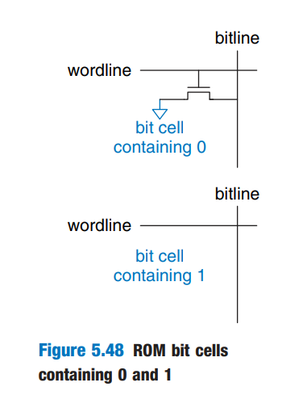

<b>图 1-1</b>：掩模 ROM 单元。左：有晶体管，选中时位线通过单元放电，读为 0；右：无晶体管，位线保持预充高电平，读为 1。

**优势**
- 面积最小
- 成本最低（大批量）

**劣势**
- 无法修改
- 前期成本高

### 1.2 OTP（一次性可编程）

**应用场景**
- 芯片配置信息
- 安全密钥存储
- 校准数据

### 1.3 eFuse/anti-fuse

#### 1.3.1 eFuse（电子熔丝）

**原理**

通过大电流烧断金属连线：
- 初始状态：低阻（读 0）
- 编程后：高阻（读 1）
- 具体 0/1 极性以数据手册为准

**特点**
- 可多次读取
- 一次性编程
- 编程电流大（mA级）

**读取与编程**

读时给熔丝加小偏置，通过灵敏放大器比较节点电压；编程时用大电流使窄金属或多晶硅连线熔断，电阻由低变高。

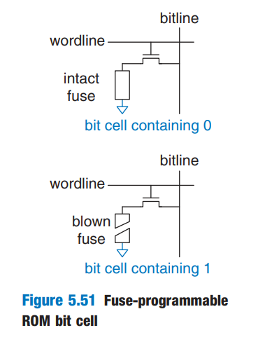

<b>图 1-2</b>：熔丝型 OTP 单元。左：熔丝完整，单元可导通，读为 0；右：熔丝熔断，单元断开，读为 1。

#### 1.3.2 anti-fuse（反熔丝）

**原理**

通过高电压击穿绝缘层：
- 初始状态：高阻（"0"）
- 编程后：低阻（"1"）

**特点**
- 编程电压高（>10V）
- 可靠性高
- 面积小

**读取与编程**

编程前绝缘层完整，单元呈高阻；加高压击穿薄氧化层后形成导电通路，电阻降低。读时同样用小偏置检测电阻，编程后不可恢复。

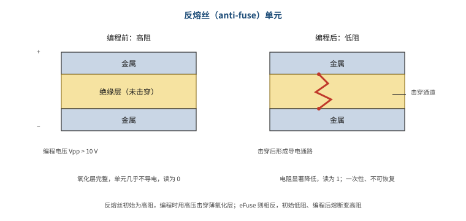

<b>图 1-3</b>：反熔丝单元。编程前绝缘层完整、电阻高；高压击穿后形成导电通路，电阻降低。与 eFuse 的初始/编程后阻态正好相反。

**eFuse 与 anti-fuse 对比**

| 类型 | 初始状态 | 编程后 | 编程条件 | 特点 |
|---|---|---|---|---|
| eFuse | 低阻 | 高阻 | 大电流熔断 | 工艺简单，编程电流大 |
| anti-fuse | 高阻 | 低阻 | 高压击穿 | 面积小、可靠性高，需高压 |

### 1.4 NOR Flash（概述）

NOR Flash 以并联阵列支持字/字节随机读，常用于代码存储、固件更新与 XIP。其单元结构、热电子注入编程、扇区擦除、过擦除与嵌入式实现见 [4.37.4 NOR Flash 原理](4.37.4-NOR-Flash原理.md)。

---

## 2. DRAM集成电路设计

### 2.1 1T1C单元结构与电荷存储

DRAM（Dynamic Random Access Memory）单元由单个访问晶体管和一个存储电容组成，称为 1T1C 结构：

**电路结构**
- 访问管（Access Transistor）：由字线 WL 控制导通
- 存储电容 $C_s$：以电荷形式存储数据

存储电容上的电荷决定了逻辑状态：
$$Q_{cell} = C_s \cdot V_{cell}$$

**数据表示**
- 逻辑"1"：电容充满电（$V_{cell} \approx V_{DD}$）
- 逻辑"0"：电容放空（$V_{cell} \approx 0$）

**核心局限**
存储电容存在泄漏电流，电荷会逐渐流失；且读出的电荷分享过程会破坏存储状态。因此 DRAM 需要周期性刷新和读出回写，属于易失性存储器。

**单元面积**
1T1C 单元面积远小于 6T SRAM（约为其 1/4-1/8），使 DRAM 在单位面积内获得更高密度，兼具速度与成本优势，因而成为主存（Main Memory）的主流实现。

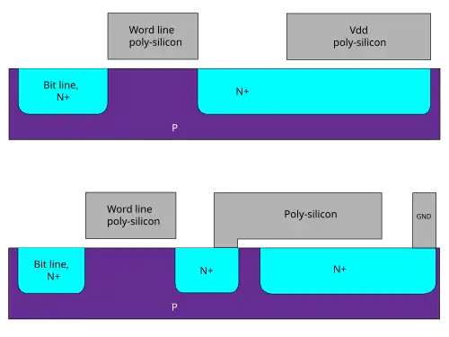

<b>图 2-1</b>：经典的 1T1C DRAM 单元。单个访问晶体管加一个存储电容，字线 WL 控制开关，位线 BL 传输电荷。

### 2.2 电荷分享式读出（Sensing）原理

DRAM 单元无法像 SRAM 那样直接驱动位线至满摆幅，必须依靠电荷分享原理进行读出。

**读出流程**
1. **位线预充**：读操作前，将位线 BL 预充电至 $V_{DD}/2$
2. **字线激活**：WL 拉高，访问管导通
3. **电荷分享**：存储电容与位线电容 $C_{BL}$ 之间发生电荷重分配
4. **灵敏放大**：灵敏放大器（交叉耦合锁存）将微小的差分电压放大至全摆幅
5. **数据回写**：读出同时将数据写回单元，修复电荷分享造成的破坏

<b>图 2-2</b>：DRAM 阵列读操作。选中字线使整行单元接入位线，每列下方的灵敏放大器把电荷分享产生的微小压差放大到满摆幅，并完成回写。

**位线差分电压**

电荷分享后，位线电压变化量：
$$\Delta V_{BL} = \frac{C_s}{C_s + C_{BL}} \cdot \left( V_{cell} - \frac{V_{DD}}{2} \right)$$

其中 $V_{cell}$ 为存储电压（$V_{DD}$ 或 0）。典型差分摆幅 $\Delta V_{BL} \approx 100 \sim 200 \text{ mV}$。

**设计要求**
- 位线电容 $C_{BL}$ 越大，读出摆幅越小，因此位线长度受 $C_s / C_{BL}$ 比例限制
- 高深宽比电容（堆叠电容/沟槽电容）技术用于增大 $C_s$
- 灵敏放大器需要精确的阈值与失调（offset）控制

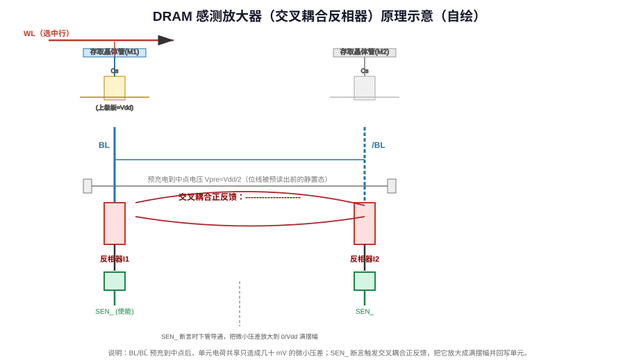

<b>图 2-3</b>：DRAM 灵敏放大器（交叉耦合反相器）。BL/BLB 预充到中点电压，读操作产生几十 mV 压差；使能后正反馈把压差放大到满摆幅，并由下管电流完成回写。

### 2.3 写操作

写操作同样先激活行。打开行后，把目标列的灵敏放大器强制到目标高压或低压，正反馈将这些值“钉住”，再沿位线写入存储电容。虽然只改一列，打开行的整行都会同时被感测并回写刷新。

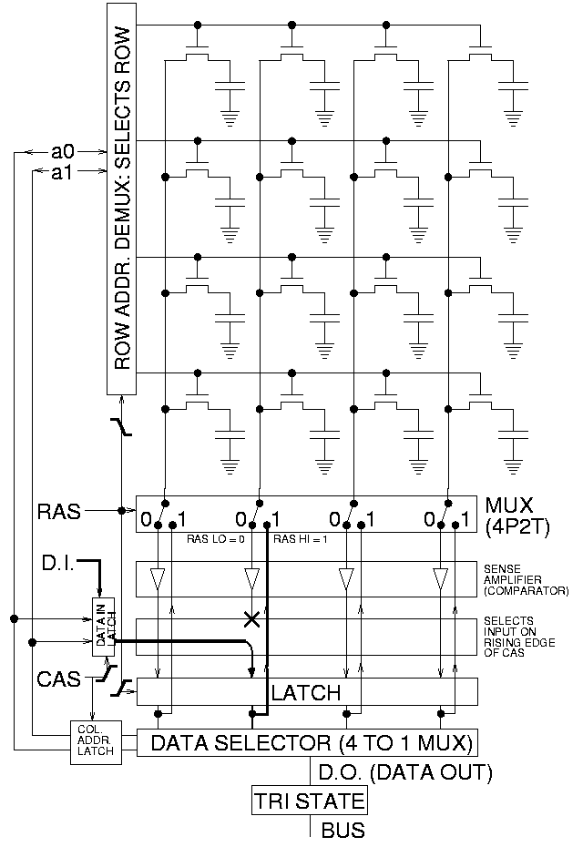

<b>图 2-4</b>：DRAM 阵列写操作。把目标列的灵敏放大器强制到目标电平，正反馈将其保持住，再沿位线写入电容；同行其余单元因感测而顺带回写刷新。

### 2.4 刷新（Refresh）机制与周期

存储电容的电荷泄漏决定了 DRAM 必须周期性刷新。

**刷新周期**
- 标准刷新周期：典型 64 ms（JEDEC 标准）
- 高温下泄漏加剧，周期缩短至 32 ms
- 刷新按行进行，每行数据通过读出再写回的方式恢复

**刷新类型**
- 行刷新（Row Refresh）：按行地址周期性刷新
- 自刷新（Self-Refresh）：进入低功耗休眠模式后芯片内部自动刷新

**刷新开销**
刷新会带来额外功耗与带宽占用，成为 DRAM 功耗的重要来源。刷新间隔须与单元泄漏速度匹配，设计中常通过温度检测动态调整刷新频率。

刷新率与刷新周期关系：
$$f_{refresh} = \frac{N_{rows}}{t_{REF}}$$

其中 $t_{REF}$ 为刷新周期，$N_{rows}$ 为总行数。例如 $N_{rows}=8192$、$t_{REF}=64\ \text{ms}$ 时，平均每 $64\ \text{ms}/8192 \approx 7.8\ \mu s$ 刷新一行，这个间隔对应 DRAM 规范中的 $t_{REFI}$；单次刷新占用的时间对应 $t_{RFC}$。

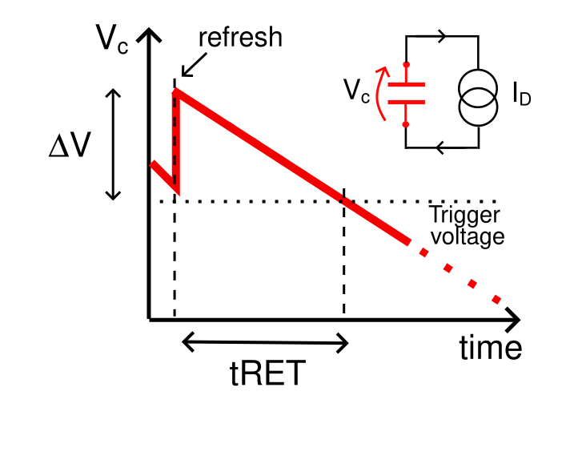

<b>图 2-5</b>：DRAM 存储电容的保持时间与刷新。电容电压随时间泄漏下降，必须在降到判决阈值前完成刷新；刷新周期由温度和单元泄漏决定。

### 2.5 关键时序参数

DRAM 的时序参数描述了命令与数据之间的时序约束，核心参数包括：

| 参数 | 含义 | 说明 |
|------|------|------|
| $t_{RCD}$ | RAS to CAS Delay | 行激活命令到列命令（读写）之间的最小间隔 |
| $t_{RP}$ | Row Precharge Time | 关闭当前行（预充电）所需时间 |
| $t_{RC}$ | Row Cycle Time | 相邻两次行激活（ACT）之间的最小时间间隔 |
| $t_{RAS}$ | RAS Active Time | 行激活状态保持的最小时间 |

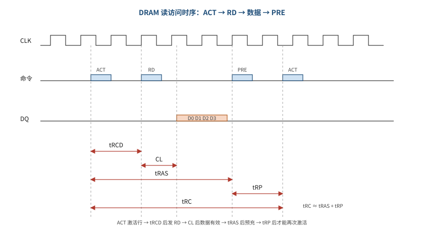

<b>图 2-6</b>：DRAM 读访问时序。ACT 激活行，$t_{RCD}$ 后发 RD，CL 后数据有效；$t_{RAS}$ 后预充，$t_{RP}$ 后才能再次激活，$t_{RC}$ 覆盖一次完整行周期。

**CAS 延迟与突发传输**

- **CAS 延迟（CL）**：列地址选通（Column Address Strobe）延迟，表示从读命令发出到第一个数据输出所需的时钟周期数，是衡量读延迟的核心指标。
- **突发传输（Burst）**：一次读命令后连续输出多个数据字（如 BL4、BL8），以提高带宽利用率，减少命令与地址开销。

带宽与突发长度相关：
$$Bandwidth \propto \frac{BL}{t_{RC}}$$

### 2.6 现代发展

- **HBM（High Bandwidth Memory）**：通过硅通孔（TSV）将多层 DRAM 芯片垂直堆叠，实现高密度、超高带宽存储，广泛用于 AI 加速器与高性能计算。
- **嵌入式 DRAM（eDRAM）**：将 DRAM 单元集成到 SoC 中用作大容量片上缓存，兼具高于普通 DRAM 的带宽与低于 SRAM 的面积成本，但需解决刷新与工艺集成的挑战。

---

## 3. NAND Flash 概览

NAND Flash 以串联单元阵列实现高密度，按页读写、按块擦除，不能原位覆盖更新，因此依赖 ECC、坏块管理、磨损均衡与垃圾回收。其浮栅/电荷俘获物理、NAND 串结构、ISPP 编程、读干扰、3D NAND 与写放大见 [4.37.3 NAND Flash 原理](4.37.3-NAND-Flash原理.md)。

| 类型 | 每单元比特 | 状态数 | 典型定位 |
|------|-----------|--------|----------|
| SLC | 1 | 2 | 高耐久、高速度 |
| MLC | 2 | 4 | 容量与耐久折中 |
| TLC | 3 | 8 | 主流大容量 |
| QLC | 4 | 16 | 读多写少、成本优先 |

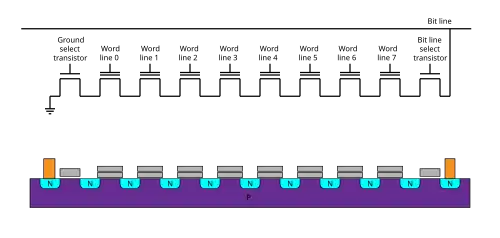

<b>图 3-1</b>：NAND Flash 存储单元剖面。浮栅被氧化层包裹，位于控制栅与沟道之间，通过注入/抽出电子改变阈值电压来存储数据。

**NAND 与 NOR 的分工**

| 特性 | NAND Flash | NOR Flash |
|---|---|---|
| 阵列结构 | 单元串联，按页访问 | 单元并联，按字/字节随机访问 |
| 读取粒度 | 页 | 字 / 字节 |
| 写入粒度 | 页编程 | 字 / 字节编程 |
| 擦除粒度 | 块 | 扇区 / 块 |
| 典型用途 | SSD、UFS、存储卡、大容量数据 | 启动代码、固件、XIP |
| 详细原理 | [4.37.3 NAND Flash 原理](4.37.3-NAND-Flash原理.md) | [4.37.4 NOR Flash 原理](4.37.4-NOR-Flash原理.md) |

---

## 4. 新兴非易失存储器（NVM）

传统存储体系中 SRAM 快而贵、DRAM 需刷新、Flash 难微缩且寿命有限。新兴非易失存储器（NVM）试图在速度、密度、非易失性和耐久性之间取得平衡。

### 4.1 STT-MRAM

**基本原理**
自旋转移矩磁随机存取存储器（Spin-Transfer Torque MRAM）以磁隧道结（MTJ）为存储单元。MTJ 由两层铁磁层夹一层超薄隧道氧化层构成：两层磁化方向相同时电阻低，相反时电阻高。通过自旋极化电流翻转自由层磁化方向完成写入，电阻高低分别表示"0"/"1"。

**优势**
- 非易失，访问速度可媲美 SRAM/DRAM
- 耐久性高，远高于 NAND/NOR Flash
- 逻辑工艺兼容性好，可嵌入 SoC

**定位**
作为低延迟、高耐久的高性能非易失存储，兼顾缓存（Cache）与持久性存储需求。

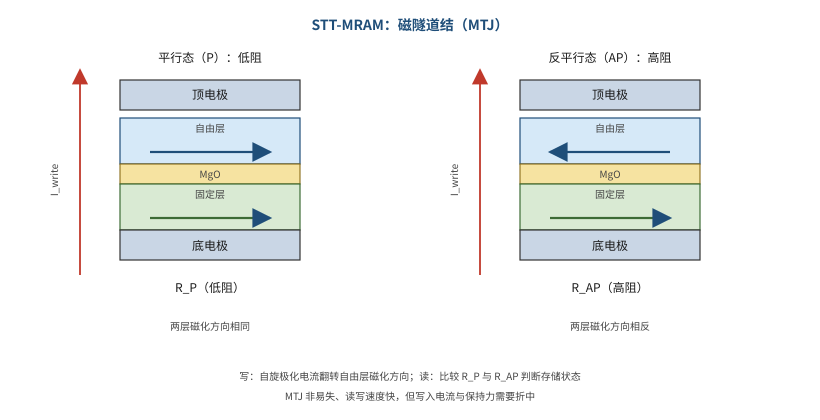

<b>图 4-1</b>：STT-MRAM 的磁隧道结（MTJ）。自由层与固定层磁化方向相同时为低阻 $R_P$，相反时为高阻 $R_{AP}$；自旋极化电流翻转自由层完成写入。

**读写方式**

读操作加小偏置测量 MTJ 电阻；写操作通入足够大的自旋极化电流，利用自旋转移矩把自由层磁化翻到目标方向。写入电流与热稳定性之间存在折中，是 STT-MRAM 设计的核心矛盾。

### 4.2 RRAM（电阻式）

**基本原理**
基于电阻开关效应：在金属氧化物等介质中，通过施加电压在高低阻态之间进行可逆切换。多数基于导电细丝（Filament）的形成与断开，高阻/低阻分别表示"0"/"1"。

**优势**
- 结构简单、单元面积小，微缩与 3D 堆叠潜力大
- 写入电压低、速度较快、功耗低
- 与标准 CMOS 工艺兼容性好

**定位**
面向高密度嵌入式非易失存储与存算一体（Compute-in-Memory）应用。

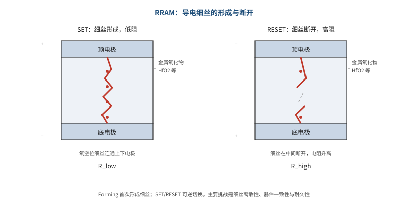

<b>图 4-2</b>：RRAM 的导电细丝。SET 时氧空位细丝连通上下电极，电阻降低；RESET 时细丝断开，电阻升高。

**Forming、SET 与 RESET**

首次编程通常需要较高的 Forming 电压形成细丝；之后 SET 用较低电压使细丝重新连通，RESET 用反向偏置使细丝断开。细丝的离散性会带来器件间与循环间的阻值波动。

### 4.3 PCM（相变存储器）

**基本原理**
利用硫系化合物（如 Ge2Sb2Te5）在晶态（低阻）与非晶态（高阻）之间的可逆相变存储数据。写入时通过电流加热改变相态，晶态/非晶态对应"0"/"1"。

**优势**
- 非易失，单元面积较小，微缩性好
- 读延迟接近 DRAM，写延迟优于 NAND Flash
- 可通过每单元多比特（多电平）提高密度

**定位**
作为存储级内存（SCM），填补 DRAM 与 NAND Flash 之间的速度/容量空档。

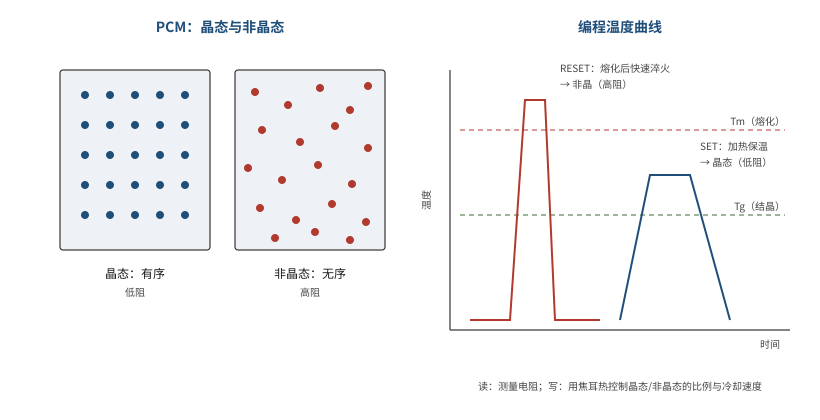

<b>图 4-3</b>：PCM 的晶态与非晶态。晶态有序、电阻低；非晶态无序、电阻高。RESET 用短而强的脉冲熔化后快速淬火，SET 用较低温度保温结晶。

**读写方式**

写操作靠焦耳热：RESET 把相变材料加热到熔化温度以上再快速冷却，形成非晶（高阻）；SET 在结晶温度附近保温，使材料转为晶态（低阻）。读操作用小电流测电阻，避免焦耳热改变相态。

### 4.4 与 SRAM/DRAM 的定位对比

| 特性 | SRAM | DRAM | STT-MRAM | RRAM | PCM |
|------|------|------|----------|------|-----|
| 易失性 | 易失 | 易失（需刷新） | 非易失 | 非易失 | 非易失 |
| 访问速度 | 最快 | 较快 | 快 | 中等 | 中等 |
| 单元面积 | 大 | 小 | 较小 | 小 | 小 |
| 耐久性 | 无限 | 高 | 高 | 中等偏高 | 中等 |
| 应用定位 | 缓存/寄存器 | 主存 | 高性能嵌入式/缓存 | 高密度嵌入式、存算一体 | 存储级内存 |

**写机理与主要挑战**

| 器件 | 写机理 | 读机理 | 主要挑战 |
|---|---|---|---|
| STT-MRAM | 自旋极化电流翻转磁化 | 测 MTJ 电阻 | 写入电流与热稳定性折中、工艺集成 |
| RRAM | 导电细丝形成 / 断开 | 测高/低阻 | 细丝离散性、Forming 电压、耐久性 |
| PCM | 焦耳热驱动相变 | 测晶态/非晶态电阻 | 编程电流、热串扰、电阻漂移 |

新兴 NVM 的核心价值是在保留非易失特性的同时逼近 SRAM/DRAM 的速度与寿命，其发展受益于材料与工艺的持续突破。

新兴 NVM 尚未全面取代 DRAM 和 NAND：密度、成本、工艺成熟度、器件一致性和可靠性仍需平衡。目前它们更多用于嵌入式存储、存算一体、存储级内存等特定场景，而不是简单替代现有存储层级。

---

## 小结

1. **ROM 与一次性存储**：掩模 ROM、OTP、eFuse/anti-fuse 分别面向固定数据、配置密钥和校准信息，编程方式与成本各不相同；NOR Flash 作为可擦写代码存储另有专章。

2. **DRAM**：1T1C 单元以高密度存储电荷，读出依赖电荷分享和灵敏放大；写操作通过强制灵敏放大器电平完成；必须通过刷新与回写维持数据，并满足 $t_{RCD}$、$t_{RP}$、$t_{RC}$ 等时序约束。

3. **NAND Flash**：以串联阵列获得高密度，页编程/块擦除导致写放大，需要 ECC、坏块管理和 FTL 配合；详见 [4.37.3 NAND Flash 原理](4.37.3-NAND-Flash原理.md)。

4. **新兴 NVM**：STT-MRAM 用自旋极化电流翻转磁化，RRAM 用导电细丝的形成与断开，PCM 用焦耳热驱动晶态/非晶态相变；它们在速度、密度、非易失性和耐久性之间提供不同定位，分别面向高性能嵌入式、存算一体和存储级内存等方向。

## 自测清单

1. 掩模 ROM、OTP、eFuse/anti-fuse 的编程机制与应用有何不同？
2. 为什么 DRAM 读出会破坏数据？电荷分享摆幅、刷新和回写如何相互关联？
3. 解释 $t_{RCD}$、$t_{RP}$、$t_{RC}$、CAS 延迟和突发传输对 DRAM 带宽的影响。
4. NAND 为什么按页读写、按块擦除？这对更新和寿命意味着什么？
5. STT-MRAM、RRAM、PCM 的存储机理及其相对 SRAM/DRAM 的定位是什么？
6. STT-MRAM、RRAM、PCM 各自的写机理与主要挑战是什么？

---

**下一章**：[4.37.3 NAND Flash 原理](4.37.3-NAND-Flash原理.md)
