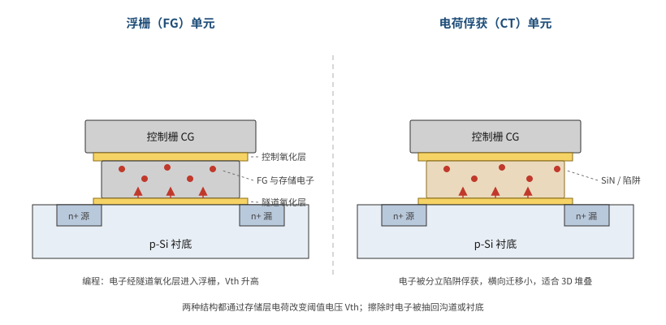
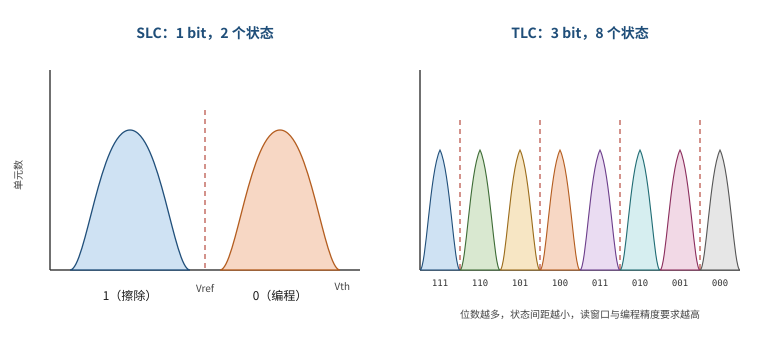
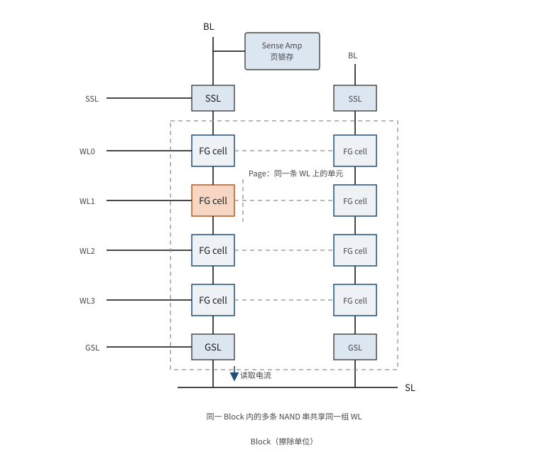
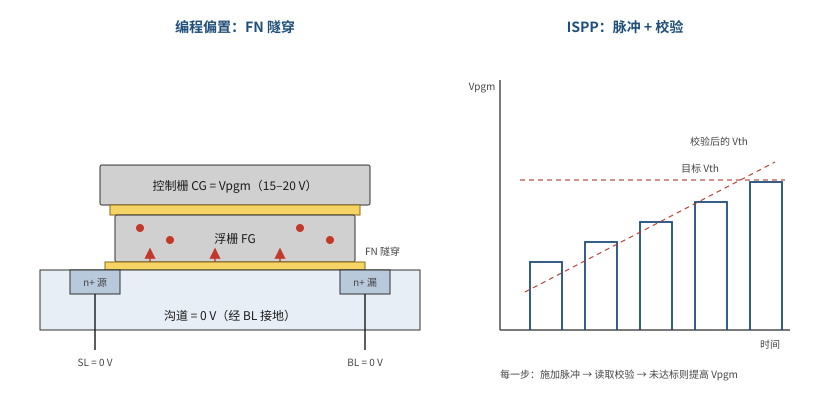
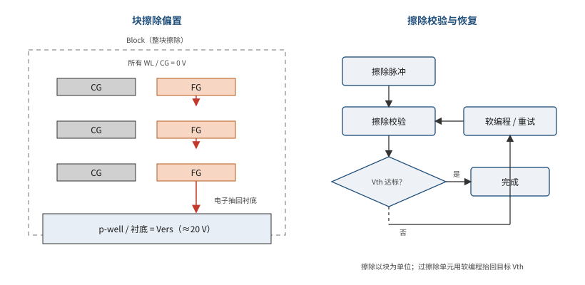
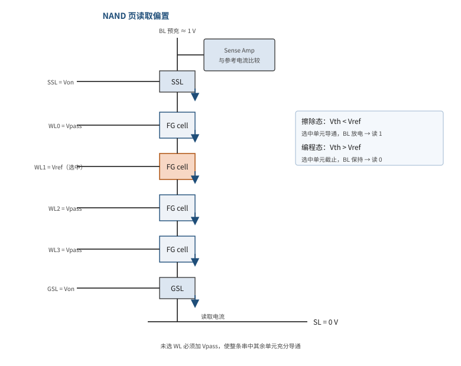

# 4.37.3 NAND Flash 原理

> **本章定位**：从存储单元、NAND 串阵列到页编程/块擦除、读干扰和 3D 堆叠，系统理解 NAND Flash 为什么适合大容量存储，又为什么必须依赖 ECC、坏块管理和垃圾回收。DRAM 与 ROM/OTP 见 [4.37.2 DRAM与非易失存储器](4.37.2-DRAM与非易失存储器.md)，可靠性测试见 [4.37.5 存储器可靠性与测试](4.37.5-存储器可靠性与测试.md)。

> **前置知识**：**必需** [4.37.2 DRAM与非易失存储器](4.37.2-DRAM与非易失存储器.md)（非易失存储与 ROM/OTP 概览）、[3.7 半导体存储器](../../03-数字与计算机系统/数字电路/3.7-半导体存储器.md)、[2.1 半导体物理基础](../../02-模拟与硬件工程/模拟电路/2.1-半导体物理基础.md)（PN 结、MOSFET 与阈值电压）、[2.4 场效应管（FET）](../../02-模拟与硬件工程/模拟电路/2.4-场效应管-FET.md)；**推荐** [4.37.5 存储器可靠性与测试](4.37.5-存储器可靠性与测试.md)（ECC 与测试）。

## 1. 存储单元：用阈值电压表示数据

### 1.1 浮栅与电荷俘获

NAND 的基本存储元件是带电荷存储层的 MOS 晶体管。存储层位于控制栅与沟道之间，注入电子后屏蔽部分控制栅电场，使晶体管阈值电压 $V_{th}$ 升高：

$$
V_{th}=V_{th0}+\frac{Q_{fg}}{C_{ox}}
$$

其中 $Q_{fg}$ 为存储层中的电荷量，$C_{ox}$ 为控制栅到沟道的等效电容。读取时在控制栅加固定电压，由沟道电流大小判断 $V_{th}$ 落在哪个区间：

$$
I_{read}\propto (V_{GS}-V_{th})^2
$$

两种主流存储层：

| 结构 | 存储介质 | 特点 |
|---|---|---|
| 浮栅（Floating Gate, FG） | 导电多晶硅 | 传统 2D NAND 主流；电荷可在整层浮栅中移动，微缩后相邻单元耦合明显 |
| 电荷俘获（Charge Trap, CT） | 氮化硅等绝缘陷阱层 | 电子被分立陷阱俘获，抗漏电与抗耦合更好，适合 3D 堆叠 |

<b>图 1-1</b>：NAND 存储单元剖面。左：浮栅单元，电子存储在连续的多晶硅浮栅中；右：电荷俘获单元，电子被氮化硅中的分立陷阱俘获。两者都通过控制栅电压经隧道氧化层注入或抽出电子，改变阈值电压 $V_{th}$。

**编程**把电子送入存储层，$V_{th}$ 升高，通常记为逻辑 0；**擦除**把电子抽出，$V_{th}$ 降低，通常记为逻辑 1。具体逻辑极性由产品定义，阅读数据手册时应以其中的 $V_{th}$ 分布图为准。

### 1.2 单比特与多比特

一个单元可以只区分两个 $V_{th}$ 状态，也可以划分多个状态：

| 类型 | 每单元比特 | 状态数 | 典型定位 |
|---|---|---|---|
| SLC | 1 | 2 | 高耐久、高速度、企业级缓存/写入 |
| MLC | 2 | 4 | 较早的消费级/企业级折中 |
| TLC | 3 | 8 | 当前主流大容量存储 |
| QLC | 4 | 16 | 读多写少、成本优先 |

每增加一位，状态间距变小，读窗口变窄，编程时间、误码率和 ECC 开销都上升。因此 TLC/QLC 更依赖强 ECC、读重试和精细的阈值管理。

<b>图 1-2</b>：SLC 与 TLC 的阈值电压分布。SLC 只用两个状态，读参考电压 $V_{ref}$ 把擦除态和编程态分开；TLC 有 8 个状态，状态之间的窗口更窄，需要更精细的 ISPP 和多组读参考电压。

## 2. NAND 串与阵列组织

### 2.1 为什么是串行连接

NAND 把多个存储单元**串联**在一条位线与源线之间，两端各有一个选择管：

- **SSL（String Select Line）**：选择该串是否接入位线；
- **GSL（Ground Select Line）**：控制串到源线的通路；
- 中间每个存储单元的控制栅接一条**字线（WL）**。

这种结构不需要每个单元单独接地线，单元面积小，适合高密度；代价是读操作必须把未选字线全部导通，才能让电流流过整条串。

<b>图 2-1</b>：NAND 串与阵列组织。单元串联在 BL 与 SL 之间，两端由 SSL、GSL 选择；同一 Block 内的多条串共享一组 WL。读/编程以页（同一条 WL）为单位，擦除以 Block 为单位。

### 2.2 页、块、平面与芯片

| 层级 | 含义 | 典型操作粒度 |
|---|---|---|
| 页（Page） | 同一条字线上的一组单元 | 读、编程的最小单位 |
| 块（Block） | 多条字线共享同一组 NAND 串 | 擦除的最小单位 |
| 平面（Plane） | 可独立操作的块阵列 | 支持多平面并行 |
| 芯片/Die、LUN | 独立片选与命令队列 | 多芯片并行与交错 |

NAND 的读写粒度与擦除粒度不对称：**按页编程、按块擦除**，并且写入前目标块必须处于已擦除状态。这直接导致它不能像 SRAM/DRAM 那样原位覆盖更新，需要文件系统或 FTL（Flash Translation Layer）做地址映射、垃圾回收和磨损均衡。

## 3. 编程、擦除与读取

### 3.1 编程（写）：FN 隧穿与增量步进

NAND 编程主要依靠 **Fowler-Nordheim（FN）隧穿**：控制栅加较高编程电压，沟道电子隧穿进入存储层。

工程上采用**增量步进脉冲编程（ISPP）**：

1. 施加一个编程脉冲；
2. 用校验电压读取，判断是否达到目标 $V_{th}$；
3. 未达到则提高脉冲幅度，继续编程；
4. 达到目标后停止，避免过编程。

未选中的串需要**编程禁止**：通过位线电压与自举（self-boosting）抬高沟道电位，使控制栅与沟道之间的电场不足以发生隧穿。自举效果不足会造成**编程干扰（program disturb）**。

**编程偏置**

| 节点 | 选中串 / 选中单元 | 未选串（编程禁止） |
|---|---|---|
| 选中 WL | $V_{pgm}$（约 15–20 V） | $V_{pass}$ |
| 未选 WL | $V_{pass}$ | $V_{pass}$ |
| BL | 0 V | $V_{cc}$ |
| SSL | 导通 | 先预充后截止 |
| GSL | 截止 | 截止 |
| 沟道 | 0 V | 自举抬高 |

<b>图 3-1</b>：NAND 编程。左：选中单元的 CG 加 $V_{pgm}$、沟道接地，电子经 FN 隧穿进入存储层；右：ISPP 用逐步升高的编程脉冲配合校验，把 $V_{th}$ 推到目标窗口。

### 3.2 擦除：整块 FN 抽出

擦除以块为单位：把存储层电子通过 FN 隧穿抽回沟道或衬底，使整块单元的 $V_{th}$ 回到较低状态。擦除后通常需要**擦除校验**；对阈值过低、接近耗尽状态的单元还要做软编程或校验修复，避免串内漏电。

擦除是 NAND 最慢的操作之一，且块越大，单次擦除时间与擦除干扰的范围越大。

**擦除偏置**

| 节点 | 擦除时 |
|---|---|
| 所有 WL / CG | 0 V（或负压） |
| p-well / 衬底 | $V_{ers}$（约 20 V） |
| BL / SL | 浮空 |
| 粒度 | 整个 Block |

<b>图 3-2</b>：NAND 块擦除。所有 WL 保持低电平、p-well 加高电压，整块单元的电子经 FN 隧穿抽回衬底；擦除后校验，过擦除单元用软编程抬回目标 $V_{th}$。

### 3.3 读取：选中字线与 Vpass

读取时：

- 选中字线加读参考电压 $V_{ref}$；
- 未选字线加较高的**通过电压 $V_{pass}$**，保证未选单元充分导通；
- 位线检测整条串的电流，经灵敏放大器判决。

因此 NAND 的读取是**按页随机读**，但同一块内不同页共享串结构。多次读会在未选字线上反复施加 $V_{pass}$，弱编程未选单元，形成**读干扰（read disturb）**。常见缓解手段包括读重试（调整 $V_{ref}$/偏移）、数据巡检与定期搬运。

**读取偏置**

| 节点 | 读取时 |
|---|---|
| 选中 WL | $V_{ref}$（落在目标状态之间） |
| 未选 WL | $V_{pass}$（约 5–7 V） |
| SSL / GSL | $V_{on}$（约 4.5 V） |
| BL | 预充约 1 V |
| SL | 0 V |

读取过程可分为：预充 BL → 导通 SSL/GSL → 未选 WL 加 $V_{pass}$、选中 WL 加 $V_{ref}$ → 检测整条串的电流 → 锁存该页数据。与 DRAM 不同，NAND 读取不改写单元电荷，不需要读后回写；但 $V_{pass}$ 的反复施加会带来读干扰。

<b>图 3-3</b>：NAND 页读取偏置。选中 WL 加 $V_{ref}$，未选 WL 加 $V_{pass}$ 保证串联通路导通；BL 预充后由灵敏放大器检测电流，判断选中单元处于擦除态还是编程态。

### 3.4 主要干扰与保持

| 现象 | 成因 | 影响 |
|---|---|---|
| 编程干扰 | 编程时未选串自举不足或相邻字线耦合 | 未选页 $V_{th}$ 上移 |
| 读干扰 | 反复读时 $V_{pass}$ 对未选字线弱编程 | 误码随读次数累积 |
| 过编程 | ISPP 步长过大或校验不准 | 状态越界，读窗口变窄 |
| 电荷保持 | 存储层漏电、工艺缺陷、高温 | 长期放置后 $V_{th}$ 漂移 |

## 4. 可靠性、坏块与写放大

### 4.1 耐久与 ECC

NAND 的编程/擦除会损伤隧穿氧化层，耐久通常以 **P/E 循环**衡量。每经过一定循环，原始误码率（RBER）上升，需要更强纠错：

- **BCH**：适合较早的 NAND 与较短的码字；
- **LDPC**：现代 TLC/QLC 的主流，软判决可进一步降低误码；
- **读重试/软解码**：用多组参考电压读同一页，获得软信息；
- **巡检（scrubbing）**：后台读取并搬运风险块，防止误码累积。

### 4.2 坏块与磨损均衡

出厂坏块和后期坏块都需要记录在坏块表中，并由控制器避开。磨损均衡让擦写分散到整个介质，避免局部块提前耗尽。

由于不能原位覆盖，更新一页时通常要写入新页，旧页变为无效；空间不足时，垃圾回收（GC）把多个块中的有效页搬到新块，再擦除旧块。搬运量与主机写入量之比即**写放大**：

$$
WA=\frac{\text{实际写入介质的数据量}}{\text{主机请求写入的数据量}}
$$

预留空间（Over-Provisioning, OP）越大，GC 可选择的有效页越多，$WA$ 通常越低，但可用容量减少。

### 4.3 一个写放大与耐久估算

设主机写入 1 GB，GC 额外搬运 0.4 GB，则：

$$
WA=\frac{1+0.4}{1}=1.4
$$

若介质总写入寿命为 600 TBW，主机可写入量近似为：

$$
\frac{600}{1.4}\approx429\ \text{TB}
$$

这说明 $WA$ 会按比例消耗耐久预算。实际产品还要考虑 ECC、预留空间、温度与工作负载。

### 4.4 编程吞吐示例

设单平面页大小 16 KiB、页编程时间 $t_{PROG}=600\ \mu s$，忽略命令与传输开销：

$$
\text{吞吐}\approx\frac{16\ \text{KiB}}{600\ \mu s}\approx27.3\ \text{MB/s}
$$

多平面、多芯片交错可以提高并行度，但受通道带宽、ECC 与控制器调度限制。

## 5. 3D NAND 与工艺演进

2D 平面 NAND 微缩到一定程度后，存储层过薄导致电荷保持变差、单元间耦合加剧。3D NAND 把存储串沿垂直方向堆叠：

- **电荷俘获 + 垂直沟道**：更适合多层堆叠；
- **串堆叠（string stacking）**：把多个字线层组叠起，继续增加层数；
- **CMOS under Array（CuA）**：把外围 CMOS 放到阵列下方，提高面积利用率；
- **多平面与多 die**：通过并行提高带宽。

层数增加改善了密度，但也带来深孔刻蚀、层间一致性、应力与良率挑战；系统侧仍需 ECC、坏块管理和热管理配合。

## 6. 接口与系统位置

NAND 芯片通过 **ONFI** 或 **Toggle** 类接口与控制器连接，常见信号包括命令/地址/数据复用总线、片选 CE、就绪/忙 RB 等。控制器侧构成 SSD 的核心：

1. 主机接口（NVMe/SATA/UFS 等）；
2. FTL：逻辑地址到物理页映射、GC、磨损均衡；
3. ECC/读重试与坏块管理；
4. NAND 通道调度与多平面/多 die 并行。

NAND 本身只提供页读写与块擦除原语，**可靠性、寿命和性能主要由控制器与固件共同实现**。

## 7. 与 NOR、DRAM 的定位对比

| 特性 | NAND Flash | NOR Flash | DRAM |
|---|---|---|---|
| 读取方式 | 按页读，随机字节访问能力弱 | 按字/字节随机读，支持 XIP | 按行激活、按列读写 |
| 写入粒度 | 页编程 | 字/字节编程 | 按列写 |
| 擦除粒度 | 块擦除 | 扇区/块擦除 | 无需擦除 |
| 速度 | 顺序吞吐高，随机延迟大 | 随机读快，写入慢 | 读写延迟低，需刷新 |
| 密度/成本 | 最高密度、最低每比特成本 | 密度较低、成本较高 | 高密度但易失 |
| 典型用途 | SSD、UFS、存储卡、大容量代码/数据 | 启动代码、固件、配置、XIP | 主存 |

NAND 的核心取舍是：**用串行阵列换取密度，用页/块粒度换取成本，再用 ECC、FTL 和 3D 堆叠弥补可靠性与管理复杂度。**

## 小结

1. NAND 用浮栅或电荷俘获层存储电子，通过阈值电压区间表示 1 位或多位数据。
2. 单元串联成 NAND 串，按页读写、按块擦除，未选字线需要 $V_{pass}$ 才能读取。
3. 编程以 FN 隧穿和 ISPP 为主，擦除整块进行；编程干扰、读干扰和电荷保持是主要可靠性问题。
4. 坏块管理、ECC、读重试、磨损均衡和垃圾回收由控制器/FTL 完成，写放大直接影响寿命与性能。
5. 3D NAND 通过垂直堆叠和电荷俘获继续提升密度，但需要更复杂的工艺与系统管理。

## 自测清单

1. 浮栅与电荷俘获结构各有什么优缺点？为什么 3D NAND 更倾向电荷俘获？
2. 为什么 NAND 的读取需要给未选字线加 $V_{pass}$？这会带来什么副作用？
3. 页编程、块擦除和写放大之间的因果关系是什么？
4. ISPP 如何减小过编程风险？编程禁止依赖什么机制？
5. TLC/QLC 为什么需要更强的 ECC 和读重试？
6. 写放大 1.4 时，600 TBW 的介质大约能承受多少主机写入量？

---

**下一章**：[4.37.4 NOR Flash 原理](4.37.4-NOR-Flash原理.md)
