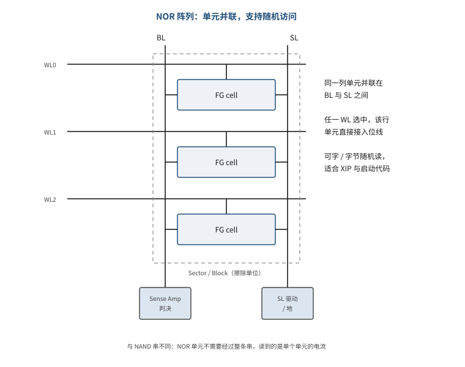
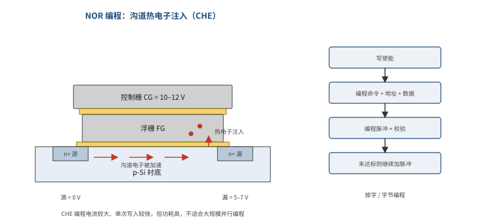
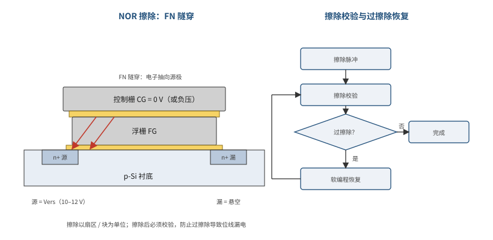
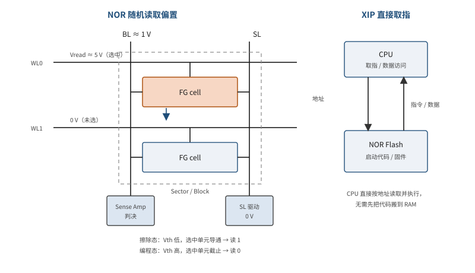

# 4.37.4 NOR Flash 原理

> **本章定位**：从并联式 NOR 阵列、热电子注入编程到随机读取与 XIP，理解 NOR Flash 为什么适合代码存储和嵌入式启动，又为什么在密度和写入成本上不及 NAND。NAND 原理见 [4.37.3 NAND Flash 原理](4.37.3-NAND-Flash原理.md)。

> **前置知识**：**必需** [4.37.2 DRAM与非易失存储器](4.37.2-DRAM与非易失存储器.md)（非易失存储与 ROM/OTP 概览）、[3.7 半导体存储器](../../03-数字与计算机系统/数字电路/3.7-半导体存储器.md)、[2.1 半导体物理基础](../../02-模拟与硬件工程/模拟电路/2.1-半导体物理基础.md)（PN 结、MOSFET 与阈值电压）、[2.4 场效应管（FET）](../../02-模拟与硬件工程/模拟电路/2.4-场效应管-FET.md)；**推荐** [4.37.3 NAND Flash 原理](4.37.3-NAND-Flash原理.md)（对照串行阵列）。

## 1. 单元与阵列：并联随机访问

### 1.1 为什么叫 NOR

NOR Flash 的存储单元**并联**在位线与源线之间，每个单元的控制栅接字线：

- 选中字线加高电平，对应单元导通或截止；
- 位线电流直接反映该单元阈值状态；
- 因此可以按字/字节随机访问，不需要像 NAND 那样先导通整条串。

从阵列等效关系看，单元并联后对字线的响应接近 NOR 逻辑的“任一输入为高则输出为低”，NOR 的名称由此而来。

<b>图 1-1</b>：NOR 阵列结构。同一列单元并联在 BL 与 SL 之间，每条 WL 控制一行单元的栅极；选中某条 WL 即可让该行单元直接接入位线，因此支持字/字节随机读。

### 1.2 单元结构与面积代价

NOR 需要一个单元一个位线接触（或采用虚拟地结构减少接触），单元面积明显大于 NAND 串。浮栅或电荷俘获层仍位于控制栅与沟道之间，靠阈值电压表示数据。

常见结构：

| 结构 | 特点 |
|---|---|
| 标准浮栅 NOR | 工艺成熟，编程效率与读电流较好 |
| 虚拟地（Virtual Ground） | 减少位线接触，提高阵列密度，但编解码与干扰更复杂 |
| 分栅（Split-Gate） | 控制栅与存储栅分离，抗过擦除、编程效率高，常见于嵌入式 Flash |
| SONOS/电荷俘获 | 氮化硅存储层，适合嵌入式与低电压工艺 |

## 2. 编程（写）：沟道热电子注入

### 2.1 热电子注入机制

NOR 编程主要采用**沟道热电子注入（Channel Hot Electron, CHE）**：

1. 控制栅加较高编程电压，使沟道形成强反型；
2. 漏源之间加较高电压，电子在漏端附近被加速成“热电子”；
3. 部分热电子越过氧化层势垒进入浮栅/电荷俘获层；
4. 存储层带负电，单元阈值电压 $V_{th}$ 升高。

与 NAND 的 FN 隧穿相比，CHE 编程电流更大、单次写入更快，但功耗更高，不适合大规模并行编程。

**编程偏置**

| 节点 | 编程时 |
|---|---|
| 控制栅（选中 WL） | $V_{pp}$（约 10–12 V） |
| 漏极（BL） | 5–7 V |
| 源极（SL） | 0 V |
| 衬底 | 0 V |
| 编程粒度 | 字 / 字节 |

<b>图 2-1</b>：NOR 编程。控制栅加高电压、漏极加中等电压，沟道电子在漏端附近被加速并注入存储层；右侧为写使能、编程命令/地址/数据、脉冲校验的典型顺序。

### 2.2 编程校验与过编程

编程通常按字/字节进行，并配合**编程校验**：写入后读取 $V_{th}$，未达到目标则继续加脉冲。若编程过量，$V_{th}$ 过高会缩小读窗口；若擦除过量，单元可能进入耗尽状态，导致位线漏电，需要**软编程/恢复编程**把 $V_{th}$ 拉回目标范围。

## 3. 擦除：FN 隧穿与过擦除

NOR 擦除以扇区/块为单位，主要依靠 **FN 隧穿**：

- **源极擦除**：源极加高电压，控制栅接地或负压，电子从浮栅隧穿到源极；
- **沟道擦除**：控制栅加负压，衬底/沟道加正压，电子从浮栅隧穿到沟道。

擦除后需要擦除校验。由于各单元擦除速度不一致，擦得过多的单元会过擦除，因此控制器或片上状态机会执行校验与软编程恢复。

**擦除偏置**

| 节点 | 擦除时 |
|---|---|
| 控制栅 | 0 V 或负压 |
| 源极 / 沟道 | $V_{ers}$（约 10–12 V） |
| 漏极 | 浮空 |
| 粒度 | 扇区 / 块 |

<b>图 3-1</b>：NOR 擦除。控制栅保持低电平或负压、源极/沟道加高电压，电子经 FN 隧穿抽向源极；擦除后校验，过擦除单元用软编程恢复，避免位线漏电。

擦除流程通常为：发送擦除命令与扇区地址 → 施加擦除脉冲 → 擦除校验 → 过擦除单元软编程 → 复测通过后完成。

## 4. 读取与 XIP

### 4.1 随机读取

读取时选中字线加读电压，未选字线保持低电平，位线通过灵敏放大器检测电流：

$$
I_{read}\propto (V_{GS}-V_{th})^2
$$

只要 $V_{th}$ 落在编程态或擦除态区间，就能判决为 0/1。NOR 的随机读延迟通常在几十纳秒量级（具体以产品手册为准），适合处理器直接取指。

**读取偏置**

| 节点 | 读取时 |
|---|---|
| 选中 WL | $V_{read}$（约 4.5–5 V） |
| 未选 WL | 0 V |
| BL | 约 1 V |
| SL | 0 V |
| 判决依据 | 单元电流大小 |

一次随机读通常包括：锁存地址 → 行/列译码选中 WL 与 BL → 位线预充/偏置 → 灵敏放大器比较单元电流 → 输出数据。未选 WL 保持 0 V，未被选中的单元不会干扰位线，因此 NOR 可以在几十纳秒内完成一次随机读。

<b>图 4-1</b>：NOR 随机读取与 XIP。选中 WL 加读电压、未选 WL 保持 0 V，灵敏放大器根据 BL 电流判断存储状态；由于支持按地址随机读，CPU 可以直接从 NOR 取指执行。

### 4.2 XIP（Execute In Place）

由于支持按字/字节随机读，NOR 可以被处理器直接映射到地址空间执行代码，称为 **XIP**。这减少了启动时把代码搬到 RAM 的步骤，因此广泛用于：

- MCU 片上/片外程序存储；
- Boot ROM、Bootloader；
- 网络设备、汽车电子、工业控制的固件；
- FPGA 配置与设备参数存储。

XIP 的性能不仅取决于 NOR 读延迟，还受总线宽度、等待周期、缓存和预取影响。

## 5. 组织、命令与保护

### 5.1 扇区与块

NOR 的擦除粒度通常为扇区（Sector）或块（Block），容量从几 KB 到几百 KB 不等。编程粒度可以是字节、字或页，具体由产品命令集决定。

典型操作序列：

1. 发送写使能命令；
2. 发送编程/擦除命令与地址；
3. 写入数据或确认擦除；
4. 轮询状态寄存器或等待就绪；
5. 校验结果。

### 5.2 保护与安全

NOR 常提供：

- **块保护（Block Protection）**：锁定启动区或参数区，防止误擦写；
- **OTP 区**：一次性编程区域，用于密钥、序列号或校准数据；
- **读保护/安全寄存器**：限制调试接口或外部读取；
- **硬件写保护引脚**：在复位或异常时提供额外保护。

这些特性使 NOR 适合存放不能被随意改写的启动代码和安全配置。

## 6. 可靠性与嵌入式实现

### 6.1 主要退化与干扰

| 现象 | 成因 | 影响 |
|---|---|---|
| 耐久退化 | 编程/擦除损伤隧穿氧化层 | P/E 循环后读窗口缩小 |
| 过擦除 | 擦除过快或单元离散性 | 位线漏电、误读 |
| 编程干扰 | 编程电压对相邻单元耦合 | 邻近单元 $V_{th}$ 漂移 |
| 读干扰 | 长期读取导致弱编程 | 保持特性下降 |
| 电荷损失 | 氧化层缺陷、高温 | 长期放置后数据丢失 |

NOR 的耐久通常高于 MLC/QLC NAND，但低于 SRAM/DRAM；具体循环次数取决于工艺、单元结构和产品等级。系统侧仍需 ECC、校验和坏块/坏扇区管理。

### 6.2 嵌入式 Flash（eFlash）

嵌入式 NOR 把存储阵列与高压生成、电荷泵、状态机和接口集成到 MCU/SoC 中：

- 需要额外的高压工艺与掩模；
- 与标准 CMOS 逻辑集成时，要处理氧化层厚度、可靠性、ESD 与测试；
- 常见于 MCU、汽车控制器、电源管理与工业芯片；
- 可与 OTP、EEPROM 仿真区配合，形成分级非易失存储。

## 7. 性能估算示例

### 7.1 随机读吞吐

设 NOR 随机读周期为 70 ns，忽略地址/数据总线开销，理论上限为：

$$
\frac{1}{70\ \text{ns}}\approx14.3\ \text{M 次/秒}
$$

实际吞吐还受总线宽度、等待周期、缓存命中与命令开销限制。若每次读 2 字节，则理论数据率约为：

$$
14.3\times10^6\times2\ \text{B}\approx28.6\ \text{MB/s}
$$

这体现了 NOR 的特点：**随机延迟低，但顺序大块吞吐不如 NAND**。

### 7.2 擦除开销

设扇区大小 64 KiB、擦除时间 100 ms，则单扇区擦除的等效吞吐约为：

$$
\frac{64\ \text{KiB}}{100\ \text{ms}}\approx0.64\ \text{MB/s}
$$

因此 NOR 的写入/擦除不适合大块数据频繁更新，更适合“读多写少”的代码与配置存储。

## 8. 与 NAND、EEPROM 的对比

| 特性 | NOR Flash | NAND Flash | EEPROM |
|---|---|---|---|
| 读取 | 字/字节随机读，支持 XIP | 按页读，随机字节访问弱 | 字节随机读 |
| 编程 | 字/字节，CHE 为主 | 页编程，FN/ISPP 为主 | 字节/页 |
| 擦除 | 扇区/块 | 块 | 字节/页 |
| 密度/成本 | 中等 | 最高 | 低 |
| 写入速度 | 较慢、功耗高 | 顺序吞吐高 | 慢 |
| 典型用途 | 启动代码、固件、配置 | 大容量数据、SSD、存储卡 | 参数、校准、小容量配置 |

选择原则可以概括为：**需要随机读、XIP 和可靠启动代码选 NOR；需要大容量、低成本顺序读写选 NAND；只需要少量参数和字节级更新选 EEPROM 或 OTP。**

## 小结

1. NOR 采用并联阵列，支持字/字节随机读，适合 XIP 和启动代码。
2. 编程以沟道热电子注入为主，擦除以 FN 隧穿为主；过擦除需要校验与恢复。
3. NOR 的随机读延迟低，但单元面积大、写入与擦除吞吐低、成本高于 NAND。
4. 块保护、OTP、读保护和硬件写保护使其适合存放安全与启动相关数据。
5. 嵌入式 NOR/eFlash 需要高压工艺与可靠性设计，常见于 MCU、汽车和工业芯片。

## 自测清单

1. NOR 阵列为什么可以随机读，而 NAND 需要按页读？两种阵列的连接方式有何不同？
2. 沟道热电子注入与 FN 隧穿在编程机理、电流和功耗上有什么区别？
3. 什么是过擦除？为什么 NOR 需要软编程或恢复编程？
4. XIP 依赖 NOR 的哪些特性？它为什么能减少启动时的代码搬运？
5. NOR 的块保护、OTP 区和读保护分别解决什么问题？
6. 为什么 NOR 适合代码存储，而大容量数据更常用 NAND？

---

**下一章**：[4.37.5 存储器可靠性与测试](4.37.5-存储器可靠性与测试.md)
