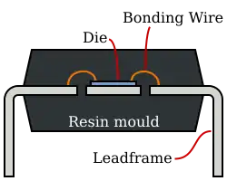
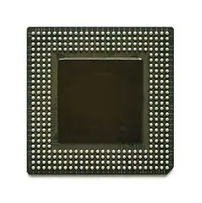

# 4.38 封装与热设计（一）封装类型、先进封装与电气特性

> **本章定位**：芯片实现的后道环节，学习封装类型、电气特性、热设计与可靠性。

> **前置知识**：[4.14 版图设计](../芯片设计/4.14-版图设计.md)；[2.25–2.26 信号完整性与 EMC](../../02-模拟与硬件工程/信号完整性与电磁兼容/2.25-信号完整性.md)。

> 本页为《封装与热设计》系列第 1/2 页。

## 1. 引言

集成电路封装（IC Packaging）是将制造完成的晶圆切割后的裸芯片（Die）进行保护、互连并提供与外部系统电气连接的工艺过程。封装不仅是芯片与外界沟通的桥梁，更是决定芯片散热能力、信号完整性和可靠性的关键环节。

随着摩尔定律放缓和"超越摩尔"（More-than-Moore）时代的到来，封装技术从传统的保护性封装演进为系统级集成的核心驱动力。先进封装（Advanced Packaging）如 2.5D/3D 封装、Chiplet 架构正在重塑半导体产业格局。

与此同时，芯片功耗密度的持续攀升使得热设计（Thermal Design）成为封装工程中不可回避的核心挑战。过高的结温不仅降低器件性能和寿命，还会引发热机械失效。因此，封装与热设计是微电子工程师必须掌握的核心知识。

## 2. 封装概述

### 2.1 封装在IC产业链中的地位

集成电路产业链可分为设计→制造→封装测试→系统集成四大环节。封装测试（OSAT, Outsourced Semiconductor Assembly and Test）占整个芯片成本的 20%~40%，是连接晶圆制造与系统应用的关键环节。

| 产业链环节 | 典型企业 | 主要任务 |
|-----------|---------|---------|
| IC设计 | 高通、英伟达、海思 | 电路设计、版图实现 |
| 晶圆制造 | 台积电、三星、中芯国际 | 光刻、刻蚀、沉积 |
| 封装测试 | 日月光、长电科技、通富微电 | 切割、键合、封装、测试 |
| 系统集成 | 华为、苹果、戴尔 | PCB组装、系统测试 |

### 2.2 封装的四大功能

封装承担以下四大核心功能：

1. **电气互连（Electrical Interconnection）**：将芯片的 I/O 焊盘通过引线、凸点或再布线层连接到封装基板或焊球，实现芯片与外部电路的电气连接。

2. **机械保护（Mechanical Protection）**：用塑封料（Mold Compound）或陶瓷外壳保护脆弱的芯片和互连结构免受物理损伤、化学腐蚀和环境影响。

3. **散热（Heat Dissipation）**：将芯片工作时产生的热量通过封装结构传导到外部环境，维持芯片在安全工作温度范围内。

4. **信号传输（Signal Transmission）**：提供高质量的信号通路，控制阻抗匹配、串扰和电源完整性，确保高速信号的完整传输。

### 2.3 封装类型演进

封装技术经历了从通孔插装到表面贴装、再到面积阵列和先进封装的演进历程：

| 时代 | 封装类型 | 典型代表 | 引脚数 | 间距 | 特点 |
|------|---------|---------|--------|------|------|
| 第一代 | 通孔插装 | DIP（双列直插） | 8~64 | 2.54mm | 通孔焊接，体积大 |
| 第二代 | 表面贴装 | SOP/SSOP/TSSOP | 14~300 | 0.65~1.27mm | 表面贴装，小型化 |
| 第三代 | 四侧引脚 | QFP/LQFP/TQFP | 44~300 | 0.4~1.0mm | 四边出线，薄型化 |
| 第四代 | 面积阵列 | BGA/FBGA | 100~3000+ | 0.5~1.27mm | 面阵列，高I/O |
| 第五代 | 晶圆级 | WLCSP/Fan-Out | 10~2000+ | 0.3~0.5mm | 近芯片尺寸封装 |
| 第六代 | 先进封装 | 2.5D/3D/SiP | 10000+ | ≤10μm | 异构集成，高密度 |

封装技术演进的驱动力：

$$\text{I/O密度} \propto \frac{1}{\text{间距}^2}$$

从 DIP 的 2.54mm 间距到 Fan-Out 的 0.3μm 微凸点间距，I/O 密度提升了约 $10^{14}$ 倍。

以双列直插（DIP）封装为例，可清晰看到封装内部的芯片、键合引线与引脚的结构关系：

## 3. 封装类型详解

### 3.1 引线键合封装（Wire Bond）

引线键合是最经典的芯片互连方式，通过细金属线将芯片焊盘连接到封装引线框架或基板上。

#### 3.1.1 键合线材

| 线材 | 材料 | 直径 | 键合方式 | 成本 | 特点 |
|------|------|------|---------|------|------|
| 金线 | Au | 15~50μm | 热超声 | 高 | 抗氧化，导电性好 |
| 铜线 | Cu | 15~30μm | 热超声 | 低 | 导电性优，易氧化 |
| 铝线 | Al | 25~50μm | 超声 | 低 | 适合功率器件 |

金线键合的可靠性最高，但成本昂贵。铜线键合因成本优势逐渐替代金线，但需要在氮气保护环境下进行以防止氧化。

#### 3.1.2 引线电感模型

每根引线键合线可等效为一段电感，其寄生电感近似为：

$$L_{wire} \approx l \cdot \left[\ln\left(\frac{2l}{r}\right) - 0.75\right] \quad (\text{nH})$$

其中：
- $l$：引线长度（cm）
- $r$：引线半径（cm）

工程经验公式：

$$L_{wire} \approx 1 \sim 2 \text{ nH/mm}$$

典型引线长度 1~3mm，对应寄生电感 1~6nH。在高频应用中，该电感会严重影响信号完整性。

引线的阻抗模型：

$$Z_{wire} = R_{wire} + j\omega L_{wire}$$

其中 $R_{wire}$ 为引线电阻（通常 < 100mΩ），$L_{wire}$ 为引线电感。

### 3.2 倒装芯片（Flip Chip）

倒装芯片技术将芯片翻转，使有源面朝下，通过芯片表面的凸点（Bump）直接与基板互连。

#### 3.2.1 凸点（Bump）技术

| 凸点类型 | 材料 | 直径 | 间距 | 特点 |
|---------|------|------|------|------|
| C4凸点 | 锡铅焊料（SnPb） | 75~150μm | 150~200μm | 传统，含铅 |
| 无铅凸点 | SAC305（Sn96.5Ag3.0Cu0.5） | 50~120μm | 100~200μm | RoHS合规 |
| 铜柱凸点 | Cu + 焊料帽 | 20~50μm | 40~100μm | 细间距，高可靠性 |
| 金凸点 | Au | 20~50μm | 40~80μm | 用于热压键合 |
| 微凸点 | Cu/Ni/Sn | 5~25μm | 10~40μm | 用于2.5D/3D封装 |

凸点的高度一致性对封装良率至关重要，高度偏差通常要求 < ±5μm。

#### 3.2.2 底部填充（Underfill）

由于芯片（Si，CTE ≈ 2.6 ppm/°C）与基板（有机基板，CTE ≈ 15~18 ppm/°C）之间存在严重的热膨胀系数（CTE）失配，在温度循环过程中焊点会承受巨大的热机械应力。底部填充胶（Underfill）通过填充芯片与基板之间的间隙来缓解应力：

- **毛细底部填充（CUF）**：利用毛细作用流入芯片底部间隙
- **非导电膜（NCF）**：预置薄膜材料
- **模制底部填充（MUF）**：与封装模塑工艺结合

底部填充的主要作用：
1. 缓解 CTE 失配引起的焊点应力
2. 提高温度循环寿命（可提升 5~10 倍）
3. 增强机械强度
4. 改善散热路径

### 3.3 球栅阵列（BGA）

BGA（Ball Grid Array）是目前最主流的高引脚数封装形式，焊球排列在封装底部整个面积上。

#### 3.3.1 焊球间距

| BGA类型 | 焊球间距 | 焊球直径 | 典型引脚数 | 应用场景 |
|---------|---------|---------|-----------|---------|
| 标准BGA | 1.27mm | 0.6mm | 100~500 | 通用处理器 |
| 细间距BGA | 1.0mm | 0.5mm | 200~800 | 移动处理器 |
| 超细间距BGA | 0.8mm | 0.4mm | 500~1500 | 高端SoC |
| 微BGA | 0.65mm | 0.3mm | 500~2000 | 先进SoC |
| 超微BGA | 0.5mm | 0.25mm | 1000~3000+ | HPC/AI芯片 |
| 极微BGA | 0.4mm | 0.2mm | 2000~5000+ | 最新HPC |

#### 3.3.2 扇出（Fan-Out）布线

BGA封装中，芯片 I/O 焊盘的间距通常远小于基板焊球的间距。需要通过扇出布线将信号从芯片区域"扇出"到更大的基板焊球阵列：

- **扇入（Fan-In）区域**：芯片正下方区域，焊球直接与芯片 I/O 对应
- **扇出（Fan-Out）区域**：芯片外围区域，通过基板布线将信号扩展到更大面积

扇出比（Fan-Out Ratio）：

$$\text{扇出比} = \frac{N_{ball}}{N_{IO}} = \frac{\text{基板焊球数}}{\text{芯片I/O数}}$$

扇出布线需要多层基板支持，通常 4~12 层基板用于高端 BGA 封装。

### 3.4 晶圆级芯片封装（WLCSP）

WLCSP（Wafer-Level Chip Scale Package）是在晶圆状态下完成封装工艺，切割后即为最终封装产品，封装尺寸几乎等于芯片尺寸。

#### 3.4.1 重布线层（RDL）

由于芯片 I/O 焊盘间距太小（通常 < 100μm），无法直接放置焊球，需要通过重布线层（Redistribution Layer, RDL）将 I/O 焊盘重新分布到更大的间距：

RDL 的关键参数：
- **线宽/线距**：典型 5μm/5μm ~ 10μm/10μm
- **层数**：1~4 层
- **介质材料**：聚酰亚胺（PI）、苯并环丁烯（BCB）
- **金属层**：Cu 或 Al/Cu

RDL 的设计规则决定了 WLCSP 的最大 I/O 数。

#### 3.4.2 凸点工艺

WLCSP 的凸点直接在晶圆上制作：

1. **电镀法**：在 RDL 上电镀锡/银焊料
2. **植球法**：将预制焊球放置到 RDL 焊盘上
3. **印刷法**：通过钢网印刷焊膏后回流

WLCSP 的典型凸点间距为 0.3~0.5mm，凸点直径 0.2~0.4mm。

### 3.5 扇出型封装（Fan-Out）

扇出型封装（Fan-Out Wafer-Level Package, FOWLP）是 WLCSP 的进阶版本，通过在芯片外围也布置 I/O 端子，突破了 WLCSP 的 I/O 密度限制。

#### 3.5.1 模塑料重构

FOWLP 的核心工艺：

1. 在载体晶圆上排列芯片（Die-Attach）
2. 用模塑料（Mold Compound）填充芯片间隙
3. 研磨至芯片和模塑料表面齐平
4. 在重构晶圆上制作 RDL 和凸点
5. 切割为单个封装

重构晶圆的关键参数：
- **芯片间距（Gap）**：典型 100~500μm
- **模塑料厚度**：与芯片厚度一致
- **RDL对准精度**：±1~2μm

#### 3.5.2 面板级封装（FOPLP）

面板级扇出封装（Fan-Out Panel Level Package）使用矩形玻璃面板或金属面板替代圆形晶圆，提高面积利用率：

| 参数 | 晶圆级（FOWLP） | 面板级（FOPLP） |
|------|----------------|----------------|
| 载体尺寸 | 300mm晶圆（~70,000cm²） | 600×600mm面板（~360,000cm²） |
| 面积利用率 | ~85% | ~95% |
| 单位成本 | 较高 | 降低 30%~50% |
| 翘曲控制 | 容易 | 困难 |
| 成熟度 | 量产 | 开发中 |

## 4. 先进封装技术

### 4.1 2.5D封装

2.5D封装使用硅中介层（Silicon Interposer）作为芯片间互连的载体，多个芯片并排排列在中介层上方，通过微凸点与中介层连接。

#### 4.1.1 硅中介层

硅中介层是 2.5D 封装的核心组件，在硅衬底中制作高密度互连布线：

- **厚度**：50~100μm（薄型）或 775μm（全厚度）
- **布线层数**：2~6 层金属层
- **最小线宽/间距**：0.5μm/0.5μm ~ 2μm/2μm
- **TSV密度**：10⁴~10⁶ 个/中介层

典型 2.5D 封装案例——TSMC CoWoS（Chip-on-Wafer-on-Substrate）：

$$\text{中介层面积} \leq 2.5 \times \text{光罩面积（Reticle Limit）}$$

当前最大中介层面积约 2500mm²（约 1.5× 光罩极限）。

#### 4.1.2 TSV在中介层中的应用

TSV（Through Silicon Via，硅通孔）是穿过硅衬底的垂直互连结构：

$$R_{TSV} = \frac{\rho \cdot h}{\pi \cdot r^2} \quad (\Omega)$$

$$L_{TSV} = \frac{\mu \cdot h}{2\pi} \cdot \ln\left(\frac{h}{r}\right) \quad (\text{H})$$

其中：
- $\rho$：填充金属电阻率（Cu: 1.7μΩ·cm）
- $h$：TSV 高度（即衬底厚度）
- $r$：TSV 半径

典型 TSV 参数：

| 参数 | 典型值 |
|------|--------|
| 直径 | 5~10μm（中介层）/ 20~50μm（存储器） |
| 深度 | 50~100μm（中介层）/ 200~500μm（存储器） |
| 间距 | 10~40μm |
| 深宽比 | 5:1 ~ 20:1 |
| 填充材料 | Cu、W、多晶硅 |

#### 4.1.3 微凸点（Micro-bump）

2.5D 封装中芯片与中介层之间使用微凸点互连：

- **尺寸**：直径 5~25μm，高度 10~30μm
- **结构**：Cu 柱 + 焊料帽（SnAg）
- **间距**：10~40μm
- **数量**：10⁵~10⁶ 个/芯片

微凸点的电阻：

$$R_{bump} \approx \frac{\rho_{Cu} \cdot h}{\pi \cdot r^2} + R_{contact} \approx 10 \sim 50 \text{ m}\Omega$$

### 4.2 HBM（High Bandwidth Memory）

HBM 是 2.5D 封装的典型应用，通过 TSV 将多层 DRAM 芯片垂直堆叠，与逻辑芯片一起封装在硅中介层上。

| 世代 | 堆叠层数 | 带宽 | 容量 | TSV数/层 |
|------|---------|------|------|---------|
| HBM | 4/8层 | 256 GB/s | 4~8 GB | ~1200 |
| HBM2 | 4/8层 | 460 GB/s | 8~16 GB | ~2500 |
| HBM2E | 8层 | 460 GB/s | 16 GB | ~4000 |
| HBM3 | 8层 | 819 GB/s | 16~24 GB | ~5000 |
| HBM3E | 8/12层 | 1.2 TB/s | 24~36 GB | ~6000 |

HBM 的总带宽：

$$BW_{total} = N_{channel} \times BW_{channel} = 1024 \times \frac{f_{clk}}{2} \times 2 \text{ (DDR)}$$

### 4.3 3D IC封装

3D IC 将多个芯片层通过 TSV 直接垂直互连堆叠，实现最短的互连距离和最高的集成密度。

#### 4.3.1 TSV堆叠

3D IC 的 TSV 堆叠方式：

1. **Via-First（先通孔）**：在 CMOS 工艺前制作 TSV
2. **Via-Middle（中通孔）**：在 BEOL 工艺后、晶圆减薄前制作 TSV
3. **Via-Last（后通孔）**：在晶圆减薄后制作 TSV

3D 堆叠的互连密度：

$$\rho_{interconnect} = \frac{1}{p^2} \quad (\text{个/mm}^2)$$

其中 $p$ 为 TSV 间距。当 $p = 10\mu m$ 时，互连密度达 $10^4$ 个/mm²。

#### 4.3.2 混合键合（Hybrid Bonding）

混合键合是下一代 3D 互连技术，不使用凸点，而是将铜焊盘和介质层同时直接键合：

- **铜-铜键合**：Cu 扩散键合，温度 200~400°C
- **介质键合**：SiO₂ 或 SiN 直接键合
- **键合间距**：0.4~10μm
- **键合强度**：> 20 MPa

混合键合 vs 微凸点对比：

| 参数 | 微凸点 | 混合键合 |
|------|--------|---------|
| 互连间距 | 10~40μm | 0.4~10μm |
| 互连密度 | ~10³/mm² | ~10⁶/mm² |
| 互连电阻 | 10~50mΩ | < 1mΩ |
| 互连电容 | ~50fF | ~5fF |
| 热预算 | 低 | 高（需高温退火） |
| 对准精度要求 | ±2μm | ±0.5μm |

混合键合的互连电阻：

$$R_{hybrid} = \frac{\rho_{Cu} \cdot t}{A_{pad}} \approx \frac{1.7 \times 10^{-8} \times 1 \times 10^{-6}}{(1 \times 10^{-6})^2} \approx 17 \text{ m}\Omega$$

### 4.4 SiP（System in Package）

SiP 将多个功能不同的芯片（处理器、存储器、射频、传感器等）集成在一个封装体内，构成完整的系统。

#### 4.4.1 多芯片模块（MCM）

MCM 是最基础的 SiP 形式，多个裸芯片安装在同一封装基板上：

- **MCM-L（层压基板）**：有机基板，成本最低
- **MCM-C（陶瓷基板）**：Al₂O₃ 或 AlN 基板，散热好
- **MCM-D（沉积薄膜基板）**：硅基板 + 薄膜布线，密度最高

#### 4.4.2 异构集成

异构集成将不同工艺节点、不同材料体系的芯片集成在一起：

- **逻辑芯片**：先进工艺（3nm/5nm）
- **存储器**：成熟工艺（DRAM 1z nm）
- **射频芯片**：SiGe/GaAs/SOI 工艺
- **光电器件**：InP/Si Photonics

异构集成的核心挑战：
1. 不同芯片的 CTE 匹配
2. 热管理（不同芯片的热密度差异大）
3. 已知已知芯片（KGD, Known Good Die）测试
4. 系统级协同设计

## 5. 封装电气特性

### 5.1 封装寄生参数模型

封装结构中的每一段互连都引入寄生电阻、电容和电感。这些寄生参数对高速信号和电源分配网络（PDN）产生显著影响。

#### 5.1.1 寄生参数汇总

| 寄生参数 | 典型值 | 影响 |
|---------|--------|------|
| 引线电感 | 1~2 nH/mm | 地弹、电源噪声 |
| 焊盘电容 | 0.1~0.5 pF | 信号延迟、带宽限制 |
| 互连电阻 | 10~100 mΩ | IR Drop、发热 |
| TSV电阻 | 10~100 mΩ | 信号衰减 |
| TSV电容 | 10~50 fF | 信号延迟 |
| 基板走线电感 | 0.3~1 nH/mm | 串扰、EMI |

#### 5.1.2 引线电感的影响

引线键合的寄生电感在高速开关时产生地弹（Ground Bounce）：

$$V_{bounce} = L_{wire} \cdot \frac{di}{dt} = L_{wire} \cdot \frac{\Delta I}{\Delta t}$$

例如：$L = 2\text{nH}$，$\Delta I = 20\text{mA}$，$\Delta t = 100\text{ps}$：

$$V_{bounce} = 2 \times 10^{-9} \times \frac{20 \times 10^{-3}}{100 \times 10^{-12}} = 0.4\text{V}$$

当多根引线同时开关（SSO, Simultaneously Switching Outputs）时，总地弹电压：

$$V_{bounce,total} = N \cdot L_{wire} \cdot \frac{di}{dt}$$

#### 5.1.3 焊盘电容

封装焊盘和凸点引入的寄生电容：

$$C_{pad} \approx \varepsilon_r \cdot \varepsilon_0 \cdot \frac{A}{d}$$

其中 $A$ 为焊盘面积，$d$ 为焊盘到参考平面的距离。

### 5.2 封装对信号完整性的影响

#### 5.2.1 阻抗不连续

封装中的阻抗不连续点包括：
- 芯片 I/O → 引线/凸点 → 基板 → 焊球 → PCB

每个不连续点都会引起信号反射。反射系数：

$$\Gamma = \frac{Z_L - Z_0}{Z_L + Z_0}$$

封装中典型的阻抗变化：

| 互连段 | 特征阻抗 |
|--------|---------|
| 芯片上互连 | 30~50 Ω |
| 引线键合 | 50~80 Ω |
| 基板走线 | 40~60 Ω |
| 焊球阵列 | 30~50 Ω |
| PCB走线 | 50 Ω（单端）/ 100 Ω（差分） |

#### 5.2.2 串扰

封装基板中的信号串扰：

- **容性串扰**：平行走线之间的电场耦合
- **感性串扰**：平行走线之间的磁场耦合
- **过孔串扰**：相邻过孔之间的耦合

串扰电压估算：

$$V_{xtalk} \approx \frac{Z_0}{2} \cdot \left(C_m \cdot \frac{dV}{dt} + L_m \cdot \frac{dI}{dt}\right) \cdot l_{couple}$$

其中 $C_m$ 和 $L_m$ 分别为单位长度的互电容和互感，$l_{couple}$ 为耦合长度。

#### 5.2.3 电源完整性（PDN）

封装的电源分配网络（PDN）需要提供低阻抗路径，确保芯片在瞬态电流需求下电压稳定。

PDN 阻抗目标：

$$Z_{target} = \frac{\Delta V_{allowed}}{\Delta I_{max}}$$

其中 $\Delta V_{allowed}$ 为允许的电压波动（通常为 $V_{DD}$ 的 ±5%），$\Delta I_{max}$ 为最大瞬态电流变化。

PDN 的阻抗频率响应由封装中各层结构决定：

- **低频段（< 1MHz）**：VRM（电压调节模块）主导
- **中频段（1~100MHz）**：封装电容和基板平面电容主导
- **高频段（> 100MHz）**：芯片去耦电容和封装寄生电感主导

PDN 谐振频率：

$$f_{res} = \frac{1}{2\pi\sqrt{L_{pkg} \cdot C_{decap}}}$$

### 5.3 封装模型提取方法

封装电气模型的提取方法包括：

1. **解析法**：基于传输线理论和集总参数模型的近似计算
2. **数值仿真**：
   - 有限元法（FEM）：适合复杂 3D 结构
   - 时域有限差分法（FDTD）：适合宽带仿真
   - 矩量法（MoM）：适合开放结构
3. **测量法**：
   - TDR（时域反射计）：提取阻抗剖面
   - VNA（矢量网络分析仪）：提取 S 参数
4. **混合方法**：仿真 + 测量联合校准

S 参数模型（二端口网络）：

$$\begin{bmatrix} b_1 \\ b_2 \end{bmatrix} = \begin{bmatrix} S_{11} & S_{12} \\ S_{21} & S_{22} \end{bmatrix} \begin{bmatrix} a_1 \\ a_2 \end{bmatrix}$$

## 本章要点

- 引言
- 封装概述
- 封装类型详解
- 先进封装技术
- 封装电气特性

## 自测清单

1. 「引言」要解决的核心问题是什么？关键结论或公式是什么？
2. 「封装概述」与上一节之间是什么关系？
3. 「封装类型详解」在什么场景下会用到？如果条件改变，结论会如何变化？
4. 能否不看正文，写出「先进封装技术」的关键流程或结构？
5. 「封装电气特性」最容易混淆的点是什么？

---

**下一章**：[4.39 封装与热设计（二）热设计、仿真、可靠性与小结](4.39-封装与热设计-热管理与可靠性.md)
