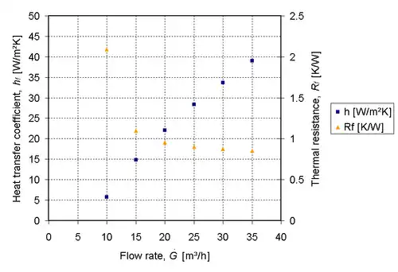

# 4.39 封装与热设计（二）热设计、仿真、可靠性与小结

> **前置知识**：[4.38 封装与热设计（一）封装类型、先进封装与电气特性](4.38-封装与热设计-封装技术.md)（承接上一章）。

> 本页为《封装与热设计》系列第 2/2 页。

## 1. 热设计基础

### 1.1 热传导基本方程

#### 6.1.1 傅里叶定律

热传导的基本定律——傅里叶定律（Fourier's Law）：

$$q = -k \cdot \frac{dT}{dx}$$

其中：
- $q$：热流密度（W/m²）
- $k$：热导率（W/m·K）
- $\frac{dT}{dx}$：温度梯度（K/m）

负号表示热量从高温向低温传递。

#### 6.1.2 热导率

不同封装材料的热导率：

| 材料 | 热导率 k (W/m·K) | 应用 |
|------|-----------------|------|
| 硅（Si） | 130~150 | 芯片衬底 |
| 铜（Cu） | 385~400 | 散热器、TSV填充 |
| 铝（Al） | 205~237 | 散热器 |
| 铝氮化物（AlN） | 170~200 | 陶瓷基板 |
| 氧化铝（Al₂O₃） | 24~30 | 陶瓷基板 |
| 有机基板（FR-4） | 0.3~0.5 | PCB |
| 模塑料 | 0.6~1.5 | 塑封料 |
| 导热膏（TIM） | 1~12 | 热界面材料 |
| 液态金属 | 30~80 | 高级TIM |
| 空气 | 0.026 | — |

#### 6.1.3 热阻模型

一维稳态热传导的热阻：

$$R_{th} = \frac{L}{k \cdot A} \quad (\text{K/W 或 °C/W})$$

其中：
- $L$：传热路径长度（m）
- $k$：热导率（W/m·K）
- $A$：传热截面积（m²）

类比电路欧姆定律：

$$\Delta T = P \cdot R_{th}$$

其中 $P$ 为功耗（W），$\Delta T$ 为温差（°C 或 K）。

多层结构的热阻串联：

$$R_{th,total} = \sum_{i=1}^{n} R_{th,i} = \sum_{i=1}^{n} \frac{L_i}{k_i \cdot A_i}$$

### 1.2 芯片热阻网络

芯片到环境的热传递路径可以建模为热阻网络：

$$T_j = T_a + P \cdot R_{th(j-a)}$$

其中：
- $T_j$：芯片结温（Junction Temperature）
- $T_a$：环境温度（Ambient Temperature）
- $P$：芯片功耗（W）
- $R_{th(j-a)}$：结到环境的总热阻（°C/W）

#### 6.2.1 各级热阻

总热阻由多级热阻串联组成：

$$R_{th(j-a)} = R_{th(j-c)} + R_{th(c-s)} + R_{th(s-a)}$$

其中：
- $R_{th(j-c)}$：结到壳（Case）热阻 — 芯片内部热阻
- $R_{th(c-s)}$：壳到散热器（Sink）热阻 — TIM 热阻
- $R_{th(s-a)}$：散热器到环境热阻 — 散热器热阻

典型热阻值：

| 热阻 | 典型值 | 说明 |
|------|--------|------|
| Rth(j-c) | 0.1~5 °C/W | 取决于芯片面积和封装 |
| Rth(c-s) | 0.1~1.0 °C/W | TIM 质量和厚度 |
| Rth(s-a) | 0.5~20 °C/W | 散热器类型和风速 |

### 1.3 热设计指标

#### 6.3.1 最大结温

半导体器件的最大允许结温：

| 器件类型 | 最大结温 | 典型工作结温 |
|---------|---------|-------------|
| 商用级 | 70~85°C | 25~70°C |
| 工业级 | 105~125°C | -40~85°C |
| 汽车级 | 125~150°C | -40~125°C |
| 军工级 | 150~200°C | -55~125°C |

硅器件的失效率与结温的关系（Arrhenius 模型）：

$$MTBF \propto \exp\left(\frac{E_a}{k_B \cdot T_j}\right)$$

其中 $E_a$ 为激活能（典型 0.3~1.0 eV），$k_B$ 为玻尔兹曼常数。经验法则：结温每升高 10°C，失效率约翻倍。

#### 6.3.2 热阻参数

封装热阻的标准测试条件由 JEDEC 标准定义：

- **θJA（θ_JA）**：结到环境热阻，取决于 PCB 布局和气流条件
- **θJC（θ_JC）**：结到壳热阻，主要取决于封装内部结构
- **ΨJT（Psi-JT）**：结到封装顶部特征热阻，用于估算结温

实际结温估算：

$$T_j = T_{case} + P \cdot \theta_{JC}$$

$$T_j \approx T_{top} + P \cdot \Psi_{JT}$$

#### 6.3.3 功耗密度

随着工艺进步，芯片功耗密度持续攀升：

| 年代 | 工艺节点 | 芯片面积 | 功耗 | 功耗密度 |
|------|---------|---------|------|---------|
| 2005 | 90nm | 100mm² | 10W | 0.1 W/mm² |
| 2010 | 32nm | 150mm² | 50W | 0.33 W/mm² |
| 2015 | 16nm | 200mm² | 100W | 0.5 W/mm² |
| 2020 | 7nm | 400mm² | 300W | 0.75 W/mm² |
| 2024 | 3nm | 500mm² | 500W+ | 1.0 W/mm² |

芯片功耗密度已接近核反应堆的功率密度水平（~1 W/mm²），散热挑战巨大。

## 2. 热管理技术

### 2.1 散热器（Heat Sink）

散热器通过增大与空气接触的表面积来增强热传导。

#### 7.1.1 自然对流 vs 强制对流

| 散热方式 | 换热系数 h (W/m²·K) | 特点 |
|---------|---------------------|------|
| 自然对流 | 5~25 | 无风扇，静音，散热能力有限 |
| 强制对流（低速） | 25~100 | 风扇 1~3 m/s |
| 强制对流（高速） | 100~500 | 风扇 > 5 m/s |
| 液冷 | 1000~10000 | 高效散热，需要冷却系统 |

散热器热阻：

$$R_{th(s-a)} = \frac{1}{h \cdot A_{eff}}$$

其中 $A_{eff}$ 为散热器有效散热面积（包括翅片面积）。

下图展示了特定散热器设计的热阻随气流流量变化的关系曲线——流量增大先快速降低热阻，之后趋于平缓：

#### 7.1.2 散热器材质选择

| 材质 | 热导率 (W/m·K) | 密度 (g/cm³) | 成本 | 特点 |
|------|----------------|-------------|------|------|
| 铝合金（6063） | 180~200 | 2.7 | 低 | 轻量，易加工 |
| 纯铜 | 385~400 | 8.9 | 高 | 导热优，重量大 |
| 铜底座+铝翅片 | 综合 | — | 中 | 性价比方案 |
| 均热板+铝翅片 | 等效 >1000 | — | 高 | 高性能方案 |
| 热管散热器 | 等效 >5000 | — | 中高 | 超高效散热 |

### 2.2 热界面材料（TIM）

热界面材料填充芯片/散热器之间的微观空隙，消除空气间隙（空气热导率仅 0.026 W/m·K）。

#### 7.2.1 TIM分类

| TIM类型 | 热导率 (W/m·K) | 厚度 | 特点 |
|---------|----------------|------|------|
| TIM1（芯片背面→散热器） | | | |
| 导热膏（Thermal Paste） | 3~8 | 50~100μm | 最常用，需定期更换 |
| 导热垫（Thermal Pad） | 1~5 | 0.1~3mm | 方便安装，可重复使用 |
| 相变材料（PCM） | 2~6 | 50~200μm | 常温固态，高温液化 |
| 液态金属（LM） | 30~80 | 25~100μm | 超高导热，需密封 |
| TIM2（基板→散热器） | | | |
| 导热凝胶 | 1~5 | 50~500μm | 可填充大间隙 |

TIM 的热阻：

$$R_{TIM} = \frac{t_{BLT}}{k_{TIM} \cdot A}$$

其中 $t_{BLT}$ 为键合层厚度（Bond Line Thickness）。

#### 7.2.2 液态金属

液态金属（如 GaInSn 合金）是新一代 TIM 材料：

- 热导率：30~80 W/m·K（是传统导热膏的 5~10 倍）
- 使用温度范围：-20~120°C（室温下为液态）
- 挑战：与铝的液态金属脆化（需使用镍镀层保护）、导电性（短路风险）

### 2.3 芯片级散热

#### 7.3.1 热通孔（Thermal Via）

在封装基板和 PCB 中制作填充铜的通孔，将热量从芯片区域传导到背面或内层铜平面：

$$R_{th,via} = \frac{L}{k_{Cu} \cdot \pi \cdot r^2 \cdot N}$$

其中 $N$ 为热通孔数量。

典型热通孔参数：
- 直径：0.3mm
- 间距：1.0~1.2mm
- 填充：铜或锡
- 数量：数十到数百个

#### 7.3.2 背面减薄

芯片背面减薄可以显著降低结到壳的热阻：

$$\Delta R_{th} = \frac{\Delta t}{k_{Si} \cdot A_{chip}}$$

例如：硅芯片从 775μm 减薄到 100μm，热阻降低约：

$$\Delta R_{th} = \frac{(775 - 100) \times 10^{-6}}{150 \times A_{chip}} = \frac{4.5 \times 10^{-6}}{A_{chip}} \text{ K/W}$$

对于 100mm² 的芯片，热阻降低约 0.045°C/W。

#### 7.3.3 微通道液冷

微通道液冷（Microchannel Cooling）在芯片背面或中介层中制作微米级流体通道：

- 通道尺寸：50~200μm 宽，200~500μm 深
- 冷却液：去离子水
- 换热系数：可达 10⁴~10⁵ W/m²·K
- 散热能力：> 1 kW/cm²（实验室演示）

微通道液冷的热阻：

$$R_{th,micro} = \frac{1}{h_{micro} \cdot A_{channel}} + \frac{t_{Si}}{k_{Si} \cdot A_{channel}}$$

### 2.4 系统级散热

#### 7.4.1 风扇散热

风扇的性能参数：
- **风量（CFM）**：立方英尺/分钟
- **风压（mmH₂O）**：克服系统阻力
- **噪声（dBA）**：与转速的 5 次方成正比

风扇选型需匹配系统阻抗曲线：

$$\Delta P = K \cdot Q^2$$

其中 $K$ 为系统阻力系数，$Q$ 为风量。

#### 7.4.2 液冷散热

液冷散热系统组成：
1. 冷板（Cold Plate）：贴合在芯片表面
2. 循环泵：驱动冷却液流动
3. 散热器/冷却塔：将热量散发到环境
4. 冷却液：去离子水或乙二醇混合液

液冷 vs 风冷对比：

| 参数 | 风冷 | 液冷 |
|------|------|------|
| 散热能力 | < 200W | > 1000W |
| 换热系数 | 10~100 W/m²·K | 1000~10000 W/m²·K |
| 噪声 | 高（风扇） | 低（泵噪声小） |
| 重量 | 轻 | 重 |
| 可靠性 | 高 | 存在泄漏风险 |
| 成本 | 低 | 高 |

#### 7.4.3 均热板（Vapor Chamber）

均热板利用工质的蒸发-冷凝循环实现高效热扩散：

工作原理：
1. **蒸发段**：热源处工质蒸发吸热
2. **蒸汽段**：蒸汽扩散到整个腔体
3. **冷凝段**：蒸汽在远离热源处冷凝放热
4. **回流段**：毛细结构将液体回流到蒸发段

均热板的等效热导率：

$$k_{eff} = \frac{Q \cdot L}{A \cdot \Delta T} \approx 5000 \sim 20000 \text{ W/m}{\cdot}\text{K}$$

是铜的 10~50 倍。

## 3. 热仿真与分析

### 3.1 热仿真工具

| 工具 | 开发商 | 特点 |
|------|--------|------|
| FloTHERM | Siemens (Mentor) | 电子热管理专用，快速建模 |
| Icepak | ANSYS | 基于 Fluent CFD，精度高 |
| ANSYS Mechanical | ANSYS | 结构热耦合分析 |
| COMSOL | COMSOL | 多物理场仿真 |
| OpenFOAM | 开源 | 免费 CFD 求解器 |

### 3.2 热仿真流程

1. **几何建模**：建立封装/系统的 3D 几何模型
2. **材料属性**：定义各层材料的热导率、比热容、密度
3. **边界条件**：设定功耗分布、环境温度、对流条件
4. **网格划分**：对几何模型进行网格离散化
5. **求解计算**：求解热传导方程
6. **后处理**：温度分布、热流路径、热点分析

稳态热传导方程：

$$\nabla \cdot (k \cdot \nabla T) + q_v = 0$$

瞬态热传导方程：

$$\rho \cdot c_p \cdot \frac{\partial T}{\partial t} = \nabla \cdot (k \cdot \nabla T) + q_v$$

其中 $\rho$ 为密度，$c_p$ 为比热容，$q_v$ 为体积热源。

### 3.3 热点（Hot Spot）识别

热点是芯片表面温度显著高于平均温度的局部区域。热点温度：

$$T_{hotspot} = T_{avg} + \Delta T_{hotspot}$$

热点形成原因：
- 局部功耗密度高（如 ALU 区域）
- 散热路径不均匀
- 封装结构不对称

热点温差 $\Delta T_{hotspot}$ 通常为 5~30°C，严重时可达 50°C 以上。

### 3.4 热-电协同仿真

热-电协同仿真（Electro-Thermal Co-Simulation）同时考虑电性能和热效应的耦合：

$$T(x,y,z) \rightarrow \mu(T), V_{TH}(T), R(T) \rightarrow I(V,T) \rightarrow P(V,I) \rightarrow T(x,y,z)$$

协同仿真流程：
1. 电仿真提取功耗分布
2. 热仿真计算温度分布
3. 将温度反馈到电仿真模型
4. 迭代直至收敛

温度对器件参数的影响：

$$\mu(T) = \mu_0 \cdot \left(\frac{T}{T_0}\right)^{-n} \quad (n \approx 1.5 \sim 2.0)$$

$$V_{TH}(T) = V_{TH0} - \alpha \cdot (T - T_0) \quad (\alpha \approx 1 \sim 3 \text{ mV/°C})$$

$$I_{leak}(T) \propto T^2 \cdot \exp\left(-\frac{E_g}{2k_BT}\right)$$

## 4. 封装可靠性

### 4.1 热机械应力（CTE失配）

不同材料的热膨胀系数（CTE）差异在温度变化时产生热机械应力：

$$\sigma = E \cdot \Delta\alpha \cdot \Delta T$$

其中：
- $E$：弹性模量
- $\Delta\alpha$：CTE 差值
- $\Delta T$：温度变化量

典型 CTE 值：

| 材料 | CTE (ppm/°C) |
|------|-------------|
| 硅（Si） | 2.6 |
| GaAs | 5.7 |
| 铜（Cu） | 17 |
| 铝（Al） | 23 |
| 有机基板 | 15~18 |
| 模塑料 | 8~20 |
| 焊料（SAC305） | 22 |

硅芯片（2.6 ppm/°C）与有机基板（15~18 ppm/°C）之间的 CTE 失配是封装可靠性的主要威胁。

### 4.2 焊点疲劳

焊点在温度循环过程中承受周期性应力，导致疲劳裂纹萌生和扩展。

Coffin-Manson 疲劳模型：

$$N_f = C \cdot (\Delta\gamma)^{-n}$$

其中：
- $N_f$：失效循环次数
- $\Delta\gamma$：剪切应变范围
- $C, n$：材料常数（SAC305: $n \approx 2 \sim 3$）

温度循环条件（JEDEC 标准）：
- **Condition G**：-40°C ~ +125°C
- **Condition J**：-40°C ~ +85°C
- 循环速率：10~15 次/天

### 4.3 翘曲（Warpage）

封装在制造和使用过程中的翘曲变形：

翘曲原因：
1. CTE 失配导致的不均匀热膨胀
2. 固化收缩（模塑料）
3. 残余应力（工艺过程）

翘曲量估算：

$$\delta = \frac{3 \cdot \Delta\alpha \cdot \Delta T \cdot L^2}{4 \cdot (t_1 + t_2)}$$

其中 $L$ 为封装尺寸，$t_1, t_2$ 为各层厚度。

翘曲过大会导致：
- 焊点开裂
- 芯片裂纹
- 分层（Delamination）

### 4.4 湿气敏感性（MSL等级）

塑封封装会吸收环境湿气，在回流焊高温时湿气急剧膨胀导致"爆米花"效应（Popcorn Effect）。

JEDEC MSL（Moisture Sensitivity Level）等级：

| MSL等级 | 车间寿命 | 测试条件 | 说明 |
|---------|---------|---------|------|
| MSL 1 | 无限 | 30°C/85%RH | 不受湿气影响 |
| MSL 2 | 1年 | 30°C/60%RH | 低敏感 |
| MSL 3 | 168小时 | 30°C/60%RH | 中敏感 |
| MSL 4 | 72小时 | 30°C/60%RH | 较高敏感 |
| MSL 5 | 48小时 | 30°C/60%RH | 高敏感 |
| MSL 5a | 24小时 | 30°C/60%RH | 很高敏感 |
| MSL 6 | 使用前烘烤 | 30°C/60%RH | 极高敏感 |

"爆米花"效应的机理：

1. 塑封料吸湿（典型吸湿率 0.1~0.3%）
2. 回流焊时温度急剧升高（240~260°C）
3. 湿气在芯片/基板界面汽化膨胀
4. 蒸汽压力超过界面粘附力
5. 发生分层（Delamination）

预防措施：
- 使用低吸湿率材料
- 增加界面粘附力
- 设置排气通道
- 严格控制车间寿命

## 小结

封装与热设计是微电子系统中至关重要的工程领域。本章的核心要点如下：

1. **封装技术演进**：从 DIP 到 2.5D/3D 先进封装，封装从单纯的"保护壳"演变为系统集成的核心平台。先进封装（CoWoS、Fan-Out、Hybrid Bonding）正在成为延续摩尔定律的关键路径。

2. **封装类型选择**：引线键合成本低但寄生参数大；倒装芯片性能优但需要底部填充；BGA 适合高 I/O 应用；WLCSP 尺寸最小但 I/O 受限；2.5D/3D 封装性能最优但成本最高。

3. **封装电气特性**：封装引入的寄生电感（~1nH/mm）、电容（~0.1pF）和电阻（~10mΩ）对高速信号完整性和电源完整性产生显著影响，需要在设计阶段精确建模。

4. **热设计基础**：傅里叶定律和热阻模型是热分析的基础。芯片结温必须控制在最大允许值以下：$T_j = T_a + P \cdot R_{th(j-a)} \leq T_{j,max}$。

5. **热管理技术**：从导热膏到液冷，从散热翅片到均热板，热管理技术的选择取决于功耗密度和系统约束。芯片级散热（热通孔、背面减薄、微通道）与系统级散热（风扇、液冷）需要协同优化。

6. **可靠性保障**：CTE 失配、焊点疲劳、翘曲和湿气敏感性是封装可靠性的四大挑战，需要通过材料选择、结构优化和工艺控制来保证产品寿命。

封装与热设计是一个多学科交叉的领域，涉及材料科学、固体力学、传热学、电磁学等多个学科。随着异构集成和 Chiplet 架构的兴起，先进封装正成为半导体产业最重要的技术方向之一。

## 自测清单

1. 「热设计基础」要解决的核心问题是什么？关键结论或公式是什么？
2. 「热管理技术」与上一节之间是什么关系？
3. 「热仿真与分析」在什么场景下会用到？如果条件改变，结论会如何变化？
4. 能否不看正文，写出「封装可靠性」的关键流程或结构？
5. 「热传导基本方程」最容易混淆的点是什么？

---

**下一章**：[4.40 数据转换器 IC 设计（一）概述与比较器](../数据转换器IC设计/4.40-数据转换器-概述与比较器.md)
