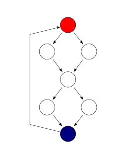

# 4.25 形式验证深入（二）模型检查

> **前置知识**：[4.24 形式验证深入（一）概述与等价性检查](4.24-形式验证-概述与等价性.md)（承接上一章）。

> 本页为《形式验证深入》系列第 2/5 页。

## 1. 模型检查（Model Checking）

### 1.1 模型检查原理

模型检查是形式验证的核心方法之一，其基本思想是将设计建模为一个状态迁移系统，并验证该系统是否满足给定时序逻辑性质。

**Kripke结构**：

设计被形式化为Kripke结构 $M = (S, S_0, R, L)$，其中：

- $S$：状态集合（有限）
- $S_0 \subseteq S$：初始状态集合
- $R \subseteq S \times S$：状态迁移关系，要求 $\forall s \in S, \exists s' \in S : (s, s') \in R$（全性）
- $L : S \to 2^{AP}$：标记函数，将每个状态映射到一组原子命题（AP）的真值

**模型检查问题**：

$$M, s_0 \models \varphi \quad ?$$

即从初始状态 $s_0$ 出发，模型 $M$ 是否满足性质 $\varphi$。

```
┌─────────────────────────────────────────────┐
│                Kripke结构示例                 │
│                                              │
│    S0 ────► S1 ────► S2                      │
│    │                  │                      │
│    │      AP={req}    │      AP={ack,req}    │
│    ▼                  ▼                      │
│    S3 ◄──── S4 ◄──── S5                      │
│           │                                  │
│           │      AP={idle}                   │
│           ▼                                  │
│    S6 ────► S0  (循环回初始)                  │
│                                              │
│    性质 φ: G(req -> F ack)                  │
│    "一旦req有效，最终必有ack"                 │
└─────────────────────────────────────────────┘
```

Kripke结构可视化示例如下，每个状态带有原子命题标记，并通过迁移关系连接起来：


### 1.2 时序逻辑

时序逻辑用于描述系统在时间维度上的性质。主要有两类：

#### 4.2.1 线性时序逻辑（LTL）

LTL将时间视为**线性序列**，每个状态只有一个后继。LTL公式语法：

$$\varphi ::= p \mid \neg \varphi \mid \varphi \wedge \varphi \mid \mathbf{X} \varphi \mid \mathbf{G} \varphi \mid \mathbf{F} \varphi \mid \varphi \mathbf{U} \varphi$$

**算子含义**：

| 算子 | 名称 | 语义 | SVA对应 | 含义 |
|------|------|------|---------|------|
| $\mathbf{X} \varphi$ | neXt | $\pi \models \mathbf{X}\varphi \iff \pi[1..] \models \varphi$ | `nexttime` | 下一时刻满足 $\varphi$ |
| $\mathbf{G} \varphi$ | Globally | $\pi \models \mathbf{G}\varphi \iff \forall i \geq 0 : \pi[i..] \models \varphi$ | `always` | 所有时刻满足 $\varphi$ |
| $\mathbf{F} \varphi$ | Finally | $\pi \models \mathbf{F}\varphi \iff \exists i \geq 0 : \pi[i..] \models \varphi$ | `s_eventually` | 某时刻满足 $\varphi$ |
| $\varphi_1 \mathbf{U} \varphi_2$ | Until | $\exists j \geq 0 : \pi[j..] \models \varphi_2 \wedge \forall 0 \leq i < j : \pi[i..] \models \varphi_1$ | `until_with` | 直到 $\varphi_2$ 成立前 $\varphi_1$ 始终成立 |

**典型LTL性质**：

- **安全性**（Safety）：$\mathbf{G}(p \to \neg q)$ —— "p成立时q不成立"
- **活性**（Liveness）：$\mathbf{G}(p \to \mathbf{F} q)$ —— "p成立则最终q成立"
- **公平性**（Fairness）：$\mathbf{GF} p$ —— "p无限多次成立"

#### 4.2.2 计算树逻辑（CTL）

CTL将时间视为**树形分支**，每个状态可能有多个后继，可表达"存在路径"或"所有路径"的性质。

**CTL语法**：

$$\varphi ::= p \mid \neg \varphi \mid \varphi \wedge \varphi \mid \mathbf{E}\mathbf{X}\varphi \mid \mathbf{E}\mathbf{G}\varphi \mid \mathbf{E}\varphi_1\mathbf{U}\varphi_2 \mid \mathbf{A}\mathbf{X}\varphi \mid \mathbf{A}\mathbf{G}\varphi \mid \mathbf{A}\varphi_1\mathbf{U}\varphi_2$$

**路径量词**：

- $\mathbf{A}$（All）：所有路径满足
- $\mathbf{E}$（Exists）：存在路径满足

**典型CTL公式**：

| 公式 | 含义 |
|------|------|
| $\mathbf{AG} \varphi$ | 所有路径上所有状态都满足 $\varphi$（不变性） |
| $\mathbf{EF} \varphi$ | 存在路径可达到满足 $\varphi$ 的状态（可达性） |
| $\mathbf{AF} \varphi$ | 所有路径最终都达到满足 $\varphi$ 的状态（必然性） |
| $\mathbf{EG} \varphi$ | 存在路径一直满足 $\varphi$（保持性） |
| $\mathbf{A}(p \mathbf{U} q)$ | 所有路径上 $p$ 一直成立直到 $q$ 成立 |

#### 4.2.3 LTL vs CTL对比

| 对比维度 | LTL | CTL |
|----------|-----|-----|
| 时间模型 | 线性 | 分支 |
| 路径量词 | 隐含全称 | 显式A/E |
| 表达能力 | 不相交于CTL | 不相交于LTL |
| 表达"存在路径" | 不能 | 能（E算子） |
| 表达"任意路径" | 能 | 能（A算子） |
| 模型检查复杂度 | $O(2^{|\varphi|} \cdot |S|)$（指数于公式） | $O(|\varphi| \cdot (|S|+|R|))$（线性于公式） |
| 在SVA中支持 | 是（通过SVA） | 否 |
| 在硬件验证中应用 | 广泛（SVA） | 较少（理论分析） |

### 1.3 属性规约（Property Specification）

#### 4.3.1 SVA（SystemVerilog Assertions）基础

SVA是SystemVerilog内建的断言语言，是工业界事实标准的属性描述语言。

**SVA断言分类**：

| 类型 | 关键字 | 触发方式 | 适用场景 |
|------|--------|----------|----------|
| 立即断言（Immediate） | `assert` | 过程执行 | 过程块中的即时检查 |
| 并发断言（Concurrent） | `assert property` | 时钟驱动 | 协议、时序属性 |
| 覆盖断言（Cover） | `cover property` | 时钟驱动 | 覆盖率统计 |

**基础算子**：

| 算子 | 含义 | LTL对应 |
|------|------|---------|
| `##n` | 延迟n个时钟周期 | $\mathbf{X}^n$ |
| `##[a:b]` | 延迟a到b个周期 | - |
| `[*n]` | 重复n次 | - |
| `[=n]` | 非连续重复n次 | - |
| `|->` | 非重叠蕴含 | - |
| `|=>` | 重叠蕴含 | - |
| `not` | 否定 | $\neg$ |
| `and/or` | 与/或 | $\wedge / \vee$ |
| `until_with` | 直到 | $\mathbf{U}$ |
| `s_eventually` | 最终 | $\mathbf{F}$ |

#### 4.3.2 SVA并发断言

```systemverilog
// ========== SVA并发断言示例 ==========

// 1. 简单安全性：req有效时，ack必须在1~3周期内有效
property p_req_ack;
    @(posedge clk) disable iff (!rst_n)
    $rose(req) |-> ##[1:3] ack;
endproperty
a_req_ack : assert property (p_req_ack);

// 2. 活性：一旦valid有效，最终必须得到ready响应
property p_valid_ready;
    @(posedge clk) disable iff (!rst_n)
    $rose(valid) |-> s_eventually ready;
endproperty
a_valid_ready : assert property (p_valid_ready);

// 3. 互斥性：grant0和grant1不能同时有效
property p_mutex_grant;
    @(posedge clk) disable iff (!rst_n)
    not (grant0 && grant1);
endproperty
a_mutex : assert property (p_mutex_grant);

// 4. FIFO满标志正确性：当且仅当写指针+1等于读指针时，full有效
property p_fifo_full;
    @(posedge clk) disable iff (!rst_n)
    (wr_ptr + 1'b1 == rd_ptr) == full;
endproperty
a_fifo_full : assert property (p_fifo_full);

// 5. AXI写响应正确性：BVALID必须在AWVALID和WVALID之后
sequence s_aw_handshake;
    @(posedge clk) $rose(awvalid) ##1 awready;
endsequence

sequence s_w_handshake;
    @(posedge clk) $rose(wvalid) ##1 wready;
endsequence

property p_axi_bvalid;
    @(posedge clk) disable iff (!rst_n)
    s_aw_handshake and s_w_handshake |-> ##[1:5] bvalid;
endproperty
a_axi_bvalid : assert property (p_axi_bvalid);

// 6. 状态机死锁检测：不能在S_WAIT状态停留超过100周期
property p_no_deadlock;
    @(posedge clk) disable iff (!rst_n)
    (state == S_WAIT) |-> ##[1:100] (state != S_WAIT);
endproperty
a_no_deadlock : assert property (p_no_deadlock);

// 7. 覆盖断言：统计协议握手发生次数
cover property (@(posedge clk) disable iff (!rst_n)
    (valid && ready)) $display("Covered: handshake at time %0t", $time);
```

#### 4.3.3 PSL（Property Specification Language）

PSL是IEEE 1850标准定义的属性规约语言，与SVA功能类似，但语法和语义略有不同。

```psl
// PSL示例
vunit fifo_properties (fifo_dut) {
    // 默认时钟
    default clock = (posedge clk);

    // 满标志正确性
    assert always (wr_ptr + 1 == rd_ptr) -> full;

    // 不下溢
    assert always !(rd_en && empty);

    // 公平性：只要req持续有效，最终得到grant
    assert always eventually! (req -> grant);
}
```

### 1.4 模型检查算法

#### 4.4.1 显式状态遍历

最朴素的模型检查方法，显式枚举所有可达状态并检查性质。

**算法步骤**：

1. 从初始状态集 $S_0$ 开始
2. 使用广度优先搜索（BFS）/深度优先搜索（DFS）枚举所有可达状态
3. 对每个状态检查是否满足性质

**复杂度**：$O(|S| \cdot |R|)$，其中 $|S|$ 为状态数，$|R|$ 为迁移数。

**问题**：状态空间爆炸。对于 $n$ 个状态变量，$|S| = 2^n$。

显式状态遍历通常基于设计的**控制流图**（CFG）展开，控制流图既刻画了程序/设计的控制结构，也决定了可遍历的状态迁移关系：



#### 4.4.2 符号模型检查（BDD-based）

符号模型检查使用**二元决策图**（BDD）隐式表示状态集合和迁移关系，能够处理更大规模的状态空间。

二元决策图以紧凑的图形化结构表示布尔函数，同一布尔函数可被规范化表示为唯一的BDD：


**核心思想**：

- 状态集合 $S$ 用特征函数 $\chi_S(\vec{x})$ 表示
- 迁移关系 $R$ 用特征函数 $\chi_R(\vec{x}, \vec{x}')$ 表示
- 像集计算：$\chi_{\text{post}(S)}(\vec{x}') = \exists \vec{x} : \chi_S(\vec{x}) \wedge \chi_R(\vec{x}, \vec{x}')$

**前向可达性分析**：

$$S_{i+1} = S_i \cup \text{Post}(S_i)$$

迭代直到 $S_{i+1} = S_i$（不动点），得到所有可达状态 $\text{Reach}(S_0)$。

**安全性检查**：

$$\text{Safe} \iff \text{Reach}(S_0) \cap \text{Bad} = \emptyset$$

其中 $\text{Bad}$ 为违反性质的状态集合。

**CTL模型检查算法**（局部计算）：

```
Check(φ):
    case φ = p (atomic):      return {s | p ∈ L(s)}
    case φ = ¬ψ:              return S \ Check(ψ)
    case φ = ψ1 ∧ ψ2:         return Check(ψ1) ∩ Check(ψ2)
    case φ = EX ψ:            return Pre∃(Check(ψ))
    case φ = EG ψ:            return GFP(λX. Check(ψ) ∩ Pre∃(X))
    case φ = ψ1 EU ψ2:        return LFP(λX. Check(ψ2) ∪ (Check(ψ1) ∩ Pre∃(X)))
```

其中 LFP/GFP 分别为最小/最大不动点。

#### 4.4.3 有界模型检查（BMC, SAT-based）

BMC将模型检查问题转换为**布尔可满足性问题**（SAT），在有限步长 $k$ 内验证性质。

**核心思想**：

将"长度为 $k$ 的路径上性质 $\varphi$ 不成立"编码为布尔公式：

$$\llbracket M, \varphi \rrbracket_k = \llbracket M \rrbracket_k \wedge \llbracket \neg \varphi \rrbracket_k$$

其中：
- $\llbracket M \rrbracket_k$：长度为 $k$ 的路径约束（初始状态 + $k$ 步迁移）
- $\llbracket \neg \varphi \rrbracket_k$：性质 $\varphi$ 在 $k$ 步内不成立的约束

如果上述公式可满足，则找到了长度为 $k$ 的反例；否则需要增大 $k$ 重试。

**路径展开**：

$$\llbracket M \rrbracket_k = I(s_0) \wedge \bigwedge_{i=0}^{k-1} T(s_i, s_{i+1})$$

其中 $I$ 为初始条件，$T$ 为迁移关系。

**LTL的BMC编码**（带循环回放）：

$$\llbracket \neg \varphi \rrbracket_k^l = \bigvee_{l=0}^{k-1} \left( \bigwedge_{i=0}^{k-1} (l \neq i) \wedge T(s_{k-1}, s_l) \wedge \llbracket \neg \varphi \rrbracket_{k,l}^{loop} \right)$$

**BMC算法**：

```
BMC(M, φ, K_max):
    for k = 0 to K_max:
        formula = encode(M, ¬φ, k)
        result = SAT_Solve(formula)
        if result == SAT:
            return Counterexample(extract_path(result))
    return "Unknown (bound reached)"
```

**对比表**：

| 算法 | 优点 | 缺点 | 适用场景 |
|------|------|------|----------|
| 显式状态遍历 | 简单直观 | 状态爆炸 | 小规模设计 |
| 符号模型检查（BDD） | 处理大规模状态空间 | BDD变量序敏感，可能爆炸 | 中等规模 |
| 有界模型检查（BMC/SAT） | 反例短，易调试 | 仅证明有限步内无错 | 找bug、找短反例 |
| $k$-归纳（k-Induction） | 可证明性质 | 需要合适的不变式 | 完整性证明 |
| IC3/PDR | 高效证明 | 实现复杂 | 大规模安全性证明 |

### 1.5 反例生成（Counterexample）

当性质违反时，模型检查器生成**最小反例**，即违反性质的最短状态序列。

**反例结构**：

```
S0 → S1 → S2 → ... → Sk
│                       │
└─────(循环回放)────────┘
```

**反例分类**：

| 类型 | 形式 | 对应性质 |
|------|------|----------|
| 有限反例 | $s_0 \to s_1 \to \dots \to s_k$（到达坏状态） | 安全性 |
| 循环反例 | $s_0 \to \dots \to s_l \to \dots \to s_k \to s_l$（无穷循环） | 活性 |

**反例在工具中的呈现**：

```
Counterexample Trace:
+-----+-----+-----+-----+-----+-----+
| Clk | req | ack | grant | state  |
+-----+-----+-----+-----+-----+-----+
|  0  |  0  |  0  |  0  | IDLE   |  ← Initial state
|  1  |  1  |  0  |  0  | WAIT   |  ← req asserted
|  2  |  1  |  0  |  0  | WAIT   |  ← No ack!
|  3  |  1  |  0  |  0  | WAIT   |  ← Still no ack!
| ... | ... | ... | ... | ...    |
+-----+-----+-----+-----+-----+-----+
Violation: Property "req -> eventually ack" failed
```

### 1.6 模型检查工具

| 工具 | 厂商 | 特点 | 适用场景 |
|------|------|------|----------|
| **VC Formal** | Synopsys | 集成于Verdi调试环境，App丰富 | 综合应用 |
| **JasperGold** | Cadence | 易用，可视化好 | 控制逻辑、协议 |
| **Questa Formal** | Siemens EDA | 集成Questa仿真平台 | 仿真+形式混合 |
| **SymbiYosys** | Open Source | 基于Yosys，开源 | 学习研究 |
| **NuSMV** | FBK-IRST | 学术研究工具 | 教学 |
| **ABC** | UC Berkeley | 综合与验证 | 学术研究 |

## 本章要点

- 模型检查（Model Checking）

## 自测清单

1. 「模型检查（Model Checking）」要解决的核心问题是什么？关键结论或公式是什么？
2. 「模型检查原理」与上一节之间是什么关系？
3. 「时序逻辑」在什么场景下会用到？如果条件改变，结论会如何变化？
4. 能否不看正文，写出「属性规约（Property Specification）」的关键流程或结构？
5. 「模型检查算法」最容易混淆的点是什么？

---

**下一章**：[4.26 形式验证深入（三）定理证明、符号仿真与断言验证](4.26-形式验证-定理证明与断言.md)
