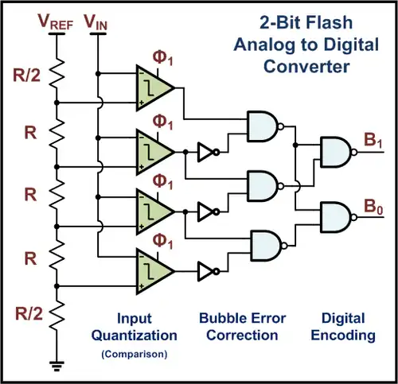

# 4.40 数据转换器 IC 设计（一）概述与比较器

> **本章定位**：连接模拟与数字的桥梁，系统学习 ADC/DAC 架构、校准与实现。

> **前置知识**：必需 [3.9 数模与模数转换](../../03-数字与计算机系统/数字电路/3.9-数模与模数转换.md) 与 [4.29–4.32 模拟 IC 设计](../模拟IC设计/4.29-运算放大器设计.md)。

> 本页为《数据转换器 IC 设计》系列第 1/4 页。

## 1. 引言

数据转换器是连接模拟世界与数字世界的核心桥梁。在自然界中，温度、压力、声音、图像等物理量均为连续变化的模拟信号，而现代信号处理、计算与存储却几乎全部依赖离散的数字系统。模数转换器（Analog-to-Digital Converter, ADC）与数模转换器（Digital-to-Analog Converter, DAC）承担着两类信号之间的相互转换，是混合信号SoC中不可或缺的关键IP核。

随着通信、多媒体、医疗电子、汽车雷达与人工智能等应用的快速发展，对数据转换器在分辨率、采样率、功耗、面积等维度上的要求日益严苛。在先进工艺节点下，器件本征增益下降、电源电压降低、匹配特性变差，使数据转换器的设计面临前所未有的挑战；与此同时，先进工艺带来的高速数字逻辑与高密度存储能力，也为数字辅助校准、后台校准等技术提供了新的机遇。

本章系统介绍数据转换器IC设计的核心内容，涵盖架构对比、高速比较器、SAR ADC、Pipeline ADC、ΣΔ ADC、DAC实现、校准技术以及时间交织ADC等关键主题，为读者建立完整的数据转换器IC设计知识体系。

---

## 2. 数据转换器IC设计概述

### 2.1 数据转换器在SoC中的地位

在现代SoC中，数据转换器承担"数字世界与模拟世界的桥梁"角色，其典型应用与指标需求如下：

| 应用领域 | 典型ADC规格 | 典型DAC规格 | 关键挑战 |
|---------|------------|------------|---------|
| 无线通信 | 12~16位, 100MS/s~1GS/s | 12~14位, 500MS/s~2GS/s | 线性度、带宽、功耗 |
| 音频处理 | 16~24位, 48~192kS/s | 16~24位, 48~192kS/s | SNR、THD+N |
| 医疗影像 | 14~16位, 20~80MS/s | — | 动态范围、低噪声 |
| 汽车雷达 | 8~12位, 1~5GS/s | — | 带宽、时间交织 |
| 数据采集 | 16~24位, 1k~1MS/s | — | 精度、INL/DNL |
| 视频显示 | 8~12位, 100~500MS/s | 10~12位, 500MS/s~2GS/s | 毛刺、建立时间 |

数据转换器在SoC中的典型占比：

| 指标 | 占比 | 说明 |
|------|------|------|
| 模拟面积 | 30%~60% | ADC/DAC中模拟部分占据主导 |
| 功耗 | 20%~50% | 高速转换器功耗显著 |
| 设计周期 | 30%~50% | 模拟迭代与版图匹配耗时 |

### 2.2 设计指标回顾

数据转换器的性能由一系列静态与动态指标衡量。

**（1）分辨率（Resolution, N）**

$$N = \log_2(2^N) \quad \text{（位）}$$

**（2）采样率（Sampling Rate, $f_s$）**

单位时间内的采样次数，单位为 Samples/s（S/s）。Nyquist采样定理要求：

$$f_s \geq 2 f_{in,max}$$

**（3）信号噪声比（SNR）**

理想N位ADC的量化噪声SNR：

$$SNR_{ideal} = 6.02N + 1.76 \quad \text{(dB)}$$

**（4）有效位数（ENOB）**

考虑实际噪声与失真后的等效位数：

$$ENOB = \frac{SNDR - 1.76}{6.02}$$

其中 $SNDR$ 为信号噪声失真比。

**（5）无杂散动态范围（SFDR）**

$$SFDR = 20\log_{10}\left(\frac{|V_{signal}|}{|V_{spur,max}|}\right) \quad \text{(dBc)}$$

**（6）积分非线性（INL）与微分非线性（DNL）**

$$DNL_k = \frac{V_{k+1} - V_k}{V_{LSB}} - 1$$

$$INL_k = \sum_{i=0}^{k-1} DNL_i$$

其中 $V_{LSB} = V_{FS}/2^N$ 为最小分辨电压。

**（7）总谐波失真（THD）**

$$THD = 20\log_{10}\left(\frac{\sqrt{\sum_{k=2}^{K} V_k^2}}{V_1}\right) \quad \text{(dB)}$$

### 2.3 ADC架构对比

不同ADC架构在速度、精度、功耗、面积等方面具有显著差异，适用于不同应用场景：

| ADC架构 | 分辨率范围 | 采样率范围 | 功耗 | 面积 | 典型应用 |
|---------|----------|----------|------|------|---------|
| **Flash（全并行）** | 4~8位 | 1~20 GS/s | 极高 | 极大 | 高速示波器、光通信 |
| **SAR** | 8~16位 | 1k~100 MS/s | 极低 | 小 | 便携设备、传感器 |
| **Pipeline** | 10~16位 | 10~500 MS/s | 中~高 | 中 | 通信、视频、成像 |
| **ΣΔ** | 16~24位 | 1k~10 MS/s | 低~中 | 中 | 音频、精密测量 |
| **Time-Interleaved** | 8~14位 | 1~100 GS/s | 极高 | 极大 | 高速采样、雷达 |
| **Two-Step/Subranging** | 8~12位 | 100M~1 GS/s | 中 | 中 | 通信中速段 |



**架构选择原则**：

- 高速低精度 → Flash 或 Time-Interleaved
- 中速中精度 → Pipeline 或 SAR
- 高精度低速 → ΣΔ
- 低功耗中精度 → SAR（先进工艺下优势显著）

### 2.4 DAC架构对比

| DAC架构 | 分辨率范围 | 采样率范围 | 功耗 | 面积 | 典型应用 |
|---------|----------|----------|------|------|---------|
| **电阻串（R-String）** | 4~10位 | 1k~100 MS/s | 低 | 中 | 低速、高单调性 |
| **R-2R梯形** | 8~16位 | 1k~50 MS/s | 中 | 小 | 通用、精密 |
| **电流舵（Current Steering）** | 8~16位 | 100M~10 GS/s | 高 | 大 | 高速通信、视频 |
| **开关电容（SC）** | 8~16位 | 1k~100 MS/s | 低 | 中 | 嵌入式SAR DAC |
| **ΣΔ DAC** | 16~24位 | 1k~10 MS/s | 低 | 中 | 音频 |

---

## 3. 高速比较器设计

### 3.1 比较器在ADC中的核心作用

比较器是ADC中实现"量化"功能的核心模块，其性能直接决定ADC的分辨率与速度。在不同ADC架构中，比较器的使用方式不同：

| ADC架构 | 比较器数量 | 比较器位数 | 关键要求 |
|---------|----------|-----------|---------|
| Flash ADC | $2^N-1$ | N位 | 低失调、高速 |
| SAR ADC | 1 | N位 | 低噪声、低回踢 |
| Pipeline ADC | 每级少量 | 每级少量 | 中等精度 |
| ΣΔ ADC | 1（量化器） | 1~3位 | 高速、低迟滞 |

### 3.2 连续时间比较器

连续时间比较器由开环高增益放大器构成，输出在连续时间内跟踪输入差值。其典型结构为差分对放大级联级：

```
                  VDD
                   │
              ┌────┴────┐
              │         │
        IN+ ─→ M1    M2 ←─ IN-
              │         │
              └────┬────┘
                   │
                  ISS
                   │
                  GND
```

**传递特性**：

$$V_{out} = A_v \cdot (V_{IN+} - V_{IN-})$$

**优点**：响应连续，无时钟馈通。

**缺点**：增益有限时分辨率受限；速度受负载电容限制。

### 3.3 离散时间比较器

离散时间比较器在时钟控制下完成比较，典型结构为预放大级 + 锁存级：

```
   Vin+ ─→ [预放大级] ─→ [锁存级] ─→ Q
   Vin- ─→
              ↑
            CLK
```

**两阶段工作**：

1. **复位/预放大阶段**（CLK低）：预放大级放大输入差值
2. **再生/锁存阶段**（CLK高）：正反馈锁存级将差值快速放大到逻辑电平

**优势**：可通过预放大降低输入失调，再生级提供高速判决。

### 3.4 钟摆比较器（Latched Comparator）

钟摆比较器（StrongARM Latch）是最经典的动态比较器结构，由交叉耦合的CMOS反相器构成正反馈锁存：

```
           VDD
         │     │
         M3   M4
          │   │
        ┌─┴───┴─┐
        │       │
   ┌────┤ 交叉  ├────┐
   │    │ 耦合  │    │
   M5   │       │   M6
   │    └───────┘    │
   │       │         │
   └──┬────┴────┬────┘
      M1       M2
      ↑         ↑
    Vin+      Vin-
      │         │
     CLK       CLK
```

**工作原理**：

1. **复位阶段**（CLK=0）：M5、M6关断，输出节点预充电至 $V_{DD}$
2. **比较阶段**（CLK=1）：M5、M6导通，差分对M1、M2根据 $V_{in+} - V_{in-}$ 决定放电速度，交叉耦合的M3、M4正反馈将输出锁定

**再生时间常数**：

$$\tau_{regen} = \frac{C_L}{g_{m,3,4}}$$

**分辨率时间**：

$$t_{res} = \tau_{regen} \cdot \ln\left(\frac{V_{DD}}{\Delta V_{in} \cdot A_{pre}}\right)$$

**优点**：动态功耗低（无静态电流），速度快。

**缺点**：输入失调较大；存在显著回踢噪声。

### 3.5 双尾比较器（Double-Tail Latched Comparator）

双尾比较器在StrongARM结构基础上引入两级尾电流，提高预放大增益并降低失调：

```
        VDD
         │
        M4  ← 上尾管（PMOS）
         │
     ┌───┴───┐
     │       │
    M3      M2  ← 交叉耦合对
     │       │
     └───┬───┘
         │
        M5  ← 下尾管（NMOS）
         │
     ┌───┴───┐
     │       │
    M1+     M1-  ← 输入对
     │       │
        GND
```

**优势**：

- 预放大与再生分离，输入对管尺寸可独立优化
- 输入失调比StrongARM降低约30%~50%
- 回踢噪声显著降低

**分辨率时间**：

$$t_{res,DT} \approx t_{pre} + t_{regen}$$

其中 $t_{pre}$ 为预放大时间，$t_{regen}$ 为再生时间。

### 3.6 再生比较器（Regenerative Comparator）

再生比较器基于交叉耦合反相器对（Cross-Coupled Inverter Pair）形成 bistable 锁存：

```
        ┌─────┐         ┌─────┐
   Q  ─→│ INV ├─┬─────→ │ INV ├─┐
        └─────┘ │       └─────┘ │
        ↑       └───────────────┘
        └───────────────────────┘
```

**再生方程**：

$$\frac{d\Delta V}{dt} = \frac{g_m}{C_L} \cdot \Delta V$$

解为指数增长：

$$\Delta V(t) = \Delta V_0 \cdot e^{t/\tau_{regen}}$$

### 3.7 比较器非理想效应

**（1）失调电压（Offset）**

比较器输入失调电压主要由器件失配引起：

$$\sigma_{V_{os}} \approx \frac{A_{VT}}{\sqrt{W \cdot L}}$$

其中 $A_{VT}$ 为阈值失配系数（典型值 2~5 mV·μm）。

**（2）回踢噪声（Kickback Noise）**

钟摆比较器在再生阶段，输出节点的电压跳变通过 $C_{GD}$ 耦合回输入端，干扰前级电路：

$$V_{kickback} \approx \frac{C_{GD}}{C_{GD} + C_{in}} \cdot \Delta V_{out}$$

**（3）亚稳态（Metastability）**

当输入差值极小时，比较器输出在判决时间内无法达到逻辑电平，称为亚稳态。亚稳态发生概率：

$$P_{meta} = \frac{V_{LSB}}{V_{DD}} \cdot e^{-t_{res}/\tau_{regen}}$$

**（4）分辨率时间（Resolution Time）**

分辨率时间是输入差值从初始值 $\Delta V_{in}$ 放大到逻辑阈值 $V_{logic}$ 所需时间：

$$t_{res} = \tau_{regen} \cdot \ln\left(\frac{V_{logic}}{\Delta V_{in} \cdot A_{pre}}\right)$$

输入越小，分辨率时间越长，呈对数发散。

### 3.8 比较器优化技术

**预放大级（Pre-Amplifier）**：

在锁存级前加入1~3级预放大，提高有效输入差值：

$$A_{total} = A_{pre,1} \cdot A_{pre,2} \cdot \cdots \cdot A_{latch}$$

**失调校准（Offset Calibration）**：

| 校准方法 | 原理 | 优点 | 缺点 |
|---------|------|------|------|
| 输入失调存储 | 比较器短接输入，将失调存储在电容上 | 简单 | 占用比较时间 |
| 输出失调存储 | 在输出节点存储失调 | 速度快 | 校准范围有限 |
| 数字辅助校准 | DAC注入校准电流/电压 | 灵活、精度高 | 需要数字逻辑 |

**降低回踢噪声**：

- 在输入与锁存级之间加入隔离级（如源极跟随器）
- 使用双尾结构
- 增加输入电容 $C_{in}$

---

## 本章要点

- 引言
- 数据转换器IC设计概述
- 高速比较器设计

## 自测清单

1. 「引言」要解决的核心问题是什么？关键结论或公式是什么？
2. 「数据转换器IC设计概述」与上一节之间是什么关系？
3. 「高速比较器设计」在什么场景下会用到？如果条件改变，结论会如何变化？
4. 能否不看正文，写出「数据转换器在SoC中的地位」的关键流程或结构？
5. 「设计指标回顾」最容易混淆的点是什么？

---

**下一章**：[4.41 数据转换器 IC 设计（二）SAR 与流水线 ADC](4.41-数据转换器-SAR与流水线.md)
