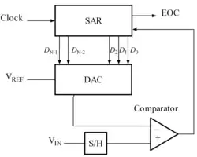

# 4.41 数据转换器 IC 设计（二）SAR 与流水线 ADC

> **前置知识**：必需 [3.9 数模与模数转换](../../03-数字与计算机系统/数字电路/3.9-数模与模数转换.md)、[4.29–4.32 模拟 IC 设计](../模拟IC设计/4.29-运算放大器设计.md) 与 [4.40 数据转换器 IC 设计（一）](4.40-数据转换器-概述与比较器.md)。

> 本页为《数据转换器 IC 设计》系列第 2/4 页。

## 1. SAR ADC IC实现

### 1.1 SAR ADC架构与工作原理

逐次逼近型ADC（Successive Approximation Register ADC）通过二分搜索算法实现模数转换，结构简洁、功耗低，是中速中精度应用的主流架构。



```
   Vin ─→ [S/H] ─→ [比较器] ─→ [SAR逻辑] ─→ D[N-1:0]
                 ↑       ↑
                 │       │
              [CDAC] ────┘
```

**二分搜索算法**：

1. 采样阶段：采样输入 $V_{in}$ 到CDAC
2. 第1位判决：MSB置1，CDAC输出 $V_{DAC} = V_{FS}/2$，比较 $V_{in}$ 与 $V_{DAC}$
3. 根据比较结果决定MSB值，再决定下一位
4. 重复N次完成N位转换

**转换时间**：

$$T_{conv} = N \cdot T_{cmp} + T_{sample}$$

其中 $T_{cmp}$ 为单次比较时间，$T_{sample}$ 为采样时间。

### 1.2 CDAC（电容DAC）设计

#### 3.2.1 二进制加权CDAC

二进制加权CDAC由 $N$ 个电容组成，电容值按2的幂次递减：

$$C_k = 2^{N-k} \cdot C_u, \quad k = 1, 2, \ldots, N$$

总电容：

$$C_{total} = \sum_{k=1}^{N} C_k + C_u = (2^N + 1) \cdot C_u$$

**优点**：结构简单，与SAR逻辑直接对应。

**缺点**：MSB电容为 $2^{N-1} C_u$，随分辨率增加指数增长，面积与功耗开销巨大。

**版图匹配**：

电容阵列采用共质心（Common Centroid）布局 + Dummy电容：

$$\sigma(\Delta C / C) \approx \frac{A_C}{\sqrt{W \cdot L}}$$

其中 $A_C$ 为电容失配系数（典型值 0.5%~1%·μm）。

#### 3.2.2 分段CDAC（Split Capacitor）

为缓解高分辨率CDAC的电容指数增长问题，将MSB段与LSB段采用"桥接电容"耦合：

```
   MSB段（高N1位）              LSB段（低N2位）
   C_M, C_{M-1}, ... C_1       C_L, ..., C_1
        │                            │
        └──────── C_bridge ──────────┘
```

**桥接电容值**：

$$C_{bridge} = \frac{C_{u,M} \cdot C_{u,L}}{C_{u,M} - C_{u,L}}$$

当 $C_{u,M} = 2^{N_2} C_{u,L}$ 时，$C_{bridge} = C_{u,L}$。

**优势**：电容总面积从 $O(2^N)$ 降为 $O(2^{N_1} + 2^{N_2})$。

**劣势**：桥接电容对失配敏感，需仔细匹配。

#### 3.2.3 C-2C结构

C-2C结构使用单位电容 $C_u$ 与 $2C_u$ 交替连接，电容值固定，匹配性好：

```
   Vin ─ C ─ C ─ C ─ ... ─ C ─ VDAC
        │   │   │         │
        2C  2C  2C       2C
        │   │   │         │
       bit bit bit       bit
       N-1 N-2 N-3        0
```

**优点**：所有电容均为 $C_u$ 或 $2C_u$，匹配性好，面积小。

**缺点**：寄生电容对精度影响显著，速度比二进制加权慢。

#### 3.2.4 CMOS开关电容考虑

**底板采样（Bottom-Plate Sampling）**：

为降低开关时钟馈通与沟道电荷注入，采用底板采样技术：

```
   Vin ──┬── R_on ──┬── Vc
         │          │
        φs         φsb（先关断）
         │          │
        GND        GND
```

底板开关（$\phi_{sb}$）先于顶板开关（$\phi_s$）关断，使沟道电荷注入到低阻抗地端，对采样电容影响最小。

**开关电阻**：

$$R_{on} = \frac{1}{\mu C_{ox} (W/L) (V_{GS} - V_{TH})}$$

**采样噪声（kT/C）**：

$$\sigma_{sample} = \sqrt{\frac{kT}{C_s}}$$

对于N位ADC，要求：

$$\sqrt{\frac{kT}{C_s}} < \frac{V_{FS}}{2^{N+1} \sqrt{12}}$$

即 $C_s > 12 \cdot kT \cdot 2^{2N+2} / V_{FS}^2$。

### 1.3 SAR逻辑设计

#### 3.3.1 同步SAR逻辑

同步SAR逻辑使用全局时钟驱动每一位转换：

```
   CLK ─→ [N位移位寄存器] ─→ [SAR控制] ─→ CDAC开关
                                     ↓
                                 [比较器输出] → 数据寄存器
```

**特点**：

- 每位转换时间固定为1个时钟周期
- 总转换时间 $T_{conv} = N \cdot T_{CLK}$
- 时钟频率 $f_{CLK} = N \cdot f_s$

#### 3.3.2 异步SAR逻辑（Asynchronous SAR）

异步SAR逻辑在每次比较完成后立即触发下一位，无需等待全局时钟：

```
   START ─→ [D触发器] ─→ [比较器] ─→ [Ready信号]
                              ↓              │
                              └───[反相延迟]─┘
                                              ↓
                                          下一位判决
```

**优势**：

- 转换速度由比较器自身速度决定，非固定时钟周期
- 不同位判决时间可不同（小差值时较长，大差值时较短）
- 平均转换速度比同步SAR提升 30%~50%

**劣势**：

- 设计复杂度增加
- 需要额外的"完成检测"电路
- 时钟抖动分析更复杂

### 1.4 比较器与CDAC的协同设计

SAR ADC性能取决于比较器与CDAC的协同：

| 协同参数 | 设计要点 |
|---------|---------|
| 比较器输入电容 | 应远小于CDAC最小单位电容 $C_u$ |
| CDAC建立时间 | 应小于比较器判决时间 |
| 比较器噪声 | 应小于1 LSB量化噪声 |
| 比较器失调 | 可通过校准消除 |

**比较器噪声预算**：

$$\sigma_{cmp}^2 < \frac{V_{LSB}^2}{12}$$

### 1.5 SAR ADC的非理想效应

**（1）电容失配（DNL/INL影响）**

电容失配直接传递到DAC输出，造成DNL/INL误差：

$$\sigma_{DNL} \approx \frac{\sqrt{2^N - 1}}{2^N} \cdot \frac{\sigma(\Delta C)}{C} \cdot 2^N \cdot V_{LSB}$$

$$\sigma_{INL,max} \approx \frac{\sigma(\Delta C)}{C} \cdot 2^{N-1} \cdot V_{LSB}$$

**（2）比较器噪声**

比较器输入噪声导致判决不确定，等效为量化噪声叠加：

$$SNR_{noise} = 20\log_{10}\left(\frac{V_{FS}/(2\sqrt{2})}{\sqrt{\sigma_q^2 + \sigma_{cmp}^2}}\right)$$

**（3）采样开关非理想性**

- **开关电阻非线性**：CMOS开关导通电阻随输入电压变化，引入谐波失真
- **时钟馈通**：开关时钟通过 $C_{GD}$ 耦合到采样节点
- **沟道电荷注入**：开关关断时沟道电荷注入采样电容

### 1.6 设计实例（10位1MS/s SAR ADC）

**规格定义**：

| 参数 | 指标 |
|------|------|
| 分辨率 | 10位 |
| 采样率 | 1 MS/s |
| 电源电压 | 1.2 V |
| SNR | ≥ 60 dB |
| ENOB | ≥ 9.5位 |
| DNL/INL | < ±0.5 LSB |
| 功耗 | < 1 mW |

**设计选择**：

- **架构**：异步SAR
- **CDAC**：分段结构，MSB 5位 + LSB 5位 + 桥接电容
- **单位电容**：$C_u = 50$ fF（满足kT/C噪声 < 1/4 LSB）
- **比较器**：双尾动态比较器 + 输入失调校准
- **采样开关**：底板采样 + CMOS互补开关

**关键计算**：

- 量化噪声：$V_{LSB} = 1.2/1024 \approx 1.17$ mV
- kT/C噪声要求：$C_s > 12 \cdot kT \cdot 2^{22} / 1.2^2 \approx 0.6$ pF
- 比较器噪声预算：$\sigma_{cmp} < 0.3$ mV
- 总电容：$C_{total} \approx 32 C_u \times 2 + C_{bridge} \approx 3.4$ pF

---

## 2. 流水线ADC（Pipeline ADC）设计

### 2.1 流水线ADC架构与工作原理

流水线ADC将N位转换分解为多级低分辨率子转换，每级处理若干位，级间通过余量放大器级联：

```
   Vin ─→ [级1] ─→ [级2] ─→ ... ─→ [级M] ─→ D[N-1:0]
            ↓       ↓                ↓
          D1,D2   D3,D4            DM
```

**每一级结构**：

```
   Vin ─→ [SHA] ─→ [Sub-ADC] ─→ 数字码
            │       ↓
            │   [Sub-DAC]
            ↓       │
          [求和] ←──┘
            ↓
        [余量放大]
            ↓
          Vres → 下一级
```

**关键模块**：

- **SHA（Sample-and-Hold Amplifier）**：采样保持
- **Sub-ADC**：子区间ADC（通常2~4位）
- **MDAC（Multiplying DAC）**：实现Sub-DAC + 求差 + 余量放大

**吞吐率**：

Pipeline ADC每周期输出一个采样，吞吐率为 $f_{clk}$；但单次转换延迟为 $M$ 个周期（流水线深度）。

### 2.2 MDAC（Multiplying DAC）设计

#### 4.2.1 1.5位/级结构

最常用的Pipeline级为1.5位/级结构，每级实际输出2位，但其中1位为冗余位用于数字校正：

**Sub-ADC判决阈值**：

$$V_{res} = \begin{cases} 2V_{in} + V_{ref} & V_{in} < -V_{ref}/4 \\ 2V_{in} & -V_{ref}/4 \leq V_{in} \leq V_{ref}/4 \\ 2V_{in} - V_{ref} & V_{in} > V_{ref}/4 \end{cases}$$

**数字输出**：

| 输入范围 | 数字码 $D_1 D_0$ | 余量放大倍数 |
|---------|------------------|------------|
| $V_{in} < -V_{ref}/4$ | 00 | 2× |
| $-V_{ref}/4 \leq V_{in} \leq V_{ref}/4$ | 01 | 2× |
| $V_{in} > V_{ref}/4$ | 10 | 2× |

#### 4.2.2 余量放大器（Residue Amplifier）

余量放大器将本级残差放大2倍，传递给下一级：

$$V_{res} = 2 \cdot (V_{in} - D \cdot V_{ref}/2)$$

**精度要求**：

余量放大器增益误差 $\epsilon_g$ 引起的等效输入误差：

$$\sigma_{INL,gain} = \frac{\epsilon_g}{2} \cdot V_{ref}$$

要求 $\epsilon_g < 2^{-(N+1)}$，对高分辨率Pipeline ADC极其严苛。

#### 4.2.3 增益精度要求

| ADC分辨率 | 余量放大器增益精度 | 实现方式 |
|---------|------------------|---------|
| 8位 | 0.4% | 简单运放 |
| 10位 | 0.1% | 高增益运放 |
| 12位 | 0.025% | 增益自举或校准 |
| 14位+ | < 0.006% | 必须校准 |

### 2.3 数字校正（Digital Correction）

#### 4.3.1 冗余位原理

通过在每级加入冗余位，使Sub-ADC的失调误差被下一级吸收：

$$\text{每级有效位数} = k \text{位}, \quad \text{每级实际位数} = k + 0.5 \text{位}$$

冗余范围：

$$|\Delta V_{sub-ADC}| < \pm \frac{V_{ref}}{2^{k+1}}$$

#### 4.3.2 数字校正算法

将每级的输出码按位错位相加，利用冗余位消除级间失调：

```
   级1:  D1,0 D1,1   ←   有效位 + 冗余位
   级2:    D2,0 D2,1
   级3:      D3,0 D3,1
   ...
                错位相加
                ↓
          最终N位输出
```

**校正公式**：

$$D_{out} = \sum_{i=1}^{M} D_i \cdot 2^{-\sum_{j=1}^{i-1} k_j}$$

### 2.4 流水线ADC的非理想效应

**（1）余量放大器有限增益**

有限增益 $A_{actual} = A_{ideal}(1 - \epsilon)$ 引入增益误差，表现为INL。

**（2）比较器失调**

Sub-ADC比较器失调在冗余范围内可被吸收，超出范围则出现失码。

**（3）SHA的热噪声**

SHA的kT/C噪声直接进入信号路径：

$$\sigma_{SHA} = \sqrt{\frac{kT}{C_s}}$$

要求 $\sigma_{SHA} < V_{LSB}/\sqrt{12}$。

**（4）运放有限带宽与建立误差**

$$\epsilon_{settling} = e^{-T_s/(2\tau)}$$

其中 $\tau = 1/(2\pi f_{UGF})$，$f_{UGF}$ 为运放单位增益带宽。

### 2.5 设计实例（12位100MS/s Pipeline ADC）

**规格**：

| 参数 | 指标 |
|------|------|
| 分辨率 | 12位 |
| 采样率 | 100 MS/s |
| SNR | ≥ 70 dB |
| SFDR | ≥ 80 dB |
| 功耗 | < 100 mW |

**架构选择**：

- **级数**：1.5位/级 × 10级 + 2位末级
- **第一级MDAC**：增益4×，运放增益 > 90 dB
- **后续级**：逐级缩小电容，降低功耗
- **数字校正**：每级1.5位冗余
- **SHA**：第一级前采用专用SHA，提升带宽

**关键参数**：

- 第一级采样电容：$C_s = 2$ pF（满足kT/C噪声 < 1/4 LSB）
- 运放单位增益带宽：$f_{UGF} > 5$ GHz
- 比较器失调：< ±100 mV（被冗余吸收）

---

## 本章要点

- SAR ADC IC实现
- 流水线ADC（Pipeline ADC）设计

## 自测清单

1. 「SAR ADC IC实现」要解决的核心问题是什么？关键结论或公式是什么？
2. 「流水线ADC（Pipeline ADC）设计」与上一节之间是什么关系？
3. 「SAR ADC架构与工作原理」在什么场景下会用到？如果条件改变，结论会如何变化？
4. 能否不看正文，写出「CDAC（电容DAC）设计」的关键流程或结构？
5. 「SAR逻辑设计」最容易混淆的点是什么？

---

**下一章**：[4.42 数据转换器 IC 设计（三）ΣΔ ADC 与 DAC](4.42-数据转换器-SigmaDelta与DAC.md)
