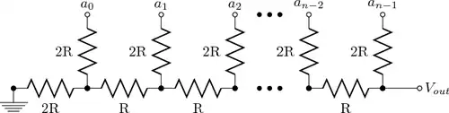

# 4.42 数据转换器 IC 设计（三）ΣΔ ADC 与 DAC

> **前置知识**：必需 [3.9 数模与模数转换](../../03-数字与计算机系统/数字电路/3.9-数模与模数转换.md)、[4.29–4.32 模拟 IC 设计](../模拟IC设计/4.29-运算放大器设计.md)、[4.41 数据转换器 IC 设计（二）](4.41-数据转换器-SAR与流水线.md) 及 [5.1–5.10 数字信号处理](../../05-信号、通信与控制/数字信号处理/5.1-从连续到离散.md)（尤其 5.3 Z 变换、5.8 多速率信号处理、5.10 定点实现与量化误差）。

> 本页为《数据转换器 IC 设计》系列第 3/4 页。

## 1. ΣΔ ADC设计

### 1.1 过采样技术原理

#### 1.1.1 过采样率OSR

过采样率（OverSampling Ratio, OSR）定义为采样频率与Nyquist频率之比：

$$OSR = \frac{f_s}{2 f_B}$$

其中 $f_B$ 为信号带宽。

#### 1.1.2 量化噪声分布

N位量化器的量化噪声功率：

$$P_q = \frac{\Delta^2}{12} = \frac{V_{LSB}^2}{12}$$

均匀分布在 $[0, f_s/2]$ 频带内，功率谱密度：

$$S_q(f) = \frac{P_q}{f_s/2} = \frac{\Delta^2}{6 f_s}$$

**过采样对SNR的改善**：

信号带内量化噪声功率：

$$P_{q,in-band} = \int_0^{f_B} S_q(f) df = \frac{\Delta^2}{12} \cdot \frac{1}{OSR}$$

对应SNR：

$$SNR_{OSR} = 6.02N + 1.76 + 10\log_{10}(OSR) \quad \text{(dB)}$$

每过采样2倍，SNR提升3 dB（0.5位ENOB）。

### 1.2 噪声整形（Noise Shaping）

#### 1.2.1 一阶ΣΔ调制器

一阶ΣΔ调制器结构：

```
   Vin ─(+)─→ [积分器] ─→ [量化器] ─→ Y
              ↑                ↓
              └───[DAC]────────┘
```


**线性化模型**：

$$Y(z) = z^{-1} X(z) + (1 - z^{-1}) E(z)$$

**信号传递函数（STF）**：

$$STF(z) = z^{-1}$$

**噪声传递函数（NTF）**：

$$NTF(z) = 1 - z^{-1}$$

噪声在直流处为零，高频被放大——噪声整形。

**带内噪声功率**：

$$P_{q,1st} = \frac{\Delta^2}{12} \cdot \frac{\pi^2}{3} \cdot \frac{1}{OSR^3}$$

对应SNR：

$$SNR_{1st} = 6.02N + 1.76 - 5.17 + 30\log_{10}(OSR) \quad \text{(dB)}$$

每过采样2倍，SNR提升9 dB（1.5位ENOB）。

#### 1.2.2 二阶ΣΔ调制器

二阶ΣΔ调制器使用两级积分器：

$$Y(z) = z^{-2} X(z) + (1 - z^{-1})^2 E(z)$$

$$NTF(z) = (1 - z^{-1})^2$$

**带内噪声功率**：

$$P_{q,2nd} = \frac{\Delta^2}{12} \cdot \frac{\pi^4}{5} \cdot \frac{1}{OSR^5}$$

对应SNR：

$$SNR_{2nd} = 6.02N + 1.76 - 12.9 + 50\log_{10}(OSR) \quad \text{(dB)}$$

每过采样2倍，SNR提升15 dB（2.5位ENOB）。

#### 1.2.3 高阶ΣΔ调制器（稳定性考虑）

L阶ΣΔ调制器：

$$NTF(z) = (1 - z^{-1})^L$$

**理想SNR**：

$$SNR_{Lth} = 6.02N + 1.76 + 10\log_{10}\left(\frac{2L+1}{\pi^{2L}}\right) + (2L+1) \cdot 10\log_{10}(OSR)$$

**稳定性问题**：

L ≥ 3 时，单环结构容易出现不稳定（量化器输入饱和），需要：

- 限制NTF最大增益：$|NTF(e^{j\omega})|_{max} < 1.5$
- 采用前馈（Feedforward）结构降低积分器输出摆幅
- 多位量化器降低量化噪声

**NTF设计方法**：Butterworth高通或逆向Chebyshev高通。

### 1.3 ΣΔ调制器拓扑

#### 1.3.1 单环结构

单环ΣΔ调制器使用一个反馈环包含所有积分器：

```
   Vin ─→ [积分器1] ─→ [积分器2] ─→ ... ─→ [积分器L] ─→ [量化器] ─→ Y
                                       ↓
                                  [反馈DAC] ──── 反馈到各级输入
```

**优点**：结构简单，对元件失配不敏感。

**缺点**：高阶时稳定性差。

#### 1.3.2 MASH（级联）结构

MASH（Multi-stAge noise SHaping）将多个低阶（通常1阶或2阶）调制器级联，实现高阶噪声整形：

```
   Vin ─→ [1阶ΣΔ] ─→ Y1, E1 ─→ [1阶ΣΔ] ─→ Y2, E2 ─→ ... → Y
```

**输出组合**：

$$Y(z) = STF_1 \cdot Y_1(z) + (1 - z^{-1}) \cdot STF_2 \cdot Y_2(z) + \cdots$$

**优势**：每一级稳定（低阶），整体实现高阶噪声整形。

**劣势**：级间增益失配会泄漏一阶量化噪声，对匹配要求高。

| 拓扑 | 阶数 | 稳定性 | 失配敏感度 | 应用 |
|------|------|--------|-----------|------|
| 单环1阶 | 1 | 极稳定 | 低 | 教学 |
| 单环2阶 | 2 | 稳定 | 低 | 通用 |
| 单环3阶+ | ≥3 | 难稳定 | 中 | 高性能音频 |
| MASH 2-1 | 3 | 稳定 | 高 | 通信 |
| MASH 2-2 | 4 | 稳定 | 高 | 高精度 |

### 1.4 抽取滤波器（Decimation Filter）

ΣΔ调制器输出为高速低位（1~3位）数据流，需经过抽取滤波器降速到Nyquist速率：

```
   高速低位流 ─→ [CIC] ─→ [半带滤波器] ─→ [FIR补偿] ─→ 低位流（Nyquist速率）
                  ↓
              降速 R1倍           降速 R2倍
```

#### 1.4.1 CIC滤波器（Cascaded Integrator-Comb）

CIC滤波器由积分级与梳状级组成，无需乘法器：

```
   输入 ─→ [积分器]×N ─→ [↓R] ─→ [梳状器]×N ─→ 输出
```

**传递函数**：

$$H_{CIC}(z) = \left(\frac{1 - z^{-RM}}{1 - z^{-1}}\right)^N$$

其中 $R$ 为抽取因子，$M$ 为差分延迟，$N$ 为级数。

**优点**：无乘法器，适合硬件实现。

**缺点**：通带衰减严重，需要后续FIR补偿。

#### 1.4.2 半带滤波器（Half-Band Filter）

半带滤波器在 $f_s/4$ 处对称，约一半系数为零：

$$H(e^{j\pi/2}) = 0.5$$

**优势**：

- 计算量减半（一半系数为零）
- 适合2倍抽取

#### 1.4.3 FIR补偿滤波器

补偿CIC滤波器的通带衰减，实现平坦的通带响应：

$$H_{comp}(f) = \frac{1}{|H_{CIC}(f)|}, \quad f \in [0, f_B]$$

### 1.5 ΣΔ ADC的非理想效应

**（1）积分器泄漏**

积分器的有限直流增益 $A_{DC}$ 导致泄漏：

$$H_{int}(z) = \frac{1}{1 + \frac{1-z^{-1}}{A_{DC}}} \approx \frac{1}{1 - z^{-1}} \cdot \left(1 - \frac{1-z^{-1}}{A_{DC}}\right)$$

效果：噪声整形减弱，SNR下降。

**（2）比较器迟滞**

1位量化器的迟滞引入死区，造成谐波失真。

**（3）时钟抖动**

DAC反馈脉冲的抖动等效为加性噪声：

$$SNR_{jitter} = -20\log_{10}(2\pi f_{in} \sigma_t)$$

### 1.6 设计实例（16位音频ΣΔ ADC）

**规格**：

| 参数 | 指标 |
|------|------|
| 分辨率 | 16位 |
| 信号带宽 | 20 kHz |
| 采样率 | 5.12 MHz |
| OSR | 128 |
| SNR | ≥ 98 dB |
| THD | < -90 dB |

**设计选择**：

- **拓扑**：单环3阶 + 1位量化器 + 1位DAC
- **NTF**：Butterworth高通，最大增益 1.5
- **积分器**：开关电容结构，增益 > 60 dB
- **抽取**：CIC(4级, R=64) + 半带(R=2) + FIR

**关键计算**：

- 理论SNR：$6.02 \times 1 + 1.76 - 12.9 + 50 \times \log_{10}(128) \approx 100$ dB
- 电容匹配：4位精度即可（噪声整形对DAC失配不敏感）
- 时钟抖动：$\sigma_t < 100$ ps

---

## 2. DAC IC实现

### 2.1 电流舵DAC（Current Steering DAC）

电流舵DAC是高速DAC的主流架构，由电流源阵列 + 开关阵列组成：

```
   码字 D[N-1:0] ─→ [译码器] ─→ [开关阵列] ─→ Iout / IoutB
                                ↑
                          [电流源阵列]
```

#### 2.1.1 电流源阵列设计

**电流源匹配要求**：

对于N位DAC，电流源相对失配：

$$\frac{\sigma_I}{I} < \frac{1}{2^N \sqrt{2^{N+1}}}$$

对应INL < ±0.5 LSB的概率（良率 > 99.7%）。

**电流源尺寸**：

$$\sigma\left(\frac{\Delta I}{I}\right) = \frac{A_{ID}}{\sqrt{W \cdot L}}$$

例如12位DAC，$A_{ID} = 1\% \cdot \mu m$：

$$\sqrt{W \cdot L} > \frac{A_{ID} \cdot 2^N \sqrt{2^{N+1}}}{1} \approx 230 \text{ μm}$$

#### 2.1.2 二进制编码 vs 温度计编码

| 编码方式 | 实现 | 优点 | 缺点 |
|---------|------|------|------|
| **二进制编码** | $I_k = 2^{k} I_u$ | 简单，面积小 | 重大毛刺，DNL差 |
| **温度计编码** | $I_k = I_u$, 共$2^N-1$个 | 单调，毛刺小 | 面积大，译码复杂 |
| **分段编码** | 高位温度计 + 低位二进制 | 折中 | 设计复杂 |

**典型分段**：N位 = 5位温度计 + 5位二进制 + 2位辅助。

#### 2.1.3 分段架构（Segmented）

```
   D[N-1:M+1] ─→ [温度计译码] ─→ [高位电流单元]（2^(M+1)-1个）
   D[M:0]    ──→ [直接驱动]  ─→ [低位电流单元]（2^M个，二进制加权）
```

**分段比例选择**：

| 高位温度计位数 | 低位二进制位数 | 毛刺 | 面积 | 适用 |
|--------------|--------------|------|------|------|
| 6 | 6 | 小 | 中 | 12位 |
| 7 | 5 | 极小 | 大 | 12位高线性度 |
| 5 | 7 | 中 | 小 | 12位低成本 |

#### 2.1.4 电流源匹配技术

- **共质心布局**：消除线性梯度
- **伪单元（Dummy）**：消除刻蚀边缘效应
- **Q²随机化布局**：抑制二次梯度
- **校准**：测量并补偿每个电流源

### 2.2 开关电容DAC

开关电容DAC通过电荷重分配实现D/A转换，与SAR ADC中的CDAC同源：

$$V_{out} = V_{ref} \cdot \frac{\sum_{k} D_k C_k}{C_{total}}$$

**与SAR CDAC的关系**：SAR ADC中的CDAC本质是一个开关电容DAC，转换过程中CDAC在比较器输入端产生对应的电压。

### 2.3 电阻串DAC

电阻串DAC使用 $2^N$ 个相等电阻串联，通过开关选择抽头：



```
   Vref ─ R ─ R ─ R ─ ... ─ R ─ GND
         │   │   │         │
        SW  SW  SW        SW
         │   │   │         │
        00  01  10        11
              ↓
            Vout
```

**优点**：单调性保证，DNL = 0（理想情况下）。

**缺点**：分辨率受电阻数限制，8位需256个电阻，10位需1024个电阻。

### 2.4 DAC的非理想效应

**（1）失配引起的DNL/INL**

$$\sigma_{DNL} \approx \frac{\sigma(\Delta I)}{I_{LSB}} = \frac{\sigma(\Delta I)}{I_u}$$

$$\sigma_{INL,max} \approx \frac{\sigma(\Delta I)}{I_u} \cdot \sqrt{2^N}$$

**（2）毛刺（Glitch）**

DAC输出在码字切换瞬间产生的尖峰脉冲，主要由开关时序不对称引起。毛刺面积：

$$A_{glitch} = \int V_{glitch}(t) dt$$

**（3）时钟馈通**

开关时钟通过寄生电容耦合到输出，产生周期性纹波。

### 2.5 设计实例（12位500MS/s电流舵DAC）

**规格**：

| 参数 | 指标 |
|------|------|
| 分辨率 | 12位 |
| 更新率 | 500 MS/s |
| SFDR | ≥ 70 dB（@ 50 MHz输出） |
| 功耗 | < 200 mW |

**设计选择**：

- **架构**：6位温度计 + 6位二进制分段
- **电流源**：$I_u = 10$ μA，总输出电流 40.96 mA
- **开关**：差分电流开关，降低毛刺
- **校准**：后台校准补偿电流源失配

**关键计算**：

- 电流源尺寸：$W \cdot L > 200$ μm²（满足12位匹配）
- 输出阻抗：$R_{out} > 2^N \cdot R_L \approx 4$ MΩ
- 时钟抖动：$\sigma_t < 1$ ps

---

## 本章要点

- ΣΔ ADC设计
- DAC IC实现

## 自测清单

1. 「ΣΔ ADC设计」要解决的核心问题是什么？关键结论或公式是什么？
2. 「DAC IC实现」与上一节之间是什么关系？
3. 「过采样技术原理」在什么场景下会用到？如果条件改变，结论会如何变化？
4. 能否不看正文，写出「噪声整形（Noise Shaping）」的关键流程或结构？
5. 「ΣΔ调制器拓扑」最容易混淆的点是什么？

---

**下一章**：[4.43 数据转换器 IC 设计（四）校准、时间交织与小结](4.43-数据转换器-校准与时间交织.md)
