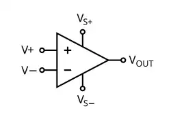

# 4.29 运算放大器设计

> **本章定位**：运放设计基础页，建立设计指标、指标权衡与规格到拓扑选择的基本框架；频率补偿、稳定性及进阶实现分别在后续页面展开。

> **前置知识**：必需 [2.1–2.8 模拟电路基础](../../02-模拟与硬件工程/模拟电路/2.1-半导体物理基础.md)、[2.13 噪声分析与低噪声设计](../../02-模拟与硬件工程/模拟电路/2.13-噪声分析与低噪声设计.md)、[2.14 电流源电路](../../02-模拟与硬件工程/模拟电路/2.14-电流源电路.md) 与 [4.3 CMOS 器件物理](../芯片设计/4.3-CMOS器件物理.md)。

## 1. 引言

运算放大器（Operational Amplifier，简称运放）是模拟集成电路中最基本、应用最广泛的构建模块。从简单的信号放大到复杂的滤波器、数据转换器、锁相环等系统，运放的性能直接决定了整个模拟系统的品质。

与数字电路设计不同，模拟运放设计是一门融合了电路理论、器件物理和设计经验的综合性工程学科。设计者需要在增益、带宽、相位裕度、功耗、输出摆幅、噪声等多个相互制约的指标之间进行权衡，最终获得满足特定应用需求的最优解。

本章将系统介绍CMOS运算放大器的设计方法，从设计指标、经典拓扑结构到高级设计技术，为读者建立完整的运放设计知识体系。

## 2. 运放设计指标

### 2.1 主要设计指标

运放的设计指标是设计的出发点和验收标准，主要包括以下几个方面：

**小信号指标**：

| 指标 | 符号 | 定义 | 典型值 |
|------|------|------|--------|
| 直流开环增益 | $A_{v0}$ | 低频小信号增益 | 60~100 dB |
| 单位增益带宽 | $GBW$ 或 $f_T$ | 增益下降到0 dB的频率 | 1~500 MHz |
| 相位裕度 | $PM$ | 单位增益频率处的相位余量 | ≥60° |
| 增益裕度 | $GM$ | 相位为-180°处的增益余量 | ≥10 dB |
| 共模抑制比 | $CMRR$ | 差模增益与共模增益之比 | 60~100 dB |
| 电源抑制比 | $PSRR$ | 差模增益与电源增益之比 | 60~80 dB |
| 输入失调电压 | $V_{OS}$ | 输出为零时输入端的等效偏移 | 1~10 mV |

**大信号指标**：

| 指标 | 符号 | 定义 | 典型值 |
|------|------|------|--------|
| 摆率 | $SR$ | 输出电压最大变化速率 | 1~500 V/μs |
| 输出摆幅 | $V_{swing}$ | 输出电压的最大峰-峰值 | 接近电源电压 |
| 建立时间 | $t_s$ | 输出稳定到指定精度所需时间 | 10~100 ns |
| 全功率带宽 | $FPBW$ | 最大摆幅下不失真的最高频率 | $FPBW = SR/(2\pi V_p)$ |

**功耗与面积**：

- 静态功耗 $P_D = V_{DD} \cdot I_{DD}$
- 芯片面积（与晶体管总数和尺寸相关）

### 2.2 指标之间的权衡关系

运放设计中的各项指标往往相互矛盾，设计者需要在它们之间做出权衡：

- **增益 vs 带宽**：增益带宽积 $GBW \cdot A_{v0}$ 近似为常数，提高增益通常意味着牺牲带宽
- **带宽 vs 功耗**：更高的带宽需要更大的偏置电流，功耗随之增加
- **摆率 vs 功耗**：$SR = I/C$，提高摆率需要增大电流或减小补偿电容
- **输出摆幅 vs 增益**：Cascode结构增益高但输出摆幅小
- **噪声 vs 功耗**：低噪声需要大器件和大电流，面积和功耗增加

### 2.3 设计流程

运放设计的典型流程如下：

1. **明确设计规格**：根据系统需求确定各项指标
2. **选择电路拓扑**：根据指标特点选择合适的运放结构
3. **手算初步设计**：利用简化模型进行晶体管尺寸计算
4. **仿真验证**：使用SPICE进行直流、交流、瞬态、噪声等仿真
5. **迭代优化**：根据仿真结果调整参数，直到满足所有指标
6. **版图设计**：考虑匹配、寄生效应的版图实现
7. **后仿真验证**：提取寄生参数后的后仿真

## 小结

1. **设计指标**：直流增益、单位增益带宽、相位裕度、摆率、输出摆幅、噪声和功耗共同构成运放规格的验收标准。

2. **指标权衡**：增益与带宽、带宽与功耗、摆率与补偿电容、输出摆幅与增益之间存在制约，设计必须围绕应用优先级取舍。

3. **设计流程**：从明确规格、选择拓扑到手算、仿真、版图和后仿真，运放设计是不断迭代的闭环过程。

## 自测清单

1. 运放的小信号指标与大信号指标分别有哪些？它们如何对应实际系统需求？
2. 为什么提高增益通常会牺牲带宽，提高摆率又会影响功耗或补偿电容？
3. 运放设计流程中，手算、仿真、版图和后仿真各自解决什么问题？
4. 如何根据增益、输出摆幅、带宽和功耗要求初步选择运放拓扑？
5. 为什么相位裕度和增益裕度必须同时纳入设计指标？

---

**下一章**：[4.29.1 运放频率补偿、稳定性与高性能拓扑](4.29.1-运放频率补偿与稳定性.md)
