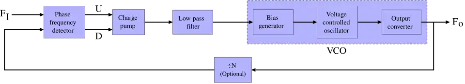

# 4.31 PLL模拟前端

> **本章定位**：PLL 系统与基本模块页，建立 CP-PLL 架构，分析 PFD、电荷泵、环路滤波器、VCO 与分频器及其主要非理想效应。

> **前置知识**：必需 [4.29 运算放大器设计](4.29-运算放大器设计.md) 与 [5.24–5.28 自动控制原理](../../05-信号、通信与控制/自动控制原理/5.24-控制系统基本概念.md)（反馈、稳定性与频域分析）；推荐 [5.17 数字调制](../../05-信号、通信与控制/通信原理/5.17-数字调制.md) 与 [5.19 同步技术](../../05-信号、通信与控制/通信原理/5.19-同步技术.md)。

## 1. 引言

锁相环（Phase-Locked Loop, PLL）是集成电路中最重要的模拟-混合信号模块之一。PLL通过反馈控制机制，使输出信号的相位与参考信号保持同步，广泛应用于时钟合成、频率综合、时钟恢复和数据同步等领域。

本章将深入探讨PLL模拟前端的设计原理、关键模块、非理想效应及优化技术，为高性能PLL设计奠定理论基础。

## 2. PLL概述

### 2.1 PLL在IC中的应用

PLL在现代集成电路中的应用极为广泛：

| 应用领域 | 具体用途 | 典型指标要求 |
|---------|---------|-------------|
| **时钟合成** | 将低频参考时钟倍频到高频系统时钟 | 低抖动（<10ps rms）、快速锁定 |
| **频率综合** | 产生射频本振信号（LO） | 低相位噪声（<-100dBc/Hz @ 1MHz） |
| **时钟恢复** | 从数据流中提取时钟（CDR） | 宽带宽、快速锁定 |
| **时钟净化** | 滤除参考时钟的抖动 | 优化环路带宽 |
| **扩频时钟** | 降低EMI辐射 | 调制频率、调制深度 |

### 2.2 PLL基本架构

电荷泵锁相环（CP-PLL）是最常用的架构，由以下模块组成：

```
参考时钟 fref ──→ [PFD] ──→ [电荷泵CP] ──→ [环路滤波器LF] ──→ [VCO] ──→ 输出 fout
                ↑                                              ↓
                └──────────── [÷N 分频器] ←────────────────────┘
```

**各模块功能**：

1. **鉴频鉴相器（PFD）**：比较参考信号和反馈信号的相位差，输出UP/DOWN脉冲
2. **电荷泵（CP）**：将PFD的相位差信息转换为电流脉冲
3. **环路滤波器（LF）**：滤除电流脉冲的高频分量，产生平滑的控制电压
4. **压控振荡器（VCO）**：根据控制电压产生输出频率
5. **分频器（÷N）**：将输出频率分频到参考频率量级，形成闭环

下图给出了电荷泵锁相环的完整闭环框图，清楚展示了 PFD、电荷泵、环路滤波器、VCO 与分频器的连接关系：



### 2.3 PLL设计指标

PLL设计需要在多个指标之间进行折中：

| 指标 | 定义 | 典型值 | 影响因素 |
|-----|------|--------|---------|
| **锁定时间** | 从启动到频率/相位稳定的时间 | 1μs ~ 1ms | 环路带宽、初始频差 |
| **相位噪声** | 偏离载波一定频率处的噪声功率密度 | -80 ~ -130 dBc/Hz @ 1MHz offset | VCO噪声、PFD/CP噪声、参考噪声 |
| **抖动（Jitter）** | 时钟边沿的时间偏差 | 1ps ~ 100ps rms | 相位噪声的时域表现 |
| **频率范围** | VCO可调谐的频率范围 | 10% ~ 100% 中心频率 | VCO设计、变容管范围 |
| **功耗** | 总功耗 | 1mW ~ 100mW | 工艺、频率、架构 |
| **杂散（Spur）** | 输出频谱中的离散干扰分量 | <-60 dBc | 电荷泵失配、电源噪声 |

**相位噪声与抖动的关系**：

$$
\sigma_{jitter,rms} = \sqrt{\int_{f_{min}}^{f_{max}} \mathcal{L}(f_m) \cdot \frac{2}{f_0^2} df_m}
$$

其中 $\mathcal{L}(f_m)$ 是偏移频率 $f_m$ 处的单边带相位噪声，$f_0$ 是载波频率。

## 3. 鉴频鉴相器（PFD）

### 3.1 PFD工作原理

鉴频鉴相器（Phase-Frequency Detector, PFD）是PLL的核心模块之一，能够检测两个输入信号的**频率差**和**相位差**。

**工作过程**：

1. **频率检测**：当 $f_{ref} \neq f_{fb}$ 时，PFD输出脉冲宽度等于两个信号的周期差
2. **相位检测**：当 $f_{ref} = f_{fb}$ 时，PFD输出脉冲宽度反映相位差
3. **锁定状态**：当相位差为零时，PFD输出极窄的脉冲或为零

### 3.2 PFD的三种状态

典型的三态PFD由两个D触发器和一个与门构成：

| 状态 | 条件 | UP输出 | DOWN输出 | 说明 |
|-----|------|--------|----------|------|
| **超前** | $\phi_{ref} > \phi_{fb}$ | 高电平脉冲 | 低电平 | VCO需要加速 |
| **滞后** | $\phi_{ref} < \phi_{fb}$ | 低电平 | 高电平脉冲 | VCO需要减速 |
| **锁定** | $\phi_{ref} \approx \phi_{fb}$ | 极窄脉冲或零 | 极窄脉冲或零 | 相位同步 |

**PFD时序分析**：

设参考信号和反馈信号的相位差为 $\Delta\phi = \phi_{ref} - \phi_{fb}$，则：

$$
t_{UP} = \frac{\Delta\phi}{2\pi} \cdot T_{ref} \quad (\Delta\phi > 0)
$$

$$
t_{DOWN} = \frac{|\Delta\phi|}{2\pi} \cdot T_{ref} \quad (\Delta\phi < 0)
$$

其中 $T_{ref} = 1/f_{ref}$ 是参考时钟周期。

### 3.3 死区（Dead Zone）问题

**死区现象**：

当 $\Delta\phi$ 非常小（接近零）时，PFD输出的UP和DOWN脉冲宽度过窄，电荷泵无法有效响应，导致PFD-CP组合的增益降为零，形成"死区"。

**死区的影响**：

- PLL无法完全锁定，存在稳态相位误差
- 可能引起参考杂散（reference spur）
- 降低环路稳定性

**死区消除技术**：

1. **插入延迟**：在PFD的复位路径插入延迟 $\tau_d$，确保最小脉冲宽度
   $$
   t_{min} = \tau_d \approx 100\text{ps} \sim 500\text{ps}
   $$
   
2. **使用异或门**：将PFD的UP和DOWN信号异或，产生"锁定指示"信号，用于控制额外的小电流注入

3. **数字校准**：通过数字逻辑检测死区并补偿

### 3.4 复位延迟的影响

PFD的复位信号存在延迟 $\tau_{reset}$，这会导致：

1. **UP和DOWN脉冲同时为高**：在 $\tau_{reset}$ 期间，UP和DOWN都有效
2. **电荷泵非线性**：当两个信号同时为高时，电荷泵的UP和DOWN电流同时注入，产生净电流误差
3. **参考杂散**：周期性的脉冲宽度调制产生杂散

**优化方法**：

- 最小化复位路径延迟
- 使用差分结构提高匹配
- 在电荷泵中添加共模反馈

## 4. 电荷泵（Charge Pump）

### 4.1 电荷泵工作原理

电荷泵（Charge Pump, CP）将PFD输出的相位差信息转换为电流脉冲，对环路滤波器电容充放电，产生VCO控制电压。

**理想电荷泵模型**：

$$
I_{CP,avg} = I_{cp} \cdot \frac{\Delta t}{T_{ref}} = I_{cp} \cdot \frac{\Delta\phi}{2\pi}
$$

其中 $I_{cp}$ 是电荷泵电流，$\Delta t$ 是脉冲宽度，$\Delta\phi$ 是相位差。

**电荷泵-环路滤波器组合的传递函数**：

$$
\frac{V_{ctrl}(s)}{\Delta\phi(s)} = \frac{I_{cp}}{2\pi} \cdot Z_{LF}(s)
$$

其中 $Z_{LF}(s)$ 是环路滤波器的阻抗。

### 4.2 非理想效应

#### 4.2.1 电荷注入与时钟馈通

**电荷注入（Charge Injection）**：

当MOS开关管关断时，沟道中的电荷注入到输出节点，产生电压误差：

$$
\Delta Q_{inj} = \frac{1}{2} W L C_{ox} (V_{GS} - V_{TH})
$$

**时钟馈通（Clock Feedthrough）**：

开关管的栅-漏/栅-源交叠电容耦合栅极时钟信号到输出：

$$
\Delta V_{ff} = \Delta V_{gate} \cdot \frac{C_{ov}}{C_{ov} + C_{load}}
$$

**影响**：

- 产生参考杂散（reference spur）
- 增加相位噪声
- 降低锁定精度

**抑制技术**：

1. **dummy管补偿**：添加半个尺寸的MOS管，栅极接反相时钟，抵消电荷注入
2. **底采样技术**：在VCO控制电压最稳定时采样，避开开关瞬态
3. **使用差分电荷泵**：抵消共模噪声

#### 4.2.2 电流失配（Current Mismatch）

**失配来源**：

UP电流源 $I_{UP}$ 和DOWN电流源 $I_{DOWN}$ 之间存在失配：

$$
\Delta I = I_{UP} - I_{DOWN}
$$

**失配的影响**：

当 $\Delta I \neq 0$ 时，即使PFD输出等宽脉冲，电荷泵也会产生净电流，导致：

1. **稳态相位误差**：
   $$
   \Delta\phi_{ss} = 2\pi \cdot \frac{\Delta I}{I_{cp}}
   $$

2. **参考杂散**：相位误差被调制到输出

**电流失配规格**：

$$
\frac{\Delta I}{I_{cp}} < 0.1\% \sim 1\%
$$

**改善匹配的技术**：

1. **共源共栅（Cascode）结构**：提高输出阻抗，减小 $V_{DS}$ 变化对电流的影响
2. **增益自举（Gain Boosting）**：使用辅助运放提高cascode管的输出阻抗
3. **单位电流元匹配**：使用多个单位电流源并联，提高匹配精度
4. **动态匹配**：通过时钟控制交替使用不同的电流源

#### 4.2.3 有限输出阻抗

电荷泵电流源的有限输出阻抗 $r_o$ 会导致：

1. **电流随输出电压变化**：
   $$
   I_{out} = I_0 \left(1 + \frac{V_{DS}}{V_A}\right)
   $$
   其中 $V_A$ 是Early电压

2. **电荷泵增益非线性**：$K_{CP} = I_{cp}/(2\pi)$ 随 $V_{ctrl}$ 变化

**提高输出阻抗的方法**：

| 技术 | 输出阻抗 | 面积 | 功耗 | 复杂度 |
|-----|---------|------|------|--------|
| 简单电流镜 | $r_o$ | 小 | 低 | 低 |
| Cascode电流源 | $g_m r_o^2$ | 中 | 中 | 中 |
| Gain-boosted Cascode | $g_m^2 r_o^3$ | 大 | 高 | 高 |

### 4.3 电荷泵设计技术

#### 4.3.1 Cascode电流源设计

Cascode结构通过堆叠MOS管提高输出阻抗：

$$
r_{out,cascode} \approx g_{m2} r_{o2} r_{o1}
$$

**设计要点**：

1. 确保所有管子工作在饱和区
2. 最小化电压裕度（headroom）
3. 使用共模反馈稳定工作点

#### 4.3.2 Dummy管补偿

在电荷泵开关管旁边添加dummy管：

```
主开关管: M1 (W×L)
Dummy管:  M2 (W/2×L), 栅极接反相时钟
```

Dummy管抵消一半的电荷注入和时钟馈通。

#### 4.3.3 电荷泵设计流程

1. **确定电荷泵电流** $I_{cp}$：根据环路带宽和相位噪声要求
2. **选择管子尺寸**：满足匹配、噪声、速度要求
3. **设计偏置电路**：提供稳定的偏置电压
4. **仿真验证**：电荷注入、失配、输出阻抗、线性度

## 5. 环路滤波器（Loop Filter）

### 5.1 环路滤波器的作用

环路滤波器（Loop Filter, LF）位于电荷泵和VCO之间，主要功能：

1. **滤除高频分量**：去除电荷泵电流脉冲中的参考频率及其谐波
2. **产生控制电压**：将电流转换为VCO的控制电压
3. **决定环路动态特性**：影响稳定性、锁定时间、噪声抑制

### 5.2 无源比例积分滤波器（PPI）

**电路结构**：

```
        R1
Icp ──┤├──┬── Vctrl
           |
          C1
           |
          GND
           |
          C2
           |
          GND
```

**阻抗表达式**：

$$
Z_{PPI}(s) = \frac{1 + sR_1C_1}{s(C_1 + C_2) + s^2R_1C_1C_2}
$$

**传递函数**：

$$
H_{LF}(s) = \frac{V_{ctrl}(s)}{I_{cp}(s)} = Z_{PPI}(s)
$$

**零极点分析**：

- **零点**：$f_z = \frac{1}{2\pi R_1 C_1}$，提供正相位裕度
- **极点1**：$f_{p1} = \frac{1}{2\pi R_1 (C_1 \| C_2)}$，高频衰减
- **极点2**：$f_{p2} = 0$（积分器极点）

**特点**：

- 无源结构，无需运放，噪声低
- 直流增益有限（$R_1$），可能导致稳态相位误差
- 适用于大多数整数分频PLL

### 5.3 有源比例积分滤波器（API）

**电路结构**：

使用运放实现，典型结构：

```
         R1
Icp ──┤├──┬──┐
           |  |
          C1  |
           |  |
          GND  \
               >── Vctrl
              /
             |
            C2
             |
            GND
```

**传递函数**：

$$
Z_{API}(s) = -\frac{1 + sR_1C_1}{sC_2(1 + sR_1C_1) + sC_1}
$$

当运放增益足够高时：

$$
Z_{API}(s) \approx -\frac{1 + sR_1C_1}{s(C_1 + C_2)}
$$

**特点**：

- 高直流增益，消除稳态相位误差
- 适用于小数分频PLL和高性能应用
- 运放引入额外噪声和功耗
- 需要稳定性补偿

### 5.4 环路参数

#### 5.4.1 自然频率 $\omega_n$

PLL的开环传递函数为：

$$
G(s) = \frac{K_{PD} \cdot K_{CP} \cdot K_{VCO}}{N \cdot s} \cdot Z_{LF}(s)
$$

对于二阶PLL（PPI滤波器），自然频率：

$$
\omega_n = \sqrt{\frac{K_{PD} \cdot K_{CP} \cdot K_{VCO}}{N \cdot C_1}}
$$

其中：
- $K_{PD} = 1/(2\pi)$ [rad/V]（PFD增益）
- $K_{CP} = I_{cp}$ [A]（电荷泵增益）
- $K_{VCO}$ [rad/s/V]（VCO增益）
- $N$ 是分频比

#### 5.4.2 阻尼因子 $\zeta$

$$
\zeta = \frac{\omega_n}{2} \cdot R_1 C_1
$$

**阻尼因子与相位裕度的关系**：

| $\zeta$ | 相位裕度 | 阶跃响应 | 应用 |
|---------|---------|---------|------|
| 0.5 | ~50° | 振荡 | 不推荐 |
| 0.707 | ~65° | 临界阻尼 | 最优，推荐 |
| 1.0 | ~75° | 过阻尼 | 稳定但慢 |
| 1.5 | ~80° | 强过阻尼 | 非常稳定 |

**推荐值**：$\zeta = 0.7 \sim 1.0$，对应相位裕度 60° ~ 75°。

#### 5.4.3 环路带宽 $\omega_c$

环路带宽（单位增益带宽）定义为开环增益为1的频率：

$$
|G(j\omega_c)| = 1
$$

对于二阶系统：

$$
\omega_c \approx \omega_n \sqrt{\sqrt{1 + 4\zeta^4} - 2\zeta^2}
$$

当 $\zeta = 0.707$ 时：

$$
\omega_c \approx 1.55 \omega_n
$$

**环路带宽的选择**：

- **上限**：$\omega_c < f_{ref}/10$，确保参考杂散被充分抑制
- **下限**：$\omega_c > 1/t_{lock}$，确保快速锁定
- **噪声优化**：$\omega_c$ 应位于VCO噪声和PFD/CP噪声的交叉点

### 5.5 滤波器元件值计算

**设计步骤**：

给定：$f_{ref}$、$N$、$I_{cp}$、$K_{VCO}$、$\omega_c$、$\zeta$

1. **计算 $C_1$**：
   $$
   C_1 = \frac{K_{PD} \cdot K_{CP} \cdot K_{VCO}}{N \cdot \omega_n^2}
   $$
   其中 $\omega_n = \omega_c / 1.55$（假设 $\zeta = 0.707$）

2. **计算 $R_1$**：
   $$
   R_1 = \frac{2\zeta}{\omega_n C_1}
   $$

3. **计算 $C_2$**：
   通常取 $C_2 = C_1 / 10 \sim C_1 / 4$，用于抑制参考杂散

4. **验证零点频率**：
   $$
   f_z = \frac{1}{2\pi R_1 C_1} \approx \frac{\omega_c}{2\pi \cdot 2\zeta}
   $$

**设计示例**：

参数：$f_{ref} = 10\text{MHz}$，$N = 100$，$I_{cp} = 100\mu\text{A}$，$K_{VCO} = 2\pi \times 500\text{MHz/V}$，$\omega_c = 2\pi \times 100\text{kHz}$，$\zeta = 0.707$

计算：
- $\omega_n = 2\pi \times 100\text{kHz} / 1.55 = 2\pi \times 64.5\text{kHz}$
- $C_1 = \frac{(1/2\pi) \times 100\mu \times 2\pi \times 500M}{100 \times (2\pi \times 64.5k)^2} \approx 30\text{pF}$
- $R_1 = \frac{2 \times 0.707}{2\pi \times 64.5k \times 30p} \approx 116\text{k}\Omega$
- $C_2 = 3\text{pF}$

## 6. 压控振荡器（VCO）

### 6.1 VCO设计指标

VCO是PLL中决定相位噪声性能的关键模块：

| 指标 | 定义 | 典型值 | 影响因素 |
|-----|------|--------|---------|
| **频率范围** | 可调谐的频率范围 | 10% ~ 100% $f_0$ | 变容管范围、电感值 |
| **增益 $K_{VCO}$** | 频率对控制电压的灵敏度 | 10 ~ 1000 MHz/V | 变容管灵敏度 |
| **相位噪声** | 偏离载波的噪声功率密度 | -80 ~ -140 dBc/Hz @ 1MHz | 有源器件噪声、Q值、功耗 |
| **调谐线性度** | 频率-电压特性的线性度 | <1% 非线性 | 变容管特性 |
| **功耗** | 总功耗 | 1 ~ 50 mW | 工艺、频率、噪声要求 |

下图是一个典型的压控振荡器（VCO）电路示意图，其振荡频率随控制电压 $V_{ctrl}$ 变化，是 PLL 中决定频率范围与相位噪声的关键模块：


### 6.2 LC振荡器VCO

LC-VCO因其优异的相位噪声性能，广泛应用于射频和高性能时钟合成。

#### 6.2.1 交叉耦合对结构

**基本电路**：

```
        L1      L2
VDD ──┤├──┬──┤├── VDD
         |  |
        C1  C2
         |  |
        GND GND
         
    M1栅 ─┤  ├─ M2栅
    M1漏 ─┤  ├─ M2漏
    M1源 ─┴──┴─ M2源 ── Itail ── GND
```

**工作原理**：

交叉耦合的NMOS对（M1、M2）提供负阻，补偿LC谐振腔的损耗：

$$
R_{neg} = -\frac{2}{g_{m1,2}}
$$

#### 6.2.2 振荡条件与起振分析

**Barkhausen判据**：

振荡条件：环路增益 $\geq 1$，环路相移 $= 2n\pi$

对于交叉耦合LC-VCO：

$$
g_m \cdot R_p \geq 1
$$

其中 $R_p$ 是LC谐振腔的等效并联电阻：

$$
R_p = Q_L \cdot \omega_0 L = \frac{Q_L}{\omega_0 C}
$$

**起振条件**：

$$
g_m > \frac{1}{R_p} = \frac{\omega_0 C}{Q_L}
$$

**设计裕度**：

实际设计中，$g_m$ 需要比临界值大 2~3 倍，确保在工艺、电压、温度（PVT）变化下可靠起振：

$$
g_m = (2 \sim 3) \cdot \frac{1}{R_p}
$$

#### 6.2.3 频率调谐（变容管）

**变容管类型**：

| 类型 | 结构 | 调谐范围 | Q值 | 线性度 |
|-----|------|---------|-----|--------|
| **PN结变容管** | 反偏PN结 | 大（3:1） | 高 | 差 |
| **MOS变容管** | MOS电容 | 中（2:1） | 中 | 中 |
| **积累型MOS** | 积累区工作 | 小（1.5:1） | 高 | 好 |

**振荡频率**：

$$
f_{osc} = \frac{1}{2\pi \sqrt{L \cdot C_{total}(V_{ctrl})}}
$$

其中 $C_{total} = C_{fixed} + C_{var}(V_{ctrl})$。

**VCO增益**：

$$
K_{VCO} = \frac{\partial f_{osc}}{\partial V_{ctrl}} = -\frac{f_{osc}}{2C_{total}} \cdot \frac{\partial C_{var}}{\partial V_{ctrl}}
$$

#### 6.2.4 相位噪声模型（Leeson公式）

**Leeson模型**：

$$
\mathcal{L}(\Delta f) = 10\log_{10}\left[\frac{2FkT}{P_{sig}} \cdot \left(1 + \frac{f_0}{2Q_L \Delta f}\right)^2 \cdot \left(1 + \frac{f_c}{\Delta f}\right)\right]
$$

其中：
- $F$ 是器件噪声系数
- $k$ 是Boltzmann常数
- $T$ 是绝对温度
- $P_{sig}$ 是信号功率
- $f_0$ 是振荡频率
- $Q_L$ 是负载Q值
- $\Delta f$ 是偏移频率
- $f_c$ 是1/f噪声拐角频率

**相位噪声特性**：

- $\Delta f < f_c$：1/f³ 区域（闪烁噪声上变频）
- $f_c < \Delta f < f_0/(2Q_L)$：1/f² 区域（热噪声主导）
- $\Delta f > f_0/(2Q_L)$：平坦区域（噪声基底）

**改善相位噪声的方法**：

1. **提高Q值**：使用高品质电感、变容管
2. **增加信号功率**：提高功耗
3. **降低器件噪声**：使用大尺寸管子、优化偏置
4. **使用尾电流噪声滤波**：添加尾电流噪声旁路电容
5. **采用互补结构**：同时使用NMOS和PMOS交叉耦合对

### 6.3 环形振荡器VCO

环形振荡器VCO因其宽频率范围和易于全集成，广泛应用于数字密集型和低成本应用。

#### 6.3.1 差动延迟单元

**基本结构**：

3级或5级差动延迟单元级联，形成环形振荡器。

**单级延迟单元**：

```
Vin+ ──┬──┐
       |  |
      [负载]
       |  |
Vout+ ─┤  ├── M1（尾电流源）
       |  |
      [负载]
       |  |
Vin- ──┴──┘
```

**振荡频率**：

对于 $N$ 级（奇数）环形振荡器：

$$
f_{osc} = \frac{1}{2N \cdot t_d}
$$

其中 $t_d$ 是单级延迟。

#### 6.3.2 频率与相位噪声

**频率调谐**：

通过改变负载（电阻、电容或电流）调节延迟 $t_d$，从而调谐频率。

**相位噪声模型**：

$$
\mathcal{L}(\Delta f) = 10\log_{10}\left[\frac{F \cdot kT}{P_{sig}} \cdot \frac{f_0^2}{\Delta f^2}\right]
$$

环形振荡器的相位噪声通常比LC-VCO差 10~20 dB，原因：

1. Q值低（$Q \approx \pi/2N$）
2. 器件噪声直接调制频率
3. 电源噪声耦合

#### 6.3.3 与LC-VCO对比

| 特性 | LC-VCO | 环形VCO |
|-----|--------|---------|
| **相位噪声** | 优（-120 ~ -140 dBc/Hz @ 1MHz） | 差（-90 ~ -110 dBc/Hz @ 1MHz） |
| **频率范围** | 窄（10% ~ 50%） | 宽（50% ~ 200%） |
| **面积** | 大（电感占用面积） | 小 |
| **功耗** | 中 ~ 高 | 低 ~ 中 |
| **集成度** | 需要片外电感或低Q片内电感 | 全集成 |
| **成本** | 高 | 低 |
| **应用** | 射频、高性能时钟 | 数字SoC、低成本应用 |

## 7. 分频器

### 7.1 整数分频

**基本原理**：

整数分频器使用 $N$ 个触发器级联，实现 ÷N 分频：

$$
f_{out} = N \cdot f_{ref}
$$

**结构**：

- **同步分频器**：所有触发器共用同一时钟，速度快但功耗高
- **异步分频器**：前级输出作为后级时钟，功耗低但存在毛刺

**多模分频器**：

使用 ÷2/÷3  prescaler 实现高速分频：

```
输入 ──→ [÷P prescaler] ──→ [÷M 计数器] ──→ 输出
```

通过控制 prescaler 的分频比，实现灵活的分频值。

### 7.2 小数分频

**基本原理**：

小数分频器通过周期性地改变分频比，实现非整数分频：

$$
f_{out} = \left(N + \frac{K}{M}\right) \cdot f_{ref}
$$

其中 $K/M$ 是小数部分。

**Σ-Δ调制器**：

使用 Σ-Δ 调制器控制多模分频器，将量化噪声推到高频：

```
小数输入 ──→ [Σ-Δ调制器] ──→ 1位控制流 ──→ [多模分频器]
```

**Σ-Δ调制器阶数**：

| 阶数 | 量化噪声整形 | 杂散性能 | 复杂度 |
|-----|-------------|---------|--------|
| 1阶 | 12 dB/oct | 差 | 低 |
| 2阶 | 24 dB/oct | 中 | 中 |
| 3阶 | 36 dB/oct | 好 | 高 |
| 4阶 | 48 dB/oct | 优秀 | 很高 |

### 7.3 小数分频的杂散问题与消除

**杂散来源**：

1. **分频比周期性变化**：Σ-Δ 调制器的周期性模式产生离散杂散
2. **PFD/CP非线性**：相位误差转换为幅度误差
3. **VCO调制效应**：分频器噪声通过VCO增益调制频率

**杂散消除技术**：

1. **Σ-Δ 调制器随机化**：添加抖动（dither）打破周期性
2. **数字补偿**：在数字域估计并抵消杂散
3. **优化环路带宽**：将杂散推到环路带宽外
4. **使用高阶调制器**：将量化噪声推到更高频率

## 小结

1. **PLL 架构**：CP-PLL 由 PFD、电荷泵、环路滤波器、VCO 和分频器组成，锁定时间、相位噪声、抖动、频率范围、功耗和杂散需要共同权衡。

2. **PFD**：三态 PFD 检测频率差和相位差，死区与复位延迟会影响锁定精度和参考杂散，可通过复位延迟和校准等方法改善。

3. **电荷泵**：电荷注入、时钟馈通、电流失配和有限输出阻抗是主要误差来源，Cascode、增益自举、单位电流元和 dummy 管可提高性能。

4. **环路滤波器**：PPI 和 API 分别适用于不同的增益、噪声和功耗要求；自然频率、阻尼因子、环路带宽及元件值需要按规格计算。

5. **VCO 与分频器**：LC-VCO 侧重低相位噪声，环形 VCO 侧重宽调谐和全集成；整数、小数分频及 Σ-Δ 调制带来不同的杂散与复杂度折中。

## 自测清单

1. CP-PLL 各模块如何形成相位反馈闭环？主要设计指标之间有哪些折中？
2. PFD 的死区和复位延迟如何影响电荷泵及输出杂散？
3. 电荷泵的电流失配、有限输出阻抗和开关非理想效应分别如何抑制？
4. 如何由自然频率、阻尼因子和目标环路带宽计算 PPI 滤波器元件值？
5. LC-VCO、环形 VCO、整数分频和小数分频各自适合什么应用？

---

**下一章**：[4.31.1 PLL环路模型与噪声](4.31.1-PLL环路模型与噪声.md)
