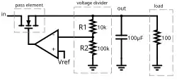

# 4.34 电源管理 IC 设计（一）概述与 LDO

> **本章定位**：电源管理 IC 的连续页面，从 LDO 到 Buck/Boost 与 PMIC 系统。

> **前置知识**：必需 [4.29–4.30 运算放大器与带隙基准](../模拟IC设计/4.29-运算放大器设计.md) 及 [5.24–5.28 自动控制原理](../../05-信号、通信与控制/自动控制原理/5.24-控制系统基本概念.md)（反馈、稳定性与频域分析）。

> 本页为《电源管理 IC 设计》系列第 1/3 页。

## 1. 引言

电源管理IC（Power Management IC, PMIC）是现代电子系统中不可或缺的核心芯片，负责将输入电源（电池、适配器或总线电源）高效、稳定地转换为系统中各功能模块所需的多种电压等级。无论是手机、PC、服务器，还是汽车电子、物联网设备，PMIC都是保障系统可靠运行的关键。

随着便携式设备对续航能力的苛刻要求、数据中心对能效的极致追求，以及汽车电气化对功率密度的不断提升，电源管理IC设计面临着效率、瞬态响应、面积、成本和可靠性之间的多重权衡。与一般模拟IC相比，PMIC需要在同一芯片上集成高压功率器件、高精度模拟控制电路和数字接口逻辑，对工艺（如BCD工艺）和版图设计提出了特殊要求。

本章将系统介绍电源管理IC设计的核心内容，涵盖LDO线性稳压器、Buck/Boost开关变换器、电池充电管理IC以及PMIC系统集成，并结合工艺与封装考虑，为读者建立完整的PMIC设计知识体系。

## 2. 电源管理IC概述

### 2.1 PMIC在电子系统中的地位

现代电子系统通常包含多个不同电压等级的子模块，需要PMIC完成电压转换、稳压、上电时序控制和保护等功能。PMIC的性能直接决定系统的能效、续航和可靠性。

| 应用领域 | 典型PMIC规模 | 主要挑战 | 典型效率要求 |
|---------|-------------|---------|-------------|
| **手机/可穿戴** | 10~20路电源（多路Buck+LDO） | 体积、效率、瞬态响应 | > 90%（Buck） |
| **PC/笔记本** | 多相Buck+LDO集成的PMIC | 大电流、瞬态响应 | > 85% |
| **服务器** | 多相Buck（单路>100A） | 大电流、热设计、遥测 | > 90% |
| **汽车电子** | 车规级PMIC（多路Buck+LDO） | 40V耐压、AEC-Q100、ASIL | > 85% |
| **物联网** | 能量收集+PMIC | 超低静态电流（< 1 μA） | > 80% |

### 2.2 电源管理IC分类

按拓扑和工作原理，电源管理IC可分为以下几类：

| 类别 | 典型电路 | 工作方式 | 效率 | 适用场景 |
|------|---------|---------|------|---------|
| **线性稳压器** | LDO、NLDO | 线性区调整 | 60%~95%（$V_{OUT}/V_{IN}$） | 低压差、低噪声、小电流 |
| **降压变换器** | Buck、半桥 | PWM开关 | 85%~95% | 高效率降压、大电流 |
| **升压变换器** | Boost | PWM开关 | 85%~95% | 电池升压、LED驱动 |
| **升降压变换器** | Buck-Boost、SEPIC | PWM开关 | 80%~90% | 输入电压可高可低 |
| **电池充电IC** | 锂电池充电器 | CC-CV控制 | 70%~90% | 锂电池/铅酸电池充电 |
| **PMIC系统** | 多路Buck+LDO集成 | 系统集成 | 系统级优化 | SoC/手机整体供电 |

### 2.3 设计指标

电源管理IC的核心设计指标包括：

| 指标 | 定义 | 公式 | 典型值 |
|------|------|------|--------|
| **效率（$\eta$）** | 输出功率与输入功率之比 | $\eta = \frac{P_{OUT}}{P_{IN}} \times 100\%$ | 80%~95% |
| **压差（$V_{DO}$）** | 维持稳压所需最小 $V_{IN}-V_{OUT}$ | $V_{DO} = I_{LOAD} \cdot R_{on}$ | 50~300 mV |
| **负载调整率** | 负载电流变化引起的输出变化 | $\frac{\Delta V_{OUT}}{\Delta I_{LOAD}}$ | 1~10 mV/A |
| **线性调整率** | 输入电压变化引起的输出变化 | $\frac{\Delta V_{OUT}}{\Delta V_{IN}}$ | 0.01%~0.1%/V |
| **瞬态响应** | 负载阶跃时输出电压尖峰 | $\Delta V = \Delta I \cdot Z_{OUT}$ | < 3% $V_{OUT}$ |
| **PSRR** | 电源噪声抑制能力 | $20\log\left(\frac{\Delta V_{IN}}{\Delta V_{OUT}}\right)$ | > 60 dB |
| **静态电流（$I_Q$）** | 无负载时自身消耗 | $I_Q = I_{EA}+I_{bias}+I_{ref}$ | 1~100 μA |
| **面积/成本** | 芯片面积、外部元件数 | — | 工艺与封装相关 |

## 3. LDO（低压差线性稳压器）IC设计

### 3.1 LDO基本架构

低压差线性稳压器（Low Dropout Regulator, LDO）通过负反馈控制调整管（Pass Transistor）的导通程度，将输入电压转换为稳定的输出电压。其基本架构如下：

```
            ┌────────── Mp (调整管) ──────────┐
            │                                │
VIN ────────┤                          VOUT ─┴─────→ 负载
            │                                │
            │  ┌─────── EA (误差放大器) ───┐   │
            │  │                           │   │
            └──┤ (+) VREF                  │   │
               │ (-) ←─── R1 ──────────────┤   │
               │              ┌────────────┘   │
               └──────────────┤                │
                              R2               │
                              │                │
                             GND              GND
```

下图是LDO的经典电路结构示意，明确标注了调整管（Pass Transistor）、误差放大器（EA）、反馈分压电阻与基准电压的关系：



**输出电压关系**：

$$V_{OUT} = V_{REF} \cdot \left(1 + \frac{R_1}{R_2}\right)$$

**环路工作原理**：当 $V_{OUT}$ 因负载变化而下降时，反馈电压 $V_{FB}$ 随之下降，EA输出驱动调整管Mp栅极使其导通增强，从而拉高 $V_{OUT}$，形成负反馈。

> **与 4.33 的分工**：4.33 §4 从混合信号集成的视角介绍了LDO的概念、片上电源隔离作用及集成耦合问题；本节则聚焦LDO作为电路模块的深入设计——调整管尺寸、稳定性、PSRR、瞬态响应与静态电流等原理和参数计算。两部分互补。

### 3.2 调整管设计

调整管是LDO中承载负载电流的关键器件，其设计直接影响压差、效率和稳定性。

#### 3.2.1 PMOS vs NMOS调整管

| 特性 | PMOS调整管 | NMOS调整管 |
|------|-----------|-----------|
| **压差** | 低（$|V_{DS,sat}|$） | 较高（需 $V_{GS} > V_{TH}$） |
| **栅极驱动** | 栅极可拉至 $V_{IN}$（容易） | 栅极需高于 $V_{OUT}+V_{TH}$（需电荷泵） |
| **PSRR** | 较好（栅极到输出隔离好） | 较差 |
| **面积** | 较大（空穴迁移率低） | 较小（电子迁移率高） |
| **稳定性** | 输出极点为主极点（易补偿） | 需额外补偿 |
| **适用场景** | 低电压、低压差、低噪声 | 大电流、有辅助电源 |

#### 3.2.2 压差（Dropout Voltage）分析

当LDO进入压差区时，调整管工作在线性区（三极管区），此时压差为：

$$V_{DO} = I_{LOAD} \cdot R_{on}$$

对于PMOS调整管，导通电阻为：

$$R_{on} = \frac{1}{\mu_p C_{ox} \frac{W}{L} (V_{GS} - |V_{TH,p}|)}$$

代入得：

$$V_{DO} = \frac{I_{LOAD}}{\mu_p C_{ox} \frac{W}{L} (V_{IN} - V_{OUT} - |V_{TH,p}|)}$$

**降低压差的途径**：

1. 增大调整管宽长比 $W/L$（但会增加栅电容，影响稳定性）
2. 选用低阈值器件（$|V_{TH}|$ 小）
3. 减小源/漏扩散区寄生电阻

#### 3.2.3 调整管尺寸优化

调整管尺寸需满足最大负载电流要求（饱和区工作）：

$$I_{LOAD,max} = \frac{1}{2} \mu_p C_{ox} \frac{W}{L} (V_{GS} - |V_{TH}|)^2 \cdot (1 + \lambda V_{DS})$$

**尺寸设计折中**：

| 设计参数 | 增大尺寸的影响 | 减小尺寸的影响 |
|---------|--------------|--------------|
| 压差 $V_{DO}$ | 降低（有利） | 升高（不利） |
| 效率 | 略升 | 略降 |
| 栅电容 $C_G$ | 增大（不利稳定性） | 减小（有利） |
| 静态电流 | 略增 | 略减 |
| 面积 | 增大 | 减小 |
| 主极点频率 | 降低 | 升高 |

### 3.3 稳定性分析

LDO是闭环负反馈系统，稳定性是设计的核心问题。不稳定会导致输出振荡，损坏负载。

#### 3.3.1 极点分析

LDO环路中的主要极点包括：

**（1）输出极点（主极点）**：

$$p_1 = \frac{1}{R_{OUT,eq} \cdot C_{OUT}} = \frac{1}{(r_{o,p} \| R_L) \cdot C_L}$$

其中 $R_L = V_{OUT}/I_{LOAD}$ 为负载电阻，$C_L$ 包含输出电容和负载电容。该极点位置随负载电流变化：重载时 $R_L$ 小，$p_1$ 频率高；轻载时 $R_L$ 大，$p_1$ 频率低。

**（2）EA输出极点（调整管栅极极点）**：

$$p_2 = \frac{1}{R_{EA,out} \cdot C_{G,p}}$$

其中 $C_{G,p} \approx \frac{2}{3} W L C_{ox} + C_{ov}$ 是调整管栅极电容。该极点通常频率较高，但在大尺寸调整管下可能成为非主极点。

**（3）其他高阶极点**：来自EA内部节点和反馈分压电阻的寄生电容。

#### 3.3.2 ESR零点的作用

实际输出电容的等效串联电阻（ESR）会在环路中引入一个左半平面（LHP）零点：

$$z_{ESR} = \frac{1}{R_{ESR} \cdot C_{OUT}}$$

该零点提供 +90° 相位提升，可补偿输出极点 $p_1$ 引起的相位滞后，改善相位裕度。

**ESR零点与极点关系**：

| ESR值 | 零点频率 | 对稳定性的影响 |
|-------|---------|--------------|
| 太小 | 太高 | 零点在穿越频率外，无补偿效果 |
| 合适 | 适中（< 穿越频率） | 提供相位提升，改善稳定性 |
| 太大 | 太低 | 零点过早，可能引入额外相移 |

**ESR稳定窗口**：

$$R_{ESR,min} < R_{ESR} < R_{ESR,max}$$

典型取值：$R_{ESR} = 0.1 \sim 1\ \Omega$，对应 $C_{OUT} = 1 \sim 10\ \mu F$。

#### 3.3.3 极点-零点双重t（Pole-Zero Doublet）

当LDO使用片内补偿（如Miller补偿）时，可能产生**极点-零点双重t（Pole-Zero Doublet）**：一个极点和一个零点位置接近但不重合，形成一个慢速建立分量。

双重t对瞬态响应的影响：即使相位裕度足够，双重t也会导致瞬态响应中存在缓慢的"拖尾"，延长建立时间。

$$V_{OUT}(t) = V_{final} \cdot \left(1 - e^{-t/\tau_{fast}} - K \cdot e^{-t/\tau_{slow}}\right)$$

其中 $\tau_{slow}$ 由双重t间距决定：

$$\tau_{slow} \approx \frac{1}{\omega_p - \omega_z}$$

**消除双重t的方法**：将补偿零点与极点精确对消（如使用主动零点补偿电路）。

#### 3.3.4 稳定性判据

LDO稳定性用相位裕度（PM）和增益裕度（GM）衡量：

$$PM = 180° + \angle H_{OL}(j\omega_c) \quad \text{其中} \ |H_{OL}(j\omega_c)| = 1$$

**稳定性设计准则**：

| 准则 | 推荐值 | 说明 |
|------|--------|------|
| 相位裕度 PM | ≥ 60° | 确保无振荡 |
| 增益裕度 GM | ≥ 10 dB | 防止工艺偏差导致失稳 |
| 穿越速率 | -20 dB/dec | 确保单极点穿越 |
| 穿越频率 $f_c$ | < $f_{SW}/10$（开关电源） | 避免开关噪声干扰 |

**不同负载下的稳定性挑战**：

| 负载条件 | 主极点 $p_1$ | 稳定性挑战 | 解决方案 |
|---------|-------------|----------|---------|
| **重载**（$I_L$ 大） | 高频 | 容易稳定 | ESR零点辅助 |
| **轻载**（$I_L$ 小） | 低频 | $p_1$ 与 $p_2$ 接近 | 增大 $C_{OUT}$ 或片内补偿 |
| **无ESR**（陶瓷电容） | 无ESR零点 | 缺少相位提升 | 主动零点补偿 |

### 3.4 PSRR分析

电源抑制比（Power Supply Rejection Ratio, PSRR）衡量LDO抑制输入电源噪声的能力：

$$PSRR = 20\log\left|\frac{\Delta V_{IN}}{\Delta V_{OUT}}\right| \quad (\text{dB})$$

#### 3.4.1 低频PSRR

低频下，环路增益高，PSRR主要由环路增益决定：

$$PSRR_{LF} \approx A_{OL} \cdot \beta \cdot \frac{g_{m,p} \cdot r_{o,p}}{1 + g_{m,p} \cdot r_{o,p}} \approx A_{OL} \cdot \beta$$

其中 $A_{OL}$ 为开环增益，$\beta = R_2/(R_1+R_2)$ 为反馈系数。低频PSRR可达 60~80 dB。

#### 3.4.2 高频PSRR

高频下，环路增益下降，PSRR受以下因素限制：

- 调整管栅漏电容 $C_{GD}$ 将电源噪声直接馈通到输出
- EA带宽有限，无法及时响应高频噪声
- 反馈分压网络的极点

$$PSRR_{HF}(f) \approx \frac{PSRR_{LF}}{\sqrt{1 + (f/f_{EA})^2}} \cdot \frac{1}{1 + j\omega R_{out} C_{GD}}$$

典型高频PSRR（1 MHz处）：20~40 dB。

#### 3.4.3 改善PSRR的技术

| 技术 | 原理 | PSRR改善 | 代价 |
|------|------|---------|------|
| **提高EA增益** | 增大低频环路增益 | +10~20 dB（低频） | 功耗增加 |
| **前馈纹波消除** | 注入反相纹波抵消 | +10~15 dB（中频） | 设计复杂 |
| **Cascode调整管** | 增大输出阻抗 | +10 dB（高频） | 压差增大 |
| **RC滤波EA电源** | 滤除EA电源噪声 | +20 dB（高频） | 面积增加 |
| **双层电源结构** | LDO级联供电 | +40 dB | 效率降低 |

### 3.5 瞬态响应分析

#### 3.5.1 负载阶跃响应

当负载电流发生阶跃变化时，LDO输出电压会经历下冲/过冲，再逐渐恢复：

```
              ΔI_LOAD (阶跃)
              ↑
              │    ┌──────
              │    │
              │    │
         ─────┘    │
              0 ───┴────→ t

V_OUT:
    ┌──┐                    ┌── 恢复
    │  │       ┌─────┐      │
    │  │       │     │      │
────┘  └───────┘     └──────┘
    t1  t2      t3     t4
    ↓           ↑
    下冲ΔVd     过冲ΔVu
```

#### 3.5.2 最大电压尖峰

负载电流从 $I_1$ 阶跃到 $I_2$ 时，输出电压尖峰由两部分组成：

**（1）ESR压降分量**：

$$\Delta V_{ESR} = (I_2 - I_1) \cdot R_{ESR}$$

**（2）电容充放电分量**：

$$\Delta V_{C} \approx \frac{\Delta I_{LOAD}}{C_{OUT}} \cdot t_{resp}$$

其中 $t_{resp}$ 为环路响应时间，约为EA带宽的倒数：

$$t_{resp} \approx \frac{1}{2\pi f_{BW,CL}}$$

**总电压尖峰**：

$$\Delta V_{spike} = \Delta V_{ESR} + \Delta V_{C} = \Delta I_{LOAD} \cdot R_{ESR} + \frac{\Delta I_{LOAD}}{C_{OUT} \cdot 2\pi f_{BW,CL}}$$

#### 3.5.3 建立时间

输出电压恢复到稳态值的指定容差范围内（如 ±1%）所需时间：

$$t_{settle} \approx \frac{4}{\zeta \omega_n} \quad \text{(2\%准则)}$$

增大环路带宽和阻尼因子可缩短建立时间。

### 3.6 静态电流优化

静态电流 $I_Q$ 是LDO在无负载时的自身功耗，直接影响轻载效率和电池续航：

$$\eta_{light} = \frac{V_{OUT} \cdot I_{LOAD}}{V_{IN}(I_{LOAD} + I_Q)}$$

**降低静态电流的技术**：

| 技术 | 描述 | $I_Q$ 优化 |
|------|------|----------|
| **动态偏置** | EA偏置随负载自适应 | 5~10x |
| **亚阈值设计** | MOS工作在亚阈值区 | 10~100x |
| **分段驱动** | 调整管多段并联，按需使能 | 2~5x |
| **数字辅助** | 数字控制EA偏置 | 3~10x |

**典型LDO静态电流指标**：

| LDO类型 | 静态电流 | 应用 |
|---------|---------|------|
| 高性能LDO | 50~500 μA | 手机/PC |
| 低功耗LDO | 1~10 μA | 物联网 |
| 超低功耗LDO | < 1 μA | 能量收集 |

### 3.7 LDO设计实例：1.2V/100mA LDO

**设计指标**：

| 参数 | 指标 |
|------|------|
| 输入电压 $V_{IN}$ | 1.8V ~ 3.3V |
| 输出电压 $V_{OUT}$ | 1.2V |
| 最大负载电流 | 100 mA |
| 压差 $V_{DO}$ | < 200 mV @ 100 mA |
| 静态电流 $I_Q$ | < 50 μA |
| PSRR (@1kHz) | > 60 dB |
| 负载瞬态尖峰 | < 50 mV @ 1mA→100mA |

**设计步骤**：

**步骤1：调整管尺寸设计**

设工艺参数 $\mu_p C_{ox} = 80\ \mu A/V^2$，$|V_{TH,p}| = 0.7V$。在压差区，$V_{GS} = V_{IN}$，$|V_{TH}| = 0.7V$，则：

$$R_{on} = \frac{V_{DO}}{I_{LOAD}} = \frac{200\text{mV}}{100\text{mA}} = 2\ \Omega$$

$$\frac{W}{L} = \frac{1}{\mu_p C_{ox} \cdot R_{on} \cdot (V_{IN} - V_{OUT} - |V_{TH}|)} = \frac{1}{80\mu \cdot 2 \cdot (1.8 - 1.2 - 0.7)} \approx 6250$$

取 $L = 0.5\ \mu m$，则 $W \approx 3125\ \mu m$。

**步骤2：EA设计**

采用折叠式共源共栅结构，目标增益 > 70 dB，带宽 > 1 MHz，静态电流 20 μA。

**步骤3：稳定性设计**

选择 $C_{OUT} = 1\ \mu F$，$R_{ESR} = 0.5\ \Omega$：

- 输出极点 $p_1 = \frac{1}{R_L C_{OUT}} = \frac{1}{12 \cdot 1\mu} \approx 13.3\text{ kHz}$（@100mA负载）
- ESR零点 $z_{ESR} = \frac{1}{R_{ESR} C_{OUT}} = \frac{1}{0.5 \cdot 1\mu} \approx 318\text{ kHz}$
- 穿越频率 $f_c \approx 200\text{ kHz}$，相位裕度 PM > 60°

**步骤4：PSRR验证**

低频PSRR = $A_{OL} \cdot \beta \approx 70 + (-6) = 64\text{ dB}$，满足要求。

## 本章要点

- 引言
- 电源管理IC概述
- LDO（低压差线性稳压器）IC设计

## 自测清单

1. 「引言」要解决的核心问题是什么？关键结论或公式是什么？
2. 「电源管理IC概述」与上一节之间是什么关系？
3. 「LDO（低压差线性稳压器）IC设计」在什么场景下会用到？如果条件改变，结论会如何变化？
4. 能否不看正文，写出「PMIC在电子系统中的地位」的关键流程或结构？
5. 「电源管理IC分类」最容易混淆的点是什么？

---

**下一章**：[4.35 电源管理 IC 设计（二）Buck 与 Boost 变换器](4.35-电源管理IC-Buck与Boost.md)
