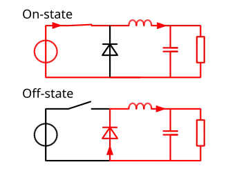
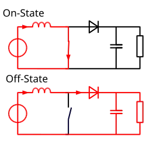

# 4.35 电源管理 IC 设计（二）Buck 与 Boost 变换器

> **前置知识**：必需 [4.34 电源管理 IC 设计（一）](4.34-电源管理IC-概述与LDO.md) 及其模拟与控制基础；开关电源另需 [2.21–2.23 电力电子与 PWM](../../02-模拟与硬件工程/电力电子/2.21-晶闸管-SCR与双向晶闸管-TRIAC.md)。

> 本页为《电源管理 IC 设计》系列第 2/3 页。

## 1. Buck变换器IC设计

### 1.1 Buck变换器IC架构

Buck（降压）变换器是开关电源中最常见的拓扑，通过控制功率开关的导通占空比实现降压。集成Buck变换器IC的典型架构如下：

```
                 ┌──── Mh (高侧PMOS/NMOS) ────┐
                 │                              │
VIN ─────────────┤                              ├──→ SW ──→ L ──→ VOUT
                 │                              │                │
                 └──── Ml (低侧NMOS) ──────────┘                │
                          ↑                                      │
                       驱动                                     COUT
                          ↑                                      │
            ┌─────────────────────┐                              │
            │   控制器             │←── VFB ←── R1/R2分压 ←──────┤
            │  (EA + PWM + 补偿)   │                              │
            └─────────────────────┘                              GND
```

下图是Buck变换器在连续导通（CCM）下开关管Mh/Ml轮流导通与电感和输出电容储能/释能的各工作阶段示意：



#### 4.1.1 高侧/低侧功率管

| 特性 | 高侧开关（Mh） | 低侧开关（Ml） |
|------|--------------|--------------|
| **典型器件** | PMOS（低压）/ NMOS+自举（高压） | NMOS |
| **驱动电压** | 需高于 $V_{IN}$（NMOS时） | 接地参考，易驱动 |
| **导通电阻** | 较大（PMOS）或较小（NMOS） | 较小 |
| **寄生电容** | 影响开关损耗 | 影响开关损耗 |

#### 4.1.2 栅驱动设计

栅驱动器需在开关瞬间提供大电流，快速充放电功率管栅电容：

$$I_{gate,peak} = C_{iss} \cdot \frac{dV_{GS}}{dt}$$

**驱动能力要求**：

$$t_{r/f} = \frac{Q_g}{I_{driver}}$$

其中 $Q_g$ 为栅极总电荷，$t_{r/f}$ 为开关上升/下降时间。典型栅驱动电流：0.5~2 A。

#### 4.1.3 自举电路（Bootstrap）

高压Buck中高侧NMOS的栅极需高于源极（SW节点）一个 $V_{GS}$，因此采用自举电路：

```
              VB (自举电压)
              ↑
              │
              │    ┌─── Cboot ───┐
              │    │             │
              └────┤             ├──→ HS Driver ──→ Mh栅极
                   │             │
                  VDD           SW ──→ Mh源极
```

**自举电容计算**：

$$C_{boot} \geq \frac{Q_{g,total}}{\Delta V_{boot}}$$

其中 $\Delta V_{boot}$ 为自举电压允许跌落（通常 < 0.1V）。

#### 4.1.4 电流检测

电流检测用于电流模式控制、限流保护和遥测：

| 检测方法 | 原理 | 精度 | 损耗 | 面积 |
|---------|------|------|------|------|
| **电阻采样** | 串联精密电阻 | 高（±1%） | 高 | 小 |
| **MOSFET $R_{DS(on)}$** | 利用导通电阻 | 中（±10~20%） | 无额外 | 无额外 |
| **电流镜采样** | 功率管并联小MOS镜像 | 中（±5~10%） | 低 | 小 |
| **感测FET（SenseFET）** | 专用感测单元 | 高（±2~5%） | 低 | 中 |

### 1.2 控制环路设计

> **与 4.33 的分工**：4.33 §5 从概念层介绍了DC-DC控制方式（电压模式/电流模式/斜坡补偿）以及其在混合信号集成中的耦合问题；本节则给出各控制方式的传递函数、补偿器设计与参数计算的完整内容。

#### 4.2.1 电压模式控制（Type III补偿器）

电压模式控制仅使用输出电压反馈，结构简单但对输入电压变化响应慢。

**功率级传递函数（CCM模式）**：

$$G_{vd}(s) = \frac{\hat{v}_{out}(s)}{\hat{d}(s)} = V_{IN} \cdot \frac{1 + s R_{ESR} C}{1 + s\frac{L}{R} + s^2 LC}$$

写成标准形式：

$$\omega_0 = \frac{1}{\sqrt{LC}}, \quad Q = R\sqrt{\frac{C}{L}}$$

**Type III补偿器**（双零点双极点）：

$$G_c(s) = K \cdot \frac{(1 + s/\omega_{z1})(1 + s/\omega_{z2})}{s(1 + s/\omega_{p1})(1 + s/\omega_{p2})}$$

**零极点放置**：

| 元件 | 频率 | 作用 |
|------|------|------|
| $z_1, z_2$ | $\omega_0$ 附近 | 补偿功率级双极点相位滞后 |
| $p_1$ | ESR零点处 | 抵消ESR零点 |
| $p_2$ | $f_{SW}/2$ | 滤除开关纹波 |

**相位提升**：

$$\phi_{boost} = \tan^{-1}\left(\frac{f_c}{f_{z1}}\right) + \tan^{-1}\left(\frac{f_c}{f_{z2}}\right) - \tan^{-1}\left(\frac{f_c}{f_{p1}}\right) - \tan^{-1}\left(\frac{f_c}{f_{p2}}\right)$$

#### 4.2.2 电流模式控制

电流模式控制在电压环内增加电流环，将功率级降为一阶系统。

**峰值电流模式控制（PCM）**：

```
VREF ──→ [电压EA] ──→ Vc ──→ [PWM比较器(+)] ──→ 驱动
              ↑                  ↑ [-]
              │           [电感电流采样]
              │                  ↑
              │           [斜坡补偿]
              │
VOUT ──→ [R1/R2] ──→ VFB
```

**控制方程**：

$$i_L(t) = V_c / R_i \quad \text{(峰值电流阈值)}$$

**优势**：

- 功率级简化为一阶系统，易补偿
- 固有逐周期限流保护
- 对输入电压变化具有前馈补偿

**次谐波振荡与斜坡补偿**：当占空比 $D > 50\%$ 时，PCM会出现次谐波振荡，需加入斜坡补偿：

$$m_a \geq \frac{m_2}{2} = \frac{V_{OUT}}{2L}$$

**平均电流模式控制**：使用电流EA对电感电流平均化，不需斜坡补偿，对噪声更鲁棒。

#### 4.2.3 恒定导通时间（COT）控制

COT控制是一种非线性控制方式，导通时间固定，关断时间可变：

$$t_{ON} = \frac{V_{OUT}}{V_{IN}} \cdot T_{SW} = \frac{V_{OUT}}{V_{IN} \cdot f_{SW}}$$

**优势**：

- 无需环路补偿，瞬态响应极快
- 输入电压前馈（$t_{ON}$ 与 $V_{IN}$ 成反比）
- 设计简单

**挑战**：

- 开关频率随负载变化（需伪定频COT）
- 噪声敏感度高

| 控制方式 | 响应速度 | 补偿复杂度 | 噪声敏感性 | 限流保护 |
|---------|---------|----------|----------|---------|
| 电压模式 | 慢 | 复杂（Type III） | 中 | 需额外 |
| 峰值电流模式 | 快 | 简单（Type II） | 高 | 固有 |
| 平均电流模式 | 快 | 简单 | 低 | 固有 |
| COT | 极快 | 无需补偿 | 高 | 需额外 |

### 1.3 功率管优化

#### 4.3.1 导通电阻与开关损耗权衡

功率管尺寸优化需要在导通损耗和开关损耗之间权衡：

**导通损耗**：

$$P_{cond} = I_{LOAD}^2 \cdot R_{DS(on)} \cdot D$$

**开关损耗**：

$$P_{sw} = \frac{1}{2} V_{IN} \cdot I_{LOAD} \cdot (t_r + t_f) \cdot f_{SW}$$

其中 $t_r, t_f$ 与栅电容成反比，$R_{DS(on)}$ 与尺寸成反比。

**总损耗与尺寸关系**：

$$P_{total}(W) = \underbrace{\frac{I_{LOAD}^2 \cdot D}{\mu C_{ox}(V_{GS}-V_{TH})} \cdot \frac{L}{W}}_{P_{cond}} + \underbrace{K_1 \cdot W \cdot f_{SW}}_{P_{sw}}$$

对 $W$ 求导得最优尺寸：

$$W_{opt} = I_{LOAD} \cdot \sqrt{\frac{D \cdot L}{\mu C_{ox}(V_{GS}-V_{TH}) \cdot K_1 \cdot f_{SW}}}$$

#### 4.3.2 死区时间设计

为防止高侧和低侧功率管同时导通（直通短路），需设置死区时间（Dead Time）：

```
Mh:  ┌──┐        ┌──┐
     │  │        │  │
─────┘  └────────┘  └────
        ↑  ↑
       t_d1 t_d2 (死区)

Ml:        ┌──┐        ┌──
           │  │        │
───────────┘  └────────┘
```

**死区时间过长**：增加体二极管导通损耗（约 0.7V 压降）

**死区时间过短**：直通短路，损坏器件

**自适应死区时间**：根据负载电流和温度动态调整，最优约 5~20 ns。

#### 4.3.3 尺寸优化

功率管尺寸需综合考虑：

| 因素 | 大尺寸 | 小尺寸 |
|------|--------|--------|
| 导通电阻 $R_{DS(on)}$ | 低（有利） | 高（不利） |
| 栅电容 $C_{iss}$ | 大（不利开关） | 小（有利） |
| 死区损耗 | 大 | 小 |
| 面积 | 大 | 小 |

### 1.4 效率分析

Buck变换器的总损耗包括以下几部分：

#### 4.4.1 导通损耗

$$P_{cond} = I_{LOAD}^2 \cdot \left(R_{DS(on),H} \cdot D + R_{DS(on),L} \cdot (1-D)\right)$$

#### 4.4.2 开关损耗

$$P_{sw} = \frac{1}{2} V_{IN} \cdot I_{LOAD} \cdot (t_{r,H} + t_{f,H}) \cdot f_{SW} + \frac{1}{2} V_{IN} \cdot I_{LOAD} \cdot (t_{r,L} + t_{f,L}) \cdot f_{SW}$$

#### 4.4.3 栅驱动损耗

$$P_{gate} = Q_{g,total} \cdot V_{GS} \cdot f_{SW}$$

#### 4.4.4 死区损耗

死区期间电感电流通过体二极管导通：

$$P_{dead} = V_{D,body} \cdot |I_L| \cdot (t_{d1} + t_{d2}) \cdot f_{SW}$$

其中 $V_{D,body} \approx 0.7V$。

#### 4.4.5 静态功耗

$$P_{Q} = V_{IN} \cdot I_{Q}$$

包括控制器、EA、振荡器、带隙基准等静态电流。

#### 4.4.6 总效率

$$\eta = \frac{P_{OUT}}{P_{OUT} + P_{cond} + P_{sw} + P_{gate} + P_{dead} + P_{Q}} \times 100\%$$

**效率优化策略**：

| 损耗类型 | 优化方法 | 代价 |
|---------|---------|------|
| 导通损耗 | 增大功率管尺寸 | 面积、开关损耗增加 |
| 开关损耗 | 降低 $f_{SW}$ | 电感尺寸增大 |
| 栅驱动损耗 | 优化栅驱动电压 | 复杂度增加 |
| 死区损耗 | 自适应死区时间 | 电路复杂 |
| 静态功耗 | 低功耗设计 | 性能下降 |

### 1.5 Buck设计实例：12V→1.2V/2A

**设计指标**：

| 参数 | 指标 |
|------|------|
| 输入电压 | 12V |
| 输出电压 | 1.2V |
| 最大负载 | 2A |
| 开关频率 | 1 MHz |
| 效率 | > 90% |
| 输出纹波 | < 20 mV |

**步骤1：占空比与电感选择**

$$D = \frac{V_{OUT}}{V_{IN}} = \frac{1.2}{12} = 0.1$$

设电感电流纹波率 $\Delta I_L / I_L = 30\%$：

$$L = \frac{(V_{IN} - V_{OUT}) \cdot D}{\Delta I_L \cdot f_{SW}} = \frac{10.8 \cdot 0.1}{0.6 \cdot 1M} = 1.8\ \mu H$$

取 $L = 2.2\ \mu H$。

**步骤2：输出电容选择**

$$C_{OUT} \geq \frac{\Delta I_L}{8 \cdot f_{SW} \cdot \Delta V_{OUT}} = \frac{0.6}{8 \cdot 1M \cdot 20m} = 3.75\ \mu F$$

取 $C_{OUT} = 22\ \mu F$（陶瓷电容，低ESR）。

**步骤3：功率管选择**

- $R_{DS(on),H} < 30\text{ m}\Omega$，$R_{DS(on),L} < 20\text{ m}\Omega$
- 导通损耗：$P_{cond} = 4 \cdot (0.03 \cdot 0.1 + 0.02 \cdot 0.9) = 0.084\text{ W}$

**步骤4：效率估算**

| 损耗项 | 数值（W） |
|--------|----------|
| 导通损耗 | 0.084 |
| 开关损耗 | 0.05 |
| 栅驱动 | 0.02 |
| 死区损耗 | 0.03 |
| 静态 | 0.01 |
| **总损耗** | **0.194** |

$$\eta = \frac{1.2 \cdot 2}{1.2 \cdot 2 + 0.194} = \frac{2.4}{2.594} \approx 92.5\%$$

## 2. Boost变换器IC设计

### 2.1 Boost变换器IC架构

Boost（升压）变换器将较低输入电压升压到较高输出电压，常用于电池供电设备（如3.7V锂电池升压至5V）。

```
VIN ──→ L ──→┬─── M (开关管) ──→ GND
              │
              └─── D (整流管) ──→ VOUT
                                    │
                                   COUT
                                    │
                                   GND
```

下图是Boost变换器在开关管导通/关断两个状态下电感储能与释放、二极管导通/截止的工作阶段示意：



**CCM模式传递函数**：

$$G_{vd}(s) = \frac{\hat{v}_{out}}{\hat{d}} = \frac{V_{OUT}}{(1-D)^2} \cdot \frac{(1 - s \cdot L_e/R)}{1 + s \cdot L_e/R + s^2 L_e C}$$

其中 $L_e = L/(1-D)^2$ 为等效电感。

**注意：Boost变换器存在右半平面（RHP）零点**：

$$z_{RHP} = \frac{R(1-D)^2}{L}$$

RHP零点会引入相位滞后，限制环路带宽，是Boost设计的主要挑战。

### 2.2 控制环路设计

**RHP零点的影响**：

- 相位滞后增加90°
- 限制最大穿越频率

**穿越频率限制**：

$$f_c \leq \frac{z_{RHP}}{3} \sim \frac{z_{RHP}}{5}$$

**补偿器选择**：通常使用电流模式控制 + Type II补偿器，电流模式将功率级降为一阶，缓解RHP零点问题。

### 2.3 Boost设计实例：3.7V→5V/1A

**设计指标**：

| 参数 | 指标 |
|------|------|
| 输入电压 | 3.7V（锂电池） |
| 输出电压 | 5V |
| 最大负载 | 1A |
| 开关频率 | 500 kHz |
| 效率 | > 90% |

**步骤1：占空比与电感选择**

$$D = 1 - \frac{V_{IN}}{V_{OUT}} = 1 - \frac{3.7}{5} = 0.26$$

设电感电流纹波 $\Delta I_L = 0.5\text{ A}$：

$$L = \frac{V_{IN} \cdot D}{\Delta I_L \cdot f_{SW}} = \frac{3.7 \cdot 0.26}{0.5 \cdot 500k} = 3.8\ \mu H$$

取 $L = 4.7\ \mu H$。

**步骤2：RHP零点计算**

$$z_{RHP} = \frac{R(1-D)^2}{L} = \frac{5 \cdot 0.74^2}{4.7\mu} \approx 583\text{ kHz}$$

**步骤3：环路带宽设计**

$$f_c \leq \frac{z_{RHP}}{5} \approx 117\text{ kHz}$$

取 $f_c = 50\text{ kHz}$，使用电流模式控制 + Type II补偿。

**步骤4：效率估算**

| 损耗项 | 数值（W） |
|--------|----------|
| 开关管导通 | 0.08 |
| 整流管正向 | 0.15 |
| 开关损耗 | 0.05 |
| 电感DCR | 0.04 |
| 静态 | 0.01 |
| **总损耗** | **0.33** |

$$\eta = \frac{5 \cdot 1}{5 + 0.33} \approx 90.4\%$$

## 本章要点

- Buck变换器IC设计
- Boost变换器IC设计

## 自测清单

1. 「Buck变换器IC设计」要解决的核心问题是什么？关键结论或公式是什么？
2. 「Boost变换器IC设计」与上一节之间是什么关系？
3. 「Buck变换器IC架构」在什么场景下会用到？如果条件改变，结论会如何变化？
4. 能否不看正文，写出「控制环路设计」的关键流程或结构？
5. 「功率管优化」最容易混淆的点是什么？

---

**下一章**：[4.36 电源管理 IC 设计（三）充电管理、PMIC 系统与工艺](4.36-电源管理IC-充电与系统.md)
