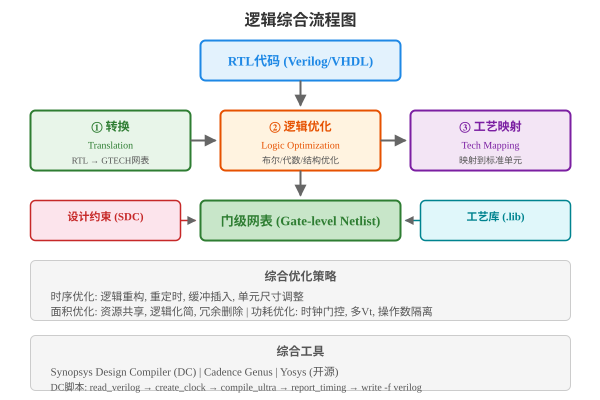
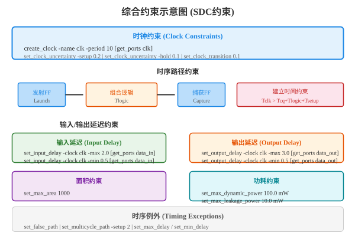
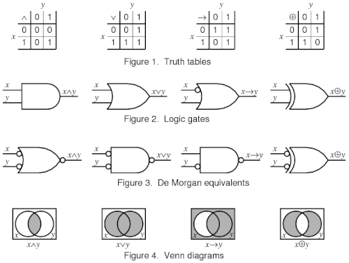

# 4.10 逻辑综合

> **前置知识**：[4.9 功能验证](4.9-功能验证.md)（承接上一章）。

## 1. 概述

逻辑综合（Logic Synthesis）是将RTL（寄存器传输级）硬件描述转换为门级网表（Gate-level Netlist）的过程，是连接前端设计（RTL）和后端设计（物理设计）的关键桥梁。综合工具根据设计约束（时序、面积、功耗）优化网表，使其满足设计目标。

## 2. 综合概念与流程

### 2.1 综合的三个阶段



逻辑综合包括以下三个阶段：

### 2.2 转换（Translation）

将RTL代码（Verilog/VHDL）转换为内部统一的布尔等式表示（GTECH网表）：

- 解析HDL代码
- 建立语法树
- 生成与工艺无关的通用门级表示

### 2.3 逻辑优化（Logic Optimization）

对布尔等式进行等价变换，优化逻辑结构：

- **布尔优化**：利用布尔代数规则化简逻辑表达式
- **代数优化**：使用代数方法简化逻辑
- **结构优化**：重构逻辑结构以减少面积或延迟

### 2.4 工艺映射（Technology Mapping）

将优化后的逻辑映射到目标工艺库的标准单元：

- 选择合适驱动强度的标准单元
- 满足时序约束
- 优化面积和功耗

## 3. RTL到门级网表转换

### 3.1 转换示例

RTL代码：

```verilog
module adder (input [3:0] a, b, input ci, output [3:0] s, output co);
    assign {co, s} = a + b + ci;
endmodule
```

综合后的门级网表：

```verilog
module adder (a, b, ci, s, co);
    input [3:0] a, b;
    input ci;
    output [3:0] s;
    output co;
    
    wire n1, n2, n3, n4, n5, n6, n7, n8;
    
    XOR2_X1 U1 (.A(a[0]), .B(b[0]), .Z(n1));
    XOR2_X1 U2 (.A(n1), .B(ci), .Z(s[0]));
    AND2_X1 U3 (.A(a[0]), .B(b[0]), .Z(n2));
    AND2_X1 U4 (.A(a[0]), .B(ci), .Z(n3));
    AND2_X1 U5 (.A(b[0]), .B(ci), .Z(n4));
    OR3_X1 U6 (.A(n2), .B(n3), .C(n4), .Z(n5));
    // ... 后续位
endmodule
```

## 4. 综合约束

### 4.1 时序约束

时序约束是综合过程中最重要的约束，定义了设计需要满足的时序要求。



### 4.2 时钟定义

```tcl
# 创建时钟
create_clock -name clk -period 10 [get_ports clk]
set_clock_uncertainty -setup 0.2 [get_clocks clk]
set_clock_uncertainty -hold 0.1 [get_clocks clk]
set_clock_transition -rise 0.1 [get_clocks clk]
set_clock_transition -fall 0.1 [get_clocks clk]
```

### 4.3 输入延迟

```tcl
# 输入延迟约束
set_input_delay -clock clk -max 2.0 [get_ports data_in]
set_input_delay -clock clk -min 0.5 [get_ports data_in]
```

### 4.4 输出延迟

```tcl
# 输出延迟约束
set_output_delay -clock clk -max 3.0 [get_ports data_out]
set_output_delay -clock clk -min 0.5 [get_ports data_out]
```

### 4.5 面积约束

```tcl
# 面积约束
set_max_area 1000
```

### 4.6 功耗约束

```tcl
# 功耗约束
set_max_dynamic_power 100.0 mW
set_max_leakage_power 10.0 mW
```

## 5. 时序约束详解

### 5.1 建立时间约束

建立时间约束保证数据在时钟沿前到达：

$$T_{clk} > T_{cq} + T_{logic} + T_{setup} + T_{skew}$$

其中：
- $T_{clk}$：时钟周期
- $T_{cq}$：时钟到输出的延迟
- $T_{logic}$：组合逻辑延迟
- $T_{setup}$：建立时间
- $T_{skew}$：时钟偏移

### 5.2 保持时间约束

保持时间约束保证数据在时钟沿后保持稳定：

$$T_{cq} + T_{logic} > T_{hold} + T_{skew}$$

### 5.3 时序裕量（Slack）

时序裕量表示时序路径的余量：

$$Slack = T_{required} - T_{arrival}$$

- **正Slack**：满足时序约束
- **负Slack**：违反时序约束，需要优化

## 6. 综合优化策略

### 6.1 时序优化

- **逻辑重构**：重定时（Retiming）、逻辑复制
- **路径优化**：关键路径识别与优化
- **缓冲插入**：在长路径上插入缓冲器
- **单元尺寸调整**：增大驱动能力

### 6.2 面积优化

- **资源共享**：多个操作共享同一硬件资源
- **逻辑化简**：简化布尔表达式
- **门级优化**：删除冗余逻辑

### 6.3 功耗优化

- **时钟门控**：自动插入时钟门控单元
- **操作数隔离**：减少无用翻转
- **多阈值电压**：使用HVT/LVT单元组合


该图示意了逻辑综合中时序、面积与功耗优化的协同关系，综合工具按约束在PPA之间取得平衡。

## 7. 网表质量评估

### 7.1 评估指标

| 指标 | 说明 |
|------|------|
| 最差负Slack（WNS） | 所有路径中最差的setup slack |
| 总负Slack（TNS） | 所有负slack路径的总和 |
| 最差保持Slack | 最差的hold slack |
| 总面积 | 网表的总面积 |
| 总功耗 | 动态功耗+静态功耗 |
| 门数 | 使用的标准单元数量 |
| 最大扇出 | 驱动能力最弱的信号 |

### 7.2 综合报告

```tcl
# 生成报告
report_timing -nworst 10 > timing.rpt
report_area > area.rpt
report_power > power.rpt
report_qor > qor.rpt
```

## 8. 综合工具

### 8.1 Design Compiler（Synopsys）

Design Compiler（DC）是业界最主流的逻辑综合工具：

```tcl
# Design Compiler脚本示例
set target_library {gscl45nm.db}
set link_library {* gscl45nm.db}
set synthetic_library {dw_foundation.sldb}

read_verilog {top.v adder.v}
current_design top
link
uniquify

set_wire_load_model -name wireload_5000

create_clock -name clk -period 10 [get_ports clk]

compile_ultra

report_timing > timing.rpt
report_area > area.rpt
write -f verilog -output top_synth.v
write_sdc top_synth.sdc
```

### 8.2 Genus（Cadence）

```tcl
# Genus脚本示例
read_hdl -language verilog {top.v}
elaborate top
read_sdc constraints.sdc
syn_generic
syn_map
syn_opt
write_hdl > top_synth.v
write_sdc > top_synth.sdc
```

### 8.3 Yosys（开源）

Yosys是开源的逻辑综合工具，支持多种工艺：

```tcl
# Yosys脚本示例
read_verilog top.v
synth -top top
dfflibmap -liberty gscl45nm.lib
abc -liberty gscl45nm.lib
write_verilog top_synth.v
```

## 9. 综合与工艺库关系

### 9.1 工艺库依赖性

综合结果高度依赖于工艺库（Liberty库）：

- **时序模型**：单元的延迟和转换时间
- **功耗模型**：内部功耗和漏电功耗
- **面积信息**：单元的面积
- **约束信息**：建立时间、保持时间

### 9.2 不同工艺库的综合差异

| 工艺节点 | 综合策略 | 特点 |
|---------|---------|------|
| 180nm/130nm | 面积优先 | 线延迟占比小 |
| 90nm/65nm | 时序优先 | 线延迟开始显著 |
| 45nm/28nm | 功耗-时序平衡 | 漏电功耗占比大 |
| 16nm/7nm | 多Vt混合 | FinFET工艺，复杂约束 |

## 10. DFT插入

### 10.1 综合阶段的DFT

逻辑综合阶段可以同时进行可测性设计（DFT）插入：

- 扫描链替换：将普通DFF替换为扫描DFF
- 扫描链连接：将扫描单元级联成扫描链
- 测试点插入：增加测试控制点

### 10.2 DFT综合流程

```tcl
# 带DFT的DC综合
set_scan_configuration -chain_count 4
set_scan_configuration -style multiplexed_flip_flop

compile_ultra -scan

create_test_protocol
dft_drc
preview_scan
insert_dft
dft_drc
```

## 小结

逻辑综合是数字IC设计流程中的关键环节，将RTL代码转化为可制造的门级网表。本章介绍了综合的概念、流程、约束、优化策略和工具使用。理解综合原理对于设计高质量、可综合的RTL代码和满足PPA目标至关重要。

## 自测清单

1. 「概述」要解决的核心问题是什么？关键结论或公式是什么？
2. 「综合概念与流程」与上一节之间是什么关系？
3. 「RTL到门级网表转换」在什么场景下会用到？如果条件改变，结论会如何变化？
4. 能否不看正文，写出「综合约束」的关键流程或结构？
5. 「时序约束详解」最容易混淆的点是什么？

---

**下一章**：[4.11 物理设计](4.11-物理设计.md)
