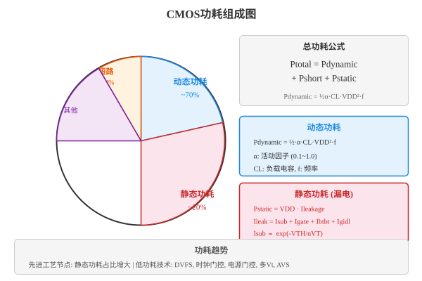
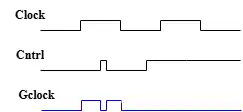
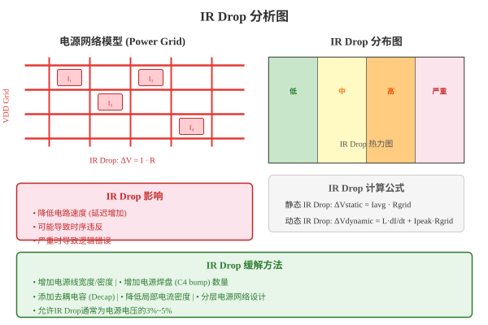

# 4.13 功耗分析

> **前置知识**：[4.12 时序分析](4.12-时序分析.md)（承接上一章）。

## 1. 概述

功耗是现代集成电路设计中的关键约束之一，与性能和面积并列为芯片设计的三大核心指标（PPA）。随着工艺节点不断缩小，功耗问题日益突出，尤其是静态功耗在总功耗中的占比越来越大。本章将详细介绍CMOS功耗的组成、分析和优化方法。

## 2. CMOS功耗组成

CMOS电路的功耗由三个主要部分组成：



$$P_{total} = P_{dynamic} + P_{short} + P_{static}$$

其中：
- $P_{dynamic}$：动态功耗（开关功耗）
- $P_{short}$：短路功耗（直流通路功耗）
- $P_{static}$：静态功耗（漏电功耗）

## 3. 动态功耗

### 3.1 动态功耗公式

动态功耗是CMOS电路工作时最主要的功耗来源，由电容充放电引起：

$$P_{dynamic} = \frac{1}{2} \cdot \alpha \cdot C_L \cdot V_{DD}^2 \cdot f$$

其中：
- $\alpha$：活动因子（Activity Factor），表示每时钟周期信号翻转的概率
- $C_L$：负载电容
- $V_{DD}$：电源电压
- $f$：工作频率

### 3.2 活动因子

活动因子$\alpha$取决于电路的功能和输入数据的统计特性：

- 时钟信号：$\alpha = 1.0$（每个周期翻转两次）
- 静态逻辑（平均）：$\alpha \approx 0.1\sim0.2$
- 数据总线：$\alpha \approx 0.5$（随机数据）

### 3.3 负载电容

负载电容包括：

$$C_L = C_{gate} + C_{diff} + C_{wire} + C_{fanout}$$

- $C_{gate}$：扇出单元的栅极电容
- $C_{diff}$：源漏扩散电容
- $C_{wire}$：互连线电容
- $C_{fanout}$：扇出负载电容

### 3.4 动态功耗与电压的关系

从公式可以看出，动态功耗与电压的平方成正比：

$$P_{dynamic} \propto V_{DD}^2$$

因此，降低电压是降低动态功耗最有效的方法。

## 4. 短路功耗

### 4.1 短路功耗原理

在信号翻转过程中，PMOS和NMOS同时导通，形成从VDD到VSS的直流通路，产生短路电流：

$$P_{short} = I_{short} \cdot V_{DD} \cdot t_{short} \cdot f$$

其中：
- $I_{short}$：短路电流峰值
- $t_{short}$：PMOS和NMOS同时导通的时间

### 4.2 影响短路功耗的因素

- 输入信号的上升/下降时间
- 输出负载电容
- 晶体管尺寸

短路功耗通常占总动态功耗的10%~20%。

## 5. 静态功耗

### 5.1 静态功耗来源

静态功耗主要由各种漏电流引起：

$$P_{static} = V_{DD} \cdot I_{leakage}$$

总漏电流由以下部分组成：

$$I_{leakage} = I_{sub} + I_{gate} + I_{btbt} + I_{gidl}$$

### 5.2 亚阈值漏电流（Subthreshold Leakage）

亚阈值漏电流是静态功耗的主要来源：

$$I_{sub} = I_0 \cdot \frac{W}{L} \cdot \exp\left(\frac{V_{GS} - V_{TH}}{n \cdot V_T}\right) \cdot \left[1 - \exp\left(-\frac{V_{DS}}{V_T}\right)\right]$$

其中：
- $I_0$：工艺相关常数
- $W/L$：晶体管宽长比
- $V_{TH}$：阈值电压
- $n$：亚阈值斜率因子
- $V_T = kT/q$：热电压

### 5.3 栅极漏电流（Gate Leakage）

栅极漏电流通过栅氧化层隧穿产生：

$$I_{gate} \propto \exp\left(-\frac{t_{ox}}{\hbar}\right)$$

在高k金属栅（HKMG）工艺中，栅极漏电显著降低。

### 5.4 PN 结漏电流（Junction Leakage）

PN 结反向偏置漏电流由载流子产生和扩散引起：

$$
I_{junction} = I_S \left[ \exp\left(\frac{qV}{kT}\right) - 1 \right] + I_{gen}
$$

当 PN 结反向偏置时，反向饱和电流为：

$$
I_S \propto A \cdot \left(\frac{D_p n_i^2}{L_p N_D} + \frac{D_n n_i^2}{L_n N_A}\right)
$$

其中 $I_{gen}$ 为耗尽区产生电流，$A$ 为 PN 结面积，$n_i$ 为本征载流子浓度。阱-衬底结和源漏-阱结的反向偏置漏电是静态功耗的重要组成部分。

### 5.5 其他漏电流

- **BTBT电流**：源漏与衬底之间的带间隧穿电流
- **GIDL电流**：栅致漏极漏电流

## 6. 漏电流与温度关系

### 6.1 温度对漏电流的影响

漏电流随温度升高呈指数增加：

$$I_{leakage}(T) = I_{leakage}(T_0) \cdot \exp\left(-\frac{E_a}{k} \cdot \left(\frac{1}{T} - \frac{1}{T_0}\right)\right)$$

其中$E_a$为激活能（约0.5~1.0 eV）。

### 6.2 温度反转效应

在先进工艺节点（28nm以下），由于电阻温度系数和迁移率温度效应的相互作用，可能出现温度反转效应（Temperature Inversion）——低温下路径延迟反而更大。

## 7. 低功耗技术

### 7.1 电压缩放（Voltage Scaling）

降低电压是最有效的功耗降低方法：

**动态电压频率缩放（DVFS）**：

$$P \propto V_{DD}^2 \cdot f$$

当性能需求降低时，同时降低电压和频率。

**自适应电压缩放（AVS）**：

根据芯片的PVT条件自动调整工作电压。

### 7.2 时钟门控（Clock Gating）

时钟门控是最常用的动态功耗降低技术：

- 关闭非活跃模块的时钟
- 减少无效翻转
- 可节省20%~50%的动态功耗


该图对比了时钟门控前后的时钟波形，说明通过关断非活跃模块时钟来抑制无用的信号翻转、降低动态功耗。

### 7.3 电源门控（Power Gating）

电源门控用于降低静态功耗：

- 使用开关晶体管（Header/Footer）切断模块电源
- 休眠模式下漏电几乎为零
- 需要隔离单元和保留寄存器

### 7.4 多阈值电压

使用不同阈值电压的单元库：

- 关键路径：LVT（低阈值，高速，高漏电）
- 非关键路径：HVT（高阈值，低速，低漏电）

### 7.5 其他低功耗技术

- **操作数隔离**：当模块不使用时，隔离输入信号
- **体偏置**：通过调整衬底偏压改变阈值电压
- **亚阈值设计**：在亚阈值区工作，功耗极低
- **近阈值计算**：在接近阈值电压的电压下工作

## 8. 动态/静态功耗分析

### 8.1 功耗分析流程

1. 读取门级网表
2. 读取工艺库信息
3. 读取寄生参数
4. 加载仿真波形（VCD/SAIF）
5. 计算翻转率
6. 计算动态功耗
7. 计算静态功耗
8. 生成功耗报告

### 8.2 功耗分析工具

| 工具 | 公司 | 功能 |
|------|------|------|
| PrimePower | Synopsys | 门级功耗分析 |
| Voltus | Cadence | 功耗完整性分析 |
| RedHawk | Ansys | 功耗/IR Drop/EM分析 |
| PowerArtist | Ansys | RTL级功耗分析 |
| SpyGlass Power | Synopsys | 早期功耗估计 |

## 9. 功耗约束与优化

### 9.1 功耗约束

```tcl
# 功耗约束
set_max_dynamic_power 100.0 mW
set_max_leakage_power 10.0 mW
set_max_total_power 110.0 mW
```

### 9.2 功耗优化策略

| 设计阶段 | 优化方法 |
|---------|---------|
| 架构级 | 并行处理、流水线、DVFS、电源门控 |
| RTL级 | 时钟门控、操作数隔离、状态编码优化 |
| 综合级 | 多Vt单元选择、门级优化 |
| 物理级 | 降低线长、减少缓冲器、电源网络优化 |

## 10. 电迁移（EM）与IR Drop分析

### 10.1 电迁移（Electromigration）

电迁移是金属原子在电流作用下发生迁移的现象，导致导线断裂或短路：

**Black's方程**：

$$MTTF = A \cdot J^{-n} \cdot \exp\left(\frac{E_a}{kT}\right)$$

其中：
- $MTTF$：平均失效时间
- $A$：常数
- $J$：电流密度
- $n$：电流密度指数（通常为2）
- $E_a$：激活能
- $k$：玻尔兹曼常数
- $T$：温度

### 10.2 IR Drop分析

IR Drop是电源网络上电压降的现象：



**静态IR Drop**：

$$\Delta V_{static} = I_{avg} \cdot R_{grid}$$

**动态IR Drop**：

$$\Delta V_{dynamic} = L \cdot \frac{dI}{dt} + I_{peak} \cdot R_{grid}$$

Ldi/dt噪声是电流快速变化时由封装/片上电感引起的电压降。

### 10.3 IR Drop的影响

- 降低电路速度
- 可能导致时序违反
- 严重时导致逻辑错误

## 11. 功耗分析工具

### 11.1 功耗分析流程

```tcl
# PrimePower脚本示例
read_verilog top_synth.v
read_liberty -max gscl45nm_ss.lib
read_liberty -min gscl45nm_ff.lib
read_sdc constraints.sdc
read_parasitics top.spef
read_vcd -strip_path tb_top/dut top.vcd

set_operating_conditions -analysis_type on_chip_variation

report_power -hier > power.rpt
report_power -analysis_type dynamic > dynamic_power.rpt
report_power -analysis_type static > static_power.rpt
```

### 11.2 功耗报告解读

```
Total Power: 85.3 mW
  Dynamic Power: 72.1 mW (84.5%)
    Switching Power: 65.3 mW (76.6%)
    Internal Power: 6.8 mW (8.0%)
  Static Power: 13.2 mW (15.5%)
```

## 小结

功耗分析是芯片设计签核的重要组成部分。本章介绍了CMOS功耗的组成（动态/短路/静态）、功耗公式、漏电流机制、低功耗技术和功耗分析方法。随着工艺节点不断缩小，功耗管理已成为芯片设计中最具挑战性的任务之一。

## 自测清单

1. 「概述」要解决的核心问题是什么？关键结论或公式是什么？
2. 「CMOS功耗组成」与上一节之间是什么关系？
3. 「动态功耗」在什么场景下会用到？如果条件改变，结论会如何变化？
4. 能否不看正文，写出「短路功耗」的关键流程或结构？
5. 「静态功耗」最容易混淆的点是什么？

---

**下一章**：[4.14 版图设计](4.14-版图设计.md)
