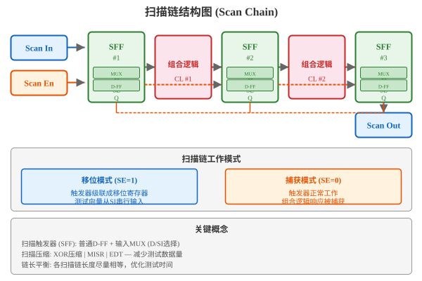
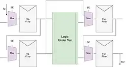
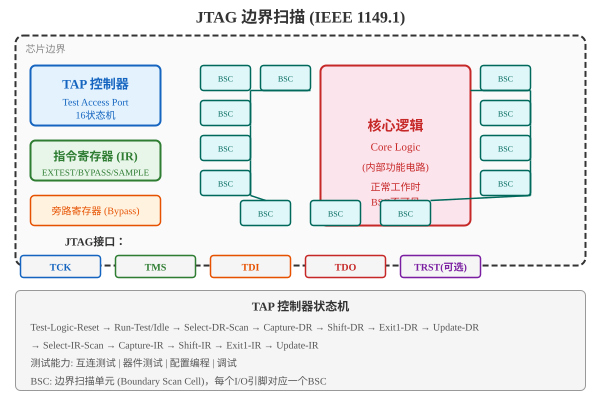
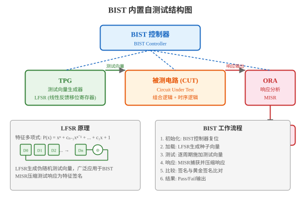

# 4.15 可测性设计（DFT）

> **前置知识**：[4.14 版图设计](4.14-版图设计.md)（承接上一章）。

## 1. 概述

可测性设计（Design for Testability, DFT）是在芯片设计阶段就考虑测试需求的工程方法，通过在芯片中添加测试结构，提高芯片制造后的测试效率和故障覆盖率。随着芯片复杂度的提高，DFT已成为芯片设计中不可或缺的组成部分。

## 2. 测试基本概念

### 2.1 测试的目的

- **制造缺陷检测**：识别制造过程中的物理缺陷
- **良率提升**：通过测试数据分析改进工艺
- **可靠性筛选**：剔除早期失效芯片
- **质量保证**：确保出厂芯片满足规格要求

### 2.2 测试成本

测试成本占芯片总成本的显著比例：

$$C_{test} = C_{ATE} + C_{program} + C_{handler} + C_{time}$$

其中：
- $C_{ATE}$：自动测试设备成本
- $C_{program}$：测试程序开发成本
- $C_{handler}$：分选机/探针台成本
- $C_{time}$：测试时间成本

## 3. 故障模型

### 3.1 固定型故障（Stuck-at Fault）

固定型故障模型假设故障节点的逻辑值固定为0或1：

- **SA0（Stuck-at 0）**：节点固定为0
- **SA1（Stuck-at 1）**：节点固定为1

固定型故障覆盖率：

$$FC_{SA} = \frac{N_{detected}}{2 \times N_{nodes}} \times 100\%$$

### 3.2 跳变延迟故障（Transition Delay Fault）

跳变延迟故障检测信号在时钟周期内不能完成从0→1或1→0的跳变：

- **慢上升（Slow-to-Rise）**：0→1跳变太慢
- **慢下降（Slow-to-Fall）**：1→0跳变太慢

### 3.3 桥接故障（Bridging Fault）

桥接故障模拟两条信号线之间的短路：

- **线与（AND-type）**：短路导致逻辑"与"
- **线或（OR-type）**：短路导致逻辑"或"
- **电阻型**：短路电阻非零

### 3.4 其他故障模型

- **开路故障（Open Fault）**：导线断裂
- **延迟故障（Delay Fault）**：路径延迟超过时钟周期
- **IDDQ故障**：静态电流异常

## 4. ATPG

### 4.1 ATPG概念

ATPG（Automatic Test Pattern Generation）自动生成测试向量，用于检测芯片中的制造缺陷。

### 4.2 ATPG算法

- **D算法**：基于D立方体的路径敏化
- **PODEM**：面向目标的测试生成
- **FAN**：扇出导向的测试生成
- **SOCRATES**：基于学习和推理的测试生成

### 4.3 ATPG效率

ATPG效率指标：

- **故障覆盖率**：检测到的故障占总故障的比例
- **测试向量数**：测试所需的最小向量数
- **测试时间**：应用测试向量所需的时间
- **ATPG运行时间**：生成测试向量所需的时间

## 5. 扫描链设计（Scan Chain）

### 5.1 扫描链原理

扫描链将电路中的普通触发器替换为扫描触发器，在测试模式下构成移位寄存器链，实现测试数据的串行输入和输出。



### 5.2 扫描触发器

扫描触发器（Scan Flip-Flop）在普通触发器基础上增加：

- **扫描输入（Scan In, SI）**：测试模式下的数据输入
- **扫描使能（Scan Enable, SE）**：控制工作模式（正常/扫描）

### 5.3 扫描链工作模式

**扫描移位模式（Shift Mode）**：

在SE=1时，触发器级联成移位寄存器，测试向量从SI串行输入，同时测试响应从SO串行输出。

**捕获模式（Capture Mode）**：

在SE=0时，触发器正常工作，组合逻辑响应被捕获到触发器。


该图示意扫描链的结构，普通触发器替换为扫描触发器后级联构成移位寄存器链，实现测试数据的串行加载与卸载。

### 5.4 扫描链设计考虑

- **链长平衡**：各扫描链长度尽量相等
- **测试时钟**：测试时钟与功能时钟的关系
- **扫描压缩**：减少测试数据量和测试时间

### 5.5 扫描压缩

扫描压缩技术在减少测试时间的同时保持高故障覆盖率：

$$\text{压缩比} = \frac{\text{标准扫描链测试时间}}{\text{压缩扫描测试时间}}$$

常用压缩技术包括：
- **XOR压缩**：多扫描链输出异或后输出
- **MISR**：多输入特征寄存器
- **EDT**：嵌入式确定性测试

## 6. 边界扫描（JTAG/IEEE 1149.1）

### 6.1 边界扫描原理

边界扫描是IEEE 1149.1标准定义的测试方法，通过在芯片I/O引脚和内部逻辑之间添加边界扫描单元（BSC），实现对芯片互连的测试。



### 6.2 JTAG接口

JTAG（Joint Test Action Group）定义了4个（可选5个）测试引脚：

| 引脚 | 名称 | 功能 |
|------|------|------|
| TCK | Test Clock | 测试时钟 |
| TMS | Test Mode Select | 测试模式选择 |
| TDI | Test Data In | 测试数据输入 |
| TDO | Test Data Out | 测试数据输出 |
| TRST | Test Reset（可选） | 测试复位 |

### 6.3 边界扫描测试能力

- **互连测试**：检测PCB上芯片间的连接故障
- **器件测试**：测试芯片内部逻辑
- **配置编程**：通过JTAG编程FPGA/CPLD
- **调试**：芯片调试和故障定位

### 6.4 边界扫描寄存器

TAP（Test Access Port）控制器状态机包含以下主要状态：

1. **Test-Logic-Reset**：测试逻辑复位
2. **Run-Test/Idle**：运行测试或空闲
3. **Select-DR-Scan**：选择数据寄存器扫描
4. **Capture-DR**：捕获数据到寄存器
5. **Shift-DR**：移位数据寄存器
6. **Update-DR**：更新数据寄存器

## 7. 内置自测试（BIST）

### 7.1 BIST概念

BIST（Built-In Self-Test）在芯片内部集成测试向量生成和响应分析电路，实现自测试能力。



### 7.2 BIST基本结构

BIST系统包含三个主要组件：

1. **TPG（Test Pattern Generator）**：测试向量生成器，通常使用LFSR（线性反馈移位寄存器）
2. **ORA（Output Response Analyzer）**：输出响应分析器，通常使用MISR（多输入特征寄存器）
3. **BIST Controller**：BIST控制器，管理测试流程

### 7.3 LFSR原理

LFSR（Linear Feedback Shift Register）用于生成伪随机测试向量：

$$P(x) = x^n + c_{n-1}x^{n-1} + \cdots + c_1x + 1$$

其中$P(x)$为本原多项式，$c_i$为反馈系数。

LFSR生成的序列周期为$2^n - 1$，其中$n$为寄存器位数。

### 7.4 MISR原理

MISR（Multiple Input Signature Register）压缩多个测试响应为单一特征值：

$$S_{new} = S_{old} \oplus (Input) \text{（通过线性反馈）}$$

测试结束时，MISR中的特征值与预期特征值比较，判断测试结果。

## 8. 存储器BIST

### 8.1 存储器测试需求

嵌入式存储器（SRAM/ROM/DRAM）在SoC中占用大量面积，需要专门的测试方法。

### 8.2 存储器故障模型

- **SAF（Stuck-At Fault）**：存储单元固定故障
- **TF（Transition Fault）**：跳变故障
- **CF（Coupling Fault）**：耦合故障
- **NPSF（Neighborhood Pattern Sensitive Fault）**：邻域敏感故障

### 8.3 March算法

March算法是存储器测试的标准算法：

**March C-算法**：

```
March C-步骤：
1. ⇑ (w0)     — 所有单元写0
2. ⇑ (r0, w1) — 读0，写1
3. ⇑ (r1, w0) — 读1，写0
4. ⇓ (r0, w1) — 读0，写1
5. ⇓ (r1, w0) — 读1，写0
6. ⇓ (r0)     — 读0
```

March C-算法的故障覆盖率为：
- 覆盖所有SAF、TF、部分CF和NPSF
- 测试时间：$O(10n)$，其中$n$为存储单元数

### 8.4 MBIST架构

存储器BIST（MBIST）架构包括：

- **BIST控制器**：生成测试算法控制信号
- **地址生成器**：生成递增/递减地址序列
- **数据生成器**：生成测试数据模式
- **比较器**：比较读写数据

## 9. 测试覆盖率

### 9.1 故障覆盖率

故障覆盖率是检测到的故障数与总故障数的比值：

$$FC = \frac{N_{detected}}{N_{total}} \times 100\%$$

### 9.2 测试覆盖率目标

| 应用领域 | 目标覆盖率 | 说明 |
|---------|-----------|------|
| 消费电子 | >95% | 成本敏感，允许一定缺陷率 |
| 工业控制 | >98% | 可靠性要求较高 |
| 汽车电子 | >99% | 安全关键应用 |
| 航空航天 | >99.5% | 极高可靠性要求 |
| 医疗器件 | >99.9% | 生命攸关应用 |

### 9.3 缺陷率与良率

良率（Yield）与缺陷密度的关系：

$$Y = \exp(-A \cdot D_0)$$

其中：
- $Y$：良率
- $A$：芯片面积
- $D_0$：缺陷密度（defects/cm²）

## 10. 诊断与良率分析

### 10.1 故障诊断

故障诊断定位芯片中的缺陷位置：

- **逻辑诊断**：基于故障字典的匹配
- **物理诊断**：结合版图信息的故障定位
- **电压/电流诊断**：基于功耗特性的分析

### 10.2 良率分析

良率分析通过测试数据找出良率损失的原因：

- **空间分析**：晶圆上缺陷分布模式
- **参数分析**：工艺参数与良率的关系
- **系统缺陷分析**：设计相关的系统性问题

### 10.3 良率提升

- **设计改进**：修改DFM规则，避免敏感结构
- **工艺优化**：改进工艺参数，减少缺陷
- **冗余设计**：添加冗余单元
- **修复技术**：通过激光修复或电编程修复

## 小结

可测性设计是确保芯片质量和良率的关键技术。本章介绍了测试的基本概念、故障模型、ATPG、扫描链设计、JTAG边界扫描、BIST、存储器测试和良率分析等内容。在现代芯片设计中，DFT是必须考虑的设计环节，直接影响芯片的可制造性和测试成本。

## 自测清单

1. 「测试的基本概念」中，可控性与可观测性分别指什么？为什么它们决定测试难度？
2. 「故障模型」为什么要用固定型故障等模型近似真实缺陷？
3. 「ATPG」如何为组合电路生成测试向量？D 算法与 PODEM 的核心差别是什么？
4. 「扫描链设计」如何把时序电路测试转化为组合电路测试？
5. 「边界扫描」与「内置自测试」分别解决板级还是芯片内部的测试问题？

---

**下一章**：[4.16 SoC 设计](4.16-SoC设计.md)
