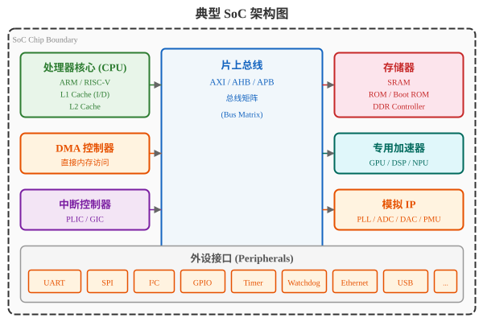
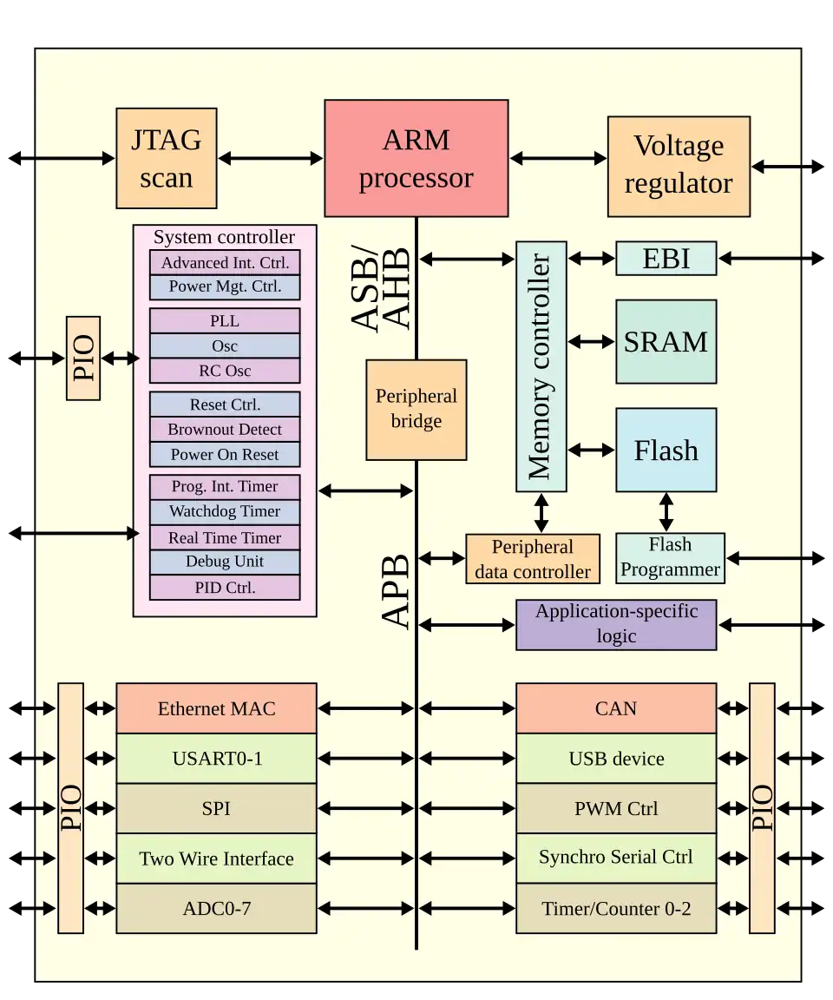
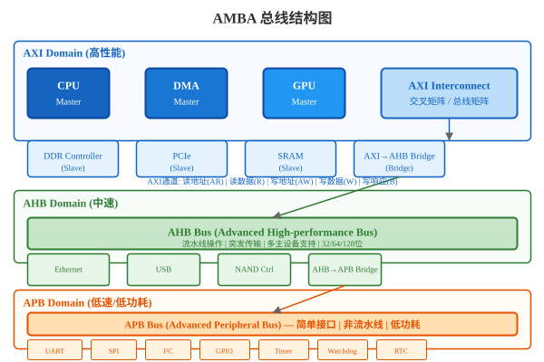
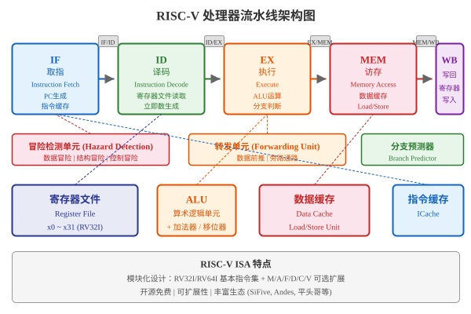

# 4.16 SoC 设计

> **前置知识**：[4.15 可测性设计（DFT）](4.15-可测性设计-DFT.md)（承接上一章）。

## 1. 概述

SoC（System on Chip）将完整的电子系统集成到单个芯片上，包括处理器核心、存储器、外设接口、模拟IP和专用加速器等。SoC设计是当今集成电路设计的主流方向，广泛应用于移动设备、IoT、汽车电子、AI计算等领域。

## 2. SoC基本架构

### 2.1 典型SoC架构



典型的SoC架构包含以下组件：

- **处理器核心（CPU）**：系统控制和通用计算
- **片上总线**：连接各模块的通信骨干
- **存储器**：SRAM、Cache、ROM
- **外设接口**：UART、SPI、I²C、USB、PCIe、Ethernet
- **专用加速器**：GPU、DSP、NPU、硬件编解码器
- **模拟IP**：PLL、ADC、DAC、PMU
- **中断控制器**：管理中断请求
- **DMA控制器**：直接内存访问


该图以框图形式展示典型SoC的组成，包括处理器核心、片上总线、存储器、外设接口与专用加速器等模块。

### 2.2 SoC架构设计原则

- **模块化设计**：功能模块独立设计，便于复用
- **层次化总线**：高性能和低性能模块使用不同总线
- **数据本地性**：减少跨模块数据传输
- **功耗管理**：多电压域、时钟门控、电源门控
- **可扩展性**：支持不同配置和衍生版本

## 3. 片上总线协议

### 3.1 AMBA总线

AMBA（Advanced Microcontroller Bus Architecture）是ARM公司开发的片上总线标准，是SoC设计中最广泛使用的总线协议。



### 3.2 AHB（Advanced High-performance Bus）

AHB用于连接高性能模块，如CPU、DMA、外部存储器接口：

- 流水线操作
- 突发传输（Burst Transfer）
- 多主设备支持
- 数据宽度：32/64/128位

### 3.3 APB（Advanced Peripheral Bus）

APB用于连接低性能外设，如UART、SPI、I²C、GPIO：

- 简单接口，低功耗
- 非流水线操作
- 单主设备（桥接至AHB/AXI）
- 地址和数据分开

### 3.4 AXI（Advanced eXtensible Interface）

AXI是高性能、高频率的片上总线协议：

- 独立的地址/数据通道（读地址、读数据、写地址、写数据、写响应）
- 乱序传输（Out-of-Order）
- 多主设备、多从设备
- 数据宽度：32/64/128/256/512/1024位
- 支持独占访问和原子操作

### 3.5 AXI总线时序

AXI写传输的握手协议：

```
// 写地址通道
TVALID → 主设备地址有效
TREADY → 从设备准备接收

// 写数据通道
TVALID → 主设备数据有效
TREADY → 从设备准备接收
WLAST  → 最后一个数据

// 写响应通道
TVALID → 从设备响应有效
TREADY → 主设备准备接收
BRESP  → 响应状态（OKAY/EXOKAY/SLVERR/DECERR）
```

## 4. 处理器内核

### 4.1 ARM处理器

| 系列 | 架构 | 应用 |
|------|------|------|
| Cortex-M | ARMv7-M/v8-M | 微控制器、IoT |
| Cortex-R | ARMv7-R/v8-R | 实时控制 |
| Cortex-A | ARMv7-A/v8-A/v9-A | 应用处理器、移动设备 |
| Neoverse | ARMv8-A/v9-A | 服务器、基础设施 |

### 4.2 RISC-V处理器



RISC-V是一种开源指令集架构（ISA），具有以下特点：

- **模块化设计**：基本ISA（RV32I/RV64I）+ 可选扩展（M/A/F/D/C/V）
- **开源免费**：无需支付授权费
- **可扩展性**：支持自定义指令扩展
- **生态丰富**：多种开源和商业实现

RISC-V处理器架构：

```
+------------------+
| 取指 (IF)        |
| 指令缓存 (ICache) |
+--------+---------+
         |
+--------+---------+
| 译码 (ID)        |
| 寄存器文件       |
+--------+---------+
         |
+--------+---------+
| 执行 (EX)        |
| ALU/分支/MUL     |
+--------+---------+
         |
+--------+---------+
| 访存 (MEM)       |
| 数据缓存 (DCache) |
+--------+---------+
         |
+--------+---------+
| 写回 (WB)        |
+------------------+
```

### 4.3 MIPS处理器

MIPS是另一种RISC架构，虽然市场份额减少，但在某些领域仍有应用。

## 5. 片内存储器

### 5.1 SRAM

SRAM（Static Random Access Memory）是SoC中最常用的片上存储器：

- 速度快（与逻辑工艺兼容）
- 面积大（6T/8T单元）
- 用于Cache、TCM、FIFO、寄存器文件

### 5.2 Cache

Cache层次结构：

- **L1 Cache**：每个CPU核私有，通常32KB~64KB，访问延迟1~2周期
- **L2 Cache**：多核共享，通常256KB~2MB，访问延迟10~20周期
- **L3 Cache**：SoC共享，通常2MB~32MB，访问延迟30~50周期

Cache性能公式：

$$\text{AMAT} = T_{hit} + P_{miss} \times T_{miss}$$

其中：
- $AMAT$：平均存储器访问时间
- $T_{hit}$：Cache命中访问时间
- $P_{miss}$：Cache缺失率
- $T_{miss}$：Cache缺失惩罚时间

### 5.3 ROM

ROM用于存储Bootloader和固件：

- Mask ROM：掩模编程，低成本
- OTP：一次可编程
- eFuse：电编程ROM

## 6. 外设IP集成

### 6.1 常见外设接口

| 接口 | 类型 | 速度 | 用途 |
|------|------|------|------|
| UART | 串行 | 1Mbps~10Mbps | 调试、低速通信 |
| SPI | 串行 | 10Mbps~100Mbps | 传感器、显示器 |
| I²C | 串行 | 100Kbps~3.4Mbps | 低速外设、配置 |
| USB 2.0/3.0 | 串行 | 480Mbps/5Gbps | 通用外设 |
| PCIe | 串行 | 1GT/s~32GT/s | 高速外设、GPU |
| Ethernet | 网络 | 10Mbps~100Gbps | 网络通信 |
| MIPI | 串行 | 1Gbps~10Gbps | 摄像头、显示器 |

### 6.2 IP集成流程

```tcl
# IP集成步骤
1. 选择IP → 评估IP规格
2. 获取IP → 获得RTL/网表和验证模型
3. IP配置 → 配置参数（数据宽度、FIFO深度等）
4. 集成验证 → 验证IP在SoC中的正确连接
5. 物理实现 → 布局布线和时序收敛
```

## 7. 中断控制器

### 7.1 中断控制器功能

- 接收多个外设的中断请求
- 优先级仲裁
- 中断屏蔽
- 中断分发（多核系统）

### 7.2 ARM GIC

ARM Generic Interrupt Controller（GIC）架构：

- **GIC-400**：Cortex-A9/A15
- **GIC-500/600**：Cortex-A53/A72/A76
- **GIC-700**：Cortex-A78/X1

### 7.3 RISC-V PLIC

RISC-V Platform-Level Interrupt Controller（PLIC）的管理：

- 最多支持1024个中断源
- 7个优先级等级
- 支持多核中断分发

## 8. DMA控制器

DMA（Direct Memory Access）控制器在不经过CPU的情况下直接在外设和存储器之间传输数据。

### 8.1 DMA传输模式

- **单次传输**：每次传输一个数据单元
- **突发传输**：连续传输多个数据单元
- **链表传输**：通过描述符链表管理多个传输任务

### 8.2 DMA性能

DMA传输速率：

$$R_{DMA} = \frac{N_{data}}{T_{setup} + N_{data} \times T_{cycle}}$$

其中：
- $N_{data}$：传输数据量
- $T_{setup}$：DMA设置时间
- $T_{cycle}$：每数据单元传输周期

## 9. 时钟与复位管理

### 9.1 时钟管理

- **PLL**：从外部参考时钟生成多个频率的时钟
- **时钟分配网络**：将时钟分配到各模块
- **时钟门控**：关闭非活跃模块的时钟
- **时钟分频**：生成不同频率的时钟

### 9.2 复位管理

- **上电复位（POR）**：芯片上电时自动复位
- **外部复位**：通过复位引脚复位
- **看门狗复位**：系统异常时自动复位
- **软件复位**：通过软件控制复位

## 10. 电源管理单元

### 10.1 PMU功能

- 多电压域管理
- 电源门控控制
- 动态电压频率缩放（DVFS）
- 休眠/唤醒控制

### 10.2 电源管理模式

| 模式 | 电压 | 时钟 | 功耗 | 唤醒时间 |
|------|------|------|------|---------|
| 运行 | 正常 | 正常 | 高 | - |
| 等待 | 正常 | 门控 | 中 | 几个周期 |
| 休眠 | 降低 | 关闭 | 低 | 几微秒 |
| 关断 | 关闭 | 关闭 | 极低 | 几毫秒 |

## 11. Boot ROM启动流程

### 11.1 启动流程

1. CPU上电复位，从Boot ROM地址取指
2. Boot ROM执行基本硬件初始化
3. 检测启动模式（Boot Mode）
4. 从选定启动设备加载Bootloader
5. 验证Bootloader签名（安全启动）
6. 跳转到Bootloader执行
7. Bootloader加载操作系统

### 11.2 启动设备

- SPI Flash（NOR Flash）
- NAND Flash
- eMMC/SD卡
- USB
- Ethernet（网络启动）

## 12. HAL与裸机驱动

### 12.1 HAL（硬件抽象层）

HAL提供统一的硬件接口，隐藏底层硬件细节：

```c
// HAL UART示例
void HAL_UART_Init(UART_HandleTypeDef *huart);
HAL_StatusTypeDef HAL_UART_Transmit(UART_HandleTypeDef *huart, 
    uint8_t *pData, uint16_t Size, uint32_t Timeout);
HAL_StatusTypeDef HAL_UART_Receive(UART_HandleTypeDef *huart, 
    uint8_t *pData, uint16_t Size, uint32_t Timeout);
```

### 12.2 裸机驱动

裸机驱动直接操作硬件寄存器，无需操作系统：

```c
// 寄存器映射
#define UART_BASE 0x40001000
#define UART_DATA (*((volatile uint32_t *)(UART_BASE + 0x00)))
#define UART_STATUS (*((volatile uint32_t *)(UART_BASE + 0x04)))

void uart_send(char c) {
    while (!(UART_STATUS & 0x2));  // 等待发送就绪
    UART_DATA = c;
}
```

## 13. RTOS基础

### 13.1 常用RTOS

- **FreeRTOS**：开源，广泛使用
- **RT-Thread**：国产开源RTOS
- **Zephyr**：Linux基金会开源RTOS
- **VxWorks**：商业RTOS，高可靠性

### 13.2 RTOS核心概念

- **任务（Task）**：独立执行线程
- **调度器（Scheduler）**：优先级调度、时间片轮转
- **同步机制**：信号量、互斥锁、消息队列
- **中断管理**：中断服务程序（ISR）
- **内存管理**：静态/动态内存分配

## 14. 软硬件协同设计

### 14.1 软硬件划分

设计决策：哪些功能由硬件实现，哪些由软件实现：

| 实现方式 | 优点 | 缺点 |
|---------|------|------|
| 硬件实现 | 速度快、功耗低 | 灵活性差、开发周期长 |
| 软件实现 | 灵活性高、开发快 | 速度慢、功耗高 |

### 14.2 协同验证

- **虚拟原型**：在软件环境中模拟完整系统
- **FPGA原型**：硬件加速验证
- **仿真加速**：使用硬件仿真器

## 15. 多核与异构计算

### 15.1 多核架构

- **对称多处理（SMP）**：各核地位平等，共享内存
- **非对称多处理（AMP）**：各核运行不同任务
- **big.LITTLE**：高性能核+高效能核组合

### 15.2 异构计算

- **CPU+GPU**：图形和通用计算
- **CPU+DSP**：数字信号处理
- **CPU+NPU**：神经网络加速
- **CPU+FPGA**：可重构计算

### 15.3 核间通信

- **共享内存**：通过共享存储器交换数据
- **消息传递**：通过Mailbox/IPC机制通信
- **硬件同步**：使用原子操作和自旋锁

## 小结

SoC设计是当今集成电路设计的主流方向，将完整的电子系统集成到单个芯片上。本章介绍了SoC的基本架构、处理器核心、片上总线协议、存储器层次、外设IP集成、电源管理、启动流程、RTOS等关键内容。随着Chiplet和异构集成技术的发展，SoC设计正朝着更复杂、更灵活的方向演进。

## 自测清单

1. 「概述」要解决的核心问题是什么？关键结论或公式是什么？
2. 「SoC基本架构」与上一节之间是什么关系？
3. 「片上总线协议」在什么场景下会用到？如果条件改变，结论会如何变化？
4. 能否不看正文，写出「处理器内核」的关键流程或结构？
5. 「片内存储器」最容易混淆的点是什么？

---

**下一章**：[4.17 先进技术专题](4.17-先进技术专题.md)
