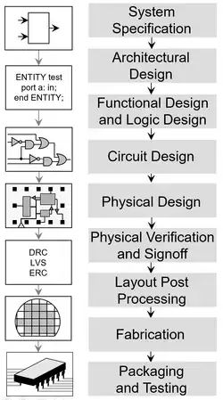
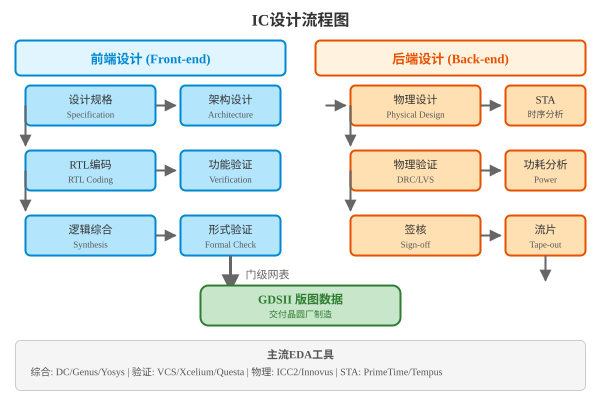
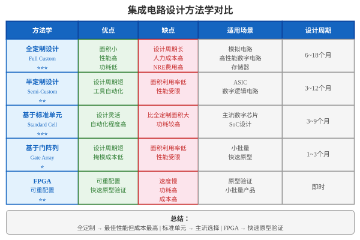

# 4.2 集成电路设计流程

> **前置知识**：[4.1 半导体工艺基础](4.1-半导体工艺基础.md)（承接上一章）。

## 1. 概述

集成电路设计是从芯片规格定义到最终流片生产的完整过程。随着芯片复杂度不断提高，设计流程也日趋规范化和自动化。本章将全面介绍标准IC设计流程的各个阶段。

## 2. 从设计到芯片全流程

完整的IC设计流程可以分为前端设计（Front-end）和后端设计（Back-end）两大阶段：

该图整体示意了从规格定义、前端设计到后端物理设计与流片的完整IC设计流程。

### 2.1 前端设计流程

1. **设计规格（Specification）**：定义芯片功能、性能指标、接口协议、功耗预算、面积约束等
2. **架构设计**：确定系统架构、模块划分、数据通路、控制逻辑
3. **RTL编码**：使用Verilog/VHDL/SystemVerilog编写寄存器传输级描述
4. **功能验证**：通过仿真验证RTL功能的正确性
5. **逻辑综合**：将RTL代码转换为门级网表（Netlist）
6. **形式验证**：验证综合前后功能等价性

### 2.2 后端设计流程

1. **物理设计（Physical Design）**：包括布图规划、布局、时钟树综合、布线
2. **静态时序分析（STA）**：验证设计是否满足时序约束
3. **物理验证**：DRC（设计规则检查）、LVS（版图与电路一致性检查）
4. **功耗分析**：评估动态和静态功耗
5. **寄生参数提取**：提取RC寄生参数用于后仿真
6. **流片（Tape-out）**：将最终版图数据交付制造

## 3. 设计规格（Specification）

设计规格书是芯片设计的起点，定义了芯片的完整功能和技术指标。一个典型的规格书包含：

- **功能描述**：芯片的主要功能和操作模式
- **接口定义**：引脚功能、时序图、协议标准
- **性能指标**：工作频率、吞吐量、延迟
- **功耗预算**：最大功耗、待机功耗、各模式功耗
- **面积约束**：芯片面积、封装类型
- **工艺节点**：制造工艺、工艺角、电压温度范围
- **测试策略**：DFT要求、测试覆盖率目标
- **合规性**：需遵循的标准（如IEEE、ISO、USB、PCIe）

## 4. 架构设计

架构设计阶段将规格转化为具体的系统架构方案。

### 4.1 架构设计要点

- **模块划分**：将系统功能划分为可管理的子模块
- **数据通路设计**：确定数据流方向、数据宽度、流水线级数
- **控制逻辑设计**：有限状态机、握手协议、仲裁机制
- **存储架构**：缓存层次结构、存储器类型和大小
- **总线架构**：系统总线拓扑、协议选择
- **电源管理**：电压域划分、电源门控策略

### 4.2 架构评估

架构设计阶段需要进行多项评估：

- **性能建模**：使用C/C++/SystemC建立性能模型
- **面积估算**：估算各模块的面积开销
- **功耗估算**：评估系统级功耗
- **设计权衡**：根据PPA（Performance/功耗/面积）指标进行权衡

## 5. 前端设计（RTL）

RTL（Register Transfer Level）设计是使用硬件描述语言（HDL）描述数字电路的行为，将在第4.5节中详细讨论。

## 6. 功能验证

功能验证是确保芯片设计正确性的关键环节，将在第4.9节中详细讨论。验证方法包括：

- **仿真验证**：动态仿真测试向量
- **形式验证**：数学方法证明设计正确性
- **等价性检查**：验证不同抽象层次的一致性
- **覆盖率分析**：代码覆盖率和功能覆盖率

## 7. 逻辑综合

逻辑综合将RTL代码转换为工艺库相关的门级网表，将在第4.10节中详细讨论。

## 8. 形式验证

形式验证使用数学方法证明设计满足特定属性，主要方法包括：

- **等价性检查（EC）**：验证RTL与门级网表的功能等价性
- **模型检查（Model Checking）**：验证设计是否满足时序逻辑属性
- **定理证明（Theorem Proving）**：使用数学推理证明设计正确性

## 9. 后端设计（物理设计）

物理设计包括从布图规划到布线完成的全过程，将在第4.11节中详细讨论。

## 10. 流片（Tape-out）

流片是将完整的芯片设计数据交付给晶圆厂进行制造的过程。

### 10.1 流片前检查

- **设计规则检查（DRC）**：确认满足所有工艺设计规则
- **版图与电路一致性检查（LVS）**：确认版图与电路一致
- **天线规则检查**：检查天线效应
- **电气规则检查（ERC）**：检查电气连接正确性
- **可靠性检查**：EM、IR Drop、热分析
- **时序签核（Timing Sign-off）**：STA确认满足所有时序约束
- **功耗签核（Power Sign-off）**：确认满足功耗预算

### 10.2 流片数据

流片需要提交的数据包括：

- GDSII/OASIS版图数据
- 掩模版制作数据
- 工艺参数文件
- 测试向量与测试程序
- 封装信息

## 11. 封装与测试

### 11.1 封装

封装类型包括：

- **DIP**：双列直插封装
- **QFP**：四方扁平封装
- **BGA**：球栅阵列封装
- **CSP**：芯片级封装
- **SiP**：系统级封装
- **3D IC封装**：堆叠封装

### 11.2 测试

芯片测试分为：

- **晶圆测试（CP测试）**：在晶圆阶段对每个芯片进行探针测试
- **成品测试（FT测试）**：封装后对芯片进行最终测试
- **可靠性测试**：HTOL、温度循环、ESD等

## 12. 设计方法学

### 12.1 设计方法学对比

| 方法学 | 优点 | 缺点 | 适用场景 |
|-------|------|------|---------|
| 全定制设计 | 面积小、性能高、功耗低 | 设计周期长、人力成本高 | 模拟电路、高性能数字电路、存储器 |
| 半定制设计 | 设计周期短、工具自动化 | 面积利用率低、性能受限 | ASIC、数字逻辑电路 |
| 基于标准单元 | 设计灵活、自动化程度高 | 相比全定制面积大 | 主流数字芯片设计 |
| 基于门阵列 | 设计周期短、掩模成本低 | 面积利用率更低 | 小批量、快速原型 |
| FPGA | 可重配置、快速原型验证 | 速度慢、功耗高、成本高 | 原型验证、小批量产品 |

### 12.2 ASIC设计

ASIC（Application Specific Integrated Circuit）是为特定应用设计的专用集成电路，具有以下特点：

- 设计成本高但批量成本低
- 性能优化、功耗优化
- 设计周期较长（通常6~18个月）
- NRE（非重复工程）费用高

### 12.3 SoC设计

SoC（System on Chip）将完整的系统集成到单个芯片上，包括：

- 处理器核心（CPU/GPU/DSP/NPU）
- 片上总线（AMBA/AXI/CHI）
- 存储器（SRAM/Cache/ROM）
- 外设接口（UART/SPI/I²C/USB/PCIe）
- 模拟IP（PLL/ADC/DAC/PMU）

SoC设计将在第4.16节中详细讨论。

### 12.4 SiP设计

SiP（System in Package）将多个芯片封装在同一基板上，实现系统级功能：

- 可混合不同工艺节点（如RF + 数字 + 模拟）
- 缩短开发周期
- 降低系统复杂度
- 提高集成度

## 13. 设计流程中的EDA工具

| 设计阶段 | 主要EDA工具 |
|---------|------------|
| 架构设计 | Synopsys Platform Architect, Cadence System Studio |
| RTL设计 | Vivado, Quartus, VCS, IES |
| 功能验证 | Synopsys VCS, Cadence Xcelium, Mentor Questa |
| 逻辑综合 | Synopsys Design Compiler, Cadence Genus, Yosys |
| 物理设计 | Synopsys ICC2, Cadence Innovus |
| 静态时序分析 | Synopsys PrimeTime, Cadence Tempus, OpenSTA |
| 物理验证 | Mentor Calibre, Synopsys ICV, Cadence PVS |
| 功耗分析 | Synopsys PrimePower, Cadence Voltus, Ansys RedHawk |

## 小结

本章介绍了集成电路设计的完整流程，从规格定义到流片测试。理解设计流程的各个阶段及其相互关系，是成为一名合格芯片设计工程师的基础。在实际项目中，设计流程可能需要迭代多次，以确保满足所有设计目标。

## 自测清单

1. 「概述」要解决的核心问题是什么？关键结论或公式是什么？
2. 「从设计到芯片全流程」与上一节之间是什么关系？
3. 「设计规格（Specification）」在什么场景下会用到？如果条件改变，结论会如何变化？
4. 能否不看正文，写出「架构设计」的关键流程或结构？
5. 「前端设计（RTL）」最容易混淆的点是什么？

---

**下一章**：[4.3 CMOS 器件物理](4.3-CMOS器件物理.md)
