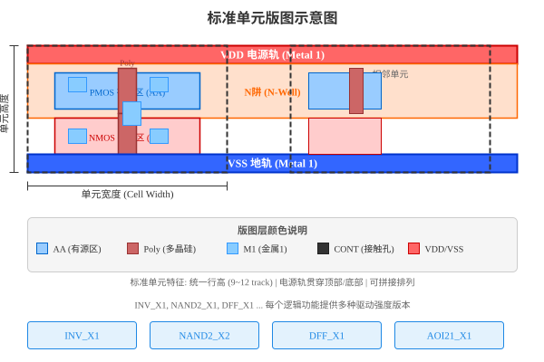
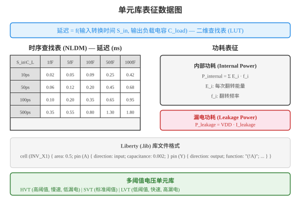

# 4.4 标准单元库

> **前置知识**：[4.3 CMOS 器件物理](4.3-CMOS器件物理.md)（承接上一章）。

## 1. 概述

标准单元库是数字集成电路设计的基础，是一组经过精心设计和验证的逻辑功能单元集合。标准单元库的质量直接影响芯片的性能、功耗和面积（PPA）。本章将全面介绍标准单元库的概念、结构、表征和应用。

## 2. 标准单元库概念与结构

### 2.1 基本概念

标准单元库（Standard Cell Library）是一组具有相同高度、不同宽度的逻辑功能单元的集合，这些单元具有以下特征：

- **统一的行高**：所有单元高度相同，便于自动布局
- **标准接口**：统一的电源/地轨线位置
- **可拼接性**：单元可以并排放置形成逻辑行
- **可表征性**：每个单元经过完整的时序、功耗和噪声表征

### 2.2 单元结构

标准单元通常包含以下层次：

- **晶体管级**：NMOS和PMOS晶体管的互连
- **版图级**：物理掩模图形
- **抽象级**：LEF（Library Exchange Format）抽象视图
- **时序级**：Liberty（.lib）时序模型
- **行为级**：Verilog/VHDL功能模型



### 2.3 版图特征

标准单元版图的关键特征：

- **单元高度**：通常为9~12个金属轨道（Track），例如12-track、9-track
- **电源轨**：VDD和VSS在单元顶部和底部水平贯穿
- **N阱**：PMOS所在的N阱区域
- **有源区**：形成晶体管沟道的区域
- **栅极**：多晶硅栅垂直跨越有源区
- **金属互连**：连接各端口的金属层

## 3. 组合逻辑单元

组合逻辑单元的输出仅取决于当前输入，没有存储功能。

### 3.1 基本逻辑单元

- **反相器（INV）**：最基本的逻辑门
- **与非门（NAND）**：NAND2、NAND3、NAND4
- **或非门（NOR）**：NOR2、NOR3、NOR4
- **与门（AND）**：AND2、AND3、AND4
- **或门（OR）**：OR2、OR3、OR4
- **异或门（XOR）**：XOR2、XOR3
- **同或门（XNOR）**：XNOR2

### 3.2 复合逻辑单元

- **与或非门（AOI）**：AOI21、AOI22、AOI221
- **或与非门（OAI）**：OAI21、OAI22、OAI221
- **多路选择器（MUX）**：MUX2、MUX4、MUX8
- **加法器（ADD）**：半加器、全加器

### 3.3 驱动能力分级

每个逻辑功能通常提供多种驱动强度的版本：

- 使用驱动器强度标识，如INV_X1、INV_X2、INV_X4、INV_X8
- X后面的数字表示相对驱动能力
- 更大的驱动能力意味着更快的速度但更高的功耗和面积

## 4. 时序逻辑单元

时序逻辑单元的输出不仅取决于当前输入，还取决于之前的状态。

### 4.1 触发器类型

- **D触发器（DFF）**：上升沿/下降沿触发
- **带复位触发器**：同步复位（DFFR_S）和异步复位（DFFR_A）
- **带置位触发器**：同步置位（DFFS_S）和异步置位（DFFS_A）
- **带使能触发器**：DFFE（带时钟使能）
- **JK触发器**：JKFF
- **T触发器**：TFF

### 4.2 锁存器

- **透明锁存器（Latch）**：高电平/低电平透明
- **带复位的锁存器**

### 4.3 时序单元参数

关键时序参数包括：

- **时钟到输出延迟（Clk→Q）**：时钟沿到输出变化的延迟
- **建立时间（Setup Time）**：数据在时钟沿前必须稳定的时间
- **保持时间（Hold Time）**：数据在时钟沿后必须稳定的时间
- **最小脉冲宽度**：时钟信号的最小高/低电平宽度

## 5. 特殊功能单元

### 5.1 扫描单元（Scan Cell）

扫描单元是带有测试功能的标准触发器，用于可测性设计（DFT）：

- 在正常模式和扫描模式之间切换
- 包含扫描输入（SI）和扫描使能（SE）端口
- 多个扫描单元级联形成扫描链

### 5.2 时钟门控单元（Clock Gating Cell）

时钟门控单元用于动态降低功耗：

- **集成时钟门控（ICG）**：包含锁存器和与门/或门
- 当使能信号无效时，关闭时钟分支，减少翻转功耗

### 5.3 电平转换单元（Level Shifter）

用于跨电压域的信号电平转换：

- **低压到高压转换（LV→HV）**
- **高压到低压转换（HV→LV）**

### 5.4 隔离单元（Isolation Cell）

用于电源关断模式下信号隔离：

- AND型隔离：输出低电平（或高电平）
- OR型隔离：输出高电平（或低电平）

### 5.5 延时单元（Delay Cell）

用于时序调整，补偿路径延迟差异。

## 6. 单元库表征

### 6.1 时序表征



时序表征的核心是查找表（Look-up Table, LUT），以输入转换时间（Input Slew）和输出负载电容（Output Load）为索引。

**延迟计算**：

$$D = f(S_{in}, C_{load})$$

其中：
- $S_{in}$：输入信号的转换时间（slew rate）
- $C_{load}$：输出端的负载电容

**输出转换时间**：

$$S_{out} = g(S_{in}, C_{load})$$

### 6.2 功耗表征

**内部功耗**：

$$P_{internal} = \sum_i E_i \cdot f_i$$

其中：
- $E_i$：每次翻转消耗的能量
- $f_i$：翻转频率

**漏电功耗**：

$$P_{leakage} = V_{DD} \cdot I_{leakage}$$

### 6.3 面积表征

- 单元宽度（Width）
- 单元高度（Height）
- 总面积（Area = Width × Height）

## 7. Liberty库文件格式

Liberty（.lib）是标准单元库的标准格式，包含以下内容：

```liberty
library (my_library) {
  delay_model : "lookup_table";
  in_place_swap_mode : "match_footprint";
  technology (cmos) {
    ...
  }
  
  cell (INV_X1) {
    area : 0.5;
    pin (A) {
      direction : input;
      capacitance : 0.002;
    }
    pin (Y) {
      direction : output;
      capacitance : 0.0;
      function : "(!A)";
      timing () {
        related_pin : "A";
        cell_rise (delay_template_7x7) {
          values ( "\
            0.01, 0.02, 0.03, 0.04, 0.05, 0.06, 0.07", \
            0.02, 0.03, 0.04, 0.05, 0.06, 0.07, 0.08", \
            ... );
        }
        rise_transition (delay_template_7x7) {
          values ( ... );
        }
      }
    }
    leakage_power () {
      value : 0.000001;
    }
  }
}
```

### 7.1 库文件关键内容

- **库级信息**：工艺、电压、温度、单位
- **引脚信息**：方向、电容、功能
- **时序模型**：延迟和转换时间的查找表
- **功耗模型**：内部能量和漏电功耗
- **约束信息**：建立时间、保持时间、最小脉冲宽度

## 8. 多阈值电压单元

### 8.1 阈值电压类型

标准单元库通常提供三种阈值电压版本的单元：

| 类型 | 阈值电压 | 速度 | 漏电 | 应用场景 |
|------|---------|------|------|---------|
| HVT | 高 | 慢 | 低 | 非关键路径，低功耗 |
| SVT/RVT | 标准 | 中 | 中 | 一般用途 |
| LVT | 低 | 快 | 高 | 关键路径，高性能 |

### 8.2 多阈值电压设计策略

- **关键路径**：使用LVT单元满足时序要求
- **非关键路径**：使用HVT单元降低漏电
- **混合使用**：在性能和功耗之间取得平衡

### 8.3 阈值电压对性能的影响

LVT单元的速度优势：

$$f_{max} \propto \frac{1}{t_{pd}} \propto \frac{V_{DD}}{(V_{DD} - V_{TH})^2}$$

LVT单元的漏电劣势：

$$I_{leak} \propto \exp\left(-\frac{V_{TH}}{nV_T}\right)$$

$V_{TH}$每降低100mV，漏电增加约10倍。

## 9. 电压域与电压缩放

### 9.1 多电压域

现代SoC设计中，不同模块可能工作在不同电压下：

- **核心逻辑**：低电压（0.6V~0.9V）以降低功耗
- **I/O接口**：标准电压（1.8V/2.5V/3.3V）
- **存储器**：优化的电压（0.8V~1.0V）
- **模拟/射频**：特定电压

### 9.2 电压缩放

电压缩放技术包括：

- **DVFS（动态电压频率缩放）**：根据 workload 动态调整电压和频率
- **AVS（自适应电压缩放）**：根据芯片PVT条件自动调整电压
- **Razor技术**：通过检测时序错误实现接近临界电压的运行

## 10. 单元库的演化

随着工艺节点演进，标准单元库的复杂度不断增加：

| 节点 | 单元数 | 特点 |
|------|-------|------|
| 180nm | 200~300 | 基本逻辑单元 |
| 90nm | 500~800 | 多Vt引入 |
| 28nm | 1000~2000 | 多电压域支持 |
| 7nm | 3000~5000 | FINFET、复杂规则 |
| 3nm | 5000+ | GAA、先进DFM |

## 小结

标准单元库是连接逻辑设计和物理实现的桥梁。本章介绍了标准单元库的概念、结构、类型、表征方法和Liberty格式。理解标准单元库对于数字IC设计工程师至关重要，直接影响到芯片的PPA指标。

## 自测清单

1. 「概述」要解决的核心问题是什么？关键结论或公式是什么？
2. 「标准单元库概念与结构」与上一节之间是什么关系？
3. 「组合逻辑单元」在什么场景下会用到？如果条件改变，结论会如何变化？
4. 能否不看正文，写出「时序逻辑单元」的关键流程或结构？
5. 「特殊功能单元」最容易混淆的点是什么？

---

**下一章**：[4.5 RTL 设计（一）Verilog 基础语法与建模](4.5-RTL设计-基础语法与建模.md)
