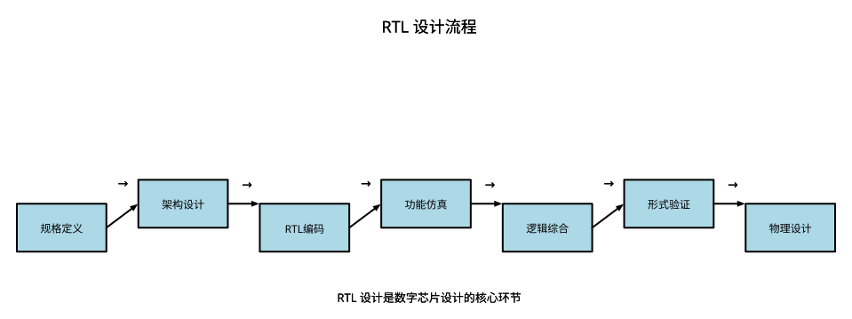

# 4.7 RTL 设计（三）综合流程、Testbench、FPGA 与高级特性

> **前置知识**：必需 [3.1–3.8 数字电路基础](../../03-数字与计算机系统/数字电路/3.1-数制与编码.md)、[3.10 数字系统设计基础](../../03-数字与计算机系统/数字电路/3.10-数字系统设计基础.md) 与 [4.5–4.6 RTL 设计](4.5-RTL设计-基础语法与建模.md)。

> 本页为《RTL 设计》系列第 3/4 页。

## 1. RTL 综合与数字设计流程

### 1.1 数字设计抽象层次

| 层次                | 描述                       | 时序信息     |
| ------------------- | -------------------------- | ------------ |
| 算法 / 系统级       | 功能算法描述，无硬件结构   | 无           |
| 寄存器传输级（RTL） | 寄存器与组合逻辑，有时钟沿 | 有时序       |
| 门级                | 基本逻辑门互连             | 有门延迟     |
| 电路级              | 晶体管级实现               | 有晶体管特性 |
| 版图级              | 物理掩模版图               | 有物理参数   |

### 1.2 RTL 设计流程



### 1.3 逻辑综合

逻辑综合将 RTL 代码转换为门级网表，包括三个子步骤：

**1. 逻辑优化**：布尔代数化简、资源共享、逻辑等价变换
**2. 技术映射**：将优化后的逻辑映射到目标工艺库的标准单元
**3. 时序约束驱动优化**：设定时钟频率，在关键路径上优化延迟

### 1.4 综合约束

```tcl
create_clock -name clk -period 10 [get_ports clk]
set_clock_uncertainty -setup 0.2 [get_clocks clk]
set_input_delay -clock clk -max 2.0 [get_ports data_in]
set_output_delay -clock clk -max 3.0 [get_ports data_out]
set_false_path -from [get_clocks rst_n]
set_multicycle_path -setup 2 -from [get_pins A_reg/CK] -to [get_pins B_reg/D]
```

---

## 2. Testbench 编写

### 2.1 基本 Testbench 结构

```verilog
module testbench;
    reg  clk, rst_n;
    reg  [7:0] data_in;
    wire [7:0] data_out;

    my_module dut (
        .clk     (clk),
        .rst_n   (rst_n),
        .data_in (data_in),
        .data_out(data_out)
    );

    // 时钟生成
    initial begin
        clk = 0;
        forever #5 clk = ~clk;
    end

    // 测试激励
    initial begin
        rst_n = 0; data_in = 0;
        #20 rst_n = 1;
        #10 data_in = 8'hA5;
        #10 data_in = 8'h5A;
        #10 data_in = 8'hFF;
        #100 $finish;
    end
endmodule
```

### 2.2 自检测 Testbench

```systemverilog
module testbench_sv;
    logic       clk, rst_n;
    logic [3:0] a, b, y;

    sillyfunction dut (.a(a), .b(b), .y(y));

    initial begin
        clk = 0;
        forever #5 clk = ~clk;
    end

    initial begin
        for (int i = 0; i < 4; i++) begin
            {a, b} = i;
            #10;
            assert (y === a & b) else
                $error("a=%b, b=%b, y=%b (expected %b)", a, b, y, a & b);
        end
        #10 $finish;
    end
endmodule
```

### 2.3 仿真常用系统函数

```verilog
$display("format", args);     // 打印信息
$monitor("format", args);     // 监测信号变化
$time;                         // 返回当前仿真时间
$finish;                       // 结束仿真
$dumpfile("sim.vcd");         // 生成 VCD 波形文件
$dumpvars(0, testbench);      // 导出所有信号
```

---

## 3. FPGA 验证实践

> **前置知识**：[3.8 可编程逻辑器件](../../03-数字与计算机系统/数字电路/3.8-可编程逻辑器件-PLD.md)（FPGA 的硬件结构：LUT/CLB/布线资源）。

仿真通过只完成了一半验证——真实时序、IO、时钟资源只有上板才能暴露。本节梳理从 RTL 到开发板的标准流程。

### 3.1 开源工具链 vs 商业工具链

| 环节 | 开源方案 | 商业方案（Xilinx/AMD） | 商业方案（Intel/Altera） |
|------|---------|----------------------|------------------------|
| 仿真 | Icarus Verilog / Verilator | Vivado Simulator | ModelSim / Questa |
| 综合 | **Yosys** | Vivado Synthesis | Quartus Synthesis |
| 布局布线 | nextpnr | Vivado Implementation | Quartus Fitter |
| 时序分析 | nextpnr 报告 | Vivado Timing | Quartus TimeQuest |
| 烧写 | openFPGALoader | Vivado Hardware Manager | Quartus Programmer |

开源流程对中小规模设计（Lattice iCE40/ECP5、部分 Gowin）已完全可用：

```bash
# 开源全流程示例（iCE40）
yosys -p "synth_ice40 -top top -json top.json" top.v   # 综合
nextpnr-ice40 --lp38k --json top.json --asc top.asc \  # 布局布线
    --freq 25 --pcf top.pcf
icepack top.asc top.bin                                  # 打包
openFPGALoader --board icebreaker top.bin                # 烧写
```

### 3.2 FPGA 设计流程六步

```
RTL编码 → 仿真验证 → 综合+布局布线 → 时序收敛 → 烧写上板 → 板级调试
   ↑______________发现问题回环________________↓
```

**关键差异（对比 ASIC 流程，见 4.3 节）**：FPGA 的"物理设计"由工具自动完成，无标准单元库约束，时钟树由全局时钟网络资源提供——验证迭代以分钟计，而 ASIC 流片以月计。这也是 4.3 节强调"FPGA 原型验证"作为 ASIC 前置环节的原因。

### 3.3 约束文件：告诉工具板子长什么样

XDC（Vivado）/ PCF（开源流程）约束定义引脚与 时钟：

```tcl
# 时钟约束：100MHz 晶振接入
create_clock -period 10.000 -name sys_clk [get_ports clk]

# 引脚约束：LED 接到指定管脚
set_property -dict {PACKAGE_PIN A1 IOSTANDARD LVCMOS33} [get_ports led]

# 跨时钟域约束（配合 4.6 第 4 节 CDC 设计）
set_clock_groups -asynchronous -group {clk_sys} -group {clk_uart}
```

### 3.4 时序报告解读

综合布线后工具报告 WNS（最差负时序裕量）：

```
WNS (Worst Negative Slack) = 实际到达时间要求到达时间
  WNS ≥ 0  → 时序收敛，可以烧写
  WNS < 0  → 违例，需优化
```

**常见违例修法**（呼应 4.6 第 2 节流水线设计）：

| 违例原因 | 修法 |
|---------|------|
| 组合逻辑太长 | 插入流水线寄存器切级 |
| 高扇出网络 | 手动复制寄存器降低扇出 |
| 跨时钟域 | [4.6](4.6-RTL设计-FSM与流水线.md) 第 4 节的同步器+约束 |
| 布线拥塞 | 改变层次结构或物理约束 |

### 3.5 板级调试手段

- **ILA（集成逻辑分析仪）**：Vivado 把逻辑分析仪核插进 FPGA，触发抓取内部信号波形，等效"硬件版 \$dumpvars"
- **VIO**：虚拟 IO，运行时改写内部寄存器初值
- **LED/七段数码管**：最低成本的状态指示
- **UART 打印**：软核或硬件打印调试信息上 PC

### 3.6 RTL 到上板的常见翻车点

| 症状 | 根因 |
|------|------|
| 仿真正确、上板不工作 | 未写约束/时钟未约束、复位未连到全局网络 |
| 偶发跑飞 | 跨时钟域没做同步（[4.6](4.6-RTL设计-FSM与流水线.md) 第 4 节） |
| 综合后Latch警告 | 组合 always 缺 default 分支（[4.5](4.5-RTL设计-基础语法与建模.md) 第 8 节） |
| 上下板行为不同 | 测试激励不完备 + 时序违例 |
| 复位后不启动 | 异步复位释放未同步，违反 Recovery/Removal |

---

## 4. Verilog 高级特性

### 4.1 门级原语

```verilog
and   g1 (out, a, b);       // 与门
or    g2 (out, a, b);       // 或门
nand  g3 (out, a, b);       // 与非门
nor   g4 (out, a, b);       // 或非门
xor   g5 (out, a, b);       // 异或门
xnor  g6 (out, a, b);       // 同或门
not   g7 (out, in);         // 反相器
bufif1 g8 (out, in, en);    // 三态缓冲器
```

### 4.2 编译器指令

```verilog
`define DATA_WIDTH 8
`ifdef SIMULATION
    initial $display("Simulation mode");
`endif
`include "defines.v"
`timescale 1ns / 1ps   // 时间单位 1ns，精度 1ps
```

### 4.3 generate 语句

```verilog
// 使用 generate 生成重复结构
generate
    for (genvar i = 0; i < 8; i++) begin
        DFF dff_inst (
            .clk(clk),
            .d(data_in[i]),
            .q(data_out[i])
        );
    end
endgenerate
```

---

## 5. 参数化模块设计

### 5.1 参数化 2:1 多路选择器

```verilog
module mux2 #(
    parameter WIDTH = 8
)(
    input  [WIDTH-1:0] d0, d1,
    input              s,
    output [WIDTH-1:0] y
);
    assign y = s ? d1 : d0;
endmodule

// 实例化时覆盖参数
mux2 #(12) lowmux (d0, d1, s, y);
```

### 5.2 参数化构建层次化设计

```verilog
module mux4 #(
    parameter WIDTH = 8
)(
    input  [WIDTH-1:0] d0, d1, d2, d3,
    input  [1:0]       s,
    output [WIDTH-1:0] y
);
    wire [WIDTH-1:0] low, high;
    mux2 #(WIDTH) lowmux  (d0, d1, s[0], low);
    mux2 #(WIDTH) highmux (d2, d3, s[0], high);
    mux2 #(WIDTH) finalmux(low, high, s[1], y);
endmodule
```

---

## 本章要点

- RTL 综合与数字设计流程
- Testbench 编写
- FPGA 验证实践
- Verilog 高级特性
- 参数化模块设计

## 自测清单

1. 「RTL 综合与数字设计流程」要解决的核心问题是什么？关键结论或公式是什么？
2. 「Testbench 编写」与上一节之间是什么关系？
3. 「FPGA 验证实践」在什么场景下会用到？如果条件改变，结论会如何变化？
4. 能否不看正文，写出「Verilog 高级特性」的关键流程或结构？
5. 「参数化模块设计」最容易混淆的点是什么？

---

**下一章**：[4.8 RTL 设计（四）SystemVerilog、Chisel 与总结](4.8-RTL设计-SystemVerilog与Chisel.md)
