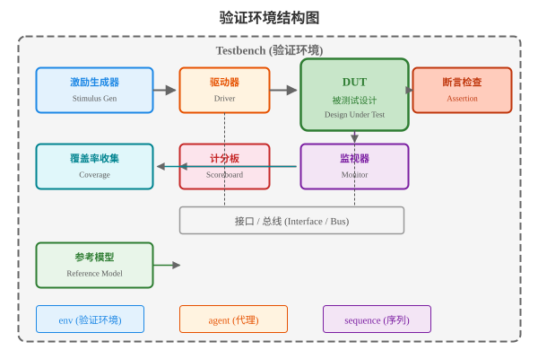
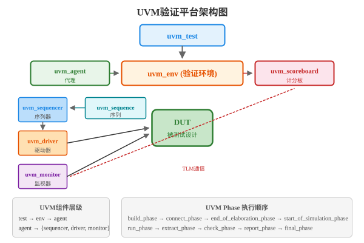

# 4.9 功能验证

> **前置知识**：[4.5–4.8 RTL 设计](4.5-RTL设计-基础语法与建模.md)。

## 1. 概述

功能验证是确保芯片设计正确性的关键环节，其目标是验证RTL设计是否满足设计规格。随着芯片复杂度不断提高，验证已成为芯片设计流程中耗时最长的阶段，通常占整个项目周期的50%~70%。

## 2. 验证方法论

### 2.1 验证计划

验证计划（Verification Plan）是验证工作的指导文档，包含：

- **验证范围**：需要验证的功能点和特性
- **验证策略**：仿真验证、形式验证、断言验证等
- **测试用例**：功能测试、边界测试、随机测试
- **覆盖率目标**：代码覆盖率和功能覆盖率目标
- **验证环境**：Testbench结构、组件和工具
- **里程碑**：验证阶段的时间节点

### 2.2 验证环境



典型的验证环境包含以下组件：

1. **Testbench**：顶层验证环境
2. **DUT（Design Under Test）**：被测试的设计
3. **Stimulus Generator**：测试激励生成器
4. **Driver**：驱动激励到DUT的接口
5. **Monitor**：监视DUT的输入输出
6. **Scoreboard**：比对期望结果和实际结果
7. **Coverage Collector**：收集覆盖率数据
8. **Checker/Assertion**：检查设计行为

## 3. 仿真工具

### 3.1 主流仿真工具

| 工具 | 公司 | 特点 |
|------|------|------|
| VCS | Synopsys | 高性能编译仿真，支持Verilog/VHDL/SystemVerilog |
| Xcelium | Cadence | 前身IES，支持混合语言仿真 |
| QuestaSim | Mentor | 基于ModelSim，支持UVM |
| Verilator | 开源 | 高性能Verilog仿真器，支持SystemVerilog |
| Icarus Verilog | 开源 | 轻量级Verilog仿真器 |
| GHDL | 开源 | VHDL仿真器 |

### 3.2 仿真流程

```bash
# 编译
vlog -work work top.v dut.v

# 优化
vopt +acc work.top -o top_opt

# 仿真
vsim -c top_opt -do "run -all"
```

## 4. Testbench编写

### 4.1 简单Testbench

```systemverilog
module tb_counter();
    reg        clk;
    reg        rst_n;
    reg        en;
    wire [7:0] count;
    
    // DUT实例化
    counter #(.WIDTH(8)) u_counter (
        .clk   (clk),
        .rst_n (rst_n),
        .en    (en),
        .count (count)
    );
    
    // 时钟生成
    initial begin
        clk = 0;
        forever #5 clk = ~clk;
    end
    
    // 测试激励
    initial begin
        rst_n = 0;
        en = 0;
        #20 rst_n = 1;
        #10 en = 1;
        #200 en = 0;
        #100 $finish;
    end
    
    // 结果检查
    initial begin
        $monitor("Time=%0t, count=%d", $time, count);
    end
    
endmodule
```

### 4.2 自检查Testbench

```systemverilog
module tb_adder();
    reg  [3:0] a, b;
    wire [4:0] sum;
    int errors;
    
    adder u_adder (.a(a), .b(b), .sum(sum));
    
    initial begin
        errors = 0;
        for (int i = 0; i < 16; i++) begin
            for (int j = 0; j < 16; j++) begin
                a = i;
                b = j;
                #10;
                if (sum !== a + b) begin
                    $error("Mismatch: a=%d, b=%d, sum=%d, expected=%d", 
                            a, b, sum, a+b);
                    errors++;
                end
            end
        end
        if (errors == 0)
            $display("All tests passed!");
        else
            $display("Failed %0d tests", errors);
        $finish;
    end
endmodule
```

## 5. 直接测试与随机测试

### 5.1 直接测试

直接测试针对特定功能点编写精确的测试向量，适用于：

- 基本功能验证
- 边界条件测试
- 错误处理测试

### 5.2 随机测试

随机测试利用随机约束生成测试向量，可以发现意料之外的bug：

```systemverilog
class Transaction;
    rand bit [31:0] addr;
    rand bit [31:0] data;
    rand bit        rw;
    
    // 约束
    constraint addr_range {
        addr inside {[0:1023]};
        addr % 4 == 0;  // 对齐
    }
    
    constraint data_valid {
        data != 0;
    }
endclass
```

约束随机测试（CRT）结合了随机性和约束条件，是现代验证的主流方法。

## 6. 功能覆盖率

### 6.1 功能覆盖率模型

```systemverilog
covergroup fifo_cov @(posedge clk);
    // 覆盖点
    wr_en: coverpoint wr_en;
    rd_en: coverpoint rd_en;
    
    // 交叉覆盖
    wr_rd_cross: cross wr_en, rd_en;
    
    // 覆盖区间
    fifo_level: coverpoint fifo_count {
        bins low    = {[0:3]};
        bins mid    = {[4:11]};
        bins high   = {[12:15]};
        bins full   = {16};
    }
endgroup
```

### 6.2 覆盖率指标

- **Bin覆盖率**：覆盖点的每个取值区间被覆盖的比例
- **交叉覆盖率**：多个覆盖点组合被覆盖的比例
- **转换覆盖率**：信号值跳变的覆盖情况

## 7. 代码覆盖率

代码覆盖率衡量RTL代码在仿真中被执行的程度，包括：

| 类型 | 说明 | 目标 |
|------|------|------|
| 行覆盖率 | 每行代码是否被执行 | 90%~100% |
| 分支覆盖率 | if/case分支是否被覆盖 | 90%~100% |
| 条件覆盖率 | 条件表达式中的子条件 | 80%~100% |
| 状态机覆盖率 | FSM状态和跳转是否被覆盖 | 90%~100% |
| 翻转覆盖率 | 信号是否发生0→1和1→0跳变 | 70%~90% |
| 路径覆盖率 | 组合路径是否被覆盖 | 60%~80% |

## 8. 断言（Assertion）

### 8.1 SystemVerilog断言（SVA）

```systemverilog
// 立即断言
always @(posedge clk) begin
    assert (valid && ready)
        else $error("Handshake failed at time %0t", $time);
end

// 并发断言
property p_req_ack;
    @(posedge clk)
    req |=> ##[1:5] ack;
endproperty

assert property (p_req_ack);

// 覆盖断言
cover property (@(posedge clk) req ##1 ack);
```

### 8.2 断言类型

- **立即断言**：在仿真中立即检查
- **并发断言**：在时钟沿采样检查，基于时序表达式
- **假设断言**：约束输入激励
- **覆盖断言**：记录特定序列是否发生

## 9. 形式验证

### 9.1 形式验证方法

形式验证使用数学方法证明设计的正确性：

- **模型检查（Model Checking）**：验证设计是否满足时序逻辑属性
- **定理证明（Theorem Proving）**：使用数学推理证明设计正确性
- **符号仿真（Symbolic Simulation）**：使用符号值代替具体值进行仿真

### 9.2 形式验证工具

| 工具 | 公司 | 特点 |
|------|------|------|
| VC Formal | Synopsys | 综合形式验证平台 |
| JasperGold | Cadence | 高性能形式验证 |
| Questa Formal | Mentor | 断言检查 |
| SymbiYosys | 开源 | 基于Yosys的形式验证 |

本节仅对形式验证作概览式介绍；模型检查、定理证明、符号仿真、SVA 断言深入与工程化收敛技巧的完整展开，见 4.24–4.28 [4.24 形式验证深入](../数字验证方法学/4.24-形式验证-概述与等价性.md)。本章 12 节的 UVM 亦见 4.19–4.23 [4.19 UVM验证方法学](../数字验证方法学/4.19-UVM-概述与核心组件.md)。

## 10. 等价性检查（EC）

等价性检查验证两个设计表示的功能等价性：

- **RTL-to-RTL EC**：验证不同RTL版本的一致性
- **RTL-to-Gate EC**：验证综合后网表与RTL的一致性
- **Gate-to-Gate EC**：验证物理设计后网表的一致性

## 11. 静态时序分析验证

静态时序分析（STA）验证设计是否满足时序约束，将在第4.12节中详细讨论。

## 12. UVM方法学简介

### 12.1 UVM概述

UVM（Universal Verification Methodology）是基于SystemVerilog的标准验证方法学，提供可重用的验证组件和架构。



### 12.2 UVM核心组件

| 组件 | 功能 |
|------|------|
| uvm_test | 测试用例顶层 |
| uvm_env | 验证环境，包含agent、scoreboard等 |
| uvm_agent | 封装driver、monitor、sequencer |
| uvm_driver | 驱动事务到DUT接口 |
| uvm_monitor | 监视DUT接口信号 |
| uvm_sequencer | 管理事务序列 |
| uvm_scoreboard | 期望结果与实际结果比对 |
| uvm_sequence | 定义事务序列 |

### 12.3 UVM基本结构

```systemverilog
class my_agent extends uvm_agent;
    `uvm_component_utils(my_agent)
    
    my_driver    driver;
    my_monitor   monitor;
    my_sequencer sequencer;
    
    function new(string name, uvm_component parent);
        super.new(name, parent);
    endfunction
    
    function void build_phase(uvm_phase phase);
        driver = my_driver::type_id::create("driver", this);
        monitor = my_monitor::type_id::create("monitor", this);
        sequencer = my_sequencer::type_id::create("sequencer", this);
    endfunction
    
    function void connect_phase(uvm_phase phase);
        driver.seq_item_port.connect(sequencer.seq_item_export);
    endfunction
endclass
```

### 12.4 UVM Phase

UVM定义了标准化的phase执行顺序：

1. **build_phase**：创建组件实例
2. **connect_phase**：连接组件之间的TLM端口
3. **end_of_elaboration_phase**：显示配置信息
4. **start_of_simulation_phase**：仿真前准备
5. **run_phase**：主仿真运行（消耗仿真时间）
6. **extract_phase**：提取测试结果
7. **check_phase**：检查结果正确性
8. **report_phase**：报告测试结果
9. **final_phase**：结束清理

## 13. 软硬件协同验证

软硬件协同验证同时验证硬件设计和运行在其上的软件：

- **硬件加速仿真**：使用FPGA原型或仿真加速器
- **虚拟原型**：使用软件模型模拟硬件行为
- **混合仿真**：部分硬件用RTL仿真，部分用模型

## 小结

功能验证是芯片设计成功的关键保障。本章介绍了验证方法论、Testbench编写、覆盖率分析、断言、形式验证、等价性检查和UVM方法学等内容。随着芯片复杂度不断提升，验证技术也在持续演进，高效验证策略对项目成功至关重要。

## 自测清单

1. 「概述」要解决的核心问题是什么？关键结论或公式是什么？
2. 「验证方法论」与上一节之间是什么关系？
3. 「仿真工具」在什么场景下会用到？如果条件改变，结论会如何变化？
4. 能否不看正文，写出「Testbench编写」的关键流程或结构？
5. 「直接测试与随机测试」最容易混淆的点是什么？

---

**下一章**：[4.10 逻辑综合](4.10-逻辑综合.md)
