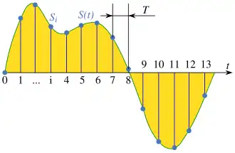
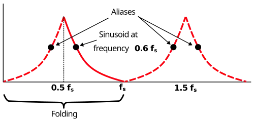
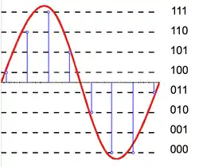

# 5.1 从连续到离散

> **本章定位**：第 5 篇的起点，从连续信号过渡到离散时间信号与系统。

> **前置知识**：[1.31 傅里叶变换 §6.4 采样定理](../../01-基础与电路分析/电路原理/1.31-傅里叶变换在电路中的应用.md)、[3.9 数模与模数转换](../../03-数字与计算机系统/数字电路/3.9-数模与模数转换.md)、[1.26 正弦稳态分析](../../01-基础与电路分析/电路原理/1.26-正弦稳态分析.md)。本章讨论模拟信号数字化（A/D）的三个环节——采样、量化、编码，核心是奈奎斯特采样定理与混叠抑制。读完本节，你应该能回答：为何采样率要高于信号最高频率两倍？混叠会带来什么后果？抗混叠滤波器需要做成什么样？

## 1. 理想采样与采样定理

### 1.1 从连续时间到离散时间

数字信号处理的第一步，是用一个均匀的时间栅格去"读取"连续时间信号 $x_c(t)$。若采样周期为 $T_s$，则得到离散时间序列

$$
x[n] = x_c(nT_s), \qquad f_s = \frac{1}{T_s}
$$

其中 $n$ 是整数序号，$f_s$ 称为**采样率**（单位 Hz）。采样在时间上把连续信号离散化，但此时每个采样值 $x[n]$ 在幅度上仍是连续量，还没有真正变成"数字"。

*连续信号 $S(t)$（绿色曲线）被等间隔采样为离散样本（蓝色竖线），即 $x[n]=x_c(nT_s)$。*

### 1.2 采样的数学模型

理想采样可以建模为连续信号与单位冲激串的乘积：

$$
x_s(t) = x_c(t) \cdot p(t), \qquad p(t) = \sum_{n=-\infty}^{\infty} \delta(t - nT_s)
$$

于是

$$
x_s(t) = \sum_{n=-\infty}^{\infty} x_c(nT_s)\, \delta(t - nT_s)
$$

这里的冲激串 $p(t)$ 起着"等间隔取样的开关"作用。这个数学模型把时域离散这一操作转化为一个纯粹的乘法，从而可以用频域分析工具加以刻画，这是理解采样定理的关键一步。

### 1.3 频谱的周期延拓（频域视角）

时域相乘对应频域卷积。冲激串 $p(t)$ 的傅里叶变换本身也是一个冲激串，其间距为采样角频率 $\Omega_s = 2\pi f_s$：

$$
P(j\Omega) = \Omega_s \sum_{k=-\infty}^{\infty} \delta(\Omega - k\Omega_s)
$$

因此采样信号的频谱是原连续频谱按 $\Omega_s$ 为周期平移叠加的结果：

$$
X_s(j\Omega) = \frac{1}{T_s} \sum_{k=-\infty}^{\infty} X_c\left(j(\Omega - k\Omega_s)\right)
$$

式中有因子 $1/T_s$，它是冲激采样的固有增益。这一结论极其重要：**采样把连续信号的频谱变成以 $\Omega_s$ 为周期的周期谱**。只要各周期的副本彼此不重叠，就可以从副本中完整地恢复出原频谱。

### 1.4 奈奎斯特采样定理（Nyquist-Shannon）

设连续带限信号 $x_c(t)$ 的最高频率为 $f_{max}$。若满足

$$
f_s \geq 2f_{max}
$$

则各频谱副本彼此不重叠，可由采样序列 $x[n]$ 完全恢复出 $x_c(t)$。习惯上把 $2f_{max}$ 称为**奈奎斯特率**，把 $f_s/2$ 称为**奈奎斯特频率**。图 1.1 从左到右对应的三种情形分别是：$f_s > 2f_{max}$（安全）、$f_s = 2f_{max}$（临界）、$f_s < 2f_{max}$（混叠）。

采样率越接近奈奎斯特率（即 $f_{max}/f_s$ 越大），频带利用率越高、器件成本越低，但对模拟前端滤波器的要求也越苛刻，设计时需要综合权衡。

### 1.5 由采样值恢复原信号

当采样满足奈奎斯特条件时，可以用一个截止频率为 $f_s/2$ 的理想低通滤波器取出频谱的 $k=0$ 副本，从而恢复连续信号。理想重建的时域表达式为 **sinc 内插公式**：

$$
x_c(t) = \sum_{n=-\infty}^{\infty} x[n]\; \text{sinc}\!\left(\frac{t - nT_s}{T_s}\right)
$$

其中 $\text{sinc}(u) = \sin(\pi u)/(\pi u)$。它说明每个采样值都以 sinc 函数为基函数进行插值，所有插值之和光滑地恢复出原信号。实际 DAC 无法输出如此规范的 sinc 插值，我们将在 5.1§4 讨论实际的重建方式。

## 2. 采样与保持（Sample-and-Hold）

### 2.1 为什么需要采样保持

真实 ADC 需要一段时间才能完成一次转换（称转换孔径时间）。若在转换期间输入仍在快速变化，转换结果将不确定。为此在采样器与量化器之间通常插入**采样保持（S/H）电路**：在采样窗口内把电压"冻结"在一个电容上，供 ADC 稳定转换。

### 2.2 采样保持模型

S/H 输出在保持期间近似为常数：

$$
x_{SH}(t) = \sum_{n=-\infty}^{\infty} x_c(nT_s)\, \text{rect}\!\left(\frac{t - nT_s - T_s/2}{T_s}\right)
$$

即每个采样值被展开为宽度 $T_s$ 的零阶保持（ZOH）脉冲。零阶保持会带来幅度呈 sinc 形状的滚降：

- 频谱乘以因子 $\text{sinc}(f/f_s) = \sin(\pi f/f_s)/(\pi f/f_s)$
- 在奈奎斯特频率 $f_s/2$ 处幅度约下降 3.92 dB，这是 DAC 输出端常见的"ZOH 滚降"
- 恢复时通常用均衡/整形滤波器补偿这一滚降

## 3. 混叠原理与抗混叠滤波

### 3.1 混叠的产生

当 $f_{max} > f_s/2$ 时，频谱各周期副本相互重叠，重叠部分无法区分，原先进不去的频率会"折叠"回有效频带，产生不可恢复的失真，称为**混叠（Aliasing）**。

对于一个原本频率为 $f$ 的连续正弦分量，采样后它会表现为一个折叠后的频率：

$$
f_{alias} = \left| f - k\, f_s \right|, \quad \text{取 } k \text{ 使 } f_{alias} \leq f_s/2
$$

**混叠不可逆**——一旦高频分量折叠进有效频带，任何数字后处理都无法把它们与真实低频分量区分开。这一点与量化噪声不同：量化是"可预测的损伤"，混叠则彻底破坏信息。

*高于采样率一半的频率会被"折叠"回有效频带，成为与真实低频分量不可区分的混叠。*

### 3.2 抗混叠滤波

在实践中，信号往往并非理想带限，因此在采样器之前必须插入**抗混叠低通滤波器**，把高于奈奎斯特频率的分量充分衰减。设计要点：

1. 抗混叠滤波器处于模拟域（连续时间），位置在采样器之前
2. 阻带截止频率应放置于 $f_s/2$ 附近，使带外分量被充分抑制
3. 滤波器过渡带越陡（阶数越高），硬件代价越大；可通过**过采样**放宽要求
4. 过采样把残余混叠推向更高频段、落在信号带外，再用数字滤波进一步抑制
5. 一阶 RC 低通的滚降只有 20 dB/十倍频程，远不够——工程上常用二阶以上有源滤波器或多极点组合

## 4. 量化与编码

### 4.1 均匀量化

采样只完成了时间离散化，幅度仍是模拟量。**量化**把每个采样值 $x[n]$ 映射到有限电平集合之一。设均匀量化间隔为 $\Delta$、位宽为 $B$，则量化电平数 $L = 2^B$，且

$$
\Delta = \frac{X_{FS}}{2^B}
$$

其中 $X_{FS}$ 为满量程幅度（输入信号摆幅）。量化间隔越小，精度越高。

*3 位量化把连续的模拟幅度就近映射为 8 个离散电平，超出满量程时会被钳位（削顶）。*

### 4.2 量化噪声模型

量化误差定义为 $e[n] = x_q[n] - x[n]$。当量化器均匀、输入信号在满量程内充分"搅动"时，$e[n]$ 可近似视为均匀分布在 $[-\Delta/2, \Delta/2]$ 的白噪声，其方差为

$$
\sigma_e^2 = \frac{\Delta^2}{12}
$$

代入 $\Delta = X_{FS}/2^B$，若输入为满摆正弦信号，可求得信噪比（SQNR）：

$$
\text{SQNR} = 6.02B + 1.76 \ \text{dB}
$$

也就是说，**每增加 1 位，信噪比约提升 6 dB**。这是 ADC 位宽与动态范围关系的核心结论，也是工程上估算"到底需要多少位"的最常用公式。

### 4.3 编码

量化后的电平用二进制码字表示，即完成**编码**，得到真正的数字信号。常见编码方式包括：补码、二进制偏移码、格雷码与周期温度计码等。编码还涉及过载区的处理：当输入超过满量程时被钳位（削顶），会引入大量失真与谐波，因此前端增益预算必须保证信号不进入过载区。

## 5. 实际 ADC 链路

一个完整的数据采集链路由以下几级串联而成：

| 环节 | 作用 | 关键器件/指标 |
|-----|-----|--------------|
| 传感器 / 放大器 | 信号调理、增益匹配 | 增益、带宽、噪声 |
| 抗混叠滤波器 | 抑制带外分量 | 截止频率、阶数 |
| 采样保持（S/H） | 冻结电压供转换 | 孔径抖动、保持稳定度 |
| 量化器 | 幅度离散化 | 位宽、满量程 |
| 编码器 | 生成数字字 | 编码、过载处理 |

每一个环节都会贡献误差，系统总信噪比通常低于各环节单独指标。

## 6. 工程 / 典型应用

- **语音与音频采集**：电话语音 8 kHz、CD 44.1 kHz、HD 音频 96 kHz，均按奈奎斯特定理选择采样率，并预留过渡带余量
- **ADC 前端设计**：由运算放大器 + 抗混叠滤波器 + 采样保持电路构成完整数据采集链路，衔接 [3.9 数模与模数转换](../../03-数字与计算机系统/数字电路/3.9-数模与模数转换.md)
- **过采样 Σ-Δ 转换器**：以远高于奈奎斯特的采样率换取噪声整形，降低对模拟抗混叠滤波器的要求（详见 [4.40 数据转换器IC设计](../../04-集成电路设计/数据转换器IC设计/4.40-数据转换器-概述与比较器.md)）
- **示波器 / 无线接收机**：DDR 信号完整性测量、软件无线电中的带通采样均依赖正确选定的采样率与抗混叠策略
- **DAC 重建端**：利用零阶保持 + 镜像滤波（重建滤波器）从数字序列恢复平滑连续波形

## 小结

- 采样在频域上把连续谱延拓为以 $f_s$ 为周期的周期谱，奈奎斯特定理 $f_s \ge 2f_{max}$ 是频谱互不重叠的充要条件
- 混叠是不可恢复的失真，必须在采样器之前用模拟抗混叠滤波器抑制
- 量化引入均匀分布白噪声，SQNR 随位宽以 6 dB/位的速率提升
- 采样保持（S/H）负责"冻结"电压，保证 ADC 转换的准确性
- 实际采集链路由信号调理、抗混叠、S/H、量化、编码五级串联构成，需逐级控制总误差

## 自测清单

1. 「理想采样与采样定理」要解决的核心问题是什么？关键结论或公式是什么？
2. 「采样与保持（Sample-and-Hold）」与上一节之间是什么关系？
3. 「混叠原理与抗混叠滤波」在什么场景下会用到？如果条件改变，结论会如何变化？
4. 能否不看正文，写出「量化与编码」的关键流程或结构？
5. 「实际 ADC 链路」最容易混淆的点是什么？

---

**下一章**：[5.2 离散时间信号与系统](5.2-离散时间信号与系统.md)
