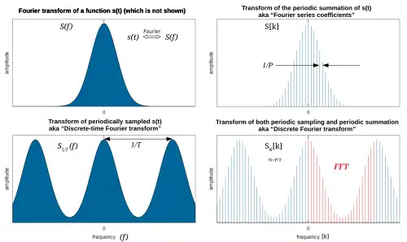
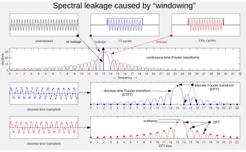
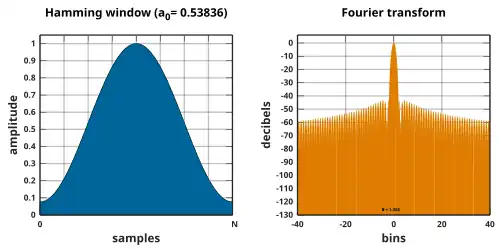

# 5.4 离散傅里叶变换（DFT）

> **前置知识**：[5.2 离散时间信号与系统](5.2-离散时间信号与系统.md)、[1.31 傅里叶变换 §6.4 采样定理](../../01-基础与电路分析/电路原理/1.31-傅里叶变换在电路中的应用.md)。本章从连续傅里叶变换出发导出离散傅里叶变换（DFT），它是数字频谱分析所立足的核心变换。

## 1. 从连续傅里叶到 DFT

### 1.1 变换谱图

离散频谱分析的出发点是四个变换之间的递进关系：

- **CTFT**（连续时间傅里叶变换）：时域连续 → 频域连续，$X(j\Omega)$
- **DTFT**（离散时间傅里叶变换）：时域离散 $x[n]$ → 频域连续 $X(e^{j\omega})$，且以 $2\pi$ 为周期
- **DFS 采样 / DFT**：在频率 $0\sim 2\pi$ 上以 $N$ 点均匀采样 DTFT，得到有限长序列的离散频谱

DTFT 的定义为

$$
X(e^{j\omega}) = \sum_{n=-\infty}^{\infty} x[n] e^{-j\omega n}
$$

*连续与离散傅里叶变换在时频域的递进关系：时域离散时，频域以 $2\pi$ 为周期延拓。*

### 1.2 从 DTFT 到 DFT

DTFT 频域连续、无法直接用数字设备处理。对有限长序列 $x[n],\ n=0..N-1$，在频率点

$$
\omega_k = \frac{2\pi k}{N}, \qquad k = 0, 1, \ldots, N-1
$$

处对 $X(e^{j\omega})$ 采样，就得到 DFT 的 $N$ 个频率样本 $X[k]$。因此 **DFT 本质上是 DTFT 在单位圆上的 $N$ 点频域采样**，两者在采样点上取值一致。

## 2. DFT 与 IDFT 定义

### 2.1 正变换（DFT）

$$
X[k] = \sum_{n=0}^{N-1} x[n]\, W_N^{kn}, \qquad W_N = e^{-j\frac{2\pi}{N}}, \quad k = 0, 1, \ldots, N-1
$$

其中 $W_N$ 称为**旋转因子**，具有对称性 $W_N^{k+N/2} = -W_N^k$ 与周期性 $W_N^{k+N} = W_N^k$。

### 2.2 反变换（IDFT）

$$
x[n] = \frac{1}{N} \sum_{k=0}^{N-1} X[k]\, W_N^{-kn}, \qquad n = 0, 1, \ldots, N-1
$$

DFT 与 IDFT 互为可逆的线性变换，可写成矩阵形式

$$
X = W\, x
$$

其中 $W$ 为 $N\times N$ 的 DFT 矩阵，元素为 $W^{kn}$。

### 2.3 DFT 隐含的周期性假设

一个关键事实：DFT/IDFT 的求和范围都是长度 $N$，且旋转因子以 $N$ 为周期，因此 DFT 运算**隐含把有限长序列视为一个周期序列的一个周期**（周期延拓）。这带来两个结论：其一，长度为 $N$ 的有限序列在圆周上"首尾相接"；其二，$X[k]$ 本身也是以 $N$ 为周期的，取 $k=0..N-1$ 即为一个周期。这一"周期延拓"假设直接引出圆周卷积。

### 2.4 DFT 的基本性质

| 性质 | 时域 | 频域 |
|-----|------|------|
| 线性 | $ax_1[n]+bx_2[n]$ | $aX_1[k]+bX_2[k]$ |
| 循环移位 | $x[(n-m)\bmod N]$ | $W_N^{km}X[k]$ |
| 循环卷积 | $x_1 \circledast x_2$ | $X_1[k]X_2[k]$ |
| 共轭对称 | $x^*[n]$ | $X^*[(-k)\bmod N]$ |
| 帕塞瓦尔 | $\sum_{n}|x[n]|^2$ | $\tfrac{1}{N}\sum_{k}|X[k]|^2$ |

其中帕塞瓦尔性质说明 DFT 变换保持信号能量（缩放 $1/N$），是能量谱/功率谱分析的依据。

## 3. 圆周卷积

### 3.1 定义

两个长度均为 $N$ 的序列的**圆周卷积**定义为

$$
y[n] = x_1[n] \circledast x_2[n] = \sum_{m=0}^{N-1} x_1[m]\, x_2[(n-m) \bmod N]
$$

与线性卷积不同，圆周卷积存在"环绕"效应：当 $n-m$ 越界时，用 $\bmod N$ 把尾巴"卷绕"到序列头部，参与叠加（卷绕叠加）。

### 3.2 圆周卷积定理

DFT 的卷积性质为：时域圆周卷积对应频域简单乘积：

$$
x_1[n] \circledast x_2[n] \xLeftrightarrow{\ \text{DFT}\ } X_1[k] \cdot X_2[k]
$$

这是"用 DFT 加速卷积"最核心的依据。它只对**圆周卷积**成立，对线性卷积并不直接成立。

### 3.3 线性卷积与圆周卷积的关系

设 $x_1$ 长 $L$、$x_2$ 长 $M$，线性卷积结果长度为 $L+M-1$。若选取 DFT 点数满足

$$
N \ge L + M - 1
$$

并分别对 $x_1$、$x_2$ 补零到长度 $N$，则它们的圆周卷积与线性卷积完全相同。这就是工程上"**先补零、再 FFT、频域相乘、再 IFFT**"得到线性卷积的标准做法（见 [5.5 快速傅里叶变换](5.5-快速傅里叶变换-FFT.md)）。

## 4. 频谱泄漏与窗函数

### 4.1 频谱泄漏

实际信号无限长，DFT 只能处理有限帧，于是对无限信号做**截断**——等价于乘以一个矩形窗。矩形窗在频域是一个带旁瓣的 sinc 谱，与真实频谱卷积后造成：

- 主瓣展宽，窄的谱线被"抹平"
- 旁瓣产生，能量泄漏到邻近频点，形成虚假谱分量

此现象称为**频谱泄漏**。加窗的频域效果是 $X(e^{j\omega})$ 与窗谱 $W(e^{j\omega})$ 的卷积：

$$
X_w(e^{j\omega}) = X(e^{j\omega}) * W(e^{j\omega})
$$

*对正弦加窗（截断）后，能量泄漏到邻近频点形成旁瓣，即频谱泄漏。*

### 4.2 常用窗函数

窗函数在主瓣宽度（决定频率分辨率）与旁瓣衰减（决定泄漏抑制）之间折衷：

| 窗函数 | 主瓣宽度 | 旁瓣衰减（dB） |
|-------|---------|--------------|
| 矩形窗 | $4\pi/N$ | -13 |
| 汉宁窗 | $8\pi/N$ | -31 |
| 汉明窗 | $8\pi/N$ | -41 |
| 布莱克曼窗 | $12\pi/N$ | -57 |

选用步骤：

1. 根据所需旁瓣抑制选择窗类型
2. 根据主瓣宽度要求确定窗长 $N$（频率分辨率约 $1/N$）
3. 若需精确定频，可结合补零（zero padding）细化频谱采样点

*汉明窗的时窗形状（左）与其频谱（右）：主瓣较宽而旁瓣更低，是抑制泄漏的常用窗。*

### 4.3 泄漏与分辨率的权衡

加窗抑制旁瓣以牺牲频率分辨率（主瓣加宽）为代价；增大窗长提高分辨率，但泄漏未必减少。因此应当依据应用目标选择候选窗并逐频点验证谱特性：强信号旁的弱信号更依赖低旁瓣，靠近的双谱线更依赖窄主瓣。

## 5. 工程 / 典型应用

- **频谱分析**：音频、振动、EMC 测试中对时域信号加窗后做 $N$ 点 DFT，观察幅值谱
- **FFT 加速线性卷积**：补零至 $N \ge L+M-1$，用 $N$ 点 FFT + 频域相乘 + IFFT 得到线性卷积，复杂度远低于时域卷积（见 [5.5 快速傅里叶变换](5.5-快速傅里叶变换-FFT.md)）
- **滤波器频率采样实现**：直接在频域设定 $H[k]$，再 IDFT 得到冲激响应
- **分段重叠相加（overlap-add）滤波**：长信号分块 + FFT 卷积拼接结果，用于实时流式处理

## 小结

- DTFT 是离散时域到连续频域的变换，DFT 是其频域 $N$ 点采样
- DFT/IDFT 以 $N$ 为周期，隐含周期延拓假设
- 时域圆周卷积对应频域乘积；补零至 $N\ge L+M-1$ 后圆周卷积等于线性卷积
- 频谱泄漏由矩形窗截断引起，可用窗函数在主瓣宽度与旁瓣衰减间折衷
- DFT 是现代频谱分析与快速卷积实现的基石

## 自测清单

1. 「从连续傅里叶到 DFT」要解决的核心问题是什么？关键结论或公式是什么？
2. 「DFT 与 IDFT 定义」与上一节之间是什么关系？
3. 「圆周卷积」在什么场景下会用到？如果条件改变，结论会如何变化？
4. 能否不看正文，写出「频谱泄漏与窗函数」的关键流程或结构？
5. 「工程 / 典型应用」最容易混淆的点是什么？

---

**下一章**：[5.5 快速傅里叶变换（FFT）](5.5-快速傅里叶变换-FFT.md)
