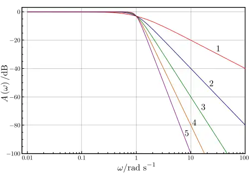
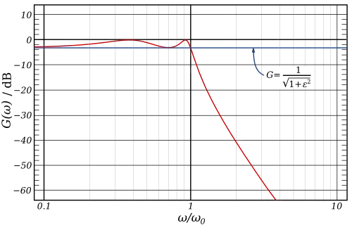
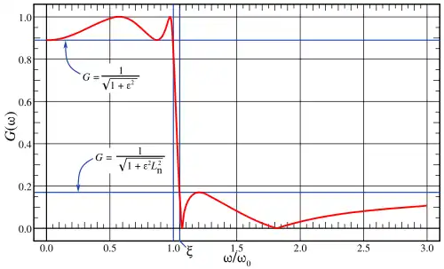

# 5.7 IIR滤波器设计

> **前置知识**：[1.29 拉普拉斯变换在电路中的应用](../../01-基础与电路分析/电路原理/1.29-拉普拉斯变换在电路中的应用.md)（模拟滤波器原型与 s 域极点）、[5.3 Z变换](5.3-Z变换.md)、[5.2 离散时间信号与系统](5.2-离散时间信号与系统.md)。本章介绍无限冲激响应（IIR）滤波器从模拟原型到数字化的设计方法。

## 1. IIR 系统与模拟原型

### 1.1 IIR 定义

**无限冲激响应（IIR）滤波器**含反馈项，系统函数兼有零点与极点：

$$
H(z) = \frac{\sum_{k=0}^{M} b_k z^{-k}}{1 + \sum_{k=1}^{N} a_k z^{-k}}
$$

由差分方程递推实现，输出依赖过去的输出。正因为有反馈，IIR 可以用**较低的阶数**获得与高阶 FIR 相近的幅频陡峭度，计算效率高，但一般没有严格线性相位，且必须保证极点位于单位圆内才稳定。

### 1.2 经典模拟原型

| 原型 | 特点 |
|-----|-----|
| 巴特沃斯（Butterworth） | 通带最平坦，单调幅频，无波纹 |
| 切比雪夫 I 型 | 通带等纹波，阻带单调，过渡带更陡 |
| 切比雪夫 II 型 | 阻带等纹波，通带单调 |
| 椭圆（Cauer） | 通带、阻带均等纹波，相同阶数过渡带最陡 |

以巴特沃斯低通为例，其幅度平方函数为

$$
|H(j\Omega)|^2 = \frac{1}{1 + \left(\dfrac{\Omega}{\Omega_c}\right)^{2N}}
$$

$N$ 为阶数，$\Omega_c$ 为截止频率。幅频单调、在 $\Omega=0$ 处最平坦，因此过渡带最平缓；作为对比，椭圆原型在相同阶数下过渡带最陡，但通阻带都有纹波。

*巴特沃斯低通幅频单调、通带最平坦，阶数越高过渡带越陡，且无纹波。*

*切比雪夫 I 型低通通带等纹波、阻带单调，同阶数下过渡带比巴特沃斯更陡。*

*椭圆（Cauer）滤波器通带、阻带均等纹波，相同阶数下过渡带最陡。*

### 1.3 由指标确定巴特沃斯阶数

给定通带最大衰减 $\alpha_p$（在 $\Omega_p$ 处）、阻带最小衰减 $\alpha_s$（在 $\Omega_s$ 处），可由幅度平方函数解出阶数：

$$
N = \frac{\log\sqrt{\dfrac{10^{\alpha_s/10} - 1}{10^{\alpha_p/10} - 1}}}{\log(\Omega_s / \Omega_p)}
$$

再取不小于该值的整数。由此可先确定阶数与截止频率，再求极点、构造 $H(s)$。

### 1.4 由低通原型到高通/带通

实际滤波器常需要高通、带通、带阻形式。最省事的方法是在 s 域（或直接对 $H(z)$）施加**频率变换**，把低通原型映射到目标类型：

| 目标 | s 域变量代换 |
|-----|------------|
| 低通→高通 | $s \mapsto \dfrac{\Omega_c^2}{s}$ |
| 低通→带通 | $s \mapsto \dfrac{s^2 + \Omega_0^2}{Bs}$ |
| 低通→带阻 | $s \mapsto \dfrac{Bs}{s^2 + \Omega_0^2}$ |

其中 $B$ 为带宽、$\Omega_0$ 为中心频率。好处是只需设计并验证一次低通原型即可推广到任意类型，且若在数字域对 $H(z)$ 使用相应的 $z$ 域变换，还能同时保持稳定性与基本幅频特征。

## 2. 从模拟到数字

### 2.1 冲激响应不变法

采样模拟冲激响应 $h_c(t)$ 得到数字冲激响应：

$$
h[n] = T_s\, h_c(nT_s)
$$

对应 $s\to z$ 的极点映射为 $z = e^{sT_s}$。主要特点：

- **优点**：时域冲激响应严格保持，模拟与数字时域行为接近
- **缺点**：存在**频谱混叠**——对带限以外的频率，$h_c(t)$ 的频谱折叠回有效频带；且为避免混叠要乘因子 $T_s$（增益修正）
- **限制**：不能用于高通、带阻等需要无限频带响应的滤波器，因为混叠无法避免
- **安全性**：模拟极点在左半平面时，映射后落在单位圆内，稳定性保持

### 2.2 双线性变换法

双线性变换采用下面的一一映射把整个 $s$ 左半平面映到 $z$ 平面单位圆内：

$$
s = \frac{2}{T_s} \cdot \frac{1 - z^{-1}}{1 + z^{-1}}, \qquad z = \frac{1 + \frac{T_s}{2}s}{1 - \frac{T_s}{2}s}
$$

特点：

- **完全消除混叠**（整个左半平面压进单位圆）
- 稳定的模拟系统映射后仍稳定（极点在左半平面 → 单位圆内）
- 代价是引入**频率弯曲（Warping）**：模拟频率与数字频率呈非线性关系
- 因此需**预畸变**边界频率。设计前用

$$
\Omega_{pre} = \frac{2}{T_s}\tan\!\left(\frac{\omega_d}{2}\right)
$$

把每个数字边界频率 $\omega_d$ 逆映射为模拟原型频率 $\Omega_{pre}$，用预畸变频率设计模拟原型后再反代得到数字滤波器。这是 IIR 设计最常用、最稳健的方法。

### 2.3 设计流程

1. 根据数字指标确定各边界频率 $\omega_d$（归一化到 $2\pi$）
2. 用频率预畸变公式把每个 $\omega_d$ 转成模拟原型频率 $\Omega_{pre}$
3. 以预畸变频率对选定原型（巴特沃斯/切比雪夫/椭圆）设计 $H(s)$
4. 施加双线性变换得到 $H(z)$，验证数字域频率响应是否满足通带/阻带指标

## 3. IIR 实现结构

### 3.1 直接型

直接 I 型、直接 II 型直接依据系统函数系数实现。直接 II 型共享一条延迟链，减少延迟单元，但对**系数量化高度敏感**——高阶系统稍许系数偏差就可能导致极点越出单位圆或性能严重劣化，因此高阶 IIR 通常不使用单纯直接型。

### 3.2 级联型（SOS）

把高阶系统分解为一阶、二阶节相乘：

$$
H(z) = \prod_{i=1}^{K} \frac{b_{0i} + b_{1i} z^{-1} + b_{2i} z^{-2}}{1 + a_{1i} z^{-1} + a_{2i} z^{-2}}
$$

每个二阶节（biquad）的极零点独立，量化误差只影响局部，稳定性与灵敏度明显优于直接型。工程上几乎都用**二阶节级联（SOS）**实现任意阶 IIR——这也是 TI、CSC 等 DSP 库的通用形态。

### 3.3 并联型

把 $H(z)$ 做部分分式展开，得到并联子系统的和：

$$
H(z) = A + \sum_{i=1}^{K} \frac{B_i}{1 - p_i z^{-1}}
$$

并联型利于并行计算、各支路独立，但部分分式展开要求极点互异，对零点分配灵活性有限。

## 4. IIR 与 FIR 对比

| 特性 | IIR | FIR |
|-----|-----|-----|
| 幅频选择性/效率 | 高阶陡峭只需低阶 | 需更高阶 |
| 线性相位 | 一般不具备 | 易实现（系数对称） |
| 稳定性 | 需保证极点在单位圆内 | 必然稳定 |
| 计算量 | 低 | 高 |
| 设计方法 | 模拟原型 + 变换 | 窗/频率采样/等纹波 |
| 量化灵敏度 | 直接型差，级联改善 | 较好 |

IIR 适合重视效率、对线性相位不敏感的应用；FIR 适合需要保真、可预测延迟的应用。

## 5. 工程 / 典型应用

- **音频与语音处理**：高效率、高性价比的语音编解码、均衡器常用 IIR 二阶节级联
- **控制环路 / 电源环路补偿**：数字 PID 本质是最低阶 IIR，见 [5.29 校正与综合](../自动控制原理/5.29-校正与综合.md)
- **DSP（如 C2000、TIC55xx）的 biquad 库**：为滤波与低功耗优化的常用移植单元
- **通信基带整形与窄带滤波**：低复杂度、高选择性，结合 [5.3 §5 稳定性](5.3-Z变换.md) 保证单位圆内极点

## 小结

- IIR 含反馈、效率高但一般无线性相位，且必须保证极点稳定
- 模拟原型（巴特沃斯/切比雪夫/椭圆）刻画不同幅频折衷，阶数由指标确定
- 双线性变换消除混叠但引入频率弯曲，需先预畸变边界频率
- 直接型对系数量化敏感，工程上用二阶节级联（SOS）实现任意阶 IIR
- IIR 与 FIR 的选择取决于效率与相位保真的权衡

## 自测清单

1. 「IIR 系统与模拟原型」要解决的核心问题是什么？关键结论或公式是什么？
2. 「从模拟到数字」与上一节之间是什么关系？
3. 「IIR 实现结构」在什么场景下会用到？如果条件改变，结论会如何变化？
4. 能否不看正文，写出「IIR 与 FIR 对比」的关键流程或结构？
5. 「工程 / 典型应用」最容易混淆的点是什么？

---

**下一章**：[5.8 多速率信号处理](5.8-多速率信号处理.md)
