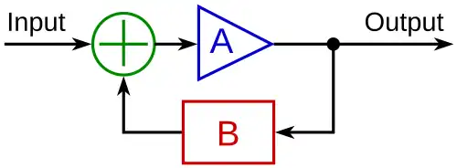
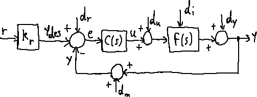

# 5.24 控制系统基本概念

> **本章定位**：用拉普拉斯变换与频域方法分析反馈控制系统。

> **前置知识**：**必需** [1.29 拉普拉斯变换在电路中的应用](../../01-基础与电路分析/电路原理/1.29-拉普拉斯变换在电路中的应用.md)（动态系统与复频域分析）、[1.33 信号与系统速成](../../01-基础与电路分析/电路原理/1.33-信号与系统速成.md)（LTI 系统与反馈分析基础）；**推荐** [2.7 负反馈放大电路](../../02-模拟与硬件工程/模拟电路/2.7-负反馈放大电路.md)（仅用于建立反馈直觉）。[4.31 PLL 模拟前端](../../04-集成电路设计/模拟IC设计/4.31-PLL模拟前端.md) 是后续应用示例，可在学完本章后选读，不是先修条件。本章从工程直觉出发，建立控制系统的基本词汇与框架。

自动控制是"不直接参与操作，却使被控量自动达到并保持期望值"的一门技术。它几乎是所有电子工程环路（开关电源、PLL、LDO、伺服电机）的共同骨架。本章先把控制系统的"词汇表"建立起来：什么是开环与闭环、反馈带来了什么、稳定性意味着什么，为后续各章的数学分析奠定概念基础。

## 1. 什么是控制系统

控制系统是通过某种机制使被控量（输出）达到并保持期望值（输入/参考）的装置集合。数学上，一个过程可以用其输入输出关系来刻画，而"控制"的目的就是**让输出跟踪给定的参考信号**。

生活中处处存在控制的例子：空调把室温稳定在设定值、巡航系统把车速保持恒定、芯片中的 PLL 把输出相位锁到参考。它们都具备如下共性——存在一个被控的物理量、一个与之比较的期望值、以及一个据此产生修正作用的机制。

### 控制系统的三个要素

- **被控对象**：需要被控制的设备或过程（如电机、电源、反应釜）
- **控制器**：根据误差产生控制作用的装置（如运放 + 补偿网络、数字 PID）
- **执行器/传感器**：将控制量作用到对象、并将被控量反馈给控制器

三者的闭环关系可以概括为"比较 → 修正 → 作用 → 检测"的循环。控制系统的设计，本质上是回答三个问题：被控什么量、以什么为基准、

图源：[Wikimedia Commons](https://commons.wikimedia.org/wiki/File:Ideal_feedback_model.svg)，CC BY-SA 4.0。
用什么修正手段。

### 被控量、控制量与扰动量

工程中先要把每个信号"对号入座"，否则建模与补偿无从谈起：

| 名称 | 符号 | 说明 |
|------|------|------|
| 给定输入（参考） | $r(t)$ / $R(s)$ | 期望输出，如设定电压 |
| 被控量（输出） | $y(t)$ / $Y(s)$ | 实际输出，如输出电压 |
| 控制量 | $u(t)$ / $U(s)$ | 控制器输出，作用到对象 |
| 扰动量 | $d(t)$ / $D(s)$ | 不希望的外来干扰，如负载突变 |

其中扰动量是不可控、也不想要的输入源，是控制系统要"对抗"的主要对象。设计时往往需要明确扰动从哪个节点进入系统，这决定了在何处引入补偿才能有效抑制它。

图源：[Wikimedia Commons](https://commons.wikimedia.org/wiki/File:Closed-loop_control_system_block_diagram_with_disturbances.png)，CC BY-SA。

## 2. 开环控制与闭环控制

### 开环控制

控制器直接按参考输入产生控制作用，不检测输出。其结构为"参考 → 控制器 → 对象 → 输出"。

图源：[Wikimedia Commons](https://commons.wikimedia.org/wiki/File:General_open_loop_system.svg)，公有领域。

开环增益关系：

$$
Y(s) = G(s) U(s), \qquad U(s) = G_c(s) R(s)
$$

开环控制没有自校正能力，当对象参数漂移或存在扰动 $D(s)$ 时，输出误差无法被自动修正：

$$
Y(s) = G_c(s) G(s) R(s) + G_d(s) D(s)
$$

这个表达式的含义是：扰动 $D(s)$ 直接通过 $G_d(s)$ 叠到输出上，没有任何机制把它拉回去。因此开环系统若要有小的稳态误差，就必须精确知道对象特性并维护其不变——这在工程中几乎不可能长期保证（温度、老化、批次差异都会改变对象参数）。

### 闭环控制（反馈控制）

通过比较器将输出（经反馈元件 $H(s)$）与参考相减得到误差，再用误差驱动对象：

$$
E(s) = R(s) - H(s) Y(s)
$$

闭环传递函数（单位反馈时 $H(s)=1$）：

$$
\Phi(s) = \frac{Y(s)}{R(s)} = \frac{G_c(s) G(s)}{1 + G_c(s) G(s) H(s)}
$$

当环路增益 $|G_c G H| \gg 1$ 时，$\Phi(s) \approx \frac{1}{H(s)}$，即**闭环特性主要由反馈网络决定**，与原对象参数近似无关——这是反馈抑制参数漂移的核心来源（回顾 4.7 负反馈）。这正是负反馈放大电路中"增益由反馈网络决定而非放大器件决定"这一思想在动态系统上的推广。

图源：[Wikimedia Commons](https://commons.wikimedia.org/wiki/File:General_closed_loop_feedback_system.svg)，CC BY-SA。

### 反馈的三重作用

反馈把"误差"作为修正依据，带来了三个工程收益，也付出一个代价：

1. **减小误差**：只要存在误差，环路就持续修正，直到误差小到被增益所限
2. **提高精度**：闭环增益只取决于反馈网络 $H(s)$，与对象参数漂移无关
3. **抗扰动**：扰动引起的输出偏差会被环路检测并反向抑制

代价则是**稳定性问题**：环路增益过大或相位不当，误差反而被放大成持续振荡（见 5.25、5.28 判据）。这是贯穿全书的核心权衡。

## 3. 量纲与分类：控制量、扰动量、给定输入

| 名称 | 符号 | 说明 |
|------|------|------|
| 给定输入（参考） | $r(t)$ / $R(s)$ | 期望输出，如设定电压 |
| 被控量（输出） | $y(t)$ / $Y(s)$ | 实际输出，如输出电压 |
| 控制量 | $u(t)$ / $U(s)$ | 控制器输出，作用到对象 |
| 扰动量 | $d(t)$ / $D(s)$ | 不希望的外来干扰，如负载突变 |

### 两类典型问题

- **调节问题**：$r(t)$ 恒定，抑制扰动 $d(t)$ 使 $y(t)$ 稳定在设定值（如 DC-DC 稳压）
- **跟踪问题**：$r(t)$ 变化，让 $y(t)$ 尽量精确、快速地跟随（如伺服电机定位）

调节问题考察的是"稳不稳得住"，跟踪问题考察的是"跟不跟得上"。开关电源、LDO 属于前者；电机伺服、天线跟踪属于后者。两者对控制器的要求侧重不同：调节看重抗扰带宽，跟踪看重带宽与相位。

### 典型系统的按"输入特性"分类

| 类型 | 输入形式 | 工程实例 |
|------|---------|---------|
| 定值控制 | 参考恒定，主要抗扰动 | 稳压电源、温控、恒流 |
| 随动控制 | 参考随机变化，快速跟踪 | 伺服电机、天线、雷达 |
| 程序控制 | 参考按预定时序变化 | 数控机床、生产流水线 |

## 4. 稳定性概念

稳定性的直观含义：系统收到有界扰动后，输出随时间的增长趋于收敛。形式化地，一个 LTI 系统稳定的充要条件是**所有闭环极点（特征根）位于 $s$ 平面左半平面**：

$$
\forall p_i \in \text{poles of } \Phi(s): \quad \operatorname{Re}(p_i) < 0
$$

若存在实部为正的极点，则输出呈指数发散，系统不稳定；实部为零 ± 纯虚极点则临界稳定。

反馈既能改善也能破坏稳定，这是控制设计的核心权衡：增益增大可减小误差，但可能使极点越过虚轴导致振荡发散。

### 稳定的一个直观例子

设想 Buck 稳压器的环路增益被无意加大很多：此时误差信号被过度放大，输出一旦偏离就会"修过头"，再被修反，形成持续振荡（临界稳定/不稳定）。而恰当的增益则让每次修正逐步收敛到设定值（稳定）。稳定性是"收敛"而非"振荡"的属性。

### 稳定性与工程裕量

严格地说，只要极点都落在左半平面系统就"稳定"。但落得靠近虚轴时，外部扰动仍会激起明显振荡（阻尼差）。因此工程上不仅要求稳定，还要求**足够的稳定裕度**（相位裕度、幅值裕度，见 5.28），这正是"稳定"与"好用"的区别所在。

### 通过开环/闭环对比理解反馈的价值（示意算例）

设想一个开环电压源：对象增益 $G=10$，无反馈。若对象增益因温漂下降到 $G=9$，则输出电压误差相对变化约 $10\%$，且任何负载扰动都直接反映在输出上，无法自愈。

改为闭环：令 $H=0.1$，闭环增益 $T=\frac{GH}{1+GH}$ 在高增益下近似 $\frac{1}{H}=10$。当 $G$ 从 10 变到 9 时，$T$ 的闭环值几乎不变（差远小于开环），扰动也被环路反向抑制。**代价**是需要保证 $1+GH>0$ 且裕度充足，否则等价于把"温漂误差"换成了"可能振荡"。

这个例子说明：反馈把精度从"依赖对象参数"转移到"依赖更高度的反馈网络参数"，同时引入稳定裕量这一新约束——控制设计的全部矛盾由此展开。

## 5. 典型控制系统示例

- **PLL 频率综合**（后续应用见 [4.31 PLL 模拟前端](../../04-集成电路设计/模拟IC设计/4.31-PLL模拟前端.md)）：PD 输出相位差 → LP 滤波 → VCO 压控频率，闭环使输出相位锁定于参考（相位即积分量）
- **Buck 稳压器**：误差放大器比较 $V_{out}$ 与基准 → PWM 占空比 → 电感平均电压校正 $V_{out}$
- **电机转速环**：编码器测转速 → PID 计算占空比/PWM 驱动 → 电机力矩校正转速
- **温度控制**：热敏电阻反馈 → 加热占空比 → 温度达到设定值

把这些系统抽象成"对象 + 控制器 + 反馈"后，它们共享完全相同的分析工具。以 PLL 为例：被控对象是 VCO（输入电压 → 输出频率，再积分成相位），控制器是电荷泵 + 环路滤波器，反馈元件是分频器，参考是参考相位。前几章学过的环路带宽、相位裕度概念在这里就是控制术语。

### 从"反馈"看电子工程环路的统一性

| 电子环路 | 被控量 | 参考 | 被控对象 | 控制器 |
|---------|-------|------|---------|--------|
| Buck 稳压 | 输出电压 | 基准电压 | 功率级 + LC | 误差放大器补偿 |
| LDO | 输出电压 | 基准电压 | 调整管 + 负载 | 内部放大器 |
| PLL | 输出相位 | 参考相位 | VCO | 电荷泵 + 环路滤波 |
| 电机 | 转速/位置 | 设定值 | 电机 + 负载 | PID / FOC |

## 6. 工程/典型应用

在设计任何反馈环路（开关电源环路、PLL、LDO、伺服系统）时，都应先回答：

1. 被控量是什么、基准从哪里来（决定 $H(s)$）
2. 扰动的主要来源与带宽（决定需要抑制的频段）
3. 需要多少"增益"来保证精度、又能承受多大增益才不至于失稳（衔接 5.26 时域与 5.28 频域判据）

这决定了后续建立数学模型、分析稳定性、设计校正网络的全部依据。

### 实用建议：设计第一步是"画框图"

现实中工程师拿到一个新环路任务，最重要的第一步往往不是算公式，而是画出开环框图，把被控对象、反馈通路、扰动注入点标清楚。框图一旦定下来，被控量、基准、量纲（是电压还是电流还是相位）就都明确了，后面建模与补偿才有正确的起点。

## 小结

- 控制系统的本质：让输出跟踪参考，并抑制扰动
- 闭环（反馈）以稳定性换来自动校正与被控对象参数无关性
- 稳定性等价于所有闭环极点位于 $s$ 左半平面
- 任何工程环路的设计出发点都是"被控量 + 基准 + 扰动 + 精度与稳定平衡"
- 调节问题重在抗扰，跟踪问题重在跟随，定值/随动/程序控制据此分类

## 自测清单

1. 「什么是控制系统」要解决的核心问题是什么？关键结论或公式是什么？
2. 「开环控制与闭环控制」与上一节之间是什么关系？
3. 「量纲与分类：控制量、扰动量、给定输入」在什么场景下会用到？如果条件改变，结论会如何变化？
4. 能否不看正文，写出「稳定性概念」的关键流程或结构？
5. 「典型控制系统示例」最容易混淆的点是什么？

---

**下一章**：[5.25 控制系统数学模型](5.25-控制系统数学模型.md)
