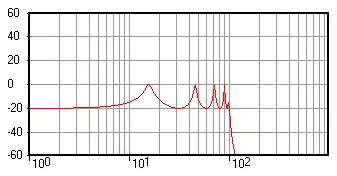
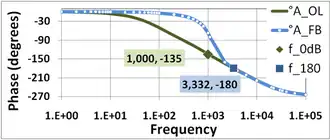
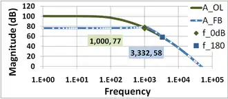

# 5.28 频域分析法

> **前置知识**：[2.6 频率响应](../../02-模拟与硬件工程/模拟电路/2.6-频率响应.md)（Bode 图与幅频/相频特性）、[4.31 PLL模拟前端](../../04-集成电路设计/模拟IC设计/4.31-PLL模拟前端.md)（环路带宽与相位裕度的实际工程语境）。频域法以 Bode/奈奎斯特图描述系统，提供稳定性的几何判据。

频域分析是电子工程师最熟悉的控制手段——因为放大器、滤波器、PLL、开关电源全都在用 Bode 图和相位裕度。它的巨大优势在于：**无需求解微分方程，只凭频率响应就能判断稳定性并给出修改方案**。工程师在环路里测一版 Bode 图，看穿越频率和相位裕度，就能决定加零点还是减增益。本章把"稳定的几何判据"（奈奎斯特判据）、"离失稳多远"（裕度）、"响应多快"（带宽）串成一个完整设计语言。

## 1. Bode 图回顾

对 $G(j\omega)$，Bode 图由**幅频特性** $20\lg|G(j\omega)|$（dB）与**相频特性** $\angle G(j\omega)$ 两张图组成。由各环节（比例/积分/惯性/一阶零点/二阶）渐近线叠加绘制。

- 每增加一个积分环节 $\frac{1}{s}$，低频段斜率 $-20\text{dB/dec}$ 且相位 $-90^\circ$
- 惯性环节 $\frac{1}{Ts+1}$ 在转角频率 $\omega=1/T$ 处斜率下降 $20\text{dB/dec}$，相位进入 $-90^\circ$

### 基本环节的 Bode 特征

| 环节 | 幅频低频斜率 | 相位趋势 | 转角频率 |
|------|-------------|---------|---------|
| 比例 $K$ | 0 dB/dec（平移） | $0^\circ$ | — |
| 积分 $\frac{1}{s}$ | $-20$ dB/dec | $-90^\circ$ | — |
| 微分 $s$ | $+20$ dB/dec | $+90^\circ$ | — |
| 惯性 $\frac{1}{Ts+1}$ | 0 → $-20$ | $0\to-90^\circ$ | $\frac{1}{T}$ |
| 一阶零点 $Ts+1$ | 0 → $+20$ | $0\to+90^\circ$ | $\frac{1}{T}$ |
| 二阶振荡 | 0 → $-40$ | $0\to-180^\circ$ | $\omega_n$ |

图源：[Wikimedia Commons](https://commons.wikimedia.org/wiki/File:Bodeplot.png)，CC BY-SA 3.0。

### 为什么频域法对控制至关重要

时域指标（超调、调节时间）虽然直观，但依赖求解响应，成本高。而 Bode 图可以从**环路增益的曲线形状**直接读出稳定性：穿越频率处的斜率与相位决定了裕度。工程上常不必先算时域，而是先用 Bode 图把环路"调稳"，再用时域校验指标——这就是 5.29 校正的日常流程。

## 2. 奈奎斯特稳定判据

以 $G(j\omega)H(j\omega)$ 的**奈奎斯特图**（$\omega: -\infty\to+\infty$）判断闭环稳定性。设 $P$ 为 $G(s)H(s)$ 在右半 $s$ 平面（含虚轴上的临界极点处理带来对应围线修正）的极点个数，$N$ 为奈奎斯特图绕 $(-1, j0)$ 点逆时针方向的包围次数，则右半平面闭环极点数：

$$
Z = P - N
$$

系统稳定的充要条件：$Z=0$，即奈奎斯特图逆时针绕过 $(-1,j0)$ 点 $P$ 次。

### 判据的几何含义

闭环特征方程为 $1+GH=0$。当 $\omega$ 沿 $j\omega$ 轴从 $-\infty$ 到 $+\infty$ 扫过时，$1+G(j\omega)H(j\omega)$ 绕原点的次数，等于右半平面极点数之差。把 $1+GH$ 曲线平移到以 $(-1,0)$ 为原点，就得到"绕 $(-1,j0)$"的说法。它是围线积分（辐角原理）的直接推论。

图源：[Wikimedia Commons](https://commons.wikimedia.org/wiki/File:Nyquist_plot.svg.png)，CC BY-SA。

### 两种图的取舍

- **Bode 图**：最常用，标出幅值/相位裕度直观，但需自行组合判断
- **奈奎斯特图**：给出严格的 Z=P-N 判据，对含纯迟延、右半平面极点的系统尤其严谨
- **对数奈奎斯特（Bode 上的 $(-1,j0)$ 映射）**：工程中最常通过 PM/GM 近似执行奈奎斯特判据
- **Nichols 图**：以幅值（纵轴）对相位（横轴）绘制，直接把闭环幅值/相位等值线与开环频响叠加在同一图上，便于直接读出闭环谐振峰与闭环带宽

> Nichols 图把开环频率响应对相位-幅值坐标绘制，并叠加闭环幅值/相位等值线，可直观读出闭环谐振峰与带宽，弥补 Bode 图需自行组合的不足。

## 3. 幅值裕度与相位裕度

用开环频率响应直接给出"离失稳还差多远"的裕度指标。

- **相位裕度** $\mathrm{PM}$：在幅值穿越频率 $\omega_{gc}$（$|G(j\omega_{gc})|=1$ 即 0 dB）处，相位距 $-180^\circ$ 的余量：
$$
\mathrm{PM} = 180^\circ + \angle G(j\omega_{gc})
$$
- **幅值裕度** $\mathrm{GM}$：在相位穿越频率 $\omega_{pc}$（$\angle G(j\omega_{pc})=-180^\circ$）处，幅值距 0 dB 的余量（dB）：
$$
\mathrm{GM} = -20\lg|G(j\omega_{pc})|
$$

**工程经验**：PM 通常取 $45^\circ\sim60^\circ$ 以获得良好阻尼（无振荡、超调适中）；GM 至少 6 dB（即 $\times 2$）。

相位裕度与时域阻尼的近似关系（对典型二阶系统）：

$$
\zeta \approx \frac{\mathrm{PM}}{100}
$$

图源：[Wikimedia Commons](https://commons.wikimedia.org/wiki/File:Phase_margin.png)，CC BY-SA 4.0。

> 幅值裕度 $\mathrm{GM}$ 在相位穿越频率处度量幅值距 0 dB 的余量，与相位裕度 $\mathrm{PM}$ 共同构成 Bode 图上"离失稳多远"的两把尺子。

### 一个数值例：由 Bode 图估算阻尼

设某开环系统在穿越频率 $\omega_{gc}$ 处测得相位 $\angle G(j\omega_{gc}) = -120^\circ$。则由定义：

$$
\mathrm{PM} = 180^\circ + (-120^\circ) = 60^\circ
$$

代入近似 $\zeta \approx 60/100 = 0.6$；再套用 5.26 的超调公式 $\%\mathrm{OS}=e^{-\pi\zeta/\sqrt{1-\zeta^2}}\approx 9.5\%$。由此可预判：阶跃响应约 10% 超调、阻尼良好。若测得相位为 $-150^\circ$，则 PM 仅 $30^\circ$，$\zeta\approx0.3$，超调约 $37\%$——明显振荡，需要 5.29 校正把相位"垫"回来。

### 裕度后验的物理意义

- 若开环增益在其附近再增大 $\mathrm{GM}$（dB）那么多，或相位再滞后 $\mathrm{PM}$ 那么多，闭环就失稳 —— 裕度刻画的是"边界距离"
- PM 还直接对应阻尼：PM 小 → 阻尼小 → 阶跃响应振荡；PM 接近 90° → 过阻尼缓慢

### 裕度过小的表现

PM 过小（如小于 30°）时，闭环阶跃会出现明显超调甚至振荡，这正是电源环路在穿越频率处相位裕度不足时"输出尖叫/振铃"的根本原因。

## 4. 系统带宽与控制能量

**闭环带宽** $\omega_{BW}$ 定义为闭环幅频特性下降到 $-3\text{dB}$ 处的频率。带宽越大，跟踪越快、对高频输入响应越好，但会放大高频噪声并使相位裕度变小。

$$
\omega_{BW} \approx \omega_n\sqrt{1 - 2\zeta^2 + \sqrt{2 - 4\zeta^2 + 4\zeta^4}}
$$

**权衡**：带宽需高于有用信号频带（保证跟随），又需低于噪声/开关频率（防止噪声与环路失稳）。

### 带宽、谐振峰与控制能量

| 频域指标 | 含义 | 工程指向 |
|---------|------|---------|
| $\omega_{BW}$ 带宽 | 闭环能响应的频率上限 | 跟随速度上限 |
| $M_r$ 谐振峰 | 闭环幅频最大值 | 阻尼与超调的量度 |
| GM/PM | 稳定边界距离 | 工程稳定性主指标 |

谐振峰 $M_r$ 与阻尼近似 $M_r \approx \frac{1}{2\zeta\sqrt{1-\zeta^2}}$（欠阻尼时），它与时域超调正相关，是带宽之外的又一个质量指标。

### 噪声与带宽的代价关系

带宽每提高一倍，环路能通过的随机噪声功率约增大，同时穿越频率附近相位更容易拖累裕度。因此"要高带宽"与"要低噪声、大裕度"永远要权衡。这在开关电源里尤其突出：环路带宽受限于开关频率，通常只能取开关频率的 $1/10\sim1/5$。

## 5. 工程/典型应用

- **PLL 环宽设计**：取合适环路带宽与相位裕度（典型 45°~60°）平衡锁定速度与抖动（10.3）
- **开关电源环路**：用 Bode 图测环路增益，在穿越频率处检查 PM/GM，决定补偿网络（5.29）
- **LDO 稳定**：通过调整 ESR 零点/极点位置保证穿越频率处的相位裕度

### 测量环路 Bode 图的实践

工程上常用"注入点 + 两通道测相"的方法在现场测环路增益：在反馈电阻处注入小信号，分别测对象与反馈两端的幅相，求得环路增益的 Bode 图。这比反复试改补偿元件高效得多——这是频域法的最大工程价值。

## 小结

- Bode 图由环节叠加绘制，奈奎斯特判据用 $(-1,j0)$ 包围判定稳定性
- 相位裕度与幅值裕度量化稳定边界，是工程上最常用的判据
- 带宽决定跟随能力与噪声权衡，谐振峰对应阻尼与超调
- 频域分析是电源、PLL 等反馈环路设计的标准化工具
- PM/GM 可直接转换到 $\zeta$ 与时域超调，构成"频域设计 + 时域效验"闭环

## 自测清单

1. 「Bode 图回顾」要解决的核心问题是什么？关键结论或公式是什么？
2. 「奈奎斯特稳定判据」与上一节之间是什么关系？
3. 「幅值裕度与相位裕度」在什么场景下会用到？如果条件改变，结论会如何变化？
4. 能否不看正文，写出「系统带宽与控制能量」的关键流程或结构？
5. 「工程/典型应用」最容易混淆的点是什么？

---

**下一章**：[5.29 校正与综合](5.29-校正与综合.md)
