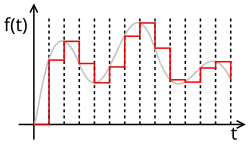
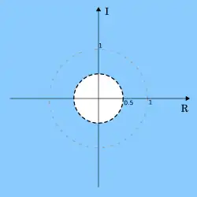

# 5.30 采样控制系统

> **前置知识**：[5.3 Z变换](../数字信号处理/5.3-Z变换.md)（离散域分析工具）、[5.26 时域分析](5.26-时域分析.md) 与 [5.29 校正与综合](5.29-校正与综合.md)（连续系统方法的对照基础）。本章把控制系统扩展到"采样-数字处理-保持"的数字实现。

现代控制系统大多由数字芯片（MCU/DSP）实现：先对连续输出采样，再在数字域里算控制律（通常是数字 PID），最后通过保持器把离散命令变回连续信号作用于对象。本章处理由此产生的全部新问题——采样导致的混叠、Z 变换描述、$\ z$ 平面稳定性、数字 PID 实现。它是把前几章连续理论"搬到数字域"的桥接章。

## 1. 采样控制系统的构成

数字控制系统在每个采样周期 $T$ 内：ADC 对输出采样 → 数字控制器计算 → 通过保持器（通常为零阶保持 ZOH）把数字量变成阶梯状连续信号作用于对象。

关键特性：采样使信号发生**混叠**与信息受限，奈奎斯特条件要求采样频率远高于信号带宽：

$$
\omega_s = \frac{2\pi}{T} \geq 2\,\omega_{\max}
$$

### 采样系统的组成环节

| 环节 | 作用 | 典型实现 |
|------|------|---------|
| 采样器（A/D） | 把连续信号变成离散序列 | ADC |
| 数字控制器 | 执行控制算法 | MCU/DSP、PID |
| 保持器（D/A） | 把离散值恢复成连续信号 | 零阶保持、PWM DAC |

### 采样频率的选择原则

- 越高越接近连续系统，但运算负担加重、功耗上升
- 太低则混叠、信息丢失、相位裕度恶化
- 工程通常取采样频率为环路带宽的 5~20 倍，以保证离散化几乎不影响原设计

## 2. 采样与保持

**理想采样**把连续信号 $e(t)$ 变成冲激序列，采样可表示为开关 + 冲激调制。**零阶保持**在采样间保持前一数值不变，其传递函数（连续域）：

$$
G_{h0}(s) = \frac{1 - e^{-sT}}{s}
$$

采样器 + 保持器 + 连续对象 $\dfrac{1-e^{-sT}}{s}G_p(s)$ 的脉冲传递函数可通过 z 变换获得。

图源：[Wikimedia Commons](https://commons.wikimedia.org/wiki/File:Zeroorderhold.signal.svg.png)，公有领域。

### 有关采样/保持的关键结论

- 零阶保持引入约 $T/2$ 的平均延迟，等效相位滞后，会侵蚀相位裕度——这是离散系统裕度通常要比连续略紧凑的原因
- 采样是**线性但不时不变**的（其对信号的"翻译"依赖采样时刻），在采样点之间信号被丢弃
- 组合 "采样器 + 保持器 + 连续对象" 离散化为脉冲传递函数 $G(z)$，是分析离散环路的基础

## 3. Z 变换与离散系统描述

离散信号 $e(k)$ 的 z 变换（衔接 20.3）：

$$
E(z) = \sum_{k=0}^{\infty} e(k) z^{-k}
$$

离散系统（脉冲传递函数）$G(z) = Y(z)/U(z)$。**采样系统时域**：脉冲响应由序列 $y(k)$ 表示。关键性质：

- 串联采样时 $G(z)=G_1(z)G_2(z)$（之间存在采样器时）；无采样器时为 $G_1G_2(z)$
- **终值定理**：$e(\infty) = \lim_{z\to 1}(1 - z^{-1})E(z)$

### 离散化连续传递函数的方法

把连续 $G(s)$ 变为离散 $G(z)$：在 $G(s)$ 前加零阶保持器的离散化（即对 $\frac{1-e^{-sT}}{s}G(s)$ 取 z 变换），是"物理等价"（step-invariant）的标准做法。工程上简化也有前向欧拉、后向欧拉、双线性变换等数值替代，各自在稳定的映射精度上有取舍。本章以零阶保持离散化为主。

## 4. 离散系统的稳定性

离散系统的稳定性取决于闭环特征根在 **z 平面单位圆内**。$z$ 平面与 $s$ 平面关系：

$$
z = e^{sT} = e^{\sigma T} e^{j\omega T}
$$

- $s$ 左半平面（$\sigma<0$）$\leftrightarrow$ 单位圆内（$|z|<1$）
- 虚轴 $\leftrightarrow$ 单位圆；右半平面 $\leftrightarrow$ 单位圆外

图源：[Wikimedia Commons](https://commons.wikimedia.org/wiki/File:Region_of_convergence_0.5_causal.svg.png)，CC BY-SA 4.0。

**劳斯判据用于离散系统**：通过双线性变换 $z=\frac{1+w}{1-w}$ 将单位圆映射到 $w$ 左半平面，再对 $w$ 域特征方程用劳斯判据判定。

### 稳定性对比速查

| 系统 | 稳定区域 | 判定工具 |
|------|---------|---------|
| 连续 | $s$ 左半平面 $\text{Re}<0$ | 劳斯、极点实部 |
| 离散 | $z$ 平面单位圆 $|z|<1$ | 双线性变换 + 劳斯、朱利判据 |

### z 域极点与响应形态

对应关系（类比 5.26）：$z$ 极点落单位圆内的位置决定离散响应形态——靠近 $z=1$（对应 $s$ 域原点）为慢衰减、离 1 远为快衰减，复数共轭对应离散的振荡分量。可据此由离散极点直接估算采样响应的快慢与振荡。

### 一个数值例：双线性变换判稳定

设离散特征方程为 $z^2 - 1.5z + 0.6 = 0$。作双线性变换 $z=\frac{1+w}{1-w}$：

$$
\left(\frac{1+w}{1-w}\right)^2 - 1.5\frac{1+w}{1-w} + 0.6 = 0
$$

乘以 $(1-w)^2$ 展开并整理得 $w$ 域多项式 $0.1w^2 + 0.8w + 2.2 = 0$，其系数全为正、同号，满足劳斯判据（第一列全正），故原离散闭环稳定。直接解原方程亦得 $z\approx0.75\pm j0.15$，模 $|z|\approx0.765<1$，同样稳定——两种方法结论一致，说明"单位圆内 $\Leftrightarrow w$ 左半平面"的映射是可靠的。

### 采样周期对稳定的影响

固定连续对象，采样周期 $T$ 增大会让离散极点向单位圆外移动、相位裕度变差。因此数字环路的采样频率不宜过低；若实时算力足够，务必把 $f_s$ 取在与性能／功耗的平衡点偏高一档，以尽量逼近连续设计。

## 5. 数字 PID 控制器

将连续 PID 离散化。用后向差分（$\frac{de}{dt}\approx\frac{e(k)-e(k-1)}{T}$，积分用矩形累加），**位置式 PID**：

$$
u(k) = K_p e(k) + K_i\sum_{j=0}^{k} e(j) + K_d \big(e(k) - e(k-1)\big)
$$

为避免积分饱和，常用**增量式 PID**（只输出控制量增量 $\Delta u(k)=u(k)-u(k-1)$）：

$$
\Delta u(k) = K_p \Delta e(k) + K_i e(k) + K_d \big(\Delta e(k) - \Delta e(k-1)\big)
$$

数字 PID 参数标定仍以连续 PID 整定结果为基础，再按采样周期调整。

### 位置式与增量式的取舍

| 特点 | 位置式 | 增量式 |
|------|--------|--------|
| 输出 | 直接是控制量 $u(k)$ | 控制量增量 $\Delta u$ |
| 积分饱和 | 需额外抗饱和处理 | 天然缓解 |
| 掉电恢复 | 需历史积分值 | 无需累计积分 |
| 手动/自动切换 | 需处理百态 | 平滑 |

工程伺服与电源里增量式更常见，因为它只输出增量、对执行器友好且不易积分饱和（配合 5.32 抗饱和技巧）。

## 6. 工程/典型应用

- **MCU 数字电源**：ADC 采样 $V_{out}$ → 数字 PID → PWM 更新占空比，实现数字环路控制（衔接 5.33）
- **伺服控制器**：编码器反馈经数字滤波后由数字 PID 驱动电机
- **混叠规避**：采样前加抗混叠低通滤波器，确保 $f_s$ 满足奈奎斯特条件

### 数字电源环路的实现要点

1. 采样频率设为环路带宽的 5–20 倍
2. ADC 前加抗混叠滤波
3. 数字 PID 采用增量式降低饱和风险
4. PWM 更新与采样同步（脉动对齐），减少相位误差
5. 依据连续整定初值再微调，在纯数字域仿真/实测中确认裕度

## 小结

- 数字控制系统 = 采样 + 数字处理 + 零阶保持，受奈奎斯特条件约束
- 采样/保持组合的脉冲传递函数经 z 变换获得
- 稳定性取决于特征根是否在 z 平面单位圆内，可由双线性变换 + 劳斯判据判定
- 数字 PID（位置式/增量式）是工程中最通用的离散控制器实现
- 采样频率、混叠、相位裕度侵蚀是数字实现特有的三处"坑"

## 自测清单

1. 「采样控制系统的构成」要解决的核心问题是什么？关键结论或公式是什么？
2. 「采样与保持」与上一节之间是什么关系？
3. 「Z 变换与离散系统描述」在什么场景下会用到？如果条件改变，结论会如何变化？
4. 能否不看正文，写出「离散系统的稳定性」的关键流程或结构？
5. 「数字 PID 控制器」最容易混淆的点是什么？

---

**下一章**：[5.31 状态空间与现代控制](5.31-状态空间与现代控制.md)
