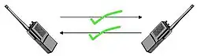

# 5.12 通信系统概述

> **本章定位**：在 DSP 之后进入通信系统，学习调制、编码、同步与链路预算。

> **前置知识**：**必需** [1.32 概率与随机变量基础](../../01-基础与电路分析/大学物理基础/1.32-概率与随机变量基础.md)（概率与随机信道基础）、[1.33 信号与系统速成](../../01-基础与电路分析/电路原理/1.33-信号与系统速成.md)（信号与系统基础），以及 DSP 的 [5.1 从连续到离散](../数字信号处理/5.1-从连续到离散.md)–[5.5 快速傅里叶变换](../数字信号处理/5.5-快速傅里叶变换-FFT.md)（采样、离散系统、Z 变换、DFT 与 FFT）。本章是通信原理的开篇，从系统层面阐述信息如何从信源端可靠地传送到信宿端，为后续各章（调制、编码、调制解调、多址等）提供整体框架。

本节先从"信息传递"的物理图景出发，建立通信系统的一体化模型，然后依次讨论信道分类、模拟与数字范式、传输方向、多址方式，最后引入衡量系统优劣的两类核心性能指标——有效性与可靠性。

## 1. 通信系统的组成模型

### 1.1 基本通信模型

通信的本质是把消息（message）从一方传递到另一方。一个典型的点对点通信系统由**信源、发送设备、信道、接收设备和信宿**五部分组成：

$$
\text{信源} \to \left[\text{发送设备}\right] \to \text{信道} \to \left[\text{接收设备}\right] \to \text{信宿}
$$

各部分职责如下：

| 部件 | 功能 | 典型实现 |
|------|------|---------|
| 信源 | 产生待传消息，并转换为原始电信号（基带信号） | 话筒、摄像头、传感器 |
| 发送设备 | 对基带信号进行调制、编码、功率放大后送入信道 | 射频发射机、光调制器 |
| 信道 | 信号传输的媒介，会引入衰减与噪声 | 双绞线、光纤、自由空间 |
| 接收设备 | 从受污染的信号中解调、译码、恢复消息 | 射频接收机、光探测器 |
| 信宿 | 消费接收到的消息 | 扬声器、显示器、处理器 |

其中，**基带信号**指未经调制、频率较低的原始电信号；发射端把它搬移到适合信道传输的高频带上，这一频率搬移过程就是**调制**。

### 1.2 数字通信系统的改进模型

当代通信以数字通信为主。数字系统在基本模型上增加了**信源编码**（压缩去冗余）、**信道编码**（加入抗干扰冗余）、**加密**与**交织**等环节：

$$
\text{信源} \to \text{信源编码} \to \text{信道编码} \to \text{调制} \to \text{信道} \to \text{解调} \to \text{信道译码} \to \text{信源译码} \to \text{信宿}
$$

各环节的可用性由[5.13 信息论基础](5.13-信息论基础.md)给出理论支撑：

- **信源编码**压缩数据，使信息速率不低于信源熵，见 [5.15 模拟信号的数字化](5.15-模拟信号的数字化.md)。
- **信道编码**由 [5.18 信道编码](5.18-信道编码.md) 详细展开，它用冗余换取可靠性。
- **调制**把比特流映到载体波形，见 [5.16 数字基带传输](5.16-数字基带传输.md) 与 [5.17 数字调制](5.17-数字调制.md)。

### 1.3 模拟通信与数字通信的比较

| 对比维度 | 模拟通信 | 数字通信 |
|---------|---------|---------|
| 信号形式 | 连续变化的波形 | 离散符号序列（0/1） |
| 抗干扰能力 | 噪声直接叠加，无法去除 | 可再生成，抗噪强 |
| 保密性 | 差，易于窃听 | 可加密，安全 |
| 抗噪质量 | 随距离/噪声下降 | 再生中继后近似不劣化 |
| 差错控制 | 无 | 可通过检错/纠错码 |
| 兼容各种业务 | 每种业务独占电路 | 统一数字化后可融合 |

数字通信的代价是需要更高带宽，但现代压缩与高效调制已大幅缓解这一矛盾。

## 2. 信道的分类

### 2.1 按传输媒介划分：有线信道与无线信道

| 类型 | 典型媒介 | 特点 |
|------|---------|------|
| 有线信道 | 双绞线、同轴电缆、光纤 | 信道特性稳定，带宽大，便于保证传输质量 |
| 无线信道 | 自由空间（电磁波传播链路） | 存在自由空间损耗、多径衰落与多普勒效应，信道随机性大 |

无线信道的**自由空间传播损耗**为：

$$
\frac{P_r}{P_t} = \left( \frac{\lambda}{4\pi d} \right)^2
$$

其中 $P_t$ 为发射功率，$P_r$ 为接收功率，$\lambda$ 为波长，$d$ 为距离。链路损耗的工程估算详见 [5.22 差错与链路预算](5.22-差错与链路预算.md)。

### 2.2 按是否叠加噪声划分：恒参信道与随参信道

- **恒参信道**：传输特性基本不随时间变化，如有线信道，可用固定频率响应与固定衰减描述。
- **随参信道**：传输参数随时间随机变化，如电离层反射、城市移动传播环境，需用统计模型（瑞利/莱斯分布）描述。

### 2.3 按传输方向划分：单工、半双工与全双工

- **单工**：信息只能单向传输（如广播、电视）。
- **半双工**：可双向传输，但不能同时进行（如对讲机）。
- **全双工**：可同时双向传输（如电话、手机）。

> 全双工允许收发双方同时双向传输，为电话、手机等系统所采用。

### 2.4 噪声模型：AWGN 信道

最常用、也是理论分析基准的信道是**加性高斯白噪声（AWGN）**信道，其输出为：

$$
y(t) = h(t) * x(t) + n(t)
$$

其中 $h(t)$ 为信道冲激响应，$n(t)$ 为零均值、功率谱密度 $N_0/2$ 的加性高斯白噪声。AWGN 模型是多数误码率公式（见 [5.16](5.16-数字基带传输.md)、[5.17](5.17-数字调制.md)）的假设前提。

## 3. 多址方式概述

多个用户共享同一物理信道资源，需要通过**多址技术**区分不同用户：

- **FDMA**（频分多址）：按频率划分用户。
- **TDMA**（时分多址）：按时间片划分用户。
- **CDMA**（码分多址）：按正交扩频码划分用户。
- **OFDMA**（正交频分多址）：按子载波集合划分用户，是现代蜂窝系统的基础。

更详细的扩频与多址分析见 [5.20 扩频与多址](5.20-扩频与多址.md)，其在现代系统中的集成见 [5.21 现代无线系统](5.21-现代无线系统.md)。

## 4. 通信系统的性能指标

通信系统的两大指标分别是衡量"传得快不快/省带宽"的**有效性**，与衡量"传得对不对"的**可靠性**。

### 4.1 有效性指标

**信息传输速率**（比特率，单位 bit/s）：

$$
R_b = \frac{I}{t}
$$

其中 $I$ 为 $t$ 时间内传输的信息量。为区分"有用信息"与"符号数"，还常用**码元速率**（波特率）$R_s$，二者关系为：

$$
R_b = R_s \log_2 M
$$

其中 $M$ 为调制阶数。**频带利用率**定义为单位带宽内传输的比特率：

$$
\eta = \frac{R_b}{B} \quad (\text{bit/s/Hz})
$$

频带利用率同时衡量了系统的有效性与对频谱资源的利用程度。

### 4.2 可靠性指标

对数字系统，核心可靠性指标是**误码率（BER, Bit Error Rate）**，即传输的比特中发生错误的比特所占比例：

$$
P_e = \frac{\text{错误比特数}}{\text{总传输比特数}}
$$

受衰落与干扰的直接丈量对象还有**误帧率（FER）/误字率（WER）**，以及衡量信号强度的**信噪比（SNR）**与每比特能量信噪比 $E_b/N_0$（详见 [5.22 差错与链路预算](5.22-差错与链路预算.md)）。

### 4.3 有效性与可靠性的矛盾

在带宽受限 AWGN 信道中，非编码数字调制下比特率与误码率存在折中：信道容量一定时，盲目提高比特率会降低可靠性（增大 $P_e$）。现代通信通过**信道编码**在有限带宽内逼近信道容量，其终极上限由香农定理给出（见 [5.13 信息论基础](5.13-信息论基础.md)）：

$$
C = B \log_2\left(1 + \frac{S}{N}\right)
$$

当实际信息速率 $R_b > C$ 时，无论采用何种编码都无法实现无误码传输；当 $R_b$ 显著小于 $C$ 时，才存在使误码率任意小的编码方案。

## 5. 通信系统在电路/芯片层面的映射

通信理论最终要靠物理电路实现。把抽象模型映射到 [4.44 RFIC 设计](../../04-集成电路设计/RFIC设计/4.44-RFIC-概述与接收机.md) 中的收发机：

| 系统环节 | 物理电路模块 |
|---------|-------------|
| 调制 | I/Q 混频器、调制器 |
| 发送/功率放大 | PA（功率放大器） |
| 低噪声接收 | LNA（低噪声放大器） |
| 下变频 | 混频器 + 本地振荡器/PLL |
| 模拟-数字接口 | ADC（见 [3.9 数模与模数转换](../../03-数字与计算机系统/数字电路/3.9-数模与模数转换.md)） |
| 基带处理 | DSP、编解码器、均衡器 |

## 6. 工程/典型应用：数字移动通信的整机链路

以 LTE/5G 手机接收链路为例，展示各环节的衔接：

1. 天线将射频信号耦合到接收前端（涉及 [4.44 RFIC 设计](../../04-集成电路设计/RFIC设计/4.44-RFIC-概述与接收机.md) 的低噪放与混频器）。
2. 接收机下变频得到基带/中频模拟信号。
3. A/D 转换得到数字化基带信号（见 [5.15 模拟信号的数字化](5.15-模拟信号的数字化.md)）。
4. 数字域完成均衡、解调、信道译码与信源译码。
5. 将还原的比特流转交给上层的语音/数据业务。

由此可以把本章的"有效性与可靠性"指标落到具体硬件上：频带利用率决定信号的频谱宽度与采样率，误码率决定调制阶数与信道编码冗余的比例。从整体上讲，一个实际通信系统就是在**香农容量**、**射频硬件**与**编码算法**三个约束下平衡有效性与可靠性的工程实现。

## 本章要点

- 通信系统的组成模型
- 信道的分类
- 多址方式概述
- 通信系统的性能指标
- 通信系统在电路/芯片层面的映射
- 工程/典型应用：数字移动通信的整机链路

## 自测清单

1. 「通信系统的组成模型」要解决的核心问题是什么？关键结论或公式是什么？
2. 「信道的分类」与上一节之间是什么关系？
3. 「多址方式概述」在什么场景下会用到？如果条件改变，结论会如何变化？
4. 能否不看正文，写出「通信系统的性能指标」的关键流程或结构？
5. 「通信系统在电路/芯片层面的映射」最容易混淆的点是什么？

---

**下一章**：[5.13 信息论基础](5.13-信息论基础.md)
