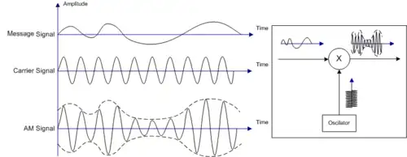
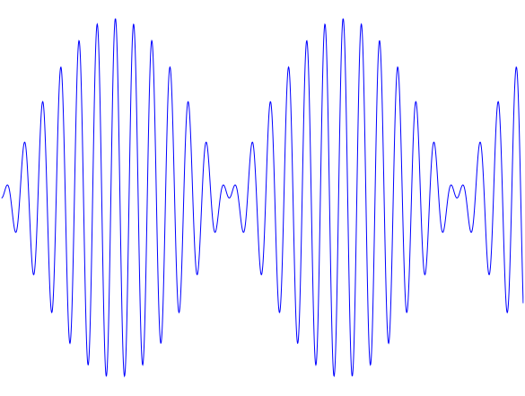

# 5.14 模拟调制

> **前置知识**：[1.31 傅里叶变换在电路中的应用](../../01-基础与电路分析/电路原理/1.31-傅里叶变换在电路中的应用.md)、[2.15 模拟乘法器](../../02-模拟与硬件工程/模拟电路/2.15-模拟乘法器.md)、[2.16 自动增益控制](../../02-模拟与硬件工程/模拟电路/2.16-自动增益控制-AGC.md)。调制是把基带信号的频谱搬移到载波附近的频率变换过程，是频分复用与无线传输的前提。

模拟调制可分为两类：**线性调制**（调幅族）与**非线性调制**（角度调制族）。线性调制把频谱直接搬移、带宽最省；角度调制则通过扩展带宽换取更强的抗噪能力。本节分别讨论二者的波形、频谱、解调与抗噪性能。

## 1. 幅度调制

设调制信号（基带信号）为 $f(t)$，载波为 $c(t) = A\cos(\omega_c t)$。

### 1.1 常规调幅（AM）

带直流分量的调幅波：

$$
s_{\text{AM}}(t) = A_0\left[1 + m_a \hat{f}(t)\right]\cos(\omega_c t)
$$

其中 $m_a = \frac{\Delta A}{A_0}$ 为**调幅指数**。为避免过调幅失真，要求 $0 \le m_a \le 1$，调制前后幅度关系：

$$
m_a = \frac{A_{\max} - A_{\min}}{A_{\max} + A_{\min}}
$$

- 当 $m_a < 1$：包络与 $f(t)$ 成正比，可用简单的包络检波恢复。
- 当 $m_a > 1$（**过调幅**）：包络反向，产生失真，包络检波无法正确解调。
- 典型应用中取 $m_a \approx 0.3$，以留有裕量并减少峰值功率。

> 调制后载波的包络（幅度）随基带信号 $f(t)$ 成正比变化，对应 $0\le m_a\le 1$ 时可用包络检波恢复。

AM 信号频谱含载波分量与上下边带，**带宽**为 $B_{\text{AM}} = 2f_m$，其中 $f_m$ 为基带最高频率。其调制与解调框图各环节可用 [2.15 模拟乘法器](../../02-模拟与硬件工程/模拟电路/2.15-模拟乘法器.md) 实现。

> AM 频谱含位于 $f_c$ 的载波分量及上下两个边带，带宽 $B_{\text{AM}}=2f_m$。

> 幅度调制波形直观展示基带包络（图中低频虚包络）随调制信号变化而载波幅度（高频振荡）按 $s_{\mathrm{AM}}(t)=A_0[1+m_a\hat f(t)]\cos\omega_c t$ 变化。

**功率效率**：设调制信号功率为 $P_m$，则双边带总功率为

$$
P_{\text{AM}} = P_c\left(1 + \frac{m_a^2}{2}\right)
$$

其中 $P_c$ 为载波功率。信息全在边带中，而载波占去了大部分功率，因此 AM 的功率效率很低（最大约 $1/3$），这是其抗噪性能差的根源之一。

### 1.2 抑制载波双边带（DSB-SC）

去掉 AM 中的直流分量：

$$
s_{\text{DSB}}(t) = f(t)\cos(\omega_c t)
$$

DSB 无载波分量，功率效率高，但解调需**相干解调**（本地载波与发射端同频同相），用 [2.15 模拟乘法器](../../02-模拟与硬件工程/模拟电路/2.15-模拟乘法器.md) 相乘后经低通滤波恢复：

$$
s_{\text{DSB}}(t)\cos(\omega_c t) = \frac{1}{2}f(t) + \frac{1}{2}f(t)\cos(2\omega_c t)
$$

低通滤波去掉 $2\omega_c$ 项即得 $f(t)/2$。DSB 带宽仍为 $B=2f_m$，但省去了载波功率，输出信噪比相比 AM 改善约 $3\,\text{dB}$。

### 1.3 单边带（SSB）与残留边带（VSB）

- **SSB**：只保留 DSB 的一个边带，带宽减半 $B_{\text{SSB}} = f_m$，信噪比改善 $3\,\text{dB}$。可用滤波法或移相法实现，常用于短波窄带通信。
- **VSB**：介于 DSB 与 SSB 之间，保留了大部分一个边带及少量另一边带，广泛用于电视图像信号，其滤波器需满足残留边带互补对称条件。

| 方式 | 带宽 | 解调 | 功率效率 | 典型用途 |
|------|------|------|---------|---------|
| AM | $2f_m$ | 包络检波 | 低（含载波） | 中波广播 |
| DSB-SC | $2f_m$ | 相干解调 | 高（无载波） | 理论/分析 |
| SSB | $f_m$ | 相干解调 | 最高 | 短波话音 |
| VSB | 略大于 $f_m$ | 相干解调 | 高 | 电视图像 |

## 2. 角度调制（调频与调相）

### 2.1 调频（FM）

瞬时频率按调制信号变化：

$$
s_{\text{FM}}(t) = A\cos\left[2\pi f_c t + 2\pi K_f \int_0^t f(\tau)d\tau\right]
$$

频偏为 $\Delta f = K_f |f(t)|_{\max}$，**调频指数**为：

$$
m_f = \frac{\Delta f}{f_m} = \frac{K_f |f(t)|_{\max}}{f_m}
$$

根据 $m_f$ 大小可分为窄带 FM（$m_f < 1$）与宽带 FM（$m_f \gg 1$）。

> FM 载波的瞬时频率随基带信号变化而幅度恒定，因此抗非线性失真能力强。

### 2.2 调相（PM）

瞬时相位正比于调制信号：

$$
s_{\text{PM}}(t) = A\cos\left[2\pi f_c t + K_p f(t)\right]
$$

瞬时相位的定义与"瞬时频率与瞬时相位的导数关系"：

$$
\boxed{\ \omega(t) = \frac{d\varphi(t)}{dt},\quad \varphi(t) = \int_{t_0}^t \omega(\tau)d\tau\ }
$$

FM 与 PM 统称角度调制，二者本质相通：把 $f(t)$ 先积分再调相即得调频，把 $f(t)$ 先微分再调频即得调相，因此只需重点研究 FM。

### 2.3 角度调制的带宽与抗噪优势

根据卡森（Carson）准则，FM 信号近似带宽为：

$$
B_{\text{FM}} \approx 2(\Delta f + f_m) = 2f_m(1 + m_f)
$$

角度调制通过扩展带宽换取更高的输出信噪比。宽带 FM 的解调增益为：

$$
G_{\text{FM}} = 3 m_f^2 (m_f + 1) \approx 3 m_f^3 \quad (\text{大 } m_f)
$$

其**调频增益**使宽带 FM 的抗噪性能显著优于 AM，代价是占用更大带宽。这正是"以带宽换信噪比"思想的典型体现。

**门限效应**：当输入信噪比低于某个门限 $(\text{SNR}_{i})_{\min}$ 时，FM 解调器输出信噪比急剧恶化，因此工程上需要保持接收电平高于门限（配合 [2.16 自动增益控制](../../02-模拟与硬件工程/模拟电路/2.16-自动增益控制-AGC.md)）。

## 3. 解调方式与抗噪性能比较

| 调制方式 | 解调难度 | 带宽 | 抗噪性能（同等条件下） |
|---------|---------|------|----------------------|
| AM（包络检波） | 简单（无需本地载波） | $2f_m$ | 较差，含载波浪费功率 |
| DSB（相干解调） | 需载波同步 | $2f_m$ | 较 AM 改善，无载波功率损耗 |
| SSB（相干解调） | 需载波同步且滤波严格 | $f_m$ | 最佳带宽效率 |
| FM（鉴频/锁相） | 需鉴频器或 PLL | $2f_m(1+m_f)$ | 以大带宽换高信噪比 |

各调幅方式在相同解调输入信噪比下，输出信噪比排序大致为：

$$
(\text{SNR}_o)_{\text{AM}} \le (\text{SNR}_o)_{\text{DSB}} = (\text{SNR}_o)_{\text{SSB}} \ll (\text{SNR}_o)_{\text{FM}}\ (\text{宽带})
$$

其中 DSB 与 SSB 输出信噪比相等（带宽相同），只是前者浪费带宽而后者需更严格的滤波。

## 4. 工程/典型应用：广播与模拟射频链路

1. 中波（AM）广播与短波广播沿用 AM，接收机结构最简单，包络检波即可。
2. FM 广播与电视伴音采用宽带 FM，通过在 [2.16 自动增益控制](../../02-模拟与硬件工程/模拟电路/2.16-自动增益控制-AGC.md) 稳定接收电平后由鉴频/PLL 解调，抗噪性能好。
3. SSB 广泛用于短波窄带话音通信（如业余无线电、军用单边带），带宽效率高。
4. 在实际射频收发机中，AM/DSB 乘法器、FM 调频器与 PLL（见 [4.31 PLL 模拟前端](../../04-集成电路设计/模拟IC设计/4.31-PLL模拟前端.md)）是核心电路模块。

模拟调制是理解数字调制（[5.17](5.17-数字调制.md)）与无线链路设计的前置：数字调制在本质上就是"用数字符号去控制模拟载波的幅度/相位/频率"，其相干解调、载波同步的困难继承自 DSB-SC。因此深刻理解本节是衔接后续各章的关键。

## 本章要点

- 幅度调制
- 角度调制（调频与调相）
- 解调方式与抗噪性能比较
- 工程/典型应用：广播与模拟射频链路

## 自测清单

1. 「幅度调制」要解决的核心问题是什么？关键结论或公式是什么？
2. 「角度调制（调频与调相）」与上一节之间是什么关系？
3. 「解调方式与抗噪性能比较」在什么场景下会用到？如果条件改变，结论会如何变化？
4. 能否不看正文，写出「工程/典型应用：广播与模拟射频链路」的关键流程或结构？
5. 「常规调幅（AM）」最容易混淆的点是什么？

---

**下一章**：[5.15 模拟信号的数字化](5.15-模拟信号的数字化.md)
