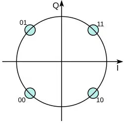
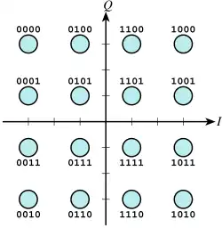

# 5.17 数字调制

> **前置知识**：**必需** [5.12 通信系统概述](5.12-通信系统概述.md)、[5.14 模拟调制](5.14-模拟调制.md)、[5.16 数字基带传输](5.16-数字基带传输.md)、[1.32 概率与随机变量基础](../../01-基础与电路分析/大学物理基础/1.32-概率与随机变量基础.md)（AWGN、高斯 Q 函数与误码率）。数字调制是用数字基带信号去控制载波的幅度、相位或频率，把比特映射到适合无线信道的波形。

数字调制方式的优劣由两个指标度量：**误码率**（可靠性）与**频带利用率**（有效性）。二者常相互折中。本节依次介绍 ASK、FSK、PSK 及其多进制扩展，最后引入星座图与 OFDM 的基本思想。

## 1. 基本数字调制方式

### 1.1 幅移键控（ASK）与频移键控（FSK）

**2ASK（二进制幅移键控）**用载波的有无表示 1/0：

$$
s(t) = \begin{cases} A\cos(2\pi f_c t), & \text{发"1"} \\ 0, & \text{发"0"} \end{cases}
$$

2ASK 可视为载波与单极性基带信号相乘。其相干解调误码率为：

$$
P_{e,\text{ASK}} = Q\left( \sqrt{\frac{E_b}{N_0}} \right)
$$

**2FSK（二进制频移键控）**用两个频率 $f_1,f_2$ 表示 0/1：

$$
s(t) = \begin{cases} A\cos(2\pi f_1 t), & \text{发"1"} \\ A\cos(2\pi f_2 t), & \text{发"0"} \end{cases}
$$

若两频率正交（频差满足 $\Delta f \cdot T_s = 1/2$ 的整数倍），相干解调误码率为：

$$
P_{e,\text{FSK}} = Q\left( \sqrt{\frac{E_b}{N_0}} \right)
$$

FSK 的主要优点是对非线性失真不敏感（恒包络），便于用限幅器与非相干解调。

### 1.2 相移键控（PSK）

二相相移键控（BPSK）用两相位表示 0/1：

$$
s(t) = A\cos(2\pi f_c t + \varphi_i), \quad \varphi_i \in \{0, \pi\}
$$

BPSK 在 AWGN 下的误码率为：

$$
P_e = Q\left( \sqrt{\frac{2E_b}{N_0}} \right)
$$

**2DPSK（差分相移键控）**用相邻符号的**相位差**表示信息，无需绝对相位基准，可在无载波同步时用非相干差分检测解调，性能损失约 1~3 dB：

$$
P_{e,\text{2DPSK}} \approx 2Q\left( \sqrt{\frac{2E_b}{N_0}} \right)
$$

### 1.3 正交相移键控（QPSK）

将序列分成同相（I）与正交（Q）两路，各以 BPSK 方式调制在同一信号上：

$$
s(t) = A\left[ I(t)\cos(2\pi f_c t) - Q(t)\sin(2\pi f_c t) \right]
$$

QPSK 在相同误码率下比特率是 BPSK 的两倍，符号速率为比特率的一半。其误码率（比特级）为：

$$
P_b = Q\left( \sqrt{\frac{2E_b}{N_0}} \right)
$$

与 BPSK 相同，但带宽效率翻倍。**OQPSK/π/4-QPSK** 通过偏移相位跳变限制包络起伏，利于非线性功放。

### 1.4 正交幅度调制（QAM）

在 I/Q 两路上同时进行多电平幅度调制：

$$
s(t) = A\left[ \sum_k a_k g(t-kT_s)\cos(2\pi f_c t) - \sum_k b_k g(t-kT_s)\sin(2\pi f_c t) \right]
$$

$M$-QAM 每个符号携带 $\log_2 M$ 比特（如 16-QAM 为 4 比特，64-QAM 为 6 比特）。方形 $M$-QAM 的近似误码率（高 $E_b/N_0$）为：

$$
P_b \approx \frac{4}{\log_2 M}\left(1 - \frac{1}{\sqrt{M}}\right) Q\left( \sqrt{\frac{3\log_2 M}{M-1}\cdot\frac{2E_b}{N_0}} \right)
$$

### 1.5 频移键控的连续相位（CPFSK/MSK）

连续相位 FSK（CPFSK）中，最小频移间隔 $h = 2\Delta f T_s = 0.5$ 时为正交的最小频移键控（MSK），既节省带宽又保持恒包络。加高斯滤波的 GMSK/GFSK 进一步压缩频谱旁瓣，用于 GSM 与蓝牙。

## 2. 星座图

### 2.1 星座图表示

在 I-Q 平面上，用符号的复基带表示 $c_k = a_k + jb_k$ 画出各符号所在点，即**星座图**：

- 点间**最小欧氏距离**决定了抗噪能力，距离越大误码率越低。
- 高阶调制（如 64-QAM、256-QAM）点更密、频谱效率更高，但抗噪能力下降。

BPSK 为两点在实轴上（距离 $2A$）；QPSK 为四点在单位圆上；$M$-QAM 为 $M$ 点在规则网格上。

> QPSK 的 4 个星座点位于单位圆上，相邻点只差 1 个比特，便于格雷映射降低误码率。

> 16-QAM 的 16 个星座点排成 $4\times4$ 网格，每符号携带 4 比特；点越密则抗噪要求越高。

### 2.2 频谱效率与抗噪的折中

$$
\eta = \log_2 M \quad (\text{bit/s/Hz}) \quad(\text{理想},\ \text{两维})
$$

星座点数 $M$ 越大，带宽效率越高但所需信噪比越高。高阶调制也需更高的 $E_b/N_0$：由误码率公式可见，要达到相同 $P_b$，调制阶数越高所需 $E_b/N_0$ 越大。

## 3. 相干解调与非相干解调

### 3.1 相干解调

需要恢复与发射端**同频同相的本地载波**，用相乘 + 低通滤波完成解调，性能最优。载波恢复可借助 [4.31 PLL 模拟前端](../../04-集成电路设计/模拟IC设计/4.31-PLL模拟前端.md) 的锁相环实现，详见 [5.19 同步技术](5.19-同步技术.md)。

### 3.2 非相干解调

不依赖载波相位信息：

- **包络检测**：直接取信号包络（适用于 FSK/ASK）。
- **差分检测**：比较相邻符号相位差（如 DPSK）。

非相干实现简单、无需载波同步，但在 AWGN 下性能损失约 1~3 dB。

### 3.3 各调制方式性能对比

| 调制 | 带宽效率 $\eta$（bit/s/Hz） | 误码率特性 | 复杂度 |
|------|---------------------------|-----------|--------|
| 2ASK | $\approx 1$ | 最差（需 $\sqrt{}$） | 低 |
| 2FSK | $\le 1$（与频偏有关） | 中等 | 低 |
| BPSK | 1 | $Q(\sqrt{2E_b/N_0})$ | 中 |
| QPSK | 2 | 与 BPSK 相同 | 中 |
| 8PSK | 3 | 需更高 $E_b/N_0$ | 中 |
| 16-QAM | 4 | 需更高 $E_b/N_0$ | 高 |
| 64-QAM | 6 | 需更高 $E_b/N_0$ | 高 |

## 4. OFDM 简介

### 4.1 正交频分复用思想

把高速数据流拆分为 $N$ 个并行的低速子流，分配到 $N$ 个相互正交的子载波上同时传输，各子载波间隔取子载波符号速率，相邻子载波频谱重叠但仍正交，从而在不增加总带宽前提下提高频率效率并抵抗频率选择性衰落。

### 4.2 实现手段

OFDM 用**逆离散傅里叶变换（IDFT）/快速傅里叶变换（FFT）**完成调制/解调，并插入**循环前缀（CP）**吸收多径时延扩展，详见 [5.21 现代无线系统](5.21-现代无线系统.md)。其频域处理与 [5.4 离散傅里叶变换](../数字信号处理/5.4-离散傅里叶变换-DFT.md) 一脉相承。

## 5. 工程/典型应用：无线接入中的调制方式选择

1. Wi-Fi（如 802.11ac/ax）依据信道信噪比自适应选择 BPSK/QPSK/16-QAM/64-QAM/256-QAM，兼顾吞吐与可靠。
2. LTE/5G 采用 QPSK 或 16/64/256-QAM + OFDMA，按用户信道条件分配调制阶数（AMC，自适应调制编码）。
3. 蓝牙/BLE 采用 GFSK（高斯频移键控），恒包络且频谱紧凑。
4. 卫星与低功耗窄带系统常用 QPSK/MPSK，因其包络恒定利于非线性功放。

调制阶数的选择本质是**在频谱效率与链路预算之间做自适应取舍**：信道好时用高阶调制冲吞吐，信道差时退回低阶调制保可靠，这正是 [5.22 差错与链路预算](5.22-差错与链路预算.md) 中 $E_b/N_0$ 门限的直接应用。

## 本章要点

- 基本数字调制方式
- 星座图
- 相干解调与非相干解调
- OFDM 简介
- 工程/典型应用：无线接入中的调制方式选择

## 自测清单

1. 「基本数字调制方式」要解决的核心问题是什么？关键结论或公式是什么？
2. 「星座图」与上一节之间是什么关系？
3. 「相干解调与非相干解调」在什么场景下会用到？如果条件改变，结论会如何变化？
4. 能否不看正文，写出「OFDM 简介」的关键流程或结构？
5. 「工程/典型应用：无线接入中的调制方式选择」最容易混淆的点是什么？

---

**下一章**：[5.18 信道编码](5.18-信道编码.md)
