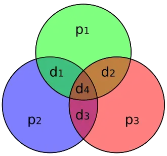
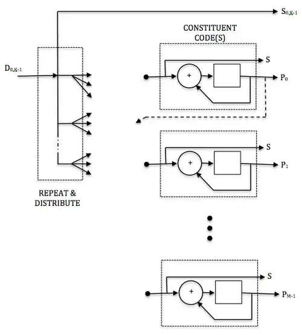

# 5.18 信道编码

> **前置知识**：[3.2 逻辑代数基础](../../03-数字与计算机系统/数字电路/3.2-逻辑代数基础.md)、[5.13 信息论基础](5.13-信息论基础.md)、[5.17 数字调制](5.17-数字调制.md)。信道编码通过加入受控冗余位，使接收端能检测乃至纠正传输差错，是实际通信逼近信道容量的关键手段。

香农定理保证了"只要速率低于容量就能可靠传输"，但没有给出构造方法。信道编码就是这一构造过程：在信息位后附加受控校验位，使合法码字之间保持足够距离，接收端据此检测或纠正错误。本节从线性分组码讲到现代迭代译码码。

## 1. 差错控制的基本概念

### 1.1 差错控制方式

| 方式 | 抗误码 | 需要反向信道 | 典型用途 |
|------|-------|-------------|---------|
| 检错（ARQ） | 只检错 + 重传 | 需要 | 数据链路/网络 |
| 前向纠错（FEC） | 直接纠错 | 不需要 | 广播、无线 |
| 混合（H-ARQ） | 检错 + 有限纠错 + 重传 | 需要 | LTE/5G |

### 1.2 最小距离与纠错能力

码的**最小汉明距离** $d_{\min}$ 决定了纠错能力：

$$
t = \left\lfloor \frac{d_{\min} - 1}{2} \right\rfloor
$$

其中 $t$ 为可纠正的错误个数；最大可检错个数为 $d_{\min} - 1$。因此设计码的关键是**在给定长度与码率下最大化 $d_{\min}$**。

## 2. 线性分组码

### 2.1 基本概念

$k$ 位信息位经编码得到 $n$ 位码字，记作 $(n,k)$ 分组码，码率 $R_c = k/n$。编码可用**生成矩阵** $\mathbf{G}$（$k\times n$）表示：

$$
\mathbf{c} = \mathbf{m} \,\mathbf{G}
$$

其中 $\mathbf{m}$ 为信息向量，$\mathbf{c}$ 为码字向量。线性分组码的两大优势：加法和编码均为异或/移位操作（适合 [3.2 逻辑代数基础](../../03-数字与计算机系统/数字电路/3.2-逻辑代数基础.md) 的数字电路实现），且最小距离等于非零码字的最小重量。

### 2.2 校验矩阵与伴随式

引入 $(n-k)\times n$ 的**校验矩阵** $\mathbf{H}$，满足 $\mathbf{G}\mathbf{H}^T = \mathbf{0}$。接收向量 $\mathbf{r}$ 的**伴随式**为：

$$
\mathbf{s} = \mathbf{r}\,\mathbf{H}^T
$$

- $\mathbf{s} = \mathbf{0}$：说明未检出错误（或错码恰为某个码字）。
- $\mathbf{s} \neq \mathbf{0}$：已检错，由 $\mathbf{s}$ 定位错误图样以纠正。

设接收向量 $\mathbf{r} = \mathbf{c} + \mathbf{e}$（$\mathbf{e}$ 为错误图样），则每次译码先算伴随式、查表得到与 $\mathbf{s}$ 对应的最可能错误图样并纠正。

### 2.3 汉明码

汉明码是 $(n,k)$ 线性码，满足校验位 $r=n-k$ 且

$$
2^r - 1 \geq n
$$

最小非平凡汉明码为 $(7,4)$，能纠正所有**单个**错误，码距 $d_{\min} = 3$。其编码译码可用简单的异或网络实现，是理解线性码的入门范例。**扩展汉明码/奇偶校验**加入一位总校验，可将 $d_{\min}$ 增至 4。

**示例**：$(7,4)$ 汉明码的校验位位于位置 $1,2,4$（$2^i$ 位），校验方程覆盖与所在比特位编号对应的信息位，可定位单比特错误的具体位置。

> 图中三个圆代表三个校验位，分别覆盖不同数据位，重叠区域对应各校验方程，单比特错误可由伴随式定位。

## 3. 循环码与 CRC

### 3.1 循环移位性质

循环码的任意码字的循环移位仍是码字，便于用移位寄存器实现。可用多项式表示：

$$
c(x) = m(x) \cdot g(x)
$$

其中 $g(x)$ 为 $(n-k)$ 次**生成多项式**。编码时信息多项式 $m(x)$ 乘 $g(x)$ 得码字多项式 $c(x)$，余式即校验位。

### 3.2 循环冗余校验（CRC）

CRC 是常用检错循环码，发送端计算余式 $r(x) = x^{n-k}m(x) \bmod g(x)$ 并附在数据后。接收端对整帧多项式作模 $g(x)$ 运算，余式为零则判为正确。常用生成多项式如 CRC-32 等。CRC 检错能力取决于生成多项式的阶数与性质：阶数 $r$ 的选择可确保检测长度 $\le r$ 的所有突发错误。

## 4. 卷积码与维特比译码

### 4.1 卷积码

卷积码的输出不仅取决于当前 $k$ 个输入比特，还与前 $m$ 个输入有关，其约束长度为 $N = m + 1$。状态转移可用**网格图（trellis）**描述。卷积码不像分组码那样把信息切成块，而是持续产生冗余，因此对突发噪声有更好的分散能力。

### 4.2 维特比译码

维特比算法在网格图上按**最大似然（最小汉明/欧氏距离）**准则逐步丢弃不可能的路径，保留每个状态的最优路径（幸存路径），最终输出最可能的比特序列（回溯）。其复杂度随约束长度指数增长，但对中等约束长度的码接近最优，且有总体复杂度随符号数线性增长的性质，广泛应用于卷积码的标准译码。

### 4.3 软判决与硬判决

- **硬判决**：把接收符号先"拍板"成 0/1 再译码，实现简单但丢弃可靠性信息。
- **软判决**：用匹配滤波/解调输出的连续对数似然比（LLR）参与度量计算，性能增益约 2 dB，是现代译码的标准做法。

## 5. 交织、级联与迭代译码

### 5.1 交织与抗突发错误

信道编码擅长纠正**随机独立差错**，但对**突发差错**（如深衰落断续）效果差。**交织器**将比特在时间或频率上打乱重排，把突发差错"拆散"为随机差错后再交由译码器纠正。

### 5.2 级联码

级联码串联两个编码器（如内码用卷积码/软译码，外码用 RS 码纠正内码译码残留错误），以较低复杂度逼近香农限。**Turbo 码**用两个递归系统卷积码（RSC）并行级联 + 随机交织，通过迭代软信息交换译码，性能逼近信道容量。

### 5.3 LDPC 码

低密度奇偶校验（LDPC）码用稀疏校验矩阵描述，通过和积（置信传播）算法迭代译码，同样可逼近香农限，已广泛用于 Wi-Fi、LTE/5G、卫星通信等，其并行性也便于 VLSI 实现。

> LDPC 码以稀疏校验矩阵/稀疏图描述，可用并行的置信传播（和积）算法迭代译码逼近香农限。

### 5.4 三种逼近香农限的码型对比

| 码型 | 结构 | 译码算法 | 应用 |
|------|------|---------|------|
| Turbo | 两个 RSC 并行级联 | 迭代后验概率（BCJR） | 3G/4G 数据信道 |
| LDPC | 稀疏校验矩阵 | 置信传播（和积） | Wi-Fi、5G 数据 |
| Polar | 信道极化 + 极化变换 | 逐位消除（SC/SCL） | 5G 控制信道 |

## 6. 工程/典型应用：移动通信与存储的信道编码

1. 存储与高速接口（如 RAID、NAND）用 **BCH/RS 码**纠正单元错误。
2. 传输控制（网络传输、数据帧）普遍使用 **CRC** 检错并触发重传（ARQ）。
3. 3G 用 **Turbo 码**，Wi-Fi/LTE/5G 用 **LDPC**（5G 数据信道）与 **Polar 码**（5G 控制信道），均以软判决 + 迭代译码逼近香农限。
4. 结合 [5.13 信息论基础](5.13-信息论基础.md) 理解：信道编码以码率冗余换取在同样 $E_b/N_0$ 下更低的误码率，即在"冗余比例"（码率）与"纠错能力"（增益）之间折中，这正是逼近香农容量 $C=B\log_2(1+S/N)$ 的具体工程手段。

## 本章要点

- 差错控制的基本概念
- 线性分组码
- 循环码与 CRC
- 卷积码与维特比译码
- 交织、级联与迭代译码
- 工程/典型应用：移动通信与存储的信道编码

## 自测清单

1. 「差错控制的基本概念」要解决的核心问题是什么？关键结论或公式是什么？
2. 「线性分组码」与上一节之间是什么关系？
3. 「循环码与 CRC」在什么场景下会用到？如果条件改变，结论会如何变化？
4. 能否不看正文，写出「卷积码与维特比译码」的关键流程或结构？
5. 「交织、级联与迭代译码」最容易混淆的点是什么？

---

**下一章**：[5.19 同步技术](5.19-同步技术.md)
