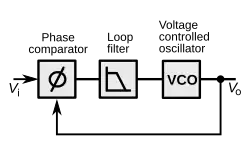

# 5.19 同步技术

> **前置知识**：[4.31 PLL 模拟前端](../../04-集成电路设计/模拟IC设计/4.31-PLL模拟前端.md)、[5.17 数字调制](5.17-数字调制.md)、[5.16 数字基带传输](5.16-数字基带传输.md)。同步是相干接收的前提，接收端必须同频同相地跟踪发射端的载波、符号时刻与帧边界，否则解调与译码都会失效。

同步是数字接收机中最基础也最关键的环节——没有同步，一切解调、均衡与译码都无法进行。本节按**载波同步、位（符号）同步、帧同步**三个层次展开，并以锁相环（PLL）这一通用载体贯穿始终。

## 1. 载波同步

### 1.1 载波同步的必要性

相干解调需要本地载波与发射端载波**同频且相位锁定**。若本地载波存在频率误差 $\Delta f$ 与相位误差 $\Delta\varphi$，输出信号将含相位误差项 $\cos(2\pi\Delta f t + \Delta\varphi)$，导致幅度衰减甚至反相。

设接收的 BPSK 信号乘以本地载波 $\cos(\omega_c t - \Delta\varphi)$，低通后得 $a(t)\cos(\Delta\varphi)$，当 $\Delta\varphi = 90^\circ$ 时输出为零——因此**相位误差直接压缩信号的幅度/能量**，必须有环路自动消除。

### 1.2 载波提取方法

- **插入导频（外同步）**：发射端插入载波或导频分量，接收端用窄带滤波器提取。
- **直接提取（自同步）**：对抑制载波信号非线性处理后提取，如平方环、Costas 环。

二元 PSK 的平方环将频谱搬移到 $2f_c$ 后再分频得到 $f_c$：

$$
s^2(t) = A^2 \cos^2(2\pi f_c t + \varphi) = \frac{A^2}{2}\left[1 + \cos(2\cdot 2\pi f_c t + 2\varphi)\right]
$$

平方后出现 $2f_c$ 分量且去除了数据相位调制（$\pm1$ 的平方为 1），用 PLL 锁定 $2f_c$ 后二分频即可恢复载波。

### 1.3 Costas 环

**Costas 环**直接在基带用正交两路压控振荡器（VCO）锁定载波，同时可复用于解调：I 路输出数据、Q 路作鉴相误差，二者相乘产生控制 VCO 的误差信号。相比平方环，Costas 环无需平方器，带宽与相位噪声控制更优，是抑制载波数字调制（BPSK/QPSK）的标准载波恢复方案。

## 2. 位（比特/符号）同步

### 2.1 作用

接收端需要知道每个码元的**最佳抽样时刻**。位同步从接收信号或其导出信号中提取与符号速率同频同相的时钟脉冲。抽样时刻偏离最佳点会缩短有效眼高、增大误码率，因此位同步环路的精度直接决定误码性能。

### 2.2 提取方法

- **外同步**：在发送流中插入同步图案或先发导频定时序列。
- **自同步**：用**早-迟门（Early-Late gate）**或对信号波形微分整流后提取时钟；数字接收机常基于最大似然的定时误差检测器（如 Mueller & Muller）驱动环路。

许多码型（如 [5.16 数字基带传输](5.16-数字基带传输.md) 的 RZ、曼彻斯特）本身就含丰富的定时信息，方便位同步提取。

### 2.3 定时误差与误码

抽样时刻偏移 $\tau$ 会缩短有效眼高，增大误码率。位同步环路通过跟踪 $E_b/N_0$ 与定时误差的非线性关系来补偿 $\tau$。载波恢复与定时恢复常采取**串行/分级**结构：先用非数据的包络信息粗定时钟，再在锁载波后精细跟踪。

## 3. 帧同步

帧同步用于标识**数据帧的起止**，使接收端能把连续比特正确地切分为码组。常见方法：

- 在帧头插入长度足够短的**独特同步字（Unique Word）**，接收端用相关器搜索该图案。
- 搜索采用**滑动相关**：当同步图案与本地码字完全对齐时相关峰最大。
- 帧同步需考虑同步字的**正确漏检/误检**折中，并通过失步计数与重捕获机制维持稳定。

设计同步字时希望其**自相关特性**接近冲激（即除零位移外副峰尽可能小），常用巴克码（Barker）序列以获得优良的自相关旁瓣。帧同步完成后才可能正确交付给 [5.18 信道编码](5.18-信道编码.md) 的译码器。

## 4. PLL 在同步中的应用

锁相环（PLL）是各类同步环路的通用载体，详见 [4.31 PLL 模拟前端](../../04-集成电路设计/模拟IC设计/4.31-PLL模拟前端.md)。其基本结构为：

> PLL 由鉴相器（PD）、环路滤波器（LF）与压控振荡器（VCO）组成，是载波/位/帧同步环路的通用载体。

$$
\text{鉴相器(PD)} \to \text{环路滤波器(LF)} \to \text{压控振荡器(VCO)}
$$

环路方程近似为三阶（或二阶）动态系统，稳态相位误差与**环路带宽**和**环路增益**有关：

- 环路带宽越窄，抗噪越好但捕获越慢；越宽捕获越快但抖动越大。
- 载波、位、帧同步常用分级结构：先用 PLL 锁载波，再用其输出导引位同步与帧同步。

### 4.1 环路的跟踪与捕获

- **捕获（Acquisition）**：环路从失锁状态把频率差拉入锁定范围的过程。
- **跟踪（Tracking）**：锁定后抵抗相位/频率摄动、维持同步的过程。

二者对应环路动力学的两个工作阶段，工程上需权衡捕获带宽（pull-in range）与跟踪精度（相位噪声/抖动）。

### 4.2 同步环路的数字实现

现代数字接收机把环路搬到数字域：NCO（数控振荡器）替代 VCO，数字鉴相器与环路滤波器构成数字 PLL（DPLL）。

$$
\boxed{\ \text{数字鉴相器} \to \text{环路滤波器} \to \text{数控振荡器(NCO)}\ }
$$

数字域同步便于倍率精确、无模拟器件漂移，且可与均衡、信道估计一并在 DSP 中融合处理。

### 4.3 同步性能指标

- **稳态相位误差**：锁定后的残余相位差，直接决定相干解调的性能损失。
- **相位抖动/相位噪声**：VCO/NCO 的短期随机相位起伏，恶化 $E_b/N_0$。
- **捕获时间**：从失锁到锁定的时间，影响接入速度与时延。
- **失锁概率/保持范围**：在恶劣信道下维持同步的能力。

这些指标与环路带宽存在折中：环路越窄抑制相位噪声越好，但捕获越慢、对频偏的抗性越差，工程上需反复权衡并在不同阶段动态调整环路带宽。

## 5. 工程/典型应用：无线接收机的同步链路

1. 接收信号送入粗同步：用 PLL 锁频/锁相恢复载波（即 [4.31 PLL 模拟前端](../../04-集成电路设计/模拟IC设计/4.31-PLL模拟前端.md) 中 PLL 在接收机的典型应用）。
2. 中频/基带信号经位同步器提取最佳采样时钟，完成抽样与均衡。
3. 帧同步器用同步字相关搜索帧边界，对齐后才可交付 [5.18 信道编码](5.18-信道编码.md) 的译码。
4. 在恶劣信道下，同步参数与信道估计会联合迭代更新，以维持链路稳定。

同步是无线接收机的"第一道工序"：OFDM（[5.21](5.21-现代无线系统.md)）还需额外的**符号/时间同步**与**频偏估计**来对准 FFT 窗口并补偿多普勒频移。掌握载波—位—帧三级同步的递进关系，是理解任何实际接收机信号处理链路的钥匙。

## 本章要点

- 载波同步
- 位（比特/符号）同步
- 帧同步
- PLL 在同步中的应用
- 工程/典型应用：无线接收机的同步链路

## 自测清单

1. 「载波同步」要解决的核心问题是什么？关键结论或公式是什么？
2. 「位（比特/符号）同步」与上一节之间是什么关系？
3. 「帧同步」在什么场景下会用到？如果条件改变，结论会如何变化？
4. 能否不看正文，写出「PLL 在同步中的应用」的关键流程或结构？
5. 「工程/典型应用：无线接收机的同步链路」最容易混淆的点是什么？

---

**下一章**：[5.20 扩频与多址](5.20-扩频与多址.md)
