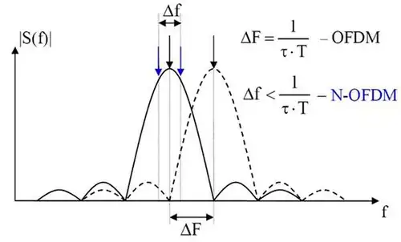
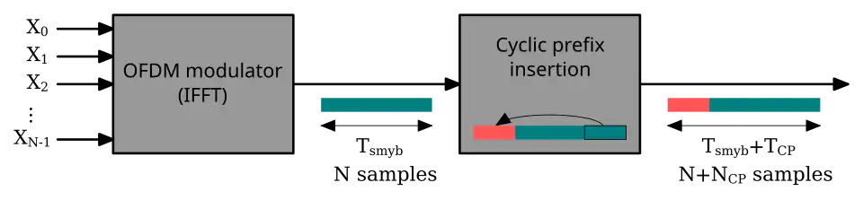
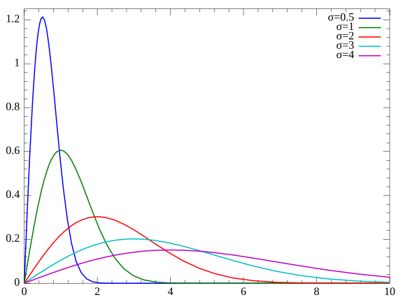

# 5.21 现代无线系统

> **前置知识**：**必需** [5.17 数字调制](5.17-数字调制.md)、[5.19 同步技术](5.19-同步技术.md)、[5.20 扩频与多址](5.20-扩频与多址.md)、[5.5 快速傅里叶变换](../数字信号处理/5.5-快速傅里叶变换-FFT.md)（IFFT/FFT 实现）、[1.32 概率与随机变量基础](../../01-基础与电路分析/大学物理基础/1.32-概率与随机变量基础.md)（瑞利衰落与随机信道）、[1.1 数学基础](../../01-基础与电路分析/大学物理基础/1.1-数学基础.md)（复指数与正交性）。本章把 OFDM、OFDMA 与多天线等技术集成到现代无线系统（Wi-Fi、4G、5G）的信号处理链路中。

现代无线系统（Wi-Fi、4G、5G）以 **OFDM + MIMO** 为两大支柱：OFDM 把宽频带切成大量窄带子载波以化解频率选择性衰落，MIMO 借助空间维度提升容量与可靠性。本章按 OFDM→OFDMA 与资源网格→典型系统→接收链路的顺序展开，MIMO 仅作系统定位，详细原理统一放在 5.23。

## 1. OFDM 原理

### 1.1 正交子载波

OFDM 把高速比特流拆分到 $N$ 个子载波并行传输，相邻子载波频率间隔取子载波符号速率 $1/T_u$：

$$
s(t) = \sum_{k=0}^{N-1} X_k \, e^{j2\pi k \Delta f\, t}, \quad \Delta f = \frac{1}{T_u}
$$

由于子载波在符号周期 $T_u$ 内整周期正交，即使频谱重叠也能无串扰地分离。正交性体现在：

> OFDM 把高速流拆分为多个相互正交的低速子载波并行传输，重叠的频谱仍可无串扰分离。

$$
\frac{1}{T_u}\int_0^{T_u} e^{j2\pi k\Delta f t} e^{-j2\pi l\Delta f t} dt = \delta_{kl}
$$

### 1.2 循环前缀（CP）

为抵抗**多径时延扩展**，在每个 OFDM 符号前插入长度为 $T_{cp}$ 的循环前缀，只要 $T_{cp}$ 大于信道最大时延扩展，即可把线性卷积转化为循环卷积，进而在频域用单抽头均衡消除码间干扰。总符号周期 $T_s = T_u + T_{cp}$。

循环前缀的代价是有效速率下降为 $T_u/T_s$，但它换来抗多径能力的极大简化，是现代 OFDM 系统的标配。

> 在每个 OFDM 符号前插入循环前缀，以吸收多径时延扩展，把线性卷积转化为循环卷积。

> 无线信道中大量不可分辨多径分量叠加使接收包络的幅度服从**瑞利分布**，是频率选择性衰落与小尺度深衰落的统计基础，也是 OFDM（化解频选衰落）与 MIMO（对抗深衰落）要面对的信道模型。

### 1.3 IFFT/FFT 实现

发送端用 $N$ 点 IDFT/IFFT 把频域数据 $X_k$ 变为时域信号，接收端用 FFT 恢复：

$$
x_n = \text{IFFT}\{X_k\}, \quad \hat{X}_k = \text{FFT}\{y_n\}
$$

IFFT 把 $O(N^2)$ 的直接计算降到 $O(N\log N)$，使 OFDM 实用化。其频域处理思想与 [5.4 离散傅里叶变换](../数字信号处理/5.4-离散傅里叶变换-DFT.md) 直接对应：OFDM 的本质就是把 DFT 分组后搬到多载波上。

## 2. OFDMA 多址

OFDMA 把可用子载波**分组分配给不同用户**，从而在频率域实现多址，兼具 OFDM 的抗多径能力与灵活的调度：

- 子载波可动态按需分配（调度），频率选择性调度可把某用户分配到其信道较好的子载波上。
- 结合自适应调制编码（AMC）与 MIMO，可实现频谱效率随信道质量的平滑提升。

### 2.1 时频资源网格

现代系统（LTE/NR）把资源组织为**时频网格**：横轴为 OFDM 符号（时间），纵轴为子载波（频率），最小单元是**资源元素（RE）**，若干 RE 组成资源块（RB）分配给用户。调度器按信道状态分配 RB，实现多用户复用与抗干扰。

## 3. MIMO 概述

MIMO 在收发两端使用多副天线，为无线链路提供空间分集、空间复用与波束赋形等能力；与 OFDM 结合时，可在各个平坦衰落的子载波上进行多天线处理。MIMO 的信道模型、容量、检测、空时编码及 WLAN 多天线演进统一见 [5.23 MIMO 与 WLAN 基础](5.23-MIMO与WLAN基础.md)，本章不再展开。

## 4. Wi-Fi、LTE 与 NR 的系统整合

### 4.1 Wi-Fi（802.11n/ac/ax）

TDMA/CSMA 接入 → OFDM/OFDMA 调制 + MIMO/空间复用 → 自适应调制与码率 → 信道估计与均衡 → FEC（LDPC）译码。

### 4.2 LTE（4G）

OFDMA 下行 / SC-FDMA 上行 → MIMO（4×2 等）→ AMC（QPSK/16/64-QAM）→ Turbo 码 → 调度与 HARQ。

### 4.3 NR（5G）

可变子载波间隔的 OFDM + OFDMA → Massive MIMO / 波束赋形 → 256-QAM → LDPC 数据信道与 Polar 控制信道 → 帧结构含灵活参数集（numerology）与多波束。

### 4.4 5G 参数集（Numerology）

5G NR 采用可变的子载波间隔 $2^\mu \times 15\ \text{kHz}$（$\mu=0,1,2,\ldots$），以适应从低频宏覆盖到毫米波高速传输的多种场景：

| $\mu$ | 子载波间隔（kHz） | 典型频段 | 适用场景 |
|-------|------------------|---------|---------|
| 0 | 15 | 低 6 GHz | 广覆盖（兼容 LTE） |
| 1 | 30 | 低 6 GHz | 城市宏基站 |
| 2 | 60 | 毫米波附近 | 高吞吐、低时延 |
| 3 | 120 | 毫米波 | 超高速、工业 |

参数集的选择本质上是在**符号周期、时延容忍度与带宽效率**之间折中：子载波间隔越大，符号越长越抗多径（CP 相对更短、开销小），而越小的间隔对相位噪声/多普勒越敏感。

## 5. 接收链路：从射频采样到信息比特

1. 天线阵列信号经前端（参见 [4.44 RFIC 设计](../../04-集成电路设计/RFIC设计/4.44-RFIC-概述与接收机.md) 的低噪放/混频器）下变频到基带。
2. A/D 转换后做时频同步与信道估计（涉及 [5.19 同步技术](5.19-同步技术.md)）。
3. FFT 把时域采样变换到频域，频域均衡去除多径影响。
4. 解映射（QAM 解）、解交织、信道译码（[5.18 信道编码](5.18-信道编码.md)）得到信息比特。
5. 配合调度与 HARQ 完成与协议栈的对接，形成完整的现代无线接收链路。

现代无线系统可以概括为**"多载波 + 多天线 + 高效率编码"**的三重奏：OFDM 化解了宽带信道的频率选择性，MIMO 挖掘了空间自由度，先进信道编码逼近香农限。这三项技术共同把无线链路的频谱效率与可靠性推到了理论极限附近，是理解 Wi-Fi/4G/5G 的核心知识框架。

## 本章要点

- OFDM 原理
- OFDMA 多址
- MIMO 概述及其与 OFDM 的系统级结合
- Wi-Fi、LTE 与 NR 的系统整合
- 接收链路：从射频采样到信息比特

## 自测清单

1. 「OFDM 原理」要解决的核心问题是什么？关键结论或公式是什么？
2. 「OFDMA 多址」与上一节之间是什么关系？
3. MIMO 为无线系统提供哪些空间维度能力？它与 OFDM 如何在系统中配合？
4. Wi-Fi、LTE 与 NR 分别怎样整合多载波、多址、调度、编码和多天线技术？
5. 能否不看正文，按顺序写出从射频采样到信息比特的接收处理流程？

---

**下一章**：[5.22 差错与链路预算](5.22-差错与链路预算.md)
