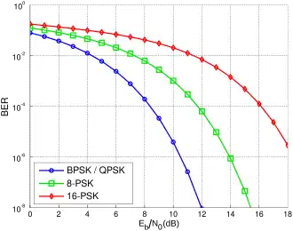

# 5.22 差错与链路预算

> **前置知识**：**必需** [1.32 概率与随机变量基础](../../01-基础与电路分析/大学物理基础/1.32-概率与随机变量基础.md)（误码率与衰落统计）、[5.17 数字调制](5.17-数字调制.md)（调制与 $E_b/N_0$）、[5.18 信道编码](5.18-信道编码.md)（编码增益）、[5.21 现代无线系统](5.21-现代无线系统.md)（OFDM/MIMO 与分集）；**推荐** [2.25 信号完整性](../../02-模拟与硬件工程/信号完整性与电磁兼容/2.25-信号完整性.md) 与 [2.16 自动增益控制](../../02-模拟与硬件工程/模拟电路/2.16-自动增益控制-AGC.md)（高速链路均衡和 AGC 工程实现）。前几章解决"信号如何调制与编码"，本章回答"信号能否可靠到达"：用链路预算估算收端信噪比，用 $E_b/N_0$ 评估差错，用衰落、分集与均衡对抗信道损伤。

一个通信系统的可靠性最终取决于**接收端的信噪比是否高于所需门限**。链路预算回答"收端能收到多大功率"，$E_b/N_0$ 把该功率换算成误码率，而衰落、分集与均衡则是让实际信噪比能不间断地高于门限的工程手段。四者合起来就是一张完整可靠的"可行性验证闭环"。

## 1. 链路预算

### 1.1 接收功率与自由空间损耗

接收功率由**弗里斯（Friis）传输方程**给出：

$$
P_r = \frac{P_t G_t G_r \lambda^2}{(4\pi d)^2}
$$

其中 $G_t$、$G_r$ 为收发天线增益，$d$ 为距离，$\lambda$ 为波长。自由空间路径损耗：

$$
L_{FS} = \left( \frac{4\pi d}{\lambda} \right)^2
$$

工程上更多用对数形式（dB）：

$$
L_{FS}\ (\text{dB}) = 92.45 + 20\log_{10} f_{\text{GHz}} + 20\log_{10} d_{\text{km}}
$$

### 1.2 链路预算方程

把发射功率与各项增益/损耗代数相加即得**接收机灵敏度**所需的余量关系：

$$
P_r = P_t + G_t + G_r - L_{FS} - L_{imp} \quad (\text{dB})
$$

其中 $L_{imp}$ 为其他损耗（馈线、雨衰、指向误差等）。加上系统裕量（fade margin）构成完整预算，常用于 [4.44 RFIC 设计](../../04-集成电路设计/RFIC设计/4.44-RFIC-概述与接收机.md) 接收灵敏度的估算。工程要求的"最小接收功率"（**灵敏度**）通常写成：

$$
P_{r,\min} = -174 + 10\log_{10}B + \text{NF} + \text{SNR}_{req} \quad (\text{dBm})
$$

其中 $-174$ dBm/Hz 为常温热噪声本底，$\text{NF}$ 为接收机噪声系数。

## 2. 差错性能与 Eb/N0

### 2.1 Eb/N0 定义

$E_b/N_0$ 是每个信息比特能量与噪声功率谱密度之比，是衡量数字链路差错性能的归一化指标：

$$
\frac{E_b}{N_0} = \frac{P_r}{N_0 R_b} = \frac{P_r}{k \, T_0 \, R_b}
$$

其中 $N_0 = kT_0$（$k$ 为玻尔兹曼常数，$T_0$ 为等效噪声温度）。它与信噪比的关系：

$$
\frac{E_b}{N_0} = \frac{C}{N}\cdot \frac{B}{R_b}
$$

### 2.2 误码率曲线

各调制方式在 AWGN 下的误码率随 $E_b/N_0$ 增大而单调下降（见 [5.17 数字调制](5.17-数字调制.md) 的 $Q(\cdot)$ 表达式）。给定目标误码率，可由曲线反查所需 $E_b/N_0$，再用链路预算校验系统裕量是否足够。

> 误码率随 $E_b/N_0$ 增大单调下降，调制阶数越高，达到相同误码率所需的 $E_b/N_0$ 越高。

对 BPSK：

$$
P_b = Q\left(\sqrt{\frac{2E_b}{N_0}}\right)
$$

### 2.3 编码增益

由 [5.18 信道编码](5.18-信道编码.md) 可知，编码可在同样 $E_b/N_0$ 下把 $P_b$ 显著降低（或同 $P_b$ 下所需 $E_b/N_0$ 更低），这个差值称为**编码增益**，是链接"链路预算"与"信道编码"的桥梁。

## 3. 无线信道衰落（Fading）

### 3.1 大尺度与小尺度衰落

- **大尺度衰落**：路径损耗 + 阴影衰落（慢变化），用对数正太模型描述。
- **小尺度衰落**：多径干涉造成快速起伏，服从**瑞利分布**（无直达分量）或**莱斯分布**（含直达分量）：

$$
f_{\text{Rayleigh}}(r) = \frac{r}{\sigma^2} e^{-r^2/(2\sigma^2)}, \quad r \ge 0
$$

莱斯分布为：

$$
f_{\text{Rice}}(r) = \frac{r}{\sigma^2} e^{-(r^2 + A^2)/(2\sigma^2)} I_0\left(\frac{A r}{\sigma^2}\right)
$$

其中 $A$ 为直达分量幅度，$I_0$ 为修正零阶贝塞尔函数；$A=0$ 时退化为瑞利分布。

### 3.2 频率选择性衰落与平坦衰落

按时延扩展与符号周期的关系可分类：

| 类型 | 条件 | 处理手段 |
|------|------|---------|
| 平坦衰落 | 时延扩展 $\ll$ 符号周期 | 分集、功率控制 |
| 频率选择性衰落 | 时延扩展 $\ge$ 符号周期 | OFDM、均衡器 |
| 快衰落 | 相干时间 $\ll$ 符号周期 | 交织、链路适配 |
| 慢衰落 | 相干时间 $\gg$ 符号周期 | 功率控制、调度 |

当信道时延扩展超过符号周期时为**频率选择性衰落**，OFDM 通过子载波细分将选择性链路转化为平坦衰落处理（见 [5.21 现代无线系统](5.21-现代无线系统.md)）。

## 4. 分集技术

对抗深衰落的核心方法是**分集**，将多路独立衰落信号合并以提高可靠性。

### 4.1 分集合并方式

| 方式 | 原理 |
|------|------|
| 选择合并（SC） | 选取瞬时 SNR 最强的支路 |
| 最大比合并（MRC） | 按 SNR 加权求和，输出 SNR 最优 |
| 等增益合并（EGC） | 各路等权重相加 |

最大比合并的输出信噪比为各支路信噪比之和 $(\text{SNR})_{\text{MRC}} = \sum_i \text{SNR}_i$，是理论最优合并。

### 4.2 分集实现维度

- **空间分集/天线分集**：多个天线间隔足够远以去相关（见 [5.21](5.21-现代无线系统.md) 的 MIMO）。
- **时间分集**：交织 + 编码（见 [5.18 信道编码](5.18-信道编码.md)）。
- **频率分集**：多载波/多频段重复传输，OFDM 本身即利用频率分集。
- **极化分集**：利用不同极化方向去相关。

分集阶数的增加可在同样误码率下显著降低所需的平均 $E_b/N_0$，是无线可靠性设计的最有效手段之一。

## 5. 均衡器概述

### 5.1 线性均衡（LE）

用线性横向滤波器 $w$ 逆逼近信道冲激响应，输出为：

$$
\hat{a}_k = \sum_{i} w_i \, y_{k-i}
$$

线性均衡（如 ZF 迫零、MMSE）结构简单，但会同时放大噪声。

### 5.2 判决反馈均衡（DFE）

DFE 用已判决符号消去已产生的码间串扰，非线性结构性能优于线性均衡，对深衰落链路的收敛与跟踪更快：

$$
\hat{a}_k = \sum_i w_i y_{k-i} - \sum_j b_j \, \hat{a}_{k-j}
$$

前馈部分抑制前向 ISI，反馈部分消除已判决符号引起的尾随 ISI。DFE 无噪声放大问题，但存在**误差传播**（判决错误会连锁影响后续符号）。

均衡器在高速串行接口、[2.25 信号完整性](../../02-模拟与硬件工程/信号完整性与电磁兼容/2.25-信号完整性.md) 的高频链路以及无线接收机中广泛使用，常与 [2.16 自动增益控制](../../02-模拟与硬件工程/模拟电路/2.16-自动增益控制-AGC.md) 联动以维持信号幅度在最优工作点。

## 6. 工程/典型应用：一条无线链路的可靠性设计闭环

1. 按链路预算推算收端 $P_r$ 与 $C/N$，换算成 $E_b/N_0$。
2. 对照目标 BER 所需的 $E_b/N_0$，评估系统裕量（含衰落余量）。
3. 针对小尺度衰落引入分集与交织，把深衰落转化为可纠正码型。
4. 用均衡器/OFDM 消除频选 ISI，用 AGC（[2.16 自动增益控制](../../02-模拟与硬件工程/模拟电路/2.16-自动增益控制-AGC.md)）稳定信号电平。
5. 综合"功率 + 分集 + 编码 + 均衡"使实际 $E_b/N_0$ 高于门限，从而满足误码率指标。

至此，第 5 篇通信原理部分（5.12–5.22）完成了从"信息如何度量"（5.13）、"如何调制"（5.14–5.17）、"如何编码与同步"（5.18–5.19）、"如何多用户共享"（5.20–5.21）到"如何保证可靠到达"（5.22）的完整闭环。工程上做任何一条无线链路，其设计流程都压缩在本章这套"链路预算 → 裕量 → 分集/均衡/编码"的方法论之中。

## 本章要点

- 链路预算
- 差错性能与 Eb/N0
- 无线信道衰落（Fading）
- 分集技术
- 均衡器概述
- 工程/典型应用：一条无线链路的可靠性设计闭环

## 自测清单

1. 「链路预算」要解决的核心问题是什么？关键结论或公式是什么？
2. 「差错性能与 Eb/N0」与上一节之间是什么关系？
3. 「无线信道衰落（Fading）」在什么场景下会用到？如果条件改变，结论会如何变化？
4. 能否不看正文，写出「分集技术」的关键流程或结构？
5. 「均衡器概述」最容易混淆的点是什么？

---

**下一章**：[5.23 MIMO 与 WLAN 基础](5.23-MIMO与WLAN基础.md)
