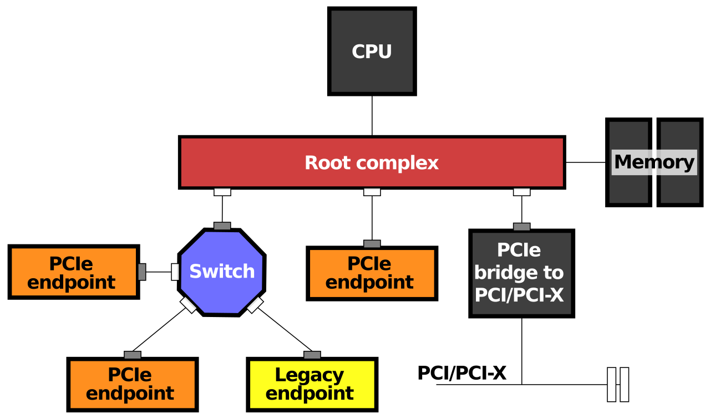
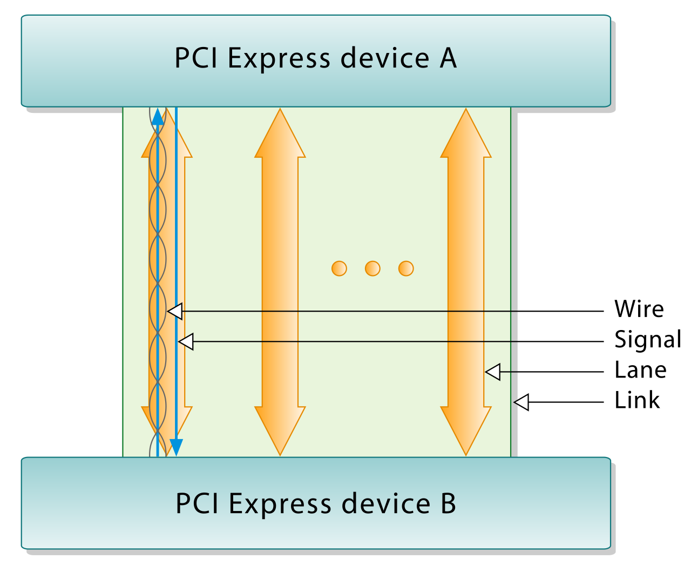
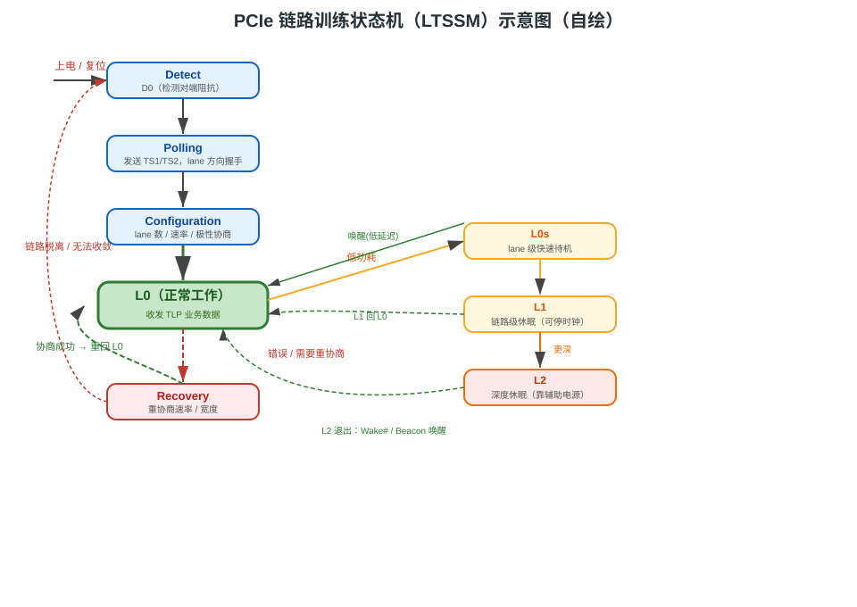
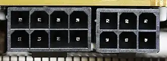
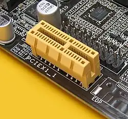
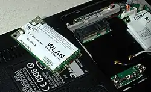
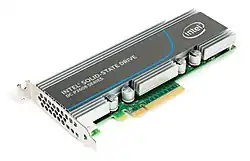
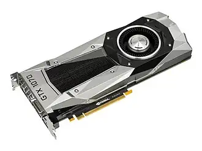

# 6.1 PCIe 详解

> **本章定位**：第 6 篇的系统专题，从 PCIe 协议分层到链路训练与事务层。

> **前置知识**：**必需** [2.17 传输线理论](../../02-模拟与硬件工程/射频与高频电路/2.17-传输线理论.md)（高速差分传输）、[2.25 信号完整性](../../02-模拟与硬件工程/信号完整性与电磁兼容/2.25-信号完整性.md)（反射、眼图与端接）、[3.11 从逻辑门到单周期处理器](../../03-数字与计算机系统/计算机组成原理/3.11-从逻辑门到单周期处理器.md)–[3.12 流水线处理器](../../03-数字与计算机系统/计算机组成原理/3.12-流水线处理器.md)（处理器数据通路与流水线）、[4.5 RTL设计](../../04-集成电路设计/芯片设计/4.5-RTL设计-基础语法与建模.md)（数字协议建模）；**推荐** [4.16 SoC设计](../../04-集成电路设计/芯片设计/4.16-SoC设计.md)（片上互连与 SoC 集成专题）。本专题系统详解 PCIe（Peripheral Component Interconnect Express，外围组件互连快速标准）。内容以 PCI-SIG 至今发布的正式规范（截至 PCIe 5.0，并前瞻 Gen6/7/8）为主线，结合中英文维基百科资料整理。

## 1. 概述与历史

### 1.1 一句话定位

PCIe 是用于在计算机内部连接硬件组件的高速标准，由 **PCI-SIG（PCI Special Interest Group）** 制定与维护，旨在取代 PCI、PCI-X 与 AGP 等旧的扩展总线标准。它被普遍用作显卡、声卡、Wi-Fi/以太网适配器，以及固态硬盘（SSD）、机械硬盘等存储设备的内部互连。

与早期标准相比，PCIe 具有四个显著优势：

- **更快的数据传输**：串行点对点，速率随代数与 lane 数线性扩展；
- **更少的引脚、更小的空间**：一个 lane 仅 4 根走线（两对差分）；
- **热插拔支持**：在计算机运行时添加/移除设备（按制式而定，如 ExpressCard、OCuLink、U.2、Thunderbolt）；
- **更强的错误检测与虚拟化支持**：AER 增强错误报告、MSI/MSI-X 中断、I/O 虚拟化（IOV）等现代特性。

### 1.2 从 HSI、3GIO 到 PCIe

| 时间 | 事件 |
|------|------|
| 2001（春） | Intel 在 IDF 上公布取代 PCI 的第三代 I/O 技术，早期开发代号 **HSI（High Speed Interconnect）**，后更名 **3GIO（3rd Generation I/O）** |
| 2002-04-17 | Arapahoe Work Group（AWG）完成 3GIO 1.0 规范草稿，移交 PCI-SIG 审核 |
| 2002-07-23 | 正式公布并更名为 **PCI Express**，由 Intel、Dell、HP、IBM 等联合制定 |
| 2003 | 发布 PCIe 1.0a，单 lane 数据率 0.25 GB/s，传输率 2.5 GT/s |
| 2005~ | 1.1 澄清并改进，兼容 1.0a，速率不变 |
| 2007 | 2.0 速率翻倍到 5 GT/s，单 lane 0.5 GB/s，仍用 8b/10b |
| 2010-11-18 | 3.0 正式发布，速率 8 GT/s，改用 128b/130b，引入链路均衡 |
| 2017-06-08 | 4.0 正式发布，速率 16 GT/s，128b/130b 保持 |
| 2019-05-29 | 5.0 正式发布，速率 32 GT/s，每 lane 3.94 GB/s |
| 2022-01-11 | 6.0 正式发布，速率 64 GT/s，改用 PAM-4 + FEC + FLIT（首款硬件 2025 年面市） |
| 2025 | 7.0 规范发布（128 GT/s，PAM-4）；8.0 启动开发（计划 256 GT/s） |

> 工程要点：每一次"代数翻倍"并非简单提高时钟，而是编码、均衡、信号完整性与协议同时演进。理解 PCIe 的核心是**分层协议栈 + 点对点串行 + lane 扩展**。

## 2. 总体架构：点对点串行取代共享并行

### 2.1 并行总线的固有局限

传统 PCI 是**共享并行总线**：PCI 主控与所有设备共享一套地址、数据、控制线，采用**双工受限（半双工）**、单向单主方式，且被**仲裁**限制为"同一时刻只有一个器件、单一方向"访问。更关键的是，其全局时钟受限于整条总线上**最慢设备**的时钟。

并行总线带宽被**时序歪斜（timing skew）**扼住瓶颈：一个字的多条信号走不同长度、不同 PCB 层、不同传播速度的铜线，虽然同时发出，却**不同时到达**。当时钟周期短于各信号到达时间的最大差时，就无法正确恢复数据字。并行总线的 skew 可达数个纳秒，因此极限带宽一般落在数百 MHz 量级。

### 2.2 为什么串行更快？

串行接口在每个方向只有一个差分信号，**不存在并行 skew**；同时时钟信息**内嵌在串行信号本身**（接收端用 CDR 恢复），无需外部全局时钟。因此串行信号的带宽可以轻松推到**多 GHz** 量级。PCIe 正是"用串行替代并行"这一大趋势的典型代表，同趋势的还有 SATA、USB、SAS、FireWire（IEEE 1394）、RapidIO；在数字视频上则体现为 DVI/HDMI/DisplayPort 取代模拟 VGA。

### 2.3 拓扑结构

- **根复合体（Root Complex, RC）**：CPU/Host 侧的根，含一个或多个 Root Port，发起并管理配置、I/O、内存访问。
- **交换器（Switch）**：把上游的一个端口（Upstream Port）分解为多个下游端口（Downstream Port），内部由虚拟 PCI-PCI 桥实现路由转发。
- **端点（Endpoint）**：真正的功能设备（显卡、SSD、网卡等），仅作为请求者或完成者。
- **链路（Link）**：两个 PCIe 端口间的点对点通信信道，物理上由若干 lane 组成。

拓扑整体是一棵以 RC 为根的树；配置空间正是按 RC → Switch → Endpoint 的遍历来枚举设备。

下图为经典的 **PCI Express 拓扑示意图**（RC → Switch → 多 Branch 端点）：


<p align="center"><b>图 2-1</b>：PCI Express 典型拓扑。Root Complex 作为根提供若干 Root Port，经 Switch（内含虚拟 PCI-PCI 桥）把上游链路扇出为多条下游分支（Branch），各自挂接不同端点；桥接 PCI、PCMCIA 等其他总线也可作为端点接入。</p>

### 2.4 Interconnect 与 Lane

- **Lane（通道）**：一条 lane 由**两对差分信号**组成——一对接收、一对发送，共 **4 根走线**。概念上每条 lane 是一条**全双工字节流**，同时双向以字节格式搬运数据包。
- **双单工（Dual Simplex）**：每个 lane 上有两条单工信道（各用一差分对），单工表示只能单向通信；两条合起来实现双向。
- **Link（互连/链路）**：可含 1、2、4、8、16 条 lane（物理实现常用 x1/x4/x8/x16；到 PCIe 5.0 为止也定义了 x12、x32 但几乎不用）。多 lane 链路会把数据包**条带（striping）**到各 lane 上，峰吞吐随链路宽度线性扩展。
- **lane 数自动协商**：链路初始化时自动协商双方共同支持的最大 lane 数；例如 x1 卡可插入 x4/x8 槽，初始握手会协商到最高共同支持数。若某些 lane 损坏/不稳定，链路还能动态降档使用更少 lane，提供容错。

**兼容性两层体现**：

1. x1 尺寸的卡物理上能插入任何不小于它的槽位并正常工作；
2. 大物理尺寸的槽（如 x16）可用更少的电气 lane（x1/x4/x8）走线，只要提供大槽所需的地线即可。两种情形下 PCIe 都协商最高共同支持的 lane 数。

下图为 **PCI Express 术语示意**（lane、互连链路、双单工差分对的关系）：


<p align="center"><b>图 2-2</b>：PCIe 术语图解。一条 lane 含一对发送差分线与一对接收差分线（双单工）；多 lane 组成一条互连链路（Link）；发送数据包被条带（Striping）到各 lane 上并行搬运，带宽随 lane 数线性扩展。</p>

## 3. 分层协议栈

PCIe 是**多层（layered）协议**，包含事务层、数据链路层、物理层；数据链路层又细分出 **MAC（媒体接入控制）子层**，物理层分为**逻辑与电气子层**，逻辑子层内含**物理编码子层（PCS）**。术语借自 IEEE 802 网络协议模型。Intel 发布的 **PIPE（PHY Interface for PCI Express）** 规范定义了 MAC/PCS 功能划分及二者接口；PIPE 还标识了包含 SerDes 与模拟电路的物理媒介接入（PMA）层。

| 层次/子层 | 主要职责 |
|-----------|---------|
| 事务层（Transaction） | 生成/解封装 TLP，维护分事务、路由、流控信用、中断与配置语义 |
| 数据链路层（Data Link） | TLP 加序列号+CRC，ACK/NAK 重传保证可靠，管理流控信用与电源管理信息（DLLP） |
| 物理层·逻辑（含 MAC/PCS） | 链路训练 LTSSM、加扰/解扰、8b/10b 或 128b/130b 编码、并串转换 |
| 物理层·电气（PMA） | 差分驱动、接收均衡、时钟恢复 CDR、端接阻抗、AC 耦合电容 |

下层为上层提供服务，层层封装。业务数据在事务层被封装为 **TLP**，链路层再加序列号与 LCRC 变为可可靠传输的帧，物理层负责把它编解码后送上差分线。

## 4. 物理层（Physical Layer）

### 4.1 电气与逻辑子层

PCIe 物理层规范分为对应**电气**和**逻辑**的两部分：

- **逻辑子层**：处理链路训练（LTSSM）、数据加扰/解扰、8b/10b 或 128b/130b 编码、并串转换、控制符号插入；Intel PIPE 把其进一步划分为 MAC 与 PCS。
- **电气子层**：每个 lane 由两个单向差分对组成，工作在 2.5/5/8/16/32 Gbit/s（按协商能力），每 lane 共 4 根数据线。

### 4.2 差分信号与内嵌时钟

每个 lane 采用两个低摆幅差分信号对，收发分开（每方向各一对）。接收端用 **CDR（时钟数据恢复）** 从数据边沿提取时钟。为保证接收端不丢失比特边沿，必须限制连续相同位数（运行长度）：

- **8b/10b 编码（Gen1/Gen2）**：每 8 位原始数据编码为 10 位传输，保证直流平衡且连续相同位受限，**开销 20%**（2/10）。
- **128b/130b 编码（Gen3 及以上）**：每 128 位加 2 位开销，**开销仅 1.54%（=2/130）**，接近原始带宽充分利用。

此外，PCIe 用已知二进制多项式对数据流按反馈拓扑做 **XOR 加扰（Scrambler）**，使 0/1 频谱密度均衡（利于电磁兼容与时钟恢复）；因多项式已知，接收端再次 XOR 即可解扰。加扰与解扰都在硬件完成。

### 4.3 序列化传输与数据条带

多 lane 链路的数据**交叉存取**：每个连续字节依次发送到连续各 lane，PCIe 规范称之为**数据条带（Striping）**。虽然 lanes 之间并未严格同步，但对 lane 间歪斜有约束（2.5/5/8 GT/s 对应 20/8/6 ns），硬件缓冲可据此重新对齐（De-skew）后重组条带数据，从而显著降低链路上"第 n 个字节"的延迟。因填充需求，条带不一定减少小数据包的延迟。

### 4.4 链路训练状态机（LTSSM）

LTSSM 是物理层最关键的状态机（共 11 个状态，核心路径）：

1. **Detect**：检测对端是否在线——发送方用有源接收检测对端阻抗是否存在。
2. **Polling**：发送 TS1/TS2 训练序列，确认 lane 方向、完成对等握手。
3. **Configuration**：lane 数协商（合并 lane、极性反转、条带重排）、通道编号、速率协商。
4. **L0**：正常数据收发状态。
5. **L0s/L1/L2**：低功耗状态——L0s 为 lane 级快速待机，L1 为链路级休眠，L2 为深度休眠（主电源关闭、靠辅助电源维持），由 L2 退出用 Wake# 或 Beacon 唤醒。
6. **Recovery**：遇错或需重新训练时回到该状态，重新协商速率/宽度。

> 链路均衡（Link Equalization）：Gen3 以上，训练时通过发送训练序列调整发射端预加重与接收端 CTLE/DFE，逐步收敛出最优眼图，是高速信号完整性的关键环节（回扣 [2.25 信号完整性](../../02-模拟与硬件工程/信号完整性与电磁兼容/2.25-信号完整性.md)）。

LTSSM 的主状态转移图（省略 Disable/Hot Reset/Loopback 等旁路，图示为自绘示意）：


<p align="center"><b>图 4-1</b>：PCIe 链路训练状态机（LTSSM）示意。左列为主线训练链，右列为低功耗状态，L0 为正常业务态，Recovery 用于速率/宽度重协商。图中省略 Disable / Hot Reset / Loopback 等次级状态。</p>

- **正常路径**：Detect → Polling → Configuration → **L0**（业务数据）。
- **功耗路径**：L0 → L0s（lane 快速待机）/ L1（链路休眠）/ L2（深休眠，靠 Wake#/Beacon 唤醒回 L0）。
- **恢复路径**：进入 L0 后若出现错误或需要重新训练速率/宽度，回 **Recovery** 再协商后重返 L0。

### 4.5 Retimer 与 Redriver（Gen4/Gen5 关键器件）

速率跨过 Gen4（16 GT/s）与 Gen5（32 GT/s）后，PCB 走线衰减使得"信号完整前行"不只靠两端均衡，桥路还需**中继器件**：

- **Redriver（线性均衡中继）**：只做模拟信号的线性均衡放大，用 CTLE 补偿短到中距离损耗，不参与协议转发，透明、低延迟。
- **Retimer（转发中继）**：含完整接收端 CDR + 重新驱动（重新均衡、重新切片），恢复时钟后重新注入信号，能打断抖动累积、延长链路最长距离；对协议层透明（可参与 Link Training/状态上报），但引入约十几到几十纳秒延迟。

| 器件 | 信号处理 | 协议参与 | 抖动处理 | 引入延迟 |
|------|---------|---------|---------|---------|
| Redriver | 模拟线性均衡 | 无 | 不处理 | 极低 |
| Retimer | CDR + 数据切片 | 部分 | 重生成时钟、抑制 | 中等 |

Gen5 长距走线通常需配合 Retimer 才能达成 $10^{-12}$ 级 BER 与合规眼图——这是 Gen5 时代信号完整性设计的核心关注点。

### 4.6 Gen1~Gen8 电气参数与带宽对照

| 版本 | 发布 | 编码/调制 | 每 lane 传输率 | 单向每 lane 带宽 | x16 单向带宽 | x16 双向 |
|------|------|----------|---------------|-----------------|-------------|---------|
| 1.0 | 2003 | NRZ 8b/10b | 2.5 GT/s | 0.25 GB/s | 4 GB/s | 8 GB/s |
| 2.0 | 2007 | NRZ 8b/10b | 5.0 GT/s | 0.5 GB/s | 8 GB/s | 16 GB/s |
| 3.0 | 2010 | NRZ 128b/130b | 8.0 GT/s | 0.985 GB/s | 15.754 GB/s | 31.5 GB/s |
| 4.0 | 2017 | NRZ 128b/130b | 16.0 GT/s | 1.969 GB/s | 31.508 GB/s | 63 GB/s |
| 5.0 | 2019 | NRZ 128b/130b | 32.0 GT/s | 3.938 GB/s | 63.015 GB/s | 126 GB/s |
| 6.0 | 2022 | PAM-4 + FEC + FLIT | 64.0 GT/s（32 GBaud） | 7.563 GB/s | 121 GB/s | 242 GB/s |
| 7.0 | 2025 | PAM-4 | 128.0 GT/s（64 GBaud） | 15.125 GB/s | 242 GB/s | 484 GB/s |

**换算说明**：每 lane 单向带宽 = 传输率 × 编码效率 ÷ 8。例如 Gen1：$2.5 \times (8/10) / 8 = 0.25$ GB/s；Gen3：$8.0 \times (128/130) / 8 \approx 0.985$ GB/s。GT/s 指**编码后的比特率**（含开销），MB/s 指**有效净吞吐**（不含编码开销）。

### 4.7 Gen6/Gen7 的新革命：PAM-4 + FEC + FLIT

Gen6（2022 发布、2025 首次实现）与 Gen7（2025 发布规范）不再只是"更快地翻倍时钟"，而是在**调制方式、纠错策略、包格式**三个维度发生根本性转变。

#### 4.7.1 为什么放弃 NRZ？——速率翻倍的物理瓶颈

PCIe Gen1~Gen5 全部使用 **NRZ（Non-Return-to-Zero，二电平，即 PAM-2）** 调制：每个时钟周期传 1 bit，信号电平高/低各表示一个逻辑值。要把速率继续翻倍到 64 GT/s，有两种路径：

1. **继续提高符号率**：需要更高信道带宽。铜介质高频损耗（趋肤效应、介质损耗、连接器谐振）随频率急剧上升，超过约 28 GHz 后，铜缆与 PCB 走线损耗已使接收端几乎无法在 NRZ 下恢复出合规眼图，所需发射/接收机功耗与面积也不可接受。
2. **提高每个符号的比特数**：改用 **PAM-4（四电平脉冲幅度调制）**，一个符号携带 2 bit，代价是符号率只需 32 GBaud 即可达到 64 GT/s。相比按 NRZ 一路冲到 64 Gbaud，PAM-4 在信道上用更低符号率换取等效吞吐，从而绕过高频损耗极限。

> 类比：PAM-4 ≈ 用"更宽的 M 级"换"更低的码元速率"。代价是每个电平一眼图开口更小、信噪比裕量下降，误码率更高——这正是引入 FEC 的原因。

#### 4.7.2 PAM-4 原理与对比

PAM（Pulse-Amplitude Modulation，脉冲幅度调制）把信息编码在脉冲幅度上；数字 PAM 用有限个电平（3、4、5、8、16…）表示不同符号。PCIe 6.0 选用 **PAM-4（4 电平）**：

| 特性 | NRZ（PAM-2，Gen≤5） | PAM-4（Gen6/7） |
|------|--------------------|-----------------|
| 每种电平 bit 数 | 1 | 2 |
| 电平数 | 2（高/低） | 4（00/01/10/11） |
| 实现同速率所需符号率 | 高（需 2×） | 低（只需一半） |
| 单电平眼高 | 大（净幅度大） | 小（三大眼，开口更窄） |
| 对抗噪声/损耗 | 好 | 差（需 FEC 兜底） |
| 误码率 | 原始 BER ~ $10^{-12}$ | 原始 BER 恶化到 ~ $10^{-6}$ |
| 别名 | （=PAM-2） | 又称 4-level signaling |

PAM-4 用**三个眼**传递四个电平；因三眼之间垂直高度不同、且受码间干扰（ISI）与噪声影响，接收端需要更多均衡（CTLE/DFE）且判决门限增多，眼图评估比 NRZ 复杂得多。

PAM-4 在业界早已用于高吞吐场景（对比可加深理解）：25G 以太网与部分 100/200G 铜以太网用 PAM-4，400G 以太网亦用 PAM-4；显卡显存 **GDDR6X（显存）** 也用 PAM-4 无双通道即达更高每 pin 带宽（代价是实现更昂贵、更吃 SNR）；而 GDDR7 则改用 PAM-3 折中。

#### 4.7.3 低延迟前向纠错（FEC）

原始 BER 从 $10^{-12}$ 恶化到 $10^{-6}$（差 6 个数量级），单靠重传（ACK/NACK）会频繁重发、破坏低延迟目标。因此 Gen6 引入 **L-FEC（低延迟前向纠错，Forward Error Correction）**：

- 前向纠错 = 发送端附加冗余码，接收端**无需重传即可本地纠错**，显著降低重试带来的延迟，特别适合存储与 AI 等对延迟敏感的海量传输。
- 与 CRC 的区别：CRC **检错**（发现后仍需重发），FEC **纠错**（直接本地修正）。Gen6 两者兼用：FEC 纠正突发错误，CRC 兜底未纠正的残余错误。
- 早期以太网/BCH 类 FEC 延迟大；PCIe 6.0 专门设计**低延迟、低代价**的 FEC，以符合 "low-latency, high-reliability" 的既定目标。

#### 4.7.4 固定长度包：FLIT（Flow Control Unit）

为配合 FEC 的低延迟固定步进纠错，Gen6 把业界常用的**固定块（Fix Block，又称 FLIT/流控单元）**直接确立为介质上的数据传输单元——**FLIT（Flow Control Unit，流控单元）**：

$$
\text{FLIT} = 256\ \text{字节} = 242\ \text{字节数据} + 8\ \text{字节 CRC} + 6\ \text{字节 FEC}
$$

- **242 字节数据**内打包可变长度的 **TLP** 与 **DLLP**（可横跨 FLIT 边界）；
- **8 字节 CRC**：链路级检错（承接此前 LCRC 的角色，但并入 FLIT）；
- **6 字节 FEC**：前向纠错；
- 剩余 256−242−8−6=0，结构紧凑，便于成块传输与固定周期纠错。

相比 Gen≤5 的字节流/包式介质，FLIT 是 Gen6 介质层的**结构性变革**：它把"纠错步长"与"包大小"统一为固定单元，从而在 PAM-4 高误码下实现确定性低延迟。

#### 4.7.5 3-way Gray 编码与降速不降模式

- PAM-4 的四个电平映射到两 bit，易受噪声翻转。PCIe 6.0 在 PAM-4/FLIT 模式下采用 **3-way Gray code（格雷码）编码**，使相邻电平只翻转 1 bit，从而把单bit错误最小化、配合 FEC 更容易纠正，进一步降低有效 BER。
- 关键点：**链路即使降速重训练也未退回 NRZ 与 128b/130b**——PAM-4 + FLIT 是 Gen6 的固定介质形态，速率协商只在 PAM-4 体系内进行。

#### 4.7.6 Gen6 vs Gen7：速率与目标的差异

| 指标 | Gen6 | Gen7 |
|------|------|------|
| 发布 | 规范 2022，硬件首现 2025 | 规范 2025 |
| 线路码/调制 | PAM-4 + L-FEC + FLIT | 同为 PAM-4 |
| 原始比特率 | 64.0 GT/s | 128.0 GT/s |
| ×16 单向 | 121 GB/s | 242 GB/s |
| ×16 双向 | 242 GB/s | 484~512 GB/s |
| 主要手段 | 调制升级（NRZ→PAM4）+ FEC + FLIT | 微调信道参数、降损耗、提能效 |
| 主要风险 | 高 BER 需 FEC 兜底 | 信号完整性更严峻 |

> **Gen7 要点**（据 PCI-SIG 规划目标）：仍用 PAM-4；通过**精细调整信道参数与走线来降低信号损耗、提升功耗效率**实现再翻倍（而非换调制）；强调 low-latency 与 high-reliability；保持与所有前代向后兼容。此前行业预期：接口若需更长走线，将更依赖 **Retimer** 与**光/电双层 PCB 与光学互联**。Gen7 落地初期主要面向**云计算、800G 以太网、AI 应用**，而非消费 PC 市场。

#### 4.7.7 制造业态与生态变现

- **Gen6 硬件延迟**非比寻常：Intel 12 代酷睿（2021）率先带来 Gen5，但 Gen6 直到 **2025 年 8 月**才有首批产品（如世界首块 PCIe 6.0 SSD），距规范定稿约 3 年，被行业形容为"多年来只存在于纸面"。
- 生态进程：2020 年初（0.5 草案）→ 2020 年底（0.7 完整草案+流片验证）→ 2021 年底（0.9）→ 2022 年 1 月（最终规范）。每一版草案都伴随着控制器 IP 与主控（如 PLDA、Synopsys、华存 HC9001 等）的跟进。
- Gen6/7 的意义：除 BroadR-Reach/以太网等既有 PAM 用例之外，PCIe 6.0 是 PCI-SIG **首次把 PAM 引入主互连**。信号完整性与 IO 工程师的重心也随之从"链路均衡/Retimer"转向"PAM4 眼图 + FEC 预算 + FLIT 对齐"。

## 5. 数据链路层（Data Link Layer）

数据链路层向上层提供三项核心服务：

1. 为事务层生成的 TLP 加**序列号**，实现按序化；
2. 通过 **ACK/NAK 握手与重放**保证 TLP 在两个端点间可靠传递；
3. **初始化并管理流控信用**。

### 5.1 序列号与 LCRC（链路 CRC）

- 发送端为每个发出的 TLP 生成递增**序列号（Sequence Number）**，写入 TLP 头；并在 TLP 末尾追加 **32 位循环冗余校验码（LCRC）**。
- 接收端同时校验 LCRC 与序列号：
  - 若 LCRC 失败或序列号不连续（非上一个有效 TLP +1），则该坏 TLP 及之后收到的 TLP 一律视为无效并丢弃，接收端发送 **NAK**（携带坏 TLP 的序列号），请求从该序列号之后重传；
  - 若校验通过且序列号正确，视为有效，送入事务层，并返回 **ACK**（隐含确认此前所有序列号均有效）。

### 5.2 重放缓冲与重传

发送端必须保留**未确认（in-flight）**TLP 的副本，直至收到 ACK 才释放；若收到 NAK 或超时未收到任何确认，则重传所有未确认的 TLP。只要信道不是持续故障，链路层对于事务层就表现为**可靠连接**——尽管底层介质本身并不可靠。

实际同时承载的未确认 TLP 数受两个因素限制：**发送端重放缓冲区大小**，以及**接收端发放的流控信用额度**。PCIe 要求所有接收端发放最少信用，以保证总能发送配置 TLP 与消息 TLP。

### 5.3 DLLP（数据链路层包）

链路层还自行生成/消费 **DLLP**。ACK/NAK、部分电源管理消息、以及流控信用信息都以 DLLP 形式携带。流控信用即目标端把已处理完 TLP 归还的信用额度通过 DLLP 通知发送端。

### 5.4 流量控制：信用机制（Credit-based Flow Control）

生产者-消费者 + 信用额度模型：

- 接收端为自己的每个接收缓冲**广播初始信用额**（事务层按 Posted/Non-Posted/Completion 的前缀 Header 与 Data 分开计 6 类）。
- 发送端统计每个已发 TLP 消耗的信用，**只有在不会使"已消耗信用"超过"信用上限"时才允许发送**。
- 接收端处理完缓冲中的 TLP 后，返回信用（DLLP），发送端据此提升信用上限。信用计数器是**模数计数器**，比较消耗与上限需用模运算。

该方案相对握手式协议的优势在于：**信用回传延迟不影响吞吐**，只要每个设备的缓冲足够大、不触及信用上限，发送就无需停顿。

## 6. 事务层（Transaction Layer）

### 6.1 分事务（Split Transaction）

PCIe 实施**分事务**：请求与响应在时间上分离。发起方发出请求后，事务层可放下该事务去处理其他流量；目标端准备好数据后，以独立的**完成事务（Completion）**返回。这样避免了"目标端忙时整个链路阻塞"。

### 6.2 事务类型

| 事务 | 是否返回完成 | 用途 |
|------|-------------|------|
| Posted（发布） | 否 | 内存写、消息（Msg） |
| Non-Posted（非发布） | 是 | 读、非发布写（I/O 写、配置写） |
| Completion（完成） | 是（应答） | 读数据、错误报告 |

- **Posted**：发出即视为成功，速度快，但若遇错可能"丢失"（由更高层保证）；
- **Non-Posted**：必须等到 Completion 才确定成功，适合读；
- **Completion**：携带读回数据或无数据错误态。

### 6.3 TLP 格式

一个 TLP 由各层层层封装。以物理层为界，路上看到的"帧"包含（Gen2）：

```
+-------+----------+------+--------+-----+------+-----+------+
| PHY   | DLL Start|Seq#  |TLP HDDR|载荷 | ECRC |LCRC |End   |
|(调序头)| 1B       | 2B   |12/16B  |0~4K | 4B(可选)|4B | 1B  |
+-------+----------+------+--------+-----+------+-----+------+
```

TLP Header 关键字段：

- **Fmt/Type**：事务格式与类型（读/写/Completion/配置等）；
- **TC（Traffic Class）**：服务质量类别，配合 VC 实现优先级与隔离；
- **Attr**：属性（如 Strong/Relaxed Ordering、Snoop 等）；
- **Length**：有效数据长度（以 DW，4 字节为单位）；
- **Requester ID / Completer ID**：请求者/完成者 BDF 三元组；
- **Tag**：标签，用于把请求与对应 Completion 匹配；
- **Address**：内存/I/O 访问地址；
- **路由信息**：用于后续路由。

### 6.4 链路效率与开销

像任何网络链路一样，部分原始带宽被协议开销消耗。以 Gen2 为例，一个 TLP 的开销为 **20、24 或 28 字节/事务**；Gen3 为 **22、26 或 30 字节/事务**。

**包效率 = 载荷 /（载荷 + 开销）**：

- 128 字节载荷 → 86%；
- 1024 字节载荷 → 98%；
- 4 字节小访问（寄存器设置）→ 仅约 16%。

**MPS（Maximum Payload Size）**：全网设备必须以链上"最小 MPS"为准。若某一设备 MPS 为 128 字节，则整棵树所有设备 MPS 都必须设为 128，此时写事务最高效率约 86%。长连续单向传输（如高性能存储控制器）的利用率可接近 95%+；而 USB/以太网控制器这类"短小包+频繁强制 ACK"的流量，因包解析与强制中断开销，效率明显下降。

## 7. 事务路由与地址空间

### 7.1 三种路由方式

1. **地址路由（Address Routing）**：用于内存与 I/O 事务。Switch 按地址窗口把 TLP 路由到匹配的下游端口。
2. **ID 路由（ID Routing）**：用于 Completion 与配置事务。按 BDF 查表定位；Completion 必须沿发起路径按 ID 逐跳返回。
3. **隐式路由（Implicit Routing）**：用于广播型消息（如 PME、电源管理消息）与宿主消息，由 RC 或 Switch 发往所有端口。

### 7.2 四种地址空间

| 地址空间 | 说明 |
|---------|------|
| 内存空间（Memory） | 绝大多数设备访问 |
| I/O 空间 | 少量传统设备 |
| 配置空间（Configuration） | 设备枚举与配置：传统区 256B + 能力区（4KB） |
| 消息空间（Messages） | MSI/MSI-X 中断、电源管理、错误报告 |

### 7.3 配置空间、枚举与 BDF

配置空间是枚举的钥匙。枚举过程（Host/RC 驱动）：

1. 复位后从根开始扫描，为下游段分配 **Bus** 编号；
2. 逐 Device 探测其 Function（0~7/更多），通过读写配置空间判断设备是否存在；
3. 对存在的设备，读取 Configuration Header + 各能力寄存器（Capability），写入 **BAR** 分配内存/IO 空间；
4. 注册中断（MSI/MSI-X）并最终绑定驱动。

设备用 **BDF（Bus:Device:Function）** 唯一标识；这就是"即插即用（PnP）"在 PCIe 的落地。

**ARI（Alternative Routing-ID Interpretation）**：默认 Function 号仅 3 位（8 个），对含上百个 VF 的多功能设备（如 SR-IOV 网卡）不够；ARI 允许用更宽的 Function 号，把可寻址功能扩展到数千个，提升多功能设备密度与枚举效率。

### 7.4 全生命周期：从插卡到驱动就绪的完整流程

这是本专题最"练习题"式的部分：把一个 PCIe 设备从"物理插上"直到"被 OS 驱动接管、可以收发 I/O"，中间到底发生了什么？下面按**时刻顺序**无遗漏地拆解（热插拔场景覆盖其中插卡/移除环节，冷启动则复用 3~7 步）。

#### 步骤 0：物理插入与供电

- **插卡**：扩展卡插入插槽；**PRSNT1#/PRSNT2#** 因引脚更短，只有卡完全到位后才建立接触，提供"到位"检测。
- **上电**：主板/RC 提供 **+3.3V、3.3Vaux（备用）、+12V**。3.3Vaux 在系统待机时仍带电，用来维持卡的**唤醒逻辑**（WAKE#/Beacon）。
- **热插拔检测**：在热插拔系统（如 ExpressCard、OCuLink、Thunderbolt）中，PRSNT# 被检测后，RC/Switch 触发枚举；普通台式机插槽通常需要重启才重新枚举。

#### 步骤 1：复位（Reset）

- **PERST#（基本复位）**：RC 在加电稳定后置低并持续一段时间，把卡内**数字逻辑复位**（含 MAC/状态机、配置寄存器恢复到默认值）。
- 复位结束后断言解除，卡从**默认/未知状态**开始，等待链路训练。复位源还包括：全局 O/S 复位、设备功能上的 FLR（Function Level Reset，仅复位一个 Function）、以及 PME 唤醒式复位。

#### 步骤 2：链路训练（LTSSM）——速率/宽度协商

- 物理层进入 **LTSSM** 的 Detect/Polling/Configuration 阶段：发送 TS1/TS2 训练序列，检测 lane、协商 lane 数、做**极性反转与 lane 重排**，一步步升高链路速率（从 2.5 GT/s 起，逐级尝试到双方共同支持的最高速率）。
- 在 Configuration 完成、进入 **L0** 正常态后，链路的**物理与数据链路层**才可用，可开始收发 TLP。
- 之后进入 Gen3 以上需**链路均衡（Link Equalization）**收敛眼图（若失败可能回退降速）。

#### 步骤 3：数据链路层初始化

- L0 建立后，数据链路层完成 **DL Initialization**：交换链路层状态，确认对端可发送/接收 DLLP 。
- **流控信用初始化**：事务层通过 DLLP 与对端交换 6 类信用额度（Posted/Non-Posted/Completion 的 Header 与 Data），发送方据此知道"能发多少"。此时链路的**可靠传输基础**（序列号、ACK/NAK、重放缓冲）准备就绪。

#### 步骤 4：配置空间被读取——设备"现身"

以上步骤完成后，设备在主机看来仍处于**可被配置但未激活**的状态：配置空间已可访问，但 BAR 尚未分配、MSI 未使能、bus mastering 未打开。设备的"被发现"靠 RC 发起**配置读**（ID 路由访问 BDF 的 Configuration Space）。

#### 步骤 5：枚举——扫描整棵树并分配 BDF

**标准总线枚举（Bus Enumeration）**流程（Linux 的 `pci_scan_bus` 概念映射）：

1. RC 为根总线分配 **Bus 0**，扫描 Bus 0 上的每个 Device（逐 Function）；
2. 对每个"存在"的 Device（配置读 Vendor ID ≠ $FFFF$ 且不再变），分配它在总线上的 **Device:Function** 编号；
3. 若该设备是 **桥/Switch**（Type 1 Header，总是位于 Bus 0 与某下游），RC 给它分配一条**新的下游 Bus#**，为这条新总线再启动一轮子扫描，如此**深度优先递归**遍历整棵树，直到叶子端点；
4. 每一步都写设备的 **PCI_BRIDGE 寄存器（Secondary/Subordinate Bus）**，登记下游总线范围，保证后续 ID 路由正确。

> 产物：每个可寻址端点都被分配唯一的 **BDF（Bus:Device:Function）**，同时建立了完整的拓扑关系表。这是"设备被主机认识"的一刻。

#### 步骤 6：读取配置 Header 与能力，判断设备类型

枚举时逐一读取：

- **配置 Header**（Type 0 端点为：Vendor ID、Device ID、Status/Command、Class Code、Header Type、BAR 等）；
- **能力链表（Capability Linked List）**：逐个设备遍历其 Capability（PM、MSI、MSI-X、Express、AER、SR-IOV、ACS…）；
- 由此得知设备类型（Class Code：显示、存储、网络、HBA…）、厂商、需要多少资源。

#### 步骤 7：资源分配——写 BAR

RC 依据分配到的地址窗口为每个设备分配**内存/IO 基地址**：

1. 先写 **BAR 全 1** 来读取有效位宽（可分配的最小对齐/大小）；
2. RC 选择一个空闲且对齐的地址窗口，把基址写回设备的 **BAR 寄存器**；
3. 若设备有多个 BAR（BAR0~BAR5 + 64 位扩展），逐一分配并登记；
4. 对桥设备，RC 还要配置其 **Memory/IO/Prefetch 窗口**，使其能路由下游访问。

> 关键：**没有这一步，设备即使"被发现"也没有可寻址的 I/O 窗口**——驱动无法与它通信。

#### 步骤 8：配置 Command 寄存器与总线控制

RC 设置设备的 **Command 寄存器**使能位：`Memory Space Enable`、`I/O Enable`、**`Bus Master Enable`**（允许设备发起 DMA），并把必要的 **Secondary 总线/内存窗口**下发到桥。至此设备在架构上"能被 Master 访问 + 能自己发起访问"。

#### 步骤 9：中断资源分配（MSI/MSI-X 或 INTx）

- RC/中断子系统为设备的 MSI/MSI-X **Location 与 Data**（消息写入的地址和值）分配 CPU 目标，使能 Message Signaled Interrupt；
- 传统 INTx 则路由到 I/O APIC 的 GSI 中断线上。

#### 步骤 10：驱动绑定（probe）与"就绪"

1. OS 内核遍历枚举结果，把每个设备与**驱动匹配**（由 Vendor/Device ID 或 Subsystem ID 决定）；
2. 匹配成功后调驱动的 `probe()`：
   - 映射 BAR（ioremap）以便访问设备寄存器；
   - 申请/注册 irq；
   - 初始化队列、设备专用寄存器；
   - 若设备是存储/网络/NVMe，注册为对应 linux 块/网络设备；
3. 若启用了 **SR-IOV/ACS/ATS** 等虚拟化特性，驱动还配置相应 VF/地址翻译；
4. probe 成功返回后，设备连同 driver 一同挂到设备模型，`Driver ready`，可正常收发 I/O。

#### 步骤 11（热插拔/移除）逆向流程

移除时反向执行：**卸载驱动并停止 I/O → 使能拆除 Link → 释放配置/BAR/中断 → FLR 或基本复位 → 取消注意力指示 → 通知 OS 移除设备 → 回收 BDF**；若是 ExpressCard/断电，还需按步骤 0 对侧管理供电。

> 总结一句话：**物理到位（PRSNT）+ 复位（PERST）→ 训练（LTSSM）→ 链路/流控初始化 → 枚举分配 BDF → 读能力判型 → 写 BAR 分配窗口 → 使能 Command/Master → 配中断 → 驱动 probe → ready。** 任何一环缺失，设备都无法被正常使用。

## 8. 中断机制：INTx、MSI 与 MSI-X

PCIe 把全部控制消息（包括中断）都放在与数据同一条链路上传输；串行协议永不被阻塞，因此延迟仍与传统 PCI 相当。三种中断：

| 类型 | 机制 | 特点 |
|------|------|------|
| INTx | 传统边带中断线（A/B/C/D） | 共享/轮询，需 I/O APIC，性能较差 |
| MSI | 用内存写消息触发中断 | 无需中断线，可绕过 I/O APIC 直达 CPU；向量数较少且地址固定 |
| MSI-X | MSI 扩展 | 每个设备可配数千个中断向量，每个独立配置地址与 data，是 NVMe/网卡等高性能设备的标配 |

相比较：针脚中断存在 IRQ 共享问题，而 MSI 可绕过 I/O APIC 直接投递到 CPU，性能显著更优。

## 9. 服务质量：TC 与 VC

TLP 携带 **Traffic Class（TC0~TC7）**，可映射到一个或多个 **Virtual Channel（VC）**。VC 各提供独立信用缓冲与调度，据此实现：

- 不同优先级流（实时 vs 批量后台）；
- **头阻塞（HoL）隔离**：一条 VC 阻塞不影响其他 VC；
- 通过 VC 仲裁（严格优先级 / 加权轮询）分配带宽。

默认只有一个 VC（VC0）对应 TC0；未显式配置额外 VC 时，其余 TC 塌缩到 VC0。

## 10. 事务有序性（Ordering）模型

PCIe 不保证所有读写按发送顺序完成，而是定义有序性规则处理三类事务的通行关系：

- **Posted 可超越 Non-Posted**：内存写不被读阻塞，避免写后读死锁；
- **Completion 可超越 Posted**：读的完成包可越过前面 Posted，避免死锁；
- **Relaxed Ordering（弱有序）**：给事务打标记，越过强顺序之外的访问以换取性能（对应 Attr 字段）；
- **Producer-Consumer 保序**：写入方先写 Posted 数据，在读到后续同步标志前对读方可见，保证生产者-消费者语义。

该模型的目标是**在不死锁、不破坏同步语义**的前提下尽量放宽顺序，提升并发与吞吐。

## 11. 错误处理与 AER

PCIe 定义结构化的错误报告机制，把异常分级处理：

- **错误等级（Error Severity）**：
  - **Correctable（可纠正）**：不影响功能（如 CRC 失败后重传成功、数据毛刺），上报但不中断；
  - **Non-Fatal（非致命）**：事务级错误但系统可继续（如取消未定义命令、收到 Poisoned TLP），由驱动处理；
  - **Fatal（致命）**：链路/功能级不可恢复错误，常需复位端点或链路；
- **AER（Advanced Error Reporting，增强错误报告）**：通过能力寄存器记录错误源，发送错误消息（经 MSI 通道上报），供 O/S 驱动精确定位并做针对性恢复，是服务器可靠性（RAS）的基石；
- **Poisoned TLP**：数据受损的 TLP 被打上毒位继续传递而非丢弃，接收方据此判定事务失败，防止数据被"静默篡改"。

## 12. DMA 与地址转换（IOMMU/ATS/ACS）

端点设备的读写以**总线地址（BDF+地址）**在 PCIe 上发起，但 OS 需让设备访问被隔离的**系统物理地址**：

- **传统 DMA**：设备直接把 TLP 发往 Host 内存地址，多个设备共享，O/S 只能靠 Bounce Buffer 中转，安全差；
- **IOMMU（I/O Memory Management Unit，DMA 重映射）**：把总线地址翻译为系统物理地址并做域隔离（如 `VT-d`/`AMD-Vi`），是 DMA 安全与直通虚拟化（VFIO）的基础；
- **ATS（Address Translation Services）**：设备用 `DevTLB` 缓存翻译结果，直接以物理地址发起 DMA，减少每次访问穿越 IOMMU 的开销；配合 `PRI` 在设备缺页时向内核请求页；
- **ACS（Access Control Services）**：提供端点间直访（Peer-to-Peer）的隔离域，防止恶意/异常设备越权访问，是安全虚拟化的协议级保障。

这就是"地址透明"背后的 **IOMMU/ATS/ACS 三件套**，共同构成 PCIe 虚拟化与安全骨架。

## 13. 带宽计算示例

### 例1：Gen4 ×4 NVMe SSD

单向带宽：

$$
B_{单} = 16.0\times10^9 \times 4 \times \frac{128}{130} \div 8 \approx 7.877\ \text{GB/s}
$$

双向约 $15.75$ GB/s（理论）。应用层吞吐还需扣除协议与包开销，通常为理论值 70%~90%。

### 例2：Gen5 ×16 显卡链路

$$
B_{单} = 32.0 \times 16 \times \frac{128}{130} \div 8 \approx 63 \ \text{GB/s}
$$

单向接近 63 GB/s，是当前(Gen5)时代 PC 平台的面板互连天花板，驱动计算卡与高性能存储。

### 例3：效率对实际吞吐的影响

设 MPS=128B，写事务头开销 12B，总开销约 20B（不含 CRC 与调序）。效率：

$$
\eta = \frac{128}{128+20} \approx 86\%
$$

若改为 1024B 长包，效率可超 98%；而 4B 配置读效率低至 16%。这解释了为何**带宽与"实际可用吞吐"是两回事**——流量轮廓（包长、ACK 频率）决定现实性能。

## 14. 误码率与链路预算

与 [2.25 信号完整性](../../02-模拟与硬件工程/信号完整性与电磁兼容/2.25-信号完整性.md) 衔接：高速串行链路的误码通常用 Q 函数与信噪比关系表达：

$$
BER = Q\left(\frac{aperture \times swing}{\sigma_{jitter+noise}}\right)
$$

工程上靠链路均衡（EQ）、足够短/优的走线、层叠阻抗控制、低抖动时钟与去耦来达成 $10^{-12}$ 级 BER；眼图张开度（Eye Height/Width）是直接验收指标。到 Gen6 改用 PAM-4 后原始 BER 恶化到 $10^{-6}$ 量级，需依赖 FEC 前向纠错兜底。

## 15. 电源与热插拔

### 15.1 插槽供电

PCIe 插槽支持 **+3.3V、3.3Vaux（备用电源）、+12V** 三种电压。**×16 插槽最大供电一度为 75W**（显卡常需额外供电）；为此规范引入：

- **6 针/8 针 PCIe 电源连接器**：为显卡提供更大功率；
- **12VHPWR（16 针）连接器**：用于新一代高功耗显卡，可提供高达 1000W 级供电能力；
- 设备在**待机**时靠 3.3Vaux 维持唤醒电路。

下图为常见的 **6 针/8 针辅助供电连接器**与新一代 **12VHPWR（12V-2x6）** 连接器实物对比：


<p align="center"><b>图 15-1</b>：PCIe 显卡外接供电：左为 8 针、右为 6 针的 Molex Mini-fit Jr. 辅助电源连接器（×16 插槽本身最多 75 W，高功耗显卡常需这种外加供电）。</p>


<p align="center"><b>图 15-2</b>：新一代 16 针 12VHPWR（12V-2x6）连接器，单个接口可提供 600 W 以上供电，用于 RTX 40 系等高功耗新一代显卡；向下可借助转接线适配 2×8 针传统接口。</p>

### 15.2 热插拔相关引脚

- **PRSNT1# / PRSNT2#**：**必须比其他引脚稍短**，以确保卡片完全插入后才建立连接，是检测"卡在位"的关键引脚；
- **WAKE#**：工作在备用电源域，扩展卡在计算机待机时应拉低以请求唤醒主机；
- **PERST#**：基本复位信号；
- **REFCLK±**：参考时钟差分对；**CLKREQ#**：运行所需时钟请求（配合 ASPM 电源管理）。

### 15.3 电源管理：ASPM 与链路低功耗状态

PCIe 通过 **ASPM（Active State Power Management，主动状态电源管理）协议** 管理电源，链路状态：

| 状态 | 描述 |
|------|------|
| L0 | 正常工作，数据收发 |
| L0s | 链路快速待机（Lane 级），低延迟唤醒 |
| L1 / L1.1 / L1.2 | 链路级更低功耗，时钟可停走 |
| L2 | 深度休眠，仅保留唤醒电路，靠 3.3Vaux 维持 |

## 16. 物理形态规格（Form Factors）

### 16.1 扩展卡与插槽

| 规格 | lane 数 | 引脚总数 | 主接口区引脚 | 总长 | 主接口区长 |
|------|--------|---------|-------------|------|-----------|
| ×1 | 1 | 36（2×18） | 14（2×7） | 25 mm | 7.65 mm |
| ×4 | 4 | 64（2×32） | 42（2×21） | 39 mm | 21.65 mm |
| ×8 | 8 | 98（2×49） | 76（2×38） | 56 mm | 38.65 mm |
| ×16 | 16 | 164（2×82） | 142（2×71） | 89 mm | 71.65 mm |

扩展卡物理尺寸：标准（全高）111.15 mm 高，半高（低矮）68.90 mm 高；长度可全/四分之三/半等。**卡尺寸必须不小于槽尺寸**（如 ×16 卡不能插入 ×4/×8 槽），但可用"开口端（open-ended）"插槽容纳更长的卡，同时协商最优电气/逻辑连接。

下图为 **开口端（open-ended）插槽** 实物示意：


<p align="center"><b>图 16-1</b>：开口端插槽在末端不做物理封闭，允许更长的扩展卡（如长于插槽尺寸的卡）插入并仅连接其占用的电气段，从而在物理不自锁的前提下协商最优的电气/逻辑连接。</p>

### 16.2 常见制式

- **Mini PCIe**：替代 Mini PCI，支持 x1 PCIe + USB 2.0 + SMBus；
- **ExpressCard**：PC 卡类接口，支持 x1 PCIe + USB，支持热插拔；
- **ExpressModule**：支持热插拔，用于服务器/工作站；
- **XMC / AMC / AdvancedTCA**：面向嵌入式与电信的 PCIe 制式；
- **Mobile PCI Express Module（MXM）**：NVIDIA 定义的图形模块规范；
- **M.2 / U.2 / SATA Express**：存储与扩展接口；M.2 可用最多 4 lane（通常 x4）PCIe；
- **OCuLink / 外置 PCIe（External Cabling）**：把 PCIe 引出机箱外的标准（OCuLink-2 在 Gen4 达 16 GT/s）；也可借助 **Thunderbolt / USB4** 隧道承载 PCIe。

下图为典型的 **Mini PCIe 扩展卡（Mini Card）** 实物形态：


<p align="center"><b>图 16-2</b>：Mini PCIe（半尺寸 Mini Card）扩展卡，采用 x1 电气链路并叠加以 USB 2.0 与 SMBus 总线，曾广泛用于笔记本/嵌入式设备的 Wi-Fi、蜂窝网卡与 SSD 等模块扩展。</p>

### 16.3 高带宽存储与显卡应用

- **NVMe SSD**：PCIe 之上运行 NVM Express 逻辑接口，利用设备内部并行度提供极高 IOPS，取代 SATA Express/AHCI 旧方案。NVMe 目前是最高效的 PCIe SSD 协议标准；
- **显卡**：主流 GPU（AMD/NVIDIA/Intel）均使用 PCIe ×16；支持 SLI（NVIDIA）/CrossFire（AMD）等多卡并行；
- **外置显卡**：通过 ExpressCard/Thunderbolt 连接外部 PCIe 显卡坞（如 Razer Core），让笔记本获得桌面级图形算力。

下图为两类典型的 **×4/x16 PCIe 端点**实物：一块 **NVMe SSD 扩展卡** 与一块 **×16 高性能显卡**：


<p align="center"><b>图 16-3</b>：Intel P3608 系列 NVMe flash SSD（PCIe 扩展卡形态，×4/×8 lane），把 NVM Express 逻辑接口运行在 PCIe 物理链路上，实现高 IOPS 与低延迟访问。</p>


<p align="center"><b>图 16-4</b>：Nvidia GTX 1070，一张标准的 PCIe 3.0 ×16 显卡——展现 PCIe 扩展卡的最大众形态（×16 全高卡）及其在主板上的典型占位。</p>

## 17. 竞争协议与定位

PCIe 与 InfiniBand、RapidIO、HyperTransport、Intel QuickPath、MIPI、NVLink、Gen-Z/CCIX/CAPI 等相互竞争，差异在**可扩展性/灵活性 vs 延迟/开销**的取舍：

- 支持复杂路由头的协议（InfiniBand）能实现网络拓扑热插拔，但头开销大、需软件跟踪拓扑变化；
- 缩短包以降低延迟的协议（RapidIO、HyperTransport）头占比高、有效带宽下降；
- **PCIe 取中庸之道**：定位于"系统互连（local bus）"而非"设备互连或路由网络协议"。其**软件透明**的目标也约束了协议并略增延迟。PCIe 1.0 曾与 PCI-X 2.0 竞争（均约 4 GB/s），2005 年后 PCIe 成为主导。

## 18. 关键术语速查

| 术语 | 含义 |
|------|------|
| Lane | 一对差分发送 + 一对差分接收（共 4 根线），双单工 |
| Interconnect/Link | 两个端口间的点对点信道，由若干 lane 组成 |
| Root Complex / Switch / Endpoint | 根复合体 / 交换器 / 端点（拓扑三要素） |
| LTSSM | 链路训练状态机，负责初始化与速率/宽度协商 |
| TLP / DLLP | 事务层包 / 数据链路层包 |
| LCRC / ECRC | 链路级 / 端到端 CRC |
| Posted / Non-Posted | 无需 / 需要 Completion 的事务 |
| MSI / MSI-X | 消息信号中断 / 可扩展多向量版本 |
| TC / VC | 流量类别 / 虚拟通道（服务质量） |
| BDF / BAR / ARI | 设备标识 / 基址寄存器 / 更多功能寻址 |
| MPS | 最大载荷尺寸（决定链路效率） |
| ASPM | 主动状态电源管理（L0s/L1/L2） |
| Retimer / Redriver | 转发中继 / 线性均衡中继 |
| AER / RAS | 增强错误报告 / 可靠性可用性可维护性 |
| IOMMU / ATS / ACS | DMA 重映射 / 地址翻译 / 访问控制 |
| 8b/10b, 128b/130b, PAM-4 | 编码/调制方式（Gen1/2, Gen3+/Gen5, Gen6+） |
| FEC / L-FEC | 前向纠错 / 低延迟前向纠错（Gen6 为 PAM-4 高误码兜底） |
| FLIT | 流控单元，Gen6 固定 256B（242 数据+8 CRC+6 FEC）介质块 |
| 3-way Gray code | PAM-4 相邻电平单bit翻转的格雷编码，降低 BER |

## 小结

**PCIe 是一棵以 Root Complex 为根的点对点串行差分树：物理层用 lane + 训练 + 编码恢复时钟并保证电气可靠性，数据链路层用 CRC/重传/信用保证有序可靠送达，事务层用 TLP 与 Posted/Completion/分事务表达读写语义，最后经地址路由、ID 路由与 MSI/MSI-X 把高性能通用互连落到实处。** 从 Gen1 到 Gen5，速率从 2.5 GT/s 提至 32 GT/s，靠的是编码优化（8b/10b→128b/130b）、链路均衡、更优参考时钟与 Retimer 中继等层层演进；到 Gen6/Gen7，更以 **PAM-4 调制 + 低延迟 FEC + 固定 256B FLIT** 突破铜介质高频损耗极限，把每 lane 推到 64/128 GT/s——掌握这一分层心智模型，无论面对 Gen5 及更早的 NVMe、GPU、CXL，还是 Gen6/Gen7 的高速互连，都能游刃有余。

## 自测清单

1. 「概述与历史」要解决的核心问题是什么？关键结论或公式是什么？
2. 「总体架构：点对点串行取代共享并行」与上一节之间是什么关系？
3. 「分层协议栈」在什么场景下会用到？如果条件改变，结论会如何变化？
4. 能否不看正文，写出「物理层（Physical Layer）」的关键流程或结构？
5. 「Gen6/Gen7 的新革命：PAM-4 + FEC + FLIT」最容易混淆的点是什么？

---

**下一章**：[6.2 DDR 详解](6.2-DDR详解.md)
