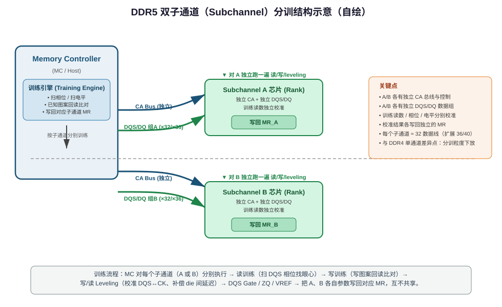

# 6.2 DDR 详解

> **本章定位**：以 DDR 为例理解高速存储接口的时序、训练与可靠性。

> **前置知识**：**必需** [3.7 半导体存储器](../../03-数字与计算机系统/数字电路/3.7-半导体存储器.md)（DRAM 单元与阵列）、[3.14 存储层次与缓存一致性](../../03-数字与计算机系统/CPU设计/3.14-存储层次与缓存一致性.md)（存储层次与主存接口）、[2.25 信号完整性](../../02-模拟与硬件工程/信号完整性与电磁兼容/2.25-信号完整性.md)（高速接口信号完整性）；**推荐** [4.37 存储器IC设计](../../04-集成电路设计/存储器IC设计/4.37-存储器IC设计.md)（DRAM 电路与阵列实现）。本专题系统梳理 DDR（Double Data Rate，双倍数据率）同步动态随机存储器从 DDR 到 DDR5 的演进、接口时序、协议命令与训练机制。

DDR 的英文全称是 **Double Data Rate SDRAM**——"双倍数据率"。它本质上仍是 **SDRAM**（同步动态随机存取存储器）：需要周期性刷新保存电荷、需要行列选通与预充电、需要与外部时钟同步。而它最醒目的创新是「一个时钟周期传两次数据」（上升沿+下降沿各一次），故名"双倍"。理解 DDR 需把握三条主线：**存储阵列的原理（电荷）、命令时序（Activate/Read/Write/Precharge/Refresh）、以及越来越精细的接口训练（Training）**。

## 1. 历史与标准化

- **双沿时钟的雏形**：1980 年代末 IBM 已造出带双沿（dual-edge）时钟特性的 DRAM，并于 1990 年 ISSCC 上展示——但那时的产品是标准 DRAM 而非 SDRAM。
- **Samsung 首块 DDR SDRAM**：1997 年 Samsung 展示第一块 DDR SDRAM 原型，**1998 年 6 月**发布首块商用 **64 Mbit** 芯片，同年韩国现代（今 SK Hynix）跟进量产。
- **JEDEC 标准化**：DDR 开发始于 1996 年，由 **JEDEC（固态技术协会）** 于 **2000 年 6 月** 定稿 JESD79 规范。规范分成两大部分：**芯片（chip）** 与 **模块（module）** 各自的标准。
- **首款商用主板**：2000 年 8 月首块采用 DDR SDRAM 的台式机主板问世。
- 此后每代（DDR2→DDR5）都由 JEDEC 持续制定 JESD79x 系列规范。

> 工程要点：DDR 的每一次代数更新都在**提高 I/O 速率**与**增加预取深度/bank 数**之间平衡，并逐步降低工作电压。这与 PCIe 的代数演进思路互相印证（回扣 [6.1 PCIe 详解](6.1-PCIe详解.md)）。

## 2. DRAM 单元与阵列：电荷即数据

### 2.1 1T1C 单元

DDR 的存储核心仍是 **1T1C（一个晶体管 + 一个电容）** 单元：

- 电容存一位电荷：有电（高）为逻辑 1，无电（低）为逻辑 0。
- 存取晶体管（Access Transistor）由**字线（WL）**控制：WL 选中即打开，把位线（BL）与电容相连进行读写。
- 电容天然漏电，因此必须**周期刷新（Refresh）**，否则数据丢失——这是 DRAM 区别于 SRAM 的根本。

### 2.2 行列与存储体（Bank）

现代 DDR 将阵列组织为多个 **Bank（存储体）**，每个 Bank 独立执行行激活、列读写与预充电，从而**交叠不同 Bank 的操作以掩蔽延迟**。

- **Row（行）/ Column（列）**：行列寻址定位到具体单元。
- **Bank 数**随代数增加：DDR4 每片 16 Bank（4组×4），DDR5 提升到 32 Bank（4组×8）。
- 一个 Bank 相当于一块小规模阵列，多 Bank 并行 = 更高带宽与更好延迟隐藏。

### 2.3 存取晶体管增益 vs 电容电荷

DRAM 单元面积小、密度高，但读出是非破坏性中的"破坏性读出"：读操作会把电容电荷放电，读后必须**写回（Restore）**。感测放大器（Sense Amplifier）在读出时放大并重写。这也是为什么读操作后需要回充，时序上体现为读后仍需管理状态。

## 3. DDR 的基础时序：Bank 状态机

一次读写并非"直接访问地址"，而是经历严格的 Bank 状态机流程：

1. **Activate（激活）**：给定 Row 地址，把该行的位线感测电路接上，整行数据被读出到感测放大器（Row Buffer），进入 **Active 状态**。
2. **Read/Write（读写）**：在 Active 状态下，用 Column 地址访问行缓冲中的具体列，走数据总线。这是真正传数据的一步。
3. **Precharge（预充电/bank 关闭）**：把位线预充回中间电平，关闭行，回到 **Idle** 状态，下一次才能 Activate 新的行。

因此有了两个经典延迟参数：

| 参数 | 含义 | 典型值（DDR4/DDR5） |
|------|------|---------------------|
| $t_{RCD}$ | Activate 到 Read/Write 的延迟（行到列） | ~13~15 ns / ~14~16 ns |
| $t_{RP}$ | Precharge 时间 | ~13~15 ns / ~13~15 ns |
| $t_{RAS}$ | Activate 到 Precharge 最短时间 | ~35~40 ns |
| $t_{RC}$ | 两次 Activate 同 Bank 间隔 = $t_{RAS}+t_{RP}$ | ~50 ns |

> 主存的 **CAS Latency（CL）** 是在 Read 命令发出到数据出现在总线上的延时（以时钟周期计），是体验上最"直观"的延迟指标。DDR4 常见 CL16~CL20，DDR5 常见 CL30~CL40（但周期更短，绝对时间未必更差）。

## 4. DDR 传输速率演进

| 代际 | I/O 频率 | 数据传输率 | 预取（Prefetch） | VDD |
|------|---------|-----------|-----------------|-----|
| DDR1 | 100~200 MHz | 200~400 MT/s | 2n | 2.5 V |
| DDR2 | 200~400 MHz | 400~800 MT/s | 4n | 1.8 V |
| DDR3 | 400~800 MHz | 800~1600 MT/s | 8n | 1.5 V |
| DDR4 | 800~1600 MHz | 1600~3200 MT/s | 8n | 1.2 V |
| DDR5 | 1600~3200 MHz | 3200~6400 MT/s | 16n | 1.1 V |

> 关键机制：**Prefetch（预取）**。DDR 内部核心频率远低于 I/O 频率，靠"一次内部预取多个数据位、再按 I/O 频率串行送出"弥补鸿沟。DDR4 8n 即内部一次读 8 位、I/O 分 8 拍送出；DDR5 提升到 16n。这也解释了为何每代带宽翻倍而核心频率增长有限。

### 4.1 MT/s 与 MHz 的区别

- **MHz**：时钟频率（CLK 的翻转频率）。
- **MT/s**：每秒数据传输次数（Mega Transfers per second）。DDR 一个周期传 2 次，所以 MT/s = 2 × MHz。

例如 DDR4-3200：I/O 时钟 1600 MHz，数据传输率 3200 MT/s。位宽为 ×8 时，单颗粒带宽为 $3200\ \text{MT/s}\times 8\ \text{bit}\div 8=3.2\ \text{GB/s}$（即 $25.6\ \text{Gb/s}$）。

### 4.2 芯片颗粒组织与位宽符号

DRAM 颗粒用 **x组织** 记法描述存储阵列，如 `64M×8` 表示"64 M 个 8 位存储位"，其中 M 来自 **banks × rows × columns** 的乘积。常见颗粒有 **×4、×8、×16**：

| 组织 | 特点 |
|------|------|
| ×4 | 支持高级纠错特性（Chipkill、memory scrubbing、Intel SDDC），服务器多用 |
| ×8 | 位宽折中，桌机/笔记本主流，也逐渐进入服务器 |
| ×16 | 位更宽、颗粒更少，成本较低 |

> 大多数主板只识别**低密度**颗粒（如 1 GB 模块用 64M×8）组成的模块；若用高密度（如 128M×4）可能无法识别——JEDEC 规定 128M×4 仅用于服务器注册模块。

## 5. 模块（Module）、Rank 与 DIMM

### 5.1 从芯片到模块：位宽与 Rank

为提升容量与带宽，芯片组合在模块上。**DIMM 的数据总线固定为 64 位（ECC 为 72 位）**，这要求**并排 8 个 ×8 芯片**（或并行的 16 个 ×4 等）以形成总线：

- **共同地址线的多颗芯片**称为一个 **Rank**——"排名"一词正是为区分"芯片内部的行/列/Bank"而引入，避免与物理"面（side）"混淆。
- 同一内存总线上可挂多个 Rank，用不同 **CS#（芯片选择）** 区分；一次命令同时作用于一个 Rank。
- **Rank ≠ 面**：模块可以两面贴片但只构成一个 Rank，也可以单面却有多个 Rank，判断依据是**芯片组织与 CS# 分组**，而不是物理位置。
- 模块容量 = 单片容量 × 芯片数；ECC 模块因 8bit 纠 1bit 需乘 8/9。例如 1 GB PC2100 可做成 36 颗 64M×4（2 Rank）、18 颗 64M×8（2 Rank）或 18 颗 128M×4（1 Rank）——购买时 ×4/×8 与单/双 rank 需仔细分辨。

### 5.2 电气负载与多通道

给共享内存总线**新增模块会加大驱动器的电气负载**，导致信号速率下降。为缓解该瓶颈并突破内存带宽，现代芯片组采用**多通道（Multi-channel）架构**，把访问分散到多组独立数据/时钟总线上。

### 5.3 DIMM 物理形态演变

| 类型 | 引脚 | 缺口 | 电压 |
|------|------|------|------|
| SDRAM DIMM | 168 | 2 | 3.3 V |
| DDR DIMM | 184 | 1 | 2.5 V |
| DDR2 DIMM | 240 | 1 | 1.8 V |
| DDR3/4 DIMM | 240 | 1 | 1.5/1.2 V |
| DDR5 DIMM | 288 | 1 | 1.1 V（模块上电压调节） |

- **SO-DIMM**（笔记本）：DDR/SO-DIMM 均为 200 引脚、缺口相似，插错有损坏风险。
- **Registered / Unbuffered（注册/非注册）**：服务器 RDIMM/LRDIMM 在模块上加有源缓冲电路，降低 DRAM 总线容性负载；UDIMM 直接暴露芯片接口。
- **低电压带来的功耗收益**：DDR 用 2.5 V（对比 SDRAM 的 3.3 V）即可显著省电。

### 5.4 DDR5 的关键结构变化：双子通道

DDR5 DIMM 上每个 DIMM 改为**两个独立子通道（Subchannel）**——早期 DIMM 只有一个通道、单条 CA 总线控制 64(或 72)条数据线。DDR5 每个子通道各拥有一条 CA 总线，控制 32（非 ECC）或 36/40（ECC）条数据线：

- 总线变窄由**双倍最小突发长度（BL=16）**补偿，保证最小访问大小仍为 **64 字节**（与现代 x86 CPU 缓存行一致）。
- 模块上集成 **PMIC（电源管理 IC）+ 片上电压调节** 与 **3.3 V 管理接口电源**，把 5 V（UDIMM）或 12 V（RDIMM/LRDIMM）就近转换为芯片需要的低电压——在用电点就近稳压供电更稳，类同 CPU 的 VRM 设计思路。

### 5.5 命令接口与信号组

模块/颗粒引脚按功能分组（对非 DIMM 的 DRAM 芯片称 x4/x8/x16 位宽颗粒）：

- **命令/地址（CA）**：`RAS#`, `CAS#`, `WE#`, `CS#`, `Addr[A0..An]`, `BA/BG（Bank 地址/组）`。
- **时钟（CK/CK#）**：差分时钟，命令按时钟沿采样。
- **数据（DQ）+ 数据选通（DQS）**：DQ 传数据，DQS 作为数据选通（源同步时钟），DDR 在 DQS 上升沿和下降沿各采样一次。
- **控制**：`CKE`（时钟使能）、`ODT`（片上端接）、`RESET#` 等。

#### 5.5.1 命令编码（真值表片段）

| 命令 | CS# | RAS# | CAS# | WE# | 功能 |
|------|-----|------|------|-----|------|
| Activate | L | L | H | H | 选通某 Bank 某行 |
| Read | L | H | L | H | 从 Row Buffer 读列 |
| Write | L | H | L | L | 向 Row Buffer 写列 |
| Precharge | L | L | H | L | 关闭 Bank |
| Auto Refresh | L | L | L | H | 所有 Bank 定期刷新 |
| NOP | H | X | X | X | 无线操作 |

#### 5.5.2 有效信号与逻辑电平

- 命令在 **CK 上升沿**采样，大部分信号低有效（带 #）。
- DQ/DQS 采用 **SSTL/POD 差分或单端**点平，电平随代数降低（1.2V→1.1V 等）以减功耗。
- 高速下 DQ 与 DQS 需保持 **TDR/TDS 相位关系**，由写训练建立。

### 5.6 DDR4/DDR5 的 Bank 与寻址演进

现代代际通过增加 **Bank 组（Bank Group）** 与 **Bank 数**来隐藏刷新与 Activate/Precharge 延迟：

| 特征 | DDR4 | DDR5 |
|------|------|------|
| Bank 组位（BG） | 2（最多 4 组） | 3（最多 8 组） |
| Bank 结构 | ×4/×8：16 Bank = 4 组×4；×16：8 Bank = 2 组×4 | 最多 8 组 × 4 Bank = 32 Bank |
| 每次突发长度 | 8（8n 预取） | 16（16n 预取，可 8 拍后 burst chop） |
| 行地址位 | 17 | 17（可扩到 R17 保留位） |
| 列地址位 | 11（×4，512B 页） | 12（×4，1KB 页） |
| 芯片 ID 位（CID） | 3（最多 8 颗堆叠） | 3（+1 保留位，地址扩展） |

> 关键工程约束：DDR5 因内部 ECC，**最低 3 位列地址被移除**——所有读写必须从 8 的倍数列地址开始（列地址 C0~C2 去掉）。配合 BL=16，保证每个访问都是一个对齐的 64B 缓存行，服务于现代 CPU 的一次性完整填充。

## 6. DDR 的训练（Training）机制：详细原理过程

> **为什么必须训练？** 每颗 DRAM 芯片（die）、每条走线、每颗电容的物理参数都存在**工艺（Process）偏斜、电压（Voltage）波动和温度（Temperature）漂移**，即 **PVT**。高频下 DQ/DQS 的走线长度差、片上 IO 延迟差、PLL 相位差，会让数据和时钟在到达采样点时**不再对齐**。DDR 的"训练（Training）"就是在上电初始化阶段，由内存控制器（Memory Controller, MC）与 DRAM 双向协作，把所有这些不确定性**逐一测出来并补偿**，使建立/保持时间（Setup/Hold）在有裕量的理想窗口内采样。这一思想与 PCIe 的 LTSSM 完全同源（回扣 [6.1 PCIe 详解](6.1-PCIe详解.md)）：**高速接口靠训练对冲 PVT 不确定，靠 ECC 兜底残余错误**。

### 6.1 训练总流程：上电 → 复位 → 初始化 → 训练

一次 DDR 初始化（以 JEDEC 规定的 Power-up & Initialization 流程为纲）大致分三层：

1. **上电与复位（Power-up / Reset）**：稳定供电 → 拉低 `RESET#` → 拉高 `CKE` → 差分时钟 `CK/CK#` 先稳定输出足够多周期（达标时钟初启），DRAM 内部进入已知初始状态。
2. **初始化序列（Initialization Sequence）**：依次下达几个处理步骤命令——
   - **写 Load Mode（MR）命令**初始化各模式寄存器；
   - **ZQ 校准命令**校准输出驱动与片上端接（ODT）阻抗；
   - 等待必要的定序时间（如 `tDLL`、`tZQinit`）让内部 DLL/校准收敛。
3. **时序训练（Training / Leveling）**：对每个字节通道（byte lane）分别校准，把结果写回 MR。至此 DRAM 才能以额定频率正常收发。

> 训练**是在初始化完成、DRAM 可用之后、但尚未做业务读写之前**进行的一轮"试运行"，通过发命令、收数据、比较已知图案来反推相位与电平的最优点。

### 6.2 训练要对付的"时间错位"从哪来

DDR 的读写是**源同步（Source Synchronous）**的：数据以 `DQS` 为选通。理想情况下数据、DQS、系统时钟 CK 应完美对齐，但实际存在三类错位源：

| 错位来源 | 影响 | 训练手段 |
|---------|------|---------|
| **走线长度差**（板级+芯片内） | DQ 与 DQS、DQS 与 CK 路径不等长 → 相位差 | DQS/DQ Leveling、Read/Write Leveling |
| **片上 IO 延迟/相位差**（不同 die 不同 pitch） | 各颗粒、各 byte lane 的延迟不一致 | 逐 byte lane 训练 + skew 补偿 |
| **温度漂移（长期）** | 延迟随时间漂移，最初校准值会失准 | 支持运行时重训练 / 校准刷新 |

> 若不训练，到了 **DDR4/DDR5 的高频（1.6~3.2 GHz+）**，这些错位可能超过一个比特时间，直接导致采样失败。

### 6.3 读训练（Read Training / DQS 相位校准）

**目标**：让 DRAM 发出的 `DQS` 与 `DQ`，在 MC 的接收端**在其采样窗口中央对齐**。

过程（MC 坐标系下的"读边"）：

1. MC 发送 **读命令**，让 DRAM 沿 DQS 边沿送出已知数据；
2. MC 的接收器从**较边缘的相位位置**开始采样，比较读回数据与期望是否一致（测出"能采对"的区间两端）；
3. 逐相位步进，描出**数据有效窗口（data eye）的左右边界**；
4. 把采样点移到**眼图中心**（左右裕量均衡处），这就是读 DQS 的最佳相位；
5. 若某 byte lane 眼太小，说明恶化严重，可能需降低速率或启用 DFE/均衡。

> **本质**：MC 用"扫描相位、找眼中心"的方法确定采样时刻，把 DQS 的延迟链调整到眼图几何中心。这等价于数字化的**眼图扫描**。

### 6.4 写训练（Write Training / DQ 建立）

**目标**：让 MC 发出的 `DQ` 在 DRAM 端被 `DQS` 边沿**正确采样**（建立/保持裕量达标）。

过程：

1. MC 往 DRAM 某个地址写入**已知图案**；
2. 再读回来与期望比较——若读到错值，说明写入时 DQ 相对 DQS 的相位关系不对；
3. MC 逐相位调整 DQS 相对 DQ 的延迟，反复"写→读→比较"，直到找到都能写对的相位窗口中心；
4. 把该偏移写入 MR，DRAM 据此在内部滞后/提前 DQS 采样 DQ。

> **写训练测量的是"DRAM 端采样点何时刻最稳"**，与读训练在 MC 端测相反方向，但方法同源（图案往返比对）。

### 6.5 写 Leveling（Write Leveling：校准 DQS 相对 CK）

**背景**：`DQS` 是源同步时钟，它相对系统命令时钟 `CK` 的延迟是**未知**的（因为路径不同、板上上有走线延迟、die 内还有 DLL/IO 延迟）。若 DQS 相对 CK 不齐，写命令里关于"对齐 DQS（TDS/TDQSS）"的窗口就被破坏，就更无法对齐 DQ 了。所以要先对齐 DQS↔CK，再对齐 DQ↔DQS。

**Write Leveling 的做法**（JEDEC 定义）：

1. MC 把 DRAM 置于 **Write Leveling Mode**；
2. DRAM 不再用 DQS 采样，而是把 **DQ[0] 当作被命令时钟 CK 采样的输入**，DQS 变成采样沿；
3. MC 发**连续 DQS 沿**，同时观察 DRAM 返回的 DQ[0]（其逻辑变化反映 DQS 相对 CK 的相位差）；
4. 通过反复对齐，找到 **DQS 上升沿与 CK 上升沿恰好对齐**的相位点；
5. 把该 DQS↔CK 偏移写入 MR；退出 Write Leveling Mode 后，Ds 已相对 CK 定标，后续就可以做 DQ 对齐了。

> **一句话**：Write Leveling 先把 DQS 与系统时钟对齐，为后续的 DQ 校准奠定基准。

### 6.6 读 Leveling（Read Leveling）

为补偿**每颗 DRAM die 读数据返回的传播延迟差异**（同样命令，不同颗粒返回数据先后可能不同），读训练后还需把各 die/byte lane 的读延迟对准：

- MC 给各 DRAM 发相同的读命令，**测量各自的读返回相位**；
- 对相位偏慢/偏快的颗粒，在 **MC 内部补偿额外的延迟**或向 DRAM 写入小的相位调整；
- 最终保证所有 byte lane 的读数据在 MC 侧**聚拢到同一条时间窗口**，便于统一采样。

### 6.7 DQS Gate 训练（DQS Gating / 选通窗）

读操作时，DQS 在数据前需要一小段 **upreamble**。MC 需要精确知道"DQS 什么时候从高阻变为有效"，才能在正确时间**打开采样门（gate）**：

- 训练时 MC 扫出一条**门窗口**，使读取过程中采样只在数据有效期间开启，避免采到空闲/毛刺；
- 若门位置不准，可能"早开门"采到预充电噪声、"晚开门"丢前几个 bit——训练把这扇窗对准眼图中心。

### 6.8 ZQ 校准（阻抗/端接校准）

**目标**：校准 DRAM 的**输出驱动阻抗**与 **ODT（On-Die Termination，片上端接）阻抗**至目标值（如 34Ω/40Ω/48Ω，按代数而定）。

原理：

1. DRAM 芯片引出 **ZQ 引脚**，外部接一颗**精密参考电阻 `RZQ`**（如 240Ω，1% 精度）到地；
2. 初始化时 MC 发 **ZQ Calibration 命令**，DRAM 内部把可调电阻/电流源与 RZQ 比对，把内部阻抗/电流**校正到 RZQ 对应的目标档位**；
3. 结果缓存为校准码（Calibration Code），供输出驱动与 ODT 使用；
4. **ZQ Calibration Long/Short**（长/短校准）分别用于加电时的完整校准与高低温漂移时的快速再校准。

> 阻抗匹配直接决定回波反射与眼图质量，ZQ 校准就是"把反射打到最小"的手段（回扣 [2.25 信号完整性](../../02-模拟与硬件工程/信号完整性与电磁兼容/2.25-信号完整性.md)）。

### 6.9 电压（VREF）校准与片上时序补偿

- **VREF Calibration**：数据采样/判断的参考电平 `VREF`（写侧为 DC，读侧即漂移）同样受 PVT 影响。训练时按已知图案扫描 VREF，找到**高低电平判断最稳的参考电压点**，写入 MR。
- **Duty Cycle 校准**：高频下高/低电平占空比可能失真（非 50%）。训练补偿占空比失真，保证双沿采样（DDR 的双沿特性）两边裕量对称。
- **片上时序补偿（On-die timing）**：DRAM 内部延迟链（含 DLL）由 MR 参数设定，训练把各种补偿量固化进去。

### 6.10 训练结果固化：写回 Mode Register

各类训练得出的相位/电平/阻抗校准值，最终都写回 DRAM 的 **MR（Mode Register）**（如 MR1 的 DLL 使能/ODT、MR2~MR3、以及为了 leveling 分配的专用 MR 字段）。DRAM 据此：

- 按 MR 里的延迟码（Phase/Delays）**设定内部延迟链**；
- 按 `ODT` 设置值**选择端接档位**；
- 按校准码**设定输出驱动强度与 VREF**。

> 训练完成时（vs. 校准），这些 **MR 保持到待机/主刷新期间**；若温度大幅漂移（≥某个阈值）或进入更深刷新状态，许多平台会在退出或恢复时**执行快速重校准（ZQ Cal Short / Re-training）**，以跟上漂移。

### 6.11 训练的工程要点小结

| 训练项 | 校准对象 | 本质手段 |
|--------|---------|---------|
| 读训练 | MC 端 DQS 采样相位 | 扫相位找眼中心 |
| 写训练 | DRAM 端 DQ 采样窗口 | 写图案回读比对 |
| 写 Leveling | DQS↔CK 相位基准 | 定标 DQS 相对系统时钟 |
| 读 Leveling | 各 die/byte lane 读延迟差 | 补偿到同一读窗口 |
| DQS Gate | 读采样门位置 | 扫描门窗对准眼中心 |
| ZQ 校准 | ODT/驱动阻抗 | 与外部 RZQ 参考比对 |
| VREF 校准 | 数据判断参考电平 | 扫 VREF 找最稳点 |
| Duty Cycle | 高/低占空比 | 补偿占空比失真 |

> **一句话**：DDR 训练 = 把 PVT 造成的时间/电平错位，通过"扫相位/扫电平 + 已知图案回读比对 + 写回 MR"逐一补偿，使高频采样收敛到有裕量的眼图中心。它读边、写边、时钟基准、端接阻抗、参考电平、占空比六个维度全面校准，是 DDR 能跑到额定频率的根本保障。

### 6.12 DDR5 专属训练差异

DDR5 继承了 6.3~6.10 的通用训练项，但因其**内部 ECC、双子通道结构、更高速、更低电平**，在训练上引入了若干**与 DDR4 明显不同**的差异：

<b>图 6-1</b>：DDR5 双子通道（Subchannel）分训结构示意（自绘）。一个 DIMM 拆成 A/B 两个独立子通道，各自拥有独立 CA 总线与 DQS/DQ 数据组。MC 的训练引擎对 A、B 分别执行完整的读训练/写训练/Leveling/ZQ/VREF，再各自写回对应的 MR（MR_A / MR_B），参数互不共享。

- **双子通道（Subchannel）分训**：DDR5 一个 DIMM 拆成两个独立子通道（A/B），每个子通道各拥有一条独立的 `CA` 总线与一组 `DQS/DQ`。因此**训练必须按子通道分别进行**——MC 对 Subchannel A 与 Subchannel B 各自跑一遍完整训练，各自的相位/电平校准值也分别写入各自的 MR。不能像 DDR4 那样"一条通道一套参数"。
- **内部 ECC 对训练的影响**：DDR5 在片内集成 ECC，接入数据时多出冗余位。写训练/读训练所访问的"已知图案"需按 ECC 位宽（如 ×4/×8 颗粒各配 1 位 ECC）处理；同时因**最低 3 位列地址被移除**（见 5.6），训练访问必须按 8 的倍数列对齐——训练命令与图案长度都要避开不能访问的列。
- **IBRD / RDQS（读 DQS）分离**：为在高频下提高读时序裕量，JEDEC（尤其 DDR5 RDIMM/LRDIMM 与高速 DIMM）趋向把**读选通与写选通分离**表达。读边训练除 DQS 相位外，还需校准内部读数据选通（如 RDQS / tRDQS）相对 DQ 的建立，降低读采样抖动。
- **更低电压与更细 VREF 步进**：DDR5 端电压更低（VDDQ 1.1V，PODL/I/O 端接改为线性 PODL），VREF 可在 MC 与 DRAM 两侧各自校准（内部 VREF 训练），步进更细，以在更窄的眼内仍有足够裕量。
- **更紧的 tDLLK 与更快的 DLL 收敛**：DDR5 对 DLL 锁定时间要求更短，训练早期即锁定 DLL；相应地提供**更细的 DQ/DQS phase 分辨率**供训练步进。
- **更强的运行时再校准（Retraining）**：温度漂移更敏感（更高密度+更小单元），DDR5 平台通常支持**周期性的快速重训练 / ZQ Cal Short + VREF 再扫**，并在进入/退出自刷新或更深掉电态时自动触发，替代 DDR4 上较"粗放"的仅靠 tREF 兜底。
- **逐 rank / 逐 die 训练的粒度**：RDIMM/LRDIMM 上多 rank、多 die 堆叠时，需**逐 rank、逐 die** 校准读返回与端接，避免把不同 die 的延迟差归咎于统一参数（对齐 6.6 读 Leveling 的扩展）。

> 一句话：DDR5 训练 = 在"一通道一套参数"基础上，细化到**按子通道、按 rank、按 die、按读写选通分离**逐级校准，并在低电平/高密度下提供更细 VREF 与更快/可重复的再校准手段，以守住更高的接口速率。

### 6.13 前瞻：PAM-4 对训练流程的影响（DDR5 仍为 NRZ）

> **先澄清一点**：**DDR5 采用 NRZ（PAM-2）单端 PODL 信号，并不是 PAM4**。PAM-4（四电平脉冲幅度调制）是 GDDR7 已量产、DDR6/未来代际正在规划的信号体制。因此下面讨论的是"PAM-4 若引入，会如何改变训练"，属于前瞻，而非对 DDR5 现状的描述。

若未来 DDR 转向 **PAM-4**，训练流程将发生如下关键变化：

- **单眼变三眼**：NRZ 只有 1 个数据眼，训练只需扫一个"采样点 + 一个判定阈值"；PAM-4 用 4 个电平（00/01/11/10）把一个 UI 内塞 2 比特，形成 **3 个（垂直堆叠的）眼**。采样点训练从"找准一个眼心"变为"**扫 3 个眼、每个眼各配一组阈值/相位**"，训练复杂度倍增。
- **多阈值校准**：3 个眼对应 **3 组判定阈值**（VREF 分层）。训练需各自校准高/中/低三段阈值，且电平间距（ΔV）更小，对噪声更敏感，VREF 训练步进需更细、容差更紧。
- **占空比/幅值失配放大**：四个电平的**幅值均匀性**（抖摆一致性）和上下沿对称性要求更高，训练须额外校准**线性度与各电平的幅度/占空比失配**，而不仅是 NRZ 的单一占空比。
- **需要 DFE/均衡配合**：三眼更窄、更易受 ISI（符号间干扰）污染，读训练须与 **发射端预加重 + 接收端 DFE/CTLE** 联动（回扣 [6.1 PCIe 详解](6.1-PCIe详解.md) 的均衡思路），训练目标从"找眼心"升级为"在均衡后找三眼心"。
- **无栅采样的定时更关键**：PAM-4 在每 UI 内多一位，tUI 变短，训练对 DQS↔CK（写 Leveling）、读 Gate 的窗宽要求更高，门窗/眼的裕量变薄，训练查找的最优解更"尖锐"。
- **编码与 FEC 兜底**：靠 3-way Gray 编码降低相邻电平误判，并配合低延迟 FEC（同 PCIe Gen6 的 L-FEC 思路）兜底残余 BER；训练目标可在"纯相位最优"与"配合 FEC 的可接受 BER"之间取得折衷。

> 小结：PAM-4 把 DDR 训练从"一维（相位×1 阈值）"扩展到"三维（多眼 × 多阈值 × 均衡）"，训练算法与时序裕量管理都显著复杂化——这也是为何它推迟到更高代际、配合更完善的信令与均衡技术才落地。**在讨论"当前 DDR5 训练"时应回到 6.1~6.12 的 NRZ 框架**。

## 7. 刷新（Refresh）与地址管理

### 7.1 为什么需要刷新

电容漏电导致数据衰减，DRAM 需在 $t_{REF}$ 时间内把每一行重新读重写一遍。**自动刷新（Auto Refresh）** 命令触发，内部用行计数器遍历所有行。

### 7.2 刷新效率与 Bank 管理

- 传统 **All-Bank Refresh**：所有 Bank 同时刷新，刷新期间无法访问，产生"刷新黑洞"。
- DDR5 引入 **Per-Bank Refresh** 与 **Refresh Management**，可只刷新部分 Bank 而让其他 Bank 继续服务，减少刷新对带宽的侵占。
- 刷新频率与温度相关（温度越高漏电越快），高温下刷新频率提高（**Thermal 特性下的 variable refresh**）。
- **DDR5 刷新间隔缩短**：≤85°C 时刷新间隔从 DDR4 的 **64 ms 降至 32 ms**，以应对更高密度、更小单元带来的更快放电；对应的定时参数由 **tRFC4**（DDR4）演进为 **tRFCsb**，并提供 `REFab`（全 Bank）与 `REFsb`（单 Bank）两条刷新命令。

## 8. **ECC**：纠错与可靠性

### 8.1 两种 ECC：系统级 ECC 与片上 ECC

- **系统级 ECC（External/True ECC）**：在数据总线上额外传纠错码（如 ×8 颗粒再多 1 bit 等），数据总线由 64 位扩到 72 位（**8 bit 纠 1 bit** = 总容量的 8/9）。由控制器完成检测/纠正，能报告错误详情，是服务器/工作站标配；内存颗粒数必须为 9 的倍数。
- **片上 ECC（On-die ECC，DDR5）**：全部 DDR5 芯片内置，**在数据送往 CPU 之前于片内检测并纠正存储错误**，从而允许使用缺陷率更高的高密度颗粒。它发生在比系统级 ECC 更低的层级：没有额外芯片与数据线、不向 CPU 上报错误详情；系统常通过"非修正错误"间接推断存在被纠正的错误。

### 8.2 其他可靠性手段

- **DBI（Data Bus Inversion，数据总线反转）**：高速下控制每次同时翻转的 DQ 位，降低 di/dt 与切换噪声。
- 结合 `Write DBI / Read DBI` 与低电平（POD），在最高速率下维持信号完整性与功耗。

## 9. 功耗管理与命令调优

- **CKE 与低功耗模式**：`idle` 时可拉低 CKE 进入 `Power-Down`；`Self-Refresh` 让 DRAM 在片内自行刷新，供睡眠时保存数据。
- **ODT 动态端接**：不同操作切换端接强度，在信号完整性和功耗间取舍。
- **Write DBI / Read DBI**：数据总线反转，减少同时翻转位，降低 di/dt 噪声。

## 10. 与软件视角的接口：Rank、Channel、Row Buffer Hit

从 CPU/控制器角度：

- **Channel（通道）**：一组独立的 DQ/DQS/时钟，可并行访问（双通道/多通道提升带宽）。
- **Rank**：共享同一条 Command/Address 总线的多条 DRAM 颗粒，一次命令同时作用于一个 Rank；多个 Rank 用不同 CS# 区分。
- **Row Buffer Hit（行命中）**：若后续访问落在已 Activate 的行，可省去 Activate/Precharge 直接列访问，延迟大幅降低。**内存控制器调度器**的目标就是最大化 Row Buffer Hit 率并充分利用 Bank 交错。

因此，**应用（顺序访问）会影响主存真实性能**，并非所有访问都等价——这与缓存原理一脉相承。

## 11. 关键时序与带宽计算示例

### 例1：DDR4-3200 ×8 单颗粒带宽

数据率 3200 MT/s，位宽 8 bit：

$$
B = 3200\ \text{MT/s}\times 8\ \text{bit}\div 8 = 3.2\ \text{GB/s} = 25.6\ \text{Gb/s}
$$

### 例2：DDR5-6400 ×8 单颗粒带宽

数据率 6400 MT/s，位宽 8 bit：

$$
B = 6400\ \text{MT/s}\times 8\ \text{bit}\div 8 = 6.4\ \text{GB/s} = 51.2\ \text{Gb/s}
$$

以上均为单颗 ×8 颗粒带宽；8 颗 ×8 颗粒组成 64 bit 通道时，通道带宽再乘 8，双通道再乘 2。

### 例3：延迟换算

DDR4-3200 典型 CL=22。周期 $t_{CK}=\frac{1}{1600\ \text{MHz}}\approx 0.625\ \text{ns}$，则

$$
t_{CL} = 22 \times 0.625\ \text{ns} \approx 13.75\ \text{ns}
$$

DDR5-6400 典型 CL=40，$t_{CK}=\frac{1}{3200\ \text{MHz}}\approx0.3125\ \text{ns}$，$t_{CL}=40\times0.3125=12.5\ \text{ns}$。可见 DDR5 尽管 CL 数字更大，绝对延迟反而更短——**判断延迟要看绝对时间而非周期数**。

## 与 PCIe 的对比

| 维度 | DDR | PCIe |
|------|-----|------|
| 本质 | 存储阵列 + 同步接口 | 点对点高速串行互连 |
| 组织 | Bank/Row/Column + Rank/Channel | Lane + 分层协议栈 |
| 采样 | DQS 源同步双沿 | CDR 内嵌时钟 |
| 训练 | 初始化相位/电平校准 | LTSSM + Link EQ |
| 可靠性 | ECC、刷新 | CRT/LCRC 重传、流控 |
| 性能核心 | 预取 + Bank 交错 + Row hit | 串行高频 + Lane 扩展 |

## 小结

**DDR 是"慢而大"的 DRAM 阵列配上一个"快而窄"的双倍数据率接口的产物：靠 1T1C 电荷存储、Bank 状态机按时序 Activate/Read/Write/Precharge、定期刷新保住电荷，靠 Prefetch 与 Bank 交错填满带宽，靠初始化训练与 ECC 在高频下守住时序与可靠性。** 从 DDR 到 DDR5，频率、预取宽度、Bank 数与功耗管理持续演进，但其"电荷 + 时序 + 训练"的三元素内核始终未变。

## 自测清单

1. MT/s 与 MHz 有何区别？如何由传输率和总线位宽计算 GB/s？
2. Activate、Read/Write、Precharge 分别改变 Bank 的什么状态？
3. 为什么 DDR 需要刷新、初始化训练和 DQS 源同步采样？
4. Bank 交错与 Row Hit 如何提高有效带宽？
5. ECC 能发现或纠正哪些错误，不能替代哪些可靠性措施？

## 进阶附录

DRAM 单元、感测放大、刷新、关键时序与可靠性机制见 [6.2.1 DRAM 底层原理与可靠性](6.2.1-DRAM底层原理与可靠性.md)。

---

**下一章**：[6.2.1 DRAM 底层原理与可靠性](6.2.1-DRAM底层原理与可靠性.md)
