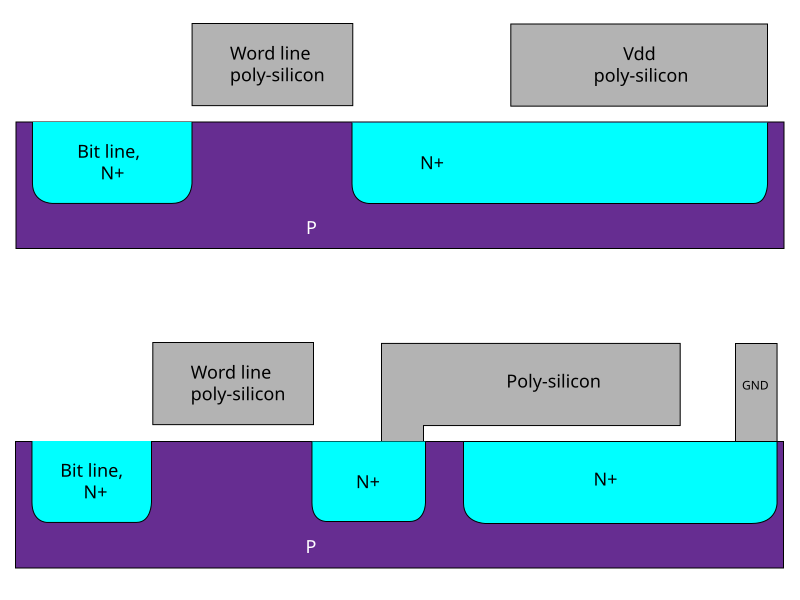
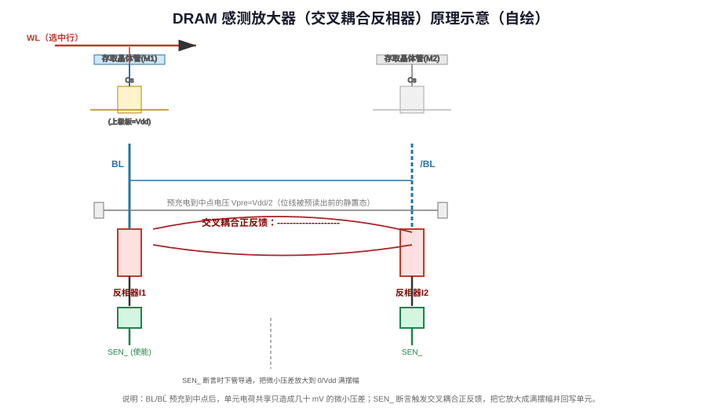
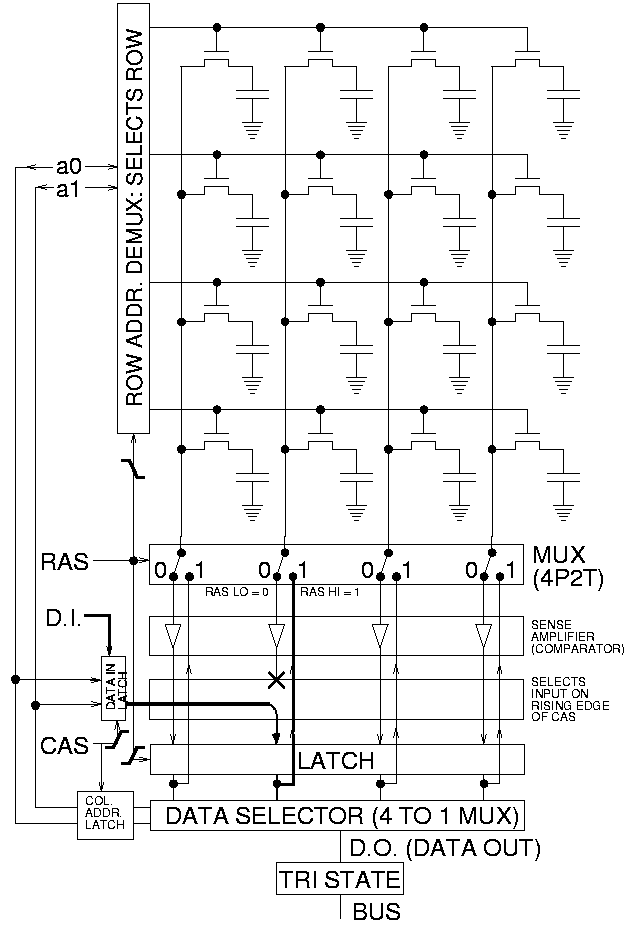
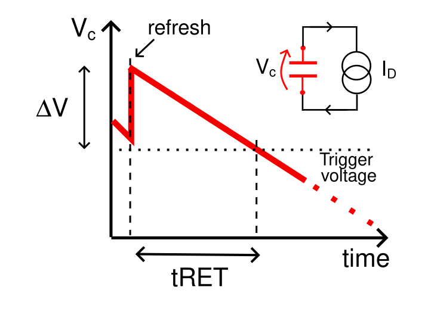
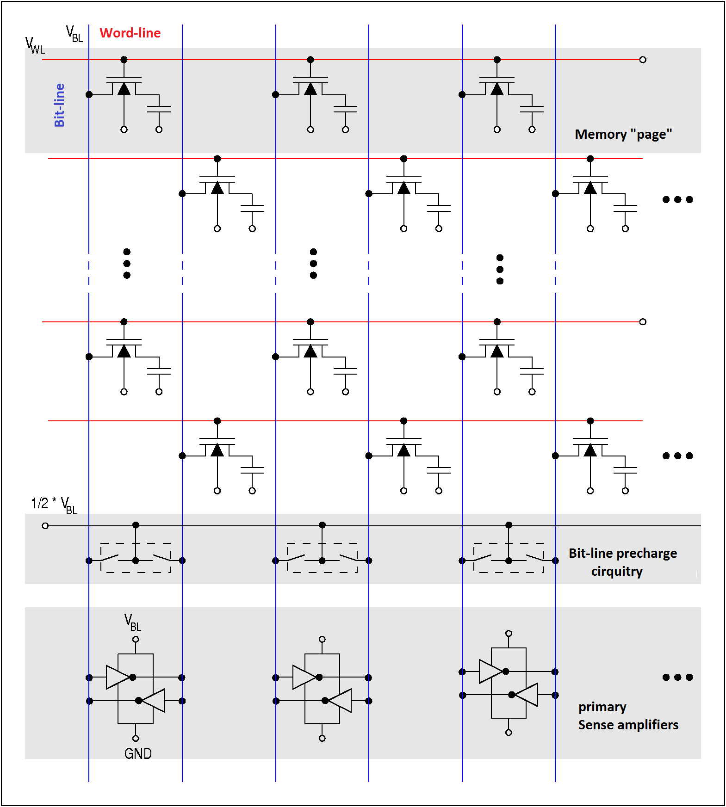

# 6.2.1 DRAM 底层原理与可靠性

> **本章定位**：作为 [6.2 DDR 详解](6.2-DDR详解.md) 的进阶附录，深入 DRAM 的单元结构、读写与刷新机制、关键时序及可靠性问题。

> **前置知识**：**必需** [6.2 DDR 详解](6.2-DDR详解.md)，先掌握 DDR 的 Bank 状态机、接口时序、训练与 ECC 主线。

本附录把 DRAM 这门存储器细讲清楚，作为 DDR 的"底层底座"。DDR 只是 DRAM 家族中最主流的**同步接口**形态；理解底层单元、感测、刷新与可靠性，才能真懂 DDR 的行为。

## A1. DRAM 单元结构：1T1C 与位线对

- **1 单元 = 1 晶体管（Access） + 1 电容**。电容存电荷代表"1/0"；晶体管由**字线（Word Line, WL）** 门控，决定电容是否接上位线。
- 阵列排版：水平**字线**每行一条；竖直方向每列有**两根位线（+BL / −BL）**，分别只接该列**每隔一个**的单元。这种"隔行接不同位线"的结构是**折叠位线（Folded Bitline）** 架构，让噪声以共模形式被抵消。
- 两个位线在列方向**物理对称**，保证电容相等、预充后电压一致。

下图为经典 **1T1C DRAM 单元剖面示意图**（字线为多晶硅（poly-silicon），位线为 N+，有源区为 P 衬底，电容接 Vdd）：

<b>图 A1-1</b>：1T1C DRAM 单元剖面。水平多晶硅字线（Word line）选中后，把存储电容通过存取晶体管接到下方位线（Bit line）进行读写；电容上极板接 Vdd。

## A2. 读操作：破坏性读出的完整时序

1. **预充电（Precharge）**：感测放大器断开，两条位线预充到高低电平的中间值（如逻辑 0/1 分别为 0/1 V 时预充到 0.5 V）。因位线长、电容大，预充撤除后能短暂保持该电平。
2. **字线拉高（Activate）**：选中行字线升高，单元的存取晶体管导通，电容与位线连通，电荷在两者间重新分布。因位线电容 ≫ 单元电容，位线电压**只被扰动很小**（如存储 1 → 位线从 0.50 升到 0.54 V；存储 0 → 降到 0.46 V）。
3. **感测放大（Sense）**：把感测放大器（一对交叉耦合反相器，正反馈）接上位线对，把小小压差**放大到满摆幅**——一根位线冲到最高，另一根拉到最低。行就此"打开（Open）"，整行数据同时被感知并锁存。
4. **列选通（Read 列）**：用**列地址**从已开行的锁存器中选择某一列接到外部数据总线。同一行的不同列再读时无需重新开行（Page Hit），这就是"页（Page）"加速的本源。
5. **回写/刷新（Restore）**：感测放大器的输出电流沿位线**回流到单元电容**，把刚被干扰的电荷"补回去"（存 1 的抬升电压、存 0 的保持放电），即**读后回写**。由于位线传播延迟长，这一步要与后续列读重叠。
6. **关闭行**：字线拉低，断开单元与位线；感测放大关断，位线重新预充，等待下次开行。

> **关键理解——为何 DRAM 读是"破坏性"的**：读操作通过电荷共享把单元电容上的电平"借用到位线"来感知，本质改变了单元电荷，因此必须回写。这也是"读即刷新一部分"的原因。

下图为 **MOSFET 阵列读操作示意**（每条字线选中一行，感测放大器放大位线对压差并锁存整行）：

<b>图 A2-1</b>：DRAM 阵列读操作。选中行（Active 的字线）使整行单元接入位线；每列下方一对交叉耦合反相器构成感测放大器，把位线上微小的电荷共享压差放大到满摆幅，行随之"打开"。

感测放大器的结构与工作原理可用下图理解：

<b>图 A2-2</b>：DRAM 感测放大器（交叉耦合反相器）原理（自绘示意）。位线对 BL/BL̄ 先预充到中点电压，读操作时单元电荷共享只造成几十 mV 的微小压差；断言使能信号 SEN_ 后，两个交叉耦合反相器正反馈把该微小压差放大到 0~Vdd 满摆幅，并由下管电流流回单元电容完成回写。

## A3. 写操作

- 打开行后，把目标**列的感测放大器强制到目标高压/低压**，感测放大器的正反馈把这些值"钉住"，再沿位线写入单元电容。
- 虽然只改一列，但打开行的**整行都会同时被感测并回写刷新**——写某一单元 = 顺带刷新整行。

<b>图 A3-1</b>：DRAM 阵列写操作。把目标列的感测放大器强制到目标电平，正反馈将其"钉住"，再沿位线写入电容；同行的其余单元因感测而顺带回写刷新。

## A4. 刷新（Refresh）与计时

- JEDEC 规定每行必须**每 64 ms 内刷新一次**（DDR5 若 ≤85℃ 缩短到 32 ms）。
- 刷新可**突发全行**，也可**逐行错开**：例如 $2^{13}=8192$ 行时，每 64 ms/8192 = **7.8 μs** 刷一行。这也是 DDR 里的 **tREFI（刷新间隔）** 与 **tRFC（刷新时长）** 的来源。
- 刷新可由外部逻辑逐行喂行地址，也可由**片内自刷新（Self Refresh）** 在低功耗待机时自主进行——对应 DDR 中的 **SRE（Self Refresh Entry）** 进入自刷新、**SRX** 退出，并由温度跟踪的自动刷新（SRT）按热态调整。
- 实际泄漏取决于温度：温度越高漏电越快，故高温下提高刷新率。

刷新沿时间轴的原理可用下图理解（存储电容的电荷随时间泄漏，需在降到触发电压前刷新）：

<b>图 A4-1</b>：DRAM 存储电容放电（保持时间）曲线（来源：维基百科）。电容电压 Vc 随时间按指数泄漏下降，虚线为触发电压（逻辑阈值）；在降至触发电压前由刷新命令恢复电荷，从而保证 64ms/32ms 内数据不丢。

## A5. 时序关键参数溯源（异步 DRAM 实例）

以 1998 年典型异步 DRAM 数据手册为例理解这些参数的本质：

| 参数 | 含义 | 50ns 档 | 60ns 档 |
|------|------|--------|--------|
| tRC | 全 /RAS 周期（一次开行到下一次） | 84 ns | 104 ns |
| tRAC | /RAS 低到数据有效的总访问时间 | 50 ns | 60 ns |
| tRCD | /RAS 低到 /CAS 低（行到列） | 11 ns | 14 ns |
| tRAS | /RAS 最小低电平宽度（开行最少时间） | 50 ns | 60 ns |
| tRP | /RAS 预充电时间（行关到可再开） | 30 ns | 40 ns |
| tPC | 页模式读/写周期（/CAS 到 /CAS） | 20 ns | 25 ns |

> 常被引用的"访问时间"是 **/RAS 低到数据有效**，它同时涵盖：开行 → 感测放大稳定 → 选出列数据输出，且 ≥ 最小 /RAS 低时间（含回写）。更大数组 → 位线电容与传播延迟上升 → 该时间变长；现代 DRAM 用"片内集成多块小型数组"对冲，避免单块变大变慢。

## A6. DRAM 的家族与接口演进

| 类型 | 说明 |
|------|------|
| 异步 DRAM | 最早形态，靠 RAS/CAS/WE 边沿握手，无共享时钟；1997 年前主流 |
| 页模式 / EDO / B-EDO | 提高同页连续访问效率的过渡形态 |
| SDRAM（同步） | 引入系统时钟同步命令，废除 /CAS 等常规握手 |
| DDR / DDR2~5 | 双沿传递 + 预取加深（2n→16n），本专题主体 |
| 图形 DRAM | VRAM/WRAM/Multibank/SGR/GDDR，侧重高带宽（如 GDDR5/6/7） |
| PSRAM / eDRAM | 片内集成型（嵌入式 DRAM）与伪静态 |
| RDRAM / RLDRAM | Rambus 系，低延迟强调 |

> DRAM 家族区分主要看**接口**，单元与阵列几十年来基本同构——这就是为什么"类型"更多体现在 I/O 层的差异上。

## A7. 芯片设计：单元与阵列进化

- **历史单元设计**：从最初的 3-T、4-T 单元（牺牲密度换稳定性）一路过渡到 1T1C。
- **电容设计**：为避免漏电同时控面积，电容做成**沟槽（Trench）** 或**堆叠（Stacked）** 结构，并引入高介电常数材料与深沟工艺。
- **阵列冗余**：行/列都留**冗余（Redundancy）**单元，出厂时熔断替换坏单元，是低成本量产的关键。
- **未来方向**：探索 3D 层叠、高密度电容工艺与新材料（HfO₂/ZrO₂ 系列）。

下图为 DRAM 存储节点的实际版图细节（字线/位线的自对准接触与存储节点布置）：

<b>图 A7-1</b>：DRAM 单元阵列的版图细节——自对准存储节点（Self-aligned storage node）位置，展示字线与位线交叉网格下如何紧凑布置存取晶体管与电容，最大限度提高单元密度。

## A8. 可靠性、软错误与安全

- **软错误（Soft Error）**：位自发翻转，主要来自**宇宙射线次级中子**轰击单元（α 粒子、背景辐射亦可能）。单个 bit 翻转可用 **SEC-DED Hamming 码**纠正并能检测双 bit（Detect）错误。
- **ECC 分工**：通常由**内存控制器**负责；部分实现擅长把纠错逻辑透明集成在 DRAM 芯片/模块内（对应 DDR5 的 On-die ECC）。
- **扰动错误（Disturbance / Row Hammer）**：反复高频打开某一行，可能造成**相邻/附近行单元漏电翻转**——2014 年证明商用 DDR3 广泛存在，被称为 **Row Hammer**。缓解靠刷新邻居行（TRR 目标行刷新）与访问节流。
- **数据残留（Data Remanence）**：断电后电容仍能保电数分钟（低温更久），可被**冷启动攻击（Cold Boot Attack）** 读出加密密钥——是 TrueCrypt/BitLocker/FileVault 的保护盲区。
- **实测可靠性**：软错误率文献差异极大（$10^{-10}\sim10^{-17}$ error/bit·h），多数错误其实是**闪烁性硬错误**（由封装内痕量放射性物质释放 α 粒子所致）。2011 年研究估算：约 26% 的总内存容量在 8 个月内出现一次存储错误的概率约为 1/1700 每 1.5% 被测内存 → 折算整机约 26% 的月失效率，因此消费级 **undetected 内存错误成为系统故障重要来源，ECC 对服务器是关键**。

## 小结

- DRAM 以 1T1C 单元和位线对存储、读出电荷；预充电、电荷共享、感测放大与读后回写构成完整读过程。
- 行激活会感测并回写整行，列选通决定具体读写位置；周期性刷新补偿漏电，保持时间与温度密切相关。
- tRCD、tRAS、tRP 等参数来自单元和阵列的物理操作；DRAM 家族的主要差异体现在接口与 I/O 组织。
- ECC、目标行刷新和访问节流分别应对软错误与 Row Hammer 等风险，数据残留还带来断电后的安全问题。

## 自测清单

1. 为什么 DRAM 读出是破坏性的？预充电、感测放大与读后回写分别完成什么任务？
2. 折叠位线对如何帮助感测放大器抑制共模噪声？
3. tREFI 与 tRFC 分别表示什么？为什么高温下需要提高刷新频率？
4. 能否根据一次异步 DRAM 访问过程解释 tRCD、tRAS、tRP 与 tRC 的关系？
5. 异步 DRAM、SDRAM 与 DDR 的主要差异是什么？哪些底层单元机制保持相同？
6. 软错误、Row Hammer 与数据残留的成因有何不同？ECC 能覆盖其中哪些风险？

---

**下一章**：[6.3 射频天线与传播基础](6.3-射频天线与传播基础.md)
