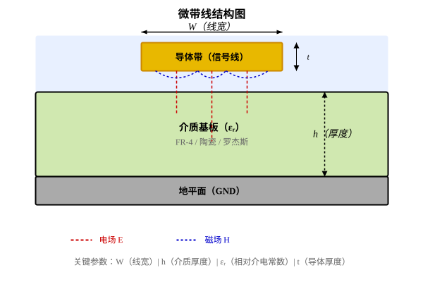
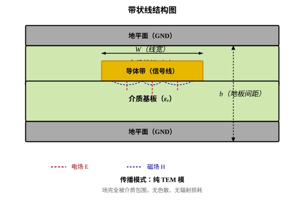

# 7.4 微带线与带状线

## 1. 引言

在射频和微波电路中，信号传输不能使用普通导线，而需要使用传输线结构。微带线（Microstrip）和带状线（Stripline）是 PCB 和微波集成电路中最常用的两种平面传输线。它们各有优缺点，适用于不同的应用场景。

## 2. 微带线（Microstrip）

### 2.1 基本结构

微带线由三层组成：
- **顶层**：宽度为 $W$、厚度为 $t$ 的导体带（信号线）
- **中间层**：厚度为 $h$ 的介质基板，相对介电常数 $\varepsilon_r$
- **底层**：完整的金属地平面

### 2.2 电磁场分布

微带线的电磁场部分在介质中、部分在空气中传播，因此其传播模式不是纯 TEM 模，而是**准 TEM 模**。由于空气和介质中相速度不同，微带线存在色散效应。

### 2.3 有效介电常数 $\varepsilon_{eff}$

由于场分布在介质和空气两种媒质中，引入有效介电常数来描述：

$$\varepsilon_{eff} = \frac{\varepsilon_r + 1}{2} + \frac{\varepsilon_r - 1}{2} \cdot \frac{1}{\sqrt{1 + 12h/W}}$$

相速度：

$$v_p = \frac{c}{\sqrt{\varepsilon_{eff}}}$$

### 2.4 特征阻抗计算

对于窄带微带线（$W/h \leq 1$）：

$$Z_0 = \frac{60}{\sqrt{\varepsilon_{eff}}} \ln\left(\frac{8h}{W} + \frac{W}{4h}\right)$$

对于宽带微带线（$W/h \geq 1$）：

$$Z_0 = \frac{120\pi}{\sqrt{\varepsilon_{eff}} \left[W/h + 1.393 + 0.667 \ln(W/h + 1.444)\right]}$$

### 2.5 微带线设计公式

给定目标特征阻抗 $Z_0$ 和基板参数，计算线宽 $W$：

当 $W/h \leq 2$ 时：

$$\frac{W}{h} = \frac{8e^A}{e^{2A} - 2}$$

当 $W/h > 2$ 时：

$$\frac{W}{h} = \frac{2}{\pi}\left[B - 1 - \ln(2B - 1) + \frac{\varepsilon_r - 1}{2\varepsilon_r}\left(\ln(B - 1) + 0.39 - \frac{0.61}{\varepsilon_r}\right)\right]$$

其中：

$$A = \frac{Z_0}{60}\sqrt{\frac{\varepsilon_r + 1}{2}} + \frac{\varepsilon_r - 1}{\varepsilon_r + 1}\left(0.23 + \frac{0.11}{\varepsilon_r}\right)$$

$$B = \frac{377\pi}{2Z_0\sqrt{\varepsilon_r}}$$

### 2.6 微带线中的色散效应

随着频率升高，有效介电常数随频率变化：

$$\varepsilon_{eff}(f) = \varepsilon_r - \frac{\varepsilon_r - \varepsilon_{eff}(0)}{1 + G \cdot (f/f_p)^2}$$

其中 $f_p = \frac{Z_0}{2\mu_0 h}$，$G$ 为与 $\varepsilon_r$ 和 $Z_0$ 相关的常数。

## 3. 带状线（Stripline）

### 3.1 基本结构

带状线由四层组成：
- **顶层**：完整的地平面
- **中间层**：厚度为 $b$ 的介质基板
- **内层**：宽度为 $W$、厚度为 $t$ 的导体带（信号线），位于介质正中间
- **底层**：完整的地平面

### 3.2 电磁场分布

带状线的电磁场完全被介质包围，传播的是**纯 TEM 模**。这是带状线相比微带线的一个重要优势。

### 3.3 特征阻抗计算

对于窄带带状线（$W/b < 0.35$）：

$$Z_0 = \frac{60}{\sqrt{\varepsilon_r}} \ln\left(\frac{4b}{\pi d}\right)$$

其中 $d$ 为等效圆导体直径：

$$d = \frac{W}{2}\left[1 + \frac{t}{W}\left(1 + \ln\frac{4\pi W}{t} + 0.51\pi\left(\frac{t}{W}\right)^2\right)\right]$$

对于宽带带状线（$W/b \geq 0.35$），Cohn 近似公式：

$$Z_0 = \frac{94.15}{\sqrt{\varepsilon_r}\left(\frac{W/b}{1 - t/b} + \frac{2}{\pi}\ln\left(\frac{1}{1 - t/b} + 1\right)\right)}$$

当 $t \ll b$ 时简化：

$$Z_0 \approx \frac{30\pi}{\sqrt{\varepsilon_r}} \cdot \frac{b}{W + 0.441b}$$

## 4. 微带线与带状线的对比

| 特性 | 微带线 | 带状线 |
|------|--------|--------|
| 层数 | 2 层 | 3 层以上 |
| 传播模式 | 准 TEM | 纯 TEM |
| 色散 | 有 | 无（理论） |
| 辐射损耗 | 有（开放结构） | 极小（封闭结构） |
| 串扰 | 较大 | 较小 |
| 阻抗范围 | 较宽 | 较窄 |
| 加工难度 | 简单 | 复杂（需内层） |
| 成本 | 低 | 高 |
| 可实现的阻抗 | 20–120 Ω | 35–80 Ω |
| 典型应用 | 天线、滤波器 | 多层高速数字 PCB |

## 5. 共面波导（CPW）简介

### 5.1 基本结构

共面波导的信号线和地平面在**同一层**，信号线两侧各有一条接地的导体带，间距为 $s$。

### 5.2 优点

- 信号线和地平面在同一层，便于并联元件安装
- 不需要过孔即可接地
- 色散比微带线小
- 适合毫米波应用

### 5.3 接地共面波导（GCPW）

在 CPW 基础上增加底部地平面，减少辐射损耗，同时保留 CPW 的便利性。

## 6. 微带线不连续性

在实际 PCB 布局中，微带线不可避免会出现不连续结构，这些不连续性会引入寄生参数。

### 6.1 拐角（Bend）

直角拐角会引入额外的电容和电感。常用处理方法：
- **切角（Mitered Bend）**：将直角切掉一部分，补偿寄生电容
- 切角比例通常为 $M \approx 0.57 \times W$（对于 50Ω 微带线）

### 6.2 T 型结（T-Junction）

T 型功率分配器/合路器，在结处会引入不连续性。需要补偿结构来优化匹配。

### 6.3 过孔（Via）

过孔从微带线层过渡到其他层时，引入电感 $L_{via}$ 和电容 $C_{via}$。过孔电感近似公式：

$$L_{via} \approx \frac{\mu_0 h}{2\pi} \left[\ln\left(\frac{4h}{d}\right) + 1\right]$$

其中 $d$ 为过孔直径，$h$ 为板厚。

## 7. 微带线中的损耗

### 7.1 导体损耗

由导体的有限电导率引起，高频下趋肤效应加剧：

$$\alpha_c \approx \frac{R_s}{Z_0 W} \quad \text{(Np/m)}$$

其中 $R_s = \sqrt{\frac{\omega \mu_0}{2\sigma}}$ 为趋肤电阻。

### 7.2 介质损耗

由介质材料的损耗角正切 $\tan\delta$ 引起：

$$\alpha_d = \frac{\pi}{\lambda_0} \cdot \frac{\varepsilon_r}{\sqrt{\varepsilon_{eff}}} \cdot \frac{\varepsilon_{eff} - 1}{\varepsilon_r - 1} \cdot \tan\delta \quad \text{(Np/m)}$$

### 7.3 辐射损耗

微带线的开放结构导致部分能量辐射到空间中，高频时更为显著。带状线几乎没有辐射损耗。

## 8. 小结

1. 微带线是射频 PCB 最常用的传输线，结构简单，但存在辐射损耗和色散
2. 带状线传播纯 TEM 模，无辐射损耗，但需要多层 PCB
3. 特征阻抗由 $W/h$ 比和 $\varepsilon_r$ 决定
4. 有效介电常数 $\varepsilon_{eff}$ 是微带线设计的核心参数
5. 不连续性（拐角、T 型结、过孔）需要仔细处理
6. 共面波导是毫米波应用中的重要选择

## 9. 延伸阅读

本章聚焦于**微波无源电路基础**，从传输线理论、阻抗匹配与 Smith 圆图，到 S 参数和微带线/带状线，为理解高频信号的行为与匹配设计打下了根基。

有源射频电路的完整设计（包括**低噪声放大器 LNA、混频器、功率放大器 PA、频率合成、收发机架构，以及基于 S 参数的系统级设计**）请继续学习**第 16 章 RFIC 设计**（16.1 RFIC设计），从中可以系统掌握这些电路的核心原理与实践方法。

**推荐学习路径**：本章（微波无源基础）→ 第 16 章 RFIC 设计（有源射频电路）→ 结合第 9 章信号完整性与电磁兼容，将高频分析与电路实现融会贯通。