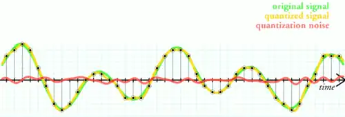

# 20.10 定点实现与量化误差

> **前置知识**：[5.1 数制与编码](../数字电路/5.1-数制与编码.md)（二进制与补码运算）、[20.7 IIR滤波器设计](20.7-IIR滤波器设计.md)、20.6 FIR滤波器设计。本章讨论数字滤波器与算术单元在定点硬件上的数值精度问题。

## 1. 定点数格式（Q 格式）

### 1.1 Q 格式表示

**定点数**用 $Q[m.n]$ 表示范围与精度：$m$ 位整数、$n$ 位小数，共 $m+n+1$ 位（含 1 位符号）。例如 $Q15$ 表示 1 位符号 + 15 位小数。DSP 处理器常用 $Q15$、$Q1.15$ 等纯小数格式，使乘加结果能稳定处于 $(-1,1)$ 区间。

表示范围与最小精度（LSB $= 2^{-n}$）：

$$
\text{范围} = \begin{cases}
[ -2^{m}, \; 2^{m} - 2^{-n} ], & \text{补码} \\[4pt]
[ -2^{m} + 2^{-n}, \; 2^{m} - 2^{-n} ], & \text{无符号定位小数}
\end{cases}, \qquad \text{LSB} = 2^{-n}
$$

定点与浮点的主要对比：

| 特性 | 定点 | 浮点 |
|-----|-----|-----|
| 硬件成本 | 低（逻辑简单） | 高（尾数+指数） |
| 动态范围 | 有限，需定标 | 大，几乎免定标 |
| 精度特性 | 相对精度随幅度变化 | 相对精度近似恒定 |
| 速度/功耗 | 高/低 | 低/高 |
| 典型位宽 | 16/24/32 | 32（float）、64（double） |

### 1.2 定点运算规则

- **加法/减法**：需对齐小数点，结果可能需进位扩展，防止溢出
- **乘法**：Q 格式乘积位数扩展为 $Q[m_1+m_2.\, n_1+n_2]$，需截断/舍入回目标位宽
- **移位加载**：右移丢弃低位产生舍入，左移可能溢出

### 1.3 工作示例：Q15 乘法与定标

以 $Q15$（$1$ 符号位 + $15$ 小数位）为例，两个 $Q15$ 数相乘得到 $Q30$ 的乘积。若直接取高 16 位再右移 15 位，可回到 $Q15$：

$$
Q15 \times Q15 \to Q30 \to \text{右移15位} \to Q15
$$

- **定标（scaling）**：在系数设计阶段按信号范数（如 $L_2$ 范数）预先缩放各级增益，使中间信号峰值保持在 $(-1,1)$ 内
- **动态范围检查**：用 $\max|x[n]| \cdot \sum_k |h[k]|$ 估算最坏峰值，据以决定是否需要在节点处插入移位，防止溢出

这类"按范数缩放 + 定点舍入"的规范化流程，是任何定点 FIR/IIR 落地时的必经步骤。

## 2. 量化噪声与舍入

### 2.1 量化/舍入误差模型

定点运算把乘积截断或舍入到 $B$ 位，引入量化误差 $e[n]$。在宽松条件下（信号充分激励、误差与信号不相关），$e[n]$ 可建模为均匀分布的白噪声：

- **舍入**：均匀分布于 $[-\tfrac{\Delta}{2}, \tfrac{\Delta}{2}]$，零均值，方差 $\dfrac{\Delta^2}{12}$
- **截断**：均匀分布于 $[-\Delta, 0]$，均值 $-\Delta/2$，方差 $\dfrac{\Delta^2}{12}$

每个乘法节点的量化噪声功率：

$$
\sigma_e^2 = \frac{\Delta^2}{12} = \frac{1}{12}\, 2^{-2B}
$$

其中 $\Delta = 2^{-B}$。可见每增加 1 位，量化噪声功率降为 1/4（约 -6 dB/位），与 20.1 的 SQNR 结论一致。

*量化把连续幅度就近映射到离散电平，产生有界量化误差，可建模为均匀分布白噪声。*

### 2.2 总输出噪声

各量化噪声源经滤波器传递函数 $H_i(e^{j\omega})$ 加权到输出，总噪声功率为各噪声贡献之和：

$$
\sigma_y^2 = \sum_i \sigma_{e,i}^2 \cdot \frac{1}{2\pi}\int_{-\pi}^{\pi} |H_i(e^{j\omega})|^2\, d\omega
$$

即总噪声取决于**噪声源数量**与**对应传递函数的噪声增益**（输出端残存能量）。噪声源越多、路径增益越大，输出噪声越大。

## 3. 系数灵敏度

### 3.1 极零点的系数量化

滤波器系数存储位宽有限，量化后极零点位置发生偏移，尤其在高阶、零极点密集聚拢时误差被放大。系数量化敏感度与**结构**密切相关：

- **直接型**对系数灵敏度最差——高阶多项式根对系数扰动敏感（病态条件数大）
- **级联/并联型**把高阶问题化成若干个低阶节，误差只影响局部，灵敏度显著改善（见 [20.7 §3 实现结构](20.7-IIR滤波器设计.md)）

极点位置由特征多项式根的微小扰动决定，条件数大的系统对系数量化更敏感，这也是高阶 IIR 必须采用 SOS 级联的原因。

### 3.2 改善措施

1. 采用二阶节级联，限制单节点聚合的噪声增益
2. 选择合理的系数排序与定点缩放
3. 必要时使用浮点或更高位宽的中间字长

## 4. 极限环

因量化的非线性，IIR 滤波器在零输入时可能产生**持续自振荡**，称为**极限环**，主要包括：

- **过幅极限环**：加法溢出触发的大幅度振荡
- **小数极限环（封装极限环）**：小信号下由舍入引起的小幅度振荡

量化使理想线性系统变成非线性系统，零输入可能落入某个周期轨道形成极限环。设计上常通过增加字宽、采用饱和与强制置零、并合理配置缩放来避免或抑制。

## 5. 溢出处理

### 5.1 溢出类型

- 加法器结果超出动态范围产生**溢出**
- 补码溢出导致大幅**符号翻转**（wrap-around），严重时产生与真实值相差极大的输出

### 5.2 处理策略

1. **饱和（saturation）**：溢出时把结果钳位到最大/最小值，避免符号翻转
2. **合理定标（scaling）**：设计时按 L2/L1 范数缩放各级系数与中间信号，使其驻留于动态范围内
3. **尾位保护位**：提高内部字宽、采用宽累加器，降低截断与溢出的统计影响（见 [20.11 §MAC](20.11-DSP硬件结构.md)）

## 6. 工程 / 典型应用

- **DSP 芯片上的定点 FIR/IIR 库**：如 TIC54xx Q15 库、ARM CMSIS-DSP q31/q15 版本
- **数字控制 / 电源环路**：定点 PID 在 MCU 上的系数标定与缩放
- **音频编解码器**：用 24/32 位定点在音质与成本间权衡
- **软错误与鲁棒性分析**：在 [20.11 DSP硬件结构](20.11-DSP硬件结构.md) 的定点 MAC 单元中采用饱和与宽累加器

## 小结

- Q 格式用固定整数/小数位宽表示数，动态范围有限、需正确定标
- 量化/舍入噪声可建模为均匀分布白噪声，功率随位宽按 -6 dB/位下降
- 总输出噪声是各噪声源经传递函数增益后的加权和
- 直接型对系数量化最敏感，级联型显著改善稳定性与灵敏度
- 溢出用饱和与缩放处理，IIR 的极限环需用加宽、置零等措施抑制