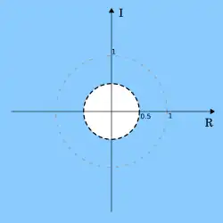
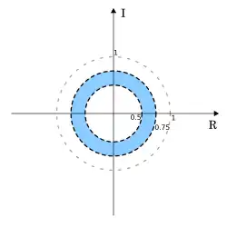

# 20.3 Z变换

> **前置知识**：[3.9 拉普拉斯变换在电路中的应用](../电路原理/3.9-拉普拉斯变换在电路中的应用.md)（Z 变换是拉氏变换在离散域的对应）、[20.2 离散时间信号与系统](20.2-离散时间信号与系统.md)。本章建立 Z 变换理论，用于求解差分方程、分析系统函数与稳定性。

## 1. Z 变换的定义与收敛域

### 1.1 定义

序列 $x[n]$ 的（双边）Z 变换定义为

$$
X(z) = \mathcal{Z}\{x[n]\} = \sum_{n=-\infty}^{\infty} x[n]\, z^{-n}, \qquad z \in \text{ROC}
$$

其中 $z$ 是复变量。**单边 Z 变换**只对 $n \ge 0$ 求和：

$$
X(z) = \sum_{n=0}^{\infty} x[n]\, z^{-n}
$$

单边形式用于处理因果序列与初始条件问题，是求解差分方程（类似拉氏变换处理微分方程初始条件）的主要工具。Z 变换与拉氏变换的关系是：对采样序列 $x[n]=x_c(nT_s)$，令 $z = e^{sT_s}$ 即可将拉氏变换过渡到 Z 变换，因此 $z = e^{sT_s}$ 是两者之间最核心的桥梁。

### 1.2 收敛域（ROC）

使级数收敛的 $z$ 之集合称为**收敛域（ROC）**，一般为 $z$ 平面上以原点为圆心的圆环。不同方向的序列对应不同形状的 ROC：

| 序列类型 | ROC 形状 |
|---------|---------|
| 有限长序列 | 整个平面（除 $z=0$ 和 $z=\infty$ 可能除外） |
| 右边序列 | 某圆外：$\|z\| > R$ |
| 左边序列 | 某圆内：$\|z\| < R$ |
| 双边序列 | 圆环：$R_1 < \|z\| < R_2$ |

ROC 一定不包含任何极点。**ROC 是逆变换唯一性的决定因素——同一表达式 $X(z)$ 配上不同 ROC 对应不同的序列**。例如 $1/(1-z^{-1})$ 在 $\|z\|>1$ 时对应 $u[n]$，在 $\|z\|<1$ 时对应 $-u[-n-1]$。

*因果（右边）序列的收敛域为某圆外部 $|z|>R$，图中蓝色区域即 ROC。*

*双边序列的收敛域为圆环 $R_1<|z|<R_2$，该环内不含任何极点。*

### 1.3 常见 Z 变换对

| 时域 $x[n]$ | Z 变换 $X(z)$ | 收敛域 |
|------------|--------------|-------|
| $\delta[n]$ | $1$ | 整个平面 |
| $u[n]$ | $\dfrac{1}{1 - z^{-1}}$ | $\|z\| > 1$ |
| $-u[-n-1]$ | $\dfrac{1}{1 - z^{-1}}$ | $\|z\| < 1$ |
| $a^n u[n]$ | $\dfrac{1}{1 - a z^{-1}}$ | $\|z\| > \|a\|$ |
| $n a^n u[n]$ | $\dfrac{a z^{-1}}{(1 - a z^{-1})^2}$ | $\|z\| > \|a\|$ |
| $\cos(\omega_0 n)u[n]$ | $\dfrac{1 - z^{-1}\cos\omega_0}{1 - 2z^{-1}\cos\omega_0 + z^{-2}}$ | $\|z\| > 1$ |
| $\sin(\omega_0 n)u[n]$ | $\dfrac{z^{-1}\sin\omega_0}{1 - 2z^{-1}\cos\omega_0 + z^{-2}}$ | $\|z\| > 1$ |

## 2. Z 变换的性质

### 2.1 性质表

| 性质 | 时域 | Z 变换 |
|-----|------|-------|
| 线性 | $ax_1[n] + bx_2[n]$ | $aX_1(z) + bX_2(z)$ |
| 时移 | $x[n-k]$ | $z^{-k}X(z)$ |
| 尺度 | $a^n x[n]$ | $X(z/a)$ |
| 翻转 | $x[-n]$ | $X(1/z)$ |
| 卷积定理 | $x_1[n] * x_2[n]$ | $X_1(z)X_2(z)$ |
| 时域微分 | $nx[n]$ | $-z\,\dfrac{dX(z)}{dz}$ |
| 初值定理 | $x[0]$ | $\lim_{z\to\infty} X(z)$ |

### 2.2 卷积定理的核心地位

利用卷积定理，时域卷积化为 Z 域乘积：

$$
y[n] = x[n]*h[n] \iff Y(z) = X(z)H(z)
$$

这极大地简化了系统分析：求一个 LTI 系统的响应，可先取 Z 变换做代数乘法，再逆变换。这正是"拉氏变换使微分方程变代数方程"思想在离散域的推广。

## 3. 逆 Z 变换

### 3.1 围线积分公式

逆 Z 变换的理论公式为

$$
x[n] = \frac{1}{2\pi j} \oint_C X(z)\, z^{n-1}\, dz
$$

其中 $C$ 是位于 ROC 内的逆时针闭合围线。该式理论严谨但工程上极少直接计算，实际常用**幂级数法与部分分式法**。

### 3.2 幂级数法（长除法）

将 $X(z)$ 按幂级数展开：

$$
X(z) = \dots + x[-1]z + x[0] + x[1]z^{-1} + x[2]z^{-2} + \dots
$$

$z^{-n}$ 的系数即 $x[n]$。当 ROC 为外部（右边序列）时用降幂长除，为内部（左边序列）时用升幂长除。此法简单但对大 $n$ 难以直接看出闭式。

### 3.3 部分分式法

1. 将 $X(z)$ 展为有理分式，必要时先除以 $z$，将 $\tfrac{X(z)}{z}$ 展开为部分分式
2. 依据 ROC 判断各项对应右边序列（$\|z\| > R$）还是左边序列（$\|z\| < R$）
3. 查基本变换表得各分式的时域项并求和

**工作示例**：求 $X(z) = \dfrac{z}{(z-1)(z-2)}$（ROC：$\|z\|>2$）的逆变换。先做部分分式：

$$
\frac{X(z)}{z} = \frac{1}{(z-1)(z-2)} = \frac{-1}{z-1} + \frac{1}{z-2}
$$

即 $X(z) = \dfrac{-1}{1-z^{-1}} + \dfrac{1}{1-2z^{-1}}$。因 ROC 为 $\|z\|>2$，两项都取右边序列，查表得：

$$
x[n] = -u[n] + 2^n u[n] = (2^n - 1)\, u[n]
$$

本例展示了"先除 $z$、再展开、按 ROC 定左右、查表求和"的完整流程。

## 4. 系统函数 $H(z)$

LTI 系统的**系统函数**定义为冲激响应的 Z 变换：

$$
H(z) = \frac{Y(z)}{X(z)} = \frac{\sum_{k=0}^{M} b_k z^{-k}}{\sum_{k=0}^{N} a_k z^{-k}}
$$

它是差分方程在 Z 域的直接表示：分子、分母系数正是差分方程的 $b_k$、$a_k$。系统输出满足

$$
Y(z) = H(z) X(z)
$$

频率响应等于 $H(z)$ 在单位圆上的取值：

$$
H(e^{j\omega}) = H(z)\big|_{z = e^{j\omega}}
$$

这与连续系统"$H(j\omega) = H(s)|_{s=j\omega}$"完全平行（见 [3.9 拉普拉斯变换在电路中的应用](../电路原理/3.9-拉普拉斯变换在电路中的应用.md)）。

## 5. 极零点与稳定性

### 5.1 极零点

分母为零的点称**极点**，分子为零的点称**零点**。设零点为 $z_i$、极点为 $p_k$，系统函数可因子化为

$$
H(z) = A \frac{\prod_{i=1}^{M}(1 - z_i z^{-1})}{\prod_{k=1}^{N}(1 - p_k z^{-1})}
$$

根轨迹图（零极点图）直观刻画了系统的时域行为：极点在复平面上的位置决定响应的衰减趋势与振荡频率。

### 5.2 稳定性判据

因果 LTI 系统稳定的充要条件是冲激响应绝对可和，等价于系统函数的**全部极点位于单位圆内**：

$$
|p_k| < 1, \quad k = 1, 2, \ldots, N
$$

- 极点在单位圆内：响应指数衰减，稳定
- 极点落在单位圆上：临界稳定，产生持续振荡
- 极点落在单位圆外：响应发散，不稳定

且系统的 ROC 必须包含单位圆，否则频率响应 $H(e^{j\omega})$ 不存在。这一判据是 IIR 滤波器设计时必须守住的底线（见 [20.7 IIR滤波器设计](20.7-IIR滤波器设计.md)）。

## 6. 工程 / 典型应用

- **求解差分方程**：将差分方程取 Z 变换化为代数方程，求 $Y(z)$ 后再反变换，可统一处理初始条件与稳态响应
- **频率响应分析**：$H(e^{j\omega})$ 即 $H(z)$ 在单位圆上的取值，是数字滤波器幅频/相频特性分析的起点
- **稳定性检查**：设计 IIR 滤波器时必须保证极点在单位圆内
- **逆滤波 / 反卷积**：$H_{inv}(z) = 1/H(z)$ 用于均衡通道失真，需保证零点在单位圆内（否则逆系统不稳定）

## 小结

- Z 变换是拉氏变换在离散域的对应，$z = e^{sT_s}$ 是连接两者的桥梁
- 收敛域 ROC 决定逆变换唯一性，不同 ROC 对应不同序列
- 卷积定理使时域卷积化为 Z 域乘积，极大简化 LTI 系统分析
- $H(z)$ 由差分方程系数直接读出，频率响应为 $H(e^{j\omega})$
- 因果系统稳定的充要条件是全部极点位于单位圆内