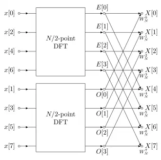
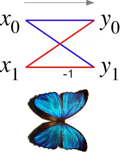

# 20.5 快速傅里叶变换（FFT）

> **前置知识**：[20.4 离散傅里叶变换](20.4-离散傅里叶变换.md)（FFT 是 DFT 的高效算法）、[20.2 离散时间信号与系统](20.2-离散时间信号与系统.md)。本章介绍最常用的基-2 FFT 算法及其工程应用。

## 1. DFT 的计算复杂度

直接计算 $N$ 点 DFT：

$$
X[k] = \sum_{n=0}^{N-1} x[n]\, W_N^{kn}
$$

对每个 $k$ 需要 $N$ 次复数乘法、$(N-1)$ 次复数加法，共有 $N$ 个 $k$，因此直接计算需要 $O(N^2)$ 次复数乘加。当 $N$ 很大（如 $N=10^6$）时，$N^2 = 10^{12}$ 次运算在实时系统中完全不可承受。DFT 矩阵是满秩稠密矩阵，naive 计算的代价高昂，正是 FFT 要攻克的瓶颈。

## 2. 基-2 蝶形算法

### 2.1 按时间抽取（DIT）分治

FFT 的关键是充分利用旋转因子的**对称性** $W_N^{k+N/2} = -W_N^k$ 与**周期性** $W_N^{k+N}=W_N^k$，把 $N$ 点 DFT 递归分解成两个 $N/2$ 点 DFT。假设 $N$ 为 2 的幂，把偶数下标与奇数下标分开：

$$
\begin{aligned}
X[k] &= X_{even}[k] + W_N^k\, X_{odd}[k], \qquad k = 0, \ldots, \tfrac{N}{2}-1 \\
X[k+\tfrac{N}{2}] &= X_{even}[k] - W_N^k\, X_{odd}[k]
\end{aligned}
$$

其中 $X_{even}[k]$、$X_{odd}[k]$ 分别是偶数下标与奇数下标序列的 $N/2$ 点 DFT。这两式构成一个**蝶形运算单元**：

$$
\begin{aligned}
A &= P + W\, Q \\
B &= P - W\, Q
\end{aligned}
$$

其中 $P = X_{even}[k]$、$Q = X_{odd}[k]$。每个蝶形只做 1 次复数乘法与 2 次复数加法。

### 2.2 递归分解与复杂度

若 $N$ 为 2 的幂，可不断二分直到 2 点 DFT（一个蝶形），总共 $\log_2 N$ 级蝶形，每级有 $N/2$ 个蝶形。总计算量：

$$
\frac{N}{2}\log_2 N \ \text{次复数乘法}, \qquad N\log_2 N \ \text{次复数加法}
$$

即总体复杂度为 $O(N\log N)$，相比 $O(N^2)$ 有数量级优势。例如 $N=1024$：直接 $10^6$ 次乘，FFT 仅 $5120$ 次，快约两个数量级。

*基-2 按时间抽取（DIT）FFT 将 $N$ 点 DFT 递归分解为两个 $N/2$ 点 DFT 的蝶形结构，共 $\log_2 N$ 级。*

### 2.3 实际实现要点

1. 输入需**位反转（bit-reversal）**重排，或采用等效的转置计算顺序
2. 采用**原位（in-place）**计算，输出写回输入存储位置，节省存储
3. 旋转因子 $W_N^k$ 可预计算并查表
4. 递归或迭代实现均可，蝶形图是最直观的算法表示

*单个蝶形单元的信号流图：$A=P+WQ$、$B=P-WQ$，仅含有 1 次复乘与 2 次复加。*

### 2.4 计算复杂度的定量对比

以复数乘法次数衡量，直接 DFT 与基-2 FFT 的对比为：

$$
\text{DFT: } N^2, \qquad \text{FFT: } \frac{N}{2}\log_2 N
$$

| $N$ | 直接 DFT | 基-2 FFT | 加速比 |
|----|---------|---------|-------|
| 16 | 256 | 32 | 8 倍 |
| 256 | 65536 | 1024 | 64 倍 |
| 1024 | 1.05 M | 5120 | 205 倍 |
| 4096 | 16.8 M | 24576 | 682 倍 |

可见点数越大，FFT 的相对优势越显著，这也是长数据频谱分析与大卷积依赖 FFT 的根本原因。

## 3. 按频率抽取（DIF）

若先对输出 $X[k]$ 按奇偶拆分而非对输入拆分，得到**按频率抽取（DIF）**算法。与 DIT 相比：

- DIF 输入顺序、输出位反转；DIT 输入位反转、输出顺序——两者恰好互补
- 两者计算量与蝶形单元相同，仅数据流向不同
- 常组合用于流水化硬件实现，以减少重排开销

## 4. 实数输入时的 FFT

现实信号几乎都是实数，对此可进一步优化：

- **共轭对称性**：实序列的 DFT 满足 $X[N-k] = X^*[k]$，只需计算一半频率点
- **双实合一**：将两个实序列分别放入复数 FFT 的实部与虚部，一次 $N$ 点复数 FFT 同时算出两个前向变换
- **2N 合一**：用 $N$ 点复数 FFT 一次计算 $2N$ 点实数信号的前 $N$ 点频谱

由此乘法量可再减少约一半，是嵌入式实时实现中的常见手段。

## 5. 其他基与变体

除基-2 外，工程上还有多种变体：

- **基-4 / 基-8**：单个蝶形处理 4 或 8 点，减少旋转因子乘法次数，适合硬件流水
- **分裂基（split-radix）**：在偶频点用基-2、奇频点用基-4，进一步减少乘量，是软件实现中乘法数最少的常规选择之一
- **混合基（mixed-radix）**：$N$ 非 2 的幂时按素因子分解，灵活处理任意长度
- **频谱剪枝（pruning）**：只关心部分输出频谱时，跳过无关输入/输出节点，减少无效蝶形
- **补零到 2 的幂**：输入长度非 2 的幂时补零至附近 2 的幂，以复用优化良好的基-2 内核

## 6. FFT 的工程应用

### 6.1 频谱分析

对数据加窗后做 $N$ 点 FFT，得到幅值谱、相位谱、功率谱，用于信号诊断与测量。窗的选择影响泄漏与分辨率（见 [20.4 §4 窗函数](20.4-离散傅里叶变换.md)），谱估计的统计特性见 [20.9 谱估计与随机信号](20.9-谱估计与随机信号.md)。

### 6.2 快速卷积（滤波加速）

时域线性卷积需要 $O(LM)$ 次乘，改用 FFT 后：

$$
y[n] = \text{IFFT}\left[ \text{FFT}(x) \cdot \text{FFT}(h) \right]
$$

要点：

- 补零至 $N \ge L + M - 1$ 使圆周卷积等价于线性卷积（见 [20.4 §3](20.4-离散傅里叶变换.md)）
- 长数据流用**重叠相加（overlap-add）**或**重叠保留（overlap-save）**分段处理
- 复杂度降为 $O(N\log N)$，在大核长滤波中提速显著

### 6.3 其他应用

- 频域滤波器设计、图像处理中的 2D FFT
- 频域均衡器、OFDM 调制解调的 IFFT/FFT 基带实现
- 单位根插值用于多项式乘法加速（大数乘法、卷积加速）

## 7. 工程 / 典型应用

- **DSP 芯片与 FPGA 加速**：硬件 FFT 核（如 Xilinx FFT IP）流水化实现蝶形单元
- **雷达 / 声呐波束形成与匹配滤波**：用 FFT 加速相关运算
- **频谱仪 / 示波器 FFT 模式**：实时 MS/s 级频谱显示
- **5G/无线通信 OFDM**：IFFT/FFT 是物理层核心，见 [20.11 DSP硬件结构](20.11-DSP硬件结构.md)

## 小结

- 直接 DFT 是 $O(N^2)$，FFT 通过分治把复杂度降至 $O(N\log N)$
- 基-2 蝶形有 DIT 与 DIF 两种数据流向，均由旋转因子对称性导出
- 实数输入可利用共轭对称性与打包技巧再减半乘量
- FFT 用于频谱分析、快速卷积、OFDM 与图像处理等众多领域