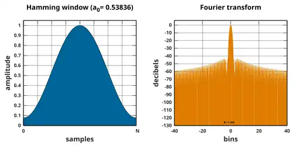
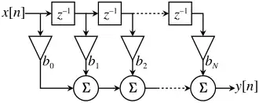

# 20.6 FIR滤波器设计

> **前置知识**：[20.4 离散傅里叶变换](20.4-离散傅里叶变换.md)（窗函数与频域设计）、[20.2 离散时间信号与系统](20.2-离散时间信号与系统.md)。本章介绍有限冲激响应（FIR）滤波器的特性与设计方法，FIR 滤波器稳定、可实现线性相位图示、无反馈累积误差。

## 1. FIR 滤波器与线性相位特性

### 1.1 FIR 定义

**有限冲激响应（FIR）滤波器**的冲激响应 $h[n]$ 只有有限个非零样本。对长度为 $M$（阶数 $M-1$）的 FIR：

$$
y[n] = \sum_{k=0}^{M-1} h[k]\, x[n-k]
$$

其系统函数只含零点、无反馈极点：

$$
H(z) = \sum_{k=0}^{M-1} h[k]\, z^{-k}
$$

因为所有极点都位于原点（$z=0$，在单位圆内），FIR 系统**必然稳定**。这是 FIR 相对 IIR 的一大优势——无需担心极点越出单位圆导致发散。

### 1.2 线性相位条件

若 $h[n]$ 满足对称或反对称条件，FIR 滤波器可具有**严格线性相位**，即相频响应是 $\omega$ 的线性函数，群延迟为常数：

$$
\angle H(e^{j\omega}) = -\alpha\,\omega, \qquad \alpha = \frac{M-1}{2}
$$

四种典型线性相位类型：

| 类型 | 对称性 | 长度 $M$ | 频率响应特点 |
|-----|-------|---------|------------|
| I | 偶对称 | 奇数 | 适合所有类型（含高通） |
| II | 偶对称 | 偶数 | 低频响应在 $z=-1$ 处为零，不适合作高通 |
| III | 奇对称 | 奇数 | 90° 相移，适合微分器、Hilbert 变换 |
| IV | 奇对称 | 偶数 | 90° 相移，适合 Hilbert、微分器 |

线性相位的优势在于**各频率分量延迟一致，波形不产生相位失真**，这对通信、音频保真意义重大。线性相位 FIR 的群延迟恒为 $(M-1)/2$ 个样本。

## 2. 窗函数设计法

### 2.1 基本原理

以理想低通（频域矩形）为设计目标，其冲激响应无限长、以 $\alpha$ 为中心对称：

$$
h_{id}[n] = \frac{\omega_c}{\pi}\, \text{sinc}\!\left(\frac{\omega_c(n - \alpha)}{\pi}\right), \qquad \alpha = \frac{M-1}{2}
$$

用长度为 $M$ 的窗函数截断并保持对称性：

$$
h[n] = w[n] \cdot h_{id}[n]
$$

频域上，所求 $H(e^{j\omega})$ 是理想低通与窗谱 $W(e^{j\omega})$ 的卷积，因此窗函数的主瓣宽度决定过渡带宽度、旁瓣水平决定阻带衰减。

### 2.2 设计步骤

1. 由阻带衰减选定窗类型（见 [20.4 §4 窗函数](20.4-离散傅里叶变换.md)）
2. 由过渡带宽度确定窗长，常用的近似为

$$
M \approx \frac{A}{\Delta\omega}
$$

其中 $A$ 是与窗类型相关的常数（如汉明窗约 $6.6$ 但需结合频谱验证）
3. 生成理想冲激响应并按中心对称移位
4. 加窗得到 $h[n]$，验证频响是否满足通带/阻带指标

由于频域卷积，实际阻带衰减受窗函数旁瓣限制，无法通过加大阻带要求任意降低——只能通过换用低旁瓣窗或增大长度来改善。

### 2.3 常用窗对比

| 窗函数 | 阻带衰减（dB） | 过渡带宽度 | 特点 |
|-------|--------------|-----------|-----|
| 矩形 | -21 | $0.9\pi/M$ | 窄过渡带但旁瓣大 |
| 汉宁 | -44 | $3.1\pi/M$ | 平缓过渡 |
| 汉明 | -53 | $3.3\pi/M$ | 常用折衷 |
| 布莱克曼 | -74 | $5.5\pi/M$ | 低旁瓣、宽过渡带 |

### 2.4 设计示例

设计一个截止频率 $\omega_c = 0.4\pi$、阻带衰减不少于 53 dB 的线性相位低通 FIR：

1. **选窗**：阻带 53 dB 需用汉明窗（主瓣宽度 $8\pi/N$）
2. **定阶**：由过渡带宽度 $\Delta\omega = 0.1\pi$，取 $M \approx 8\pi/(0.1\pi) = 80$（再取略大于到手最佳线性相位长度）
3. **生成理想冲激响应**：以 $\alpha = (M-1)/2$ 为中心的 sinc 采样并加汉明窗
4. **验证**：计算 $|H(e^{j\omega})|$ 检查阻带衰减与通带纹波是否达指标

若阻带要求提高（如 60 dB 以上），则改用布莱克曼窗并相应增大 $M$。由此可体验"窗类型决定旁瓣下限、窗长决定过渡带宽度"的设计权衡。

*汉明窗以略宽的主瓣换取约 -53 dB 的阻带衰减，是窗函数设计法中常用的折衷窗。*

## 3. 频率采样设计法

在频域对理想频率响应 $H_d(e^{j\omega})$ 在 $N$ 个等间隔点采样得 $H[k]$，再取 IDFT：

$$
h[n] = \frac{1}{N} \sum_{k=0}^{N-1} H[k]\, W_N^{-kn}
$$

特点：

- 设计过程直观，任意形状的频响（如多带、任意增益）均可实现
- 在采样点上频率严格精确匹配，但频点之间由内插（sinc 插值）近似，误差较大
- 通常配合**过渡带优化点**，把滤波器通阻带交界处的若干频点设为自由变量，用线性规划/迭代改善中间频段误差

## 4. 等纹波优化（Parks-McClellan）

利用**切比雪夫逼近**与**交替定理**，可以把频响逼近误差（通带最大偏差 $\delta_p$、阻带最大偏差 $\delta_s$）在通带、阻带内**等纹波地最小化**，即在切比雪夫意义（最小最大误差）上最优。实现常用 **Remez 交换算法**迭代求解。

相较窗函数设计法，相同阶数下等纹波法能达到更紧凑的过渡带或更小的最大误差，是工程上最常用的 FIR 设计方法（工具：MATLAB `firpm`、Python `scipy.signal.remez`）。指标由 $\delta_p$、$\delta_s$ 及通阻带边界频率共同确定，阶数可由经验公式（如 Kaiser 近似）估计后迭代调整。

## 5. 实现结构

### 5.1 直接型（直接 I 型 / 横截型）

$$
y[n] = \sum_{k=0}^{M-1} h[k]\, x[n-k]
$$

由 $M-1$ 级延迟链和 $M$ 个乘法器组成，是最常见的 FIR 直接实现。线性相位 FIR 的系数存在对称性，可把与对称系数对应的支路合并，使乘法器数量约减半。

*直接（横截）型 FIR 由 $N$ 级延迟链与 $N+1$ 个乘法器组成，系数对称时可合并对称支路。*

### 5.2 转置型（直接 II 型转置）

利用线性卷积的交换性质，把数据流方向反转得到转置结构：

- 输入直接进入多个乘法器，输出在各支路累加
- 每条加法链的关键路径只有一次加法、一次乘法，便于流水线化
- 常作为 FPGA/ASIC 高速 FIR 的首选结构，降低加法器关键路径延迟

### 5.3 多相实现

结合**多相分解**可高效实现插值/抽取滤波器（见 [20.8 多速率信号处理](20.8-多速率信号处理.md)），只对有效样本做滤波，大幅降低计算量。

## 6. FIR 与 IIR 对比

| 特性 | FIR | IIR |
|-----|-----|-----|
| 稳定性 | 必然稳定（全零点） | 需保证极点在单位圆内 |
| 线性相位 | 容易实现（系数对称） | 一般需高阶近似 |
| 阶数/计算量 | 较高 | 较低（同级频响） |
| 与模拟原型的关系 | 无 | 有（巴特沃斯等） |
| 量化灵敏度 | 较好 | 直接型较差（需级联） |

## 7. 工程 / 典型应用

- **音频均衡与降采样**：线性相位保证音质无相位失真，广泛用于音频带滤波
- **同相/正交（I/Q）解调滤波**：要求严格线性相位以保持星座图质量
- **转置直接型在 FPGA/ASIC 中高速 FIR 实现**：流水化 MAC 阵列
- **MATLAB `fir1`/`firpm`、Python `scipy.signal` 设计工具**：可直接用于快速实现与验证

## 小结

- FIR 冲激响应有限长、全极点在原点，系统必然稳定
- 系数对称可实现严格线性相位，群延迟恒为 $(M-1)/2$
- 窗函数设计法直观但阻带受窗旁瓣限制；频率采样法任意频响可设计但中间误差大
- 等纹波（Parks-McClellan）法在切比雪夫意义下最优，是工程首选
- 转置型与多相结构是 FIR 高效硬件实现的常用途径