# 5.4 组合逻辑电路

## 1. 组合逻辑电路分析方法

组合逻辑电路的特点是输出仅取决于当前输入，与电路的历史状态无关（无记忆功能）。

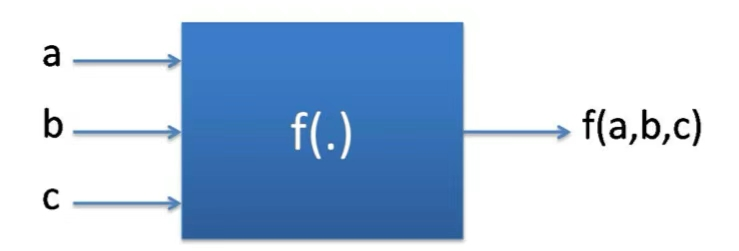

**分析步骤**：
1. 根据逻辑图写出各输出端的逻辑表达式
2. 化简逻辑表达式
3. 列出真值表
4. 分析逻辑功能

**示例**：分析一个由三个与非门构成的电路。

$$Y = \overline{\overline{AB} \cdot \overline{CD}} = AB + CD$$

由此可知，该电路实现的是"与或"功能。

## 2. 组合逻辑电路设计方法

**设计步骤**：
1. 分析逻辑功能要求，确定输入输出变量
2. 列出真值表
3. 写出逻辑表达式并化简
4. 根据化简结果画逻辑图
5. 验证设计

## 3. 加法器

### 3.1 半加器（Half Adder）

半加器实现两个 1 位二进制数的加法，不考虑来自低位的进位。

**真值表**：

| A | B | S（和） | C（进位） |
|---|---|---------|----------|
| 0 | 0 | 0 | 0 |
| 0 | 1 | 1 | 0 |
| 1 | 0 | 1 | 0 |
| 1 | 1 | 0 | 1 |

**逻辑表达式**：
$$S = A \oplus B$$
$$C = A \cdot B$$

**电路结构**：由一个异或门（产生和）和一个与门（产生进位）组成。

**使用通用门实现**：可以只用与非门或或非门等通用门电路实现半加器。

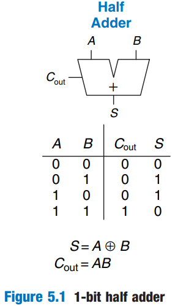

### 3.2 全加器（Full Adder）

全加器实现两个 1 位二进制数及来自低位的进位相加。

**真值表**：

| A | B | $C_{i-1}$ | S | $C_i$ |
|---|---|-----------|--|-------|
| 0 | 0 | 0 | 0 | 0 |
| 0 | 0 | 1 | 1 | 0 |
| 0 | 1 | 0 | 1 | 0 |
| 0 | 1 | 1 | 0 | 1 |
| 1 | 0 | 0 | 1 | 0 |
| 1 | 0 | 1 | 0 | 1 |
| 1 | 1 | 0 | 0 | 1 |
| 1 | 1 | 1 | 1 | 1 |

**逻辑表达式**：
$$S = A \oplus B \oplus C_{i-1}$$
$$C_i = AB + (A \oplus B)C_{i-1} = AB + BC_{i-1} + AC_{i-1}$$

**电路结构**：可以由两个半加器和一个或门组成：第一个半加器计算 A、B 的和，第二个半加器将该和与进位输入相加，最后或门将两个半加器的进位合并。

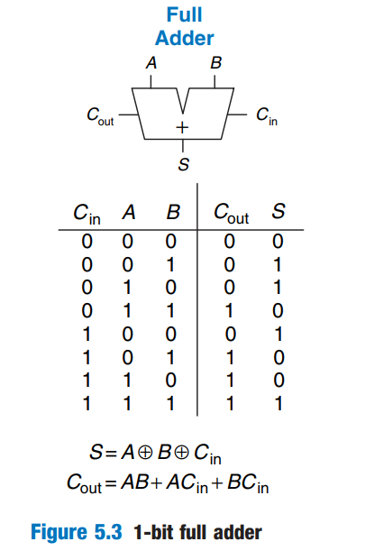

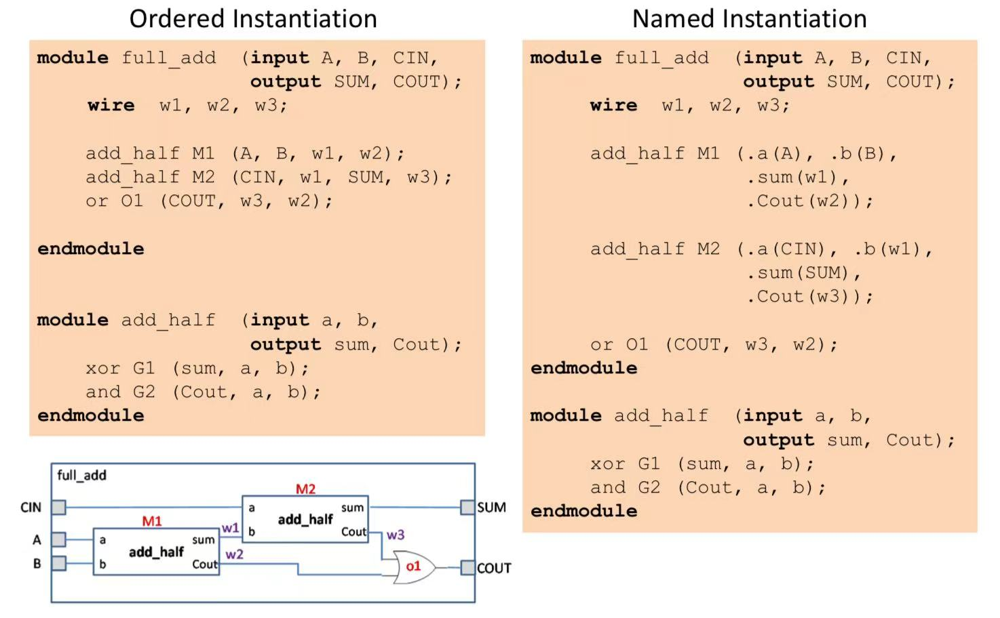

### 3.3 半减器（Half Subtractor）

半减器实现两个 1 位二进制数的减法，不考虑来自低位的借位。

**真值表**：

| A（被减数） | B（减数） | D（差） | Bout（借位） |
|---|---|---|---|
| 0 | 0 | 0 | 0 |
| 0 | 1 | 1 | 1 |
| 1 | 0 | 1 | 0 |
| 1 | 1 | 0 | 0 |

**逻辑表达式**：
$$D = A \oplus B$$
$$Bout = \overline{A} \cdot B$$

### 3.4 全减器（Full Subtractor）

全减器实现两个 1 位二进制数及来自低位的借位相减。

**真值表**：

| A | B | $B_{in}$ | D | $B_{out}$ |
|---|---|---------|---|----------|
| 0 | 0 | 0 | 0 | 0 |
| 0 | 0 | 1 | 1 | 1 |
| 0 | 1 | 0 | 1 | 1 |
| 0 | 1 | 1 | 0 | 1 |
| 1 | 0 | 0 | 1 | 0 |
| 1 | 0 | 1 | 0 | 0 |
| 1 | 1 | 0 | 0 | 0 |
| 1 | 1 | 1 | 1 | 1 |

**逻辑表达式**：
$$D = A \oplus B \oplus B_{in}$$
$$Bout = \overline{A} \cdot B + \overline{A} \cdot B_{in} + B \cdot B_{in}$$

### 3.5 行波进位加法器（Ripple Carry Adder）

n 位行波进位加法器由 n 个全加器级联组成，每级的进位输出作为下一级的进位输入。

**特点**：
- 结构简单，易于实现
- 进位信号逐级传递，延迟较大，延迟与位数成正比
- 最低位的进位输入通常接地

**4 位行波进位加法器**：
- 全加器 0 处理最低位，进位输入 Cin=0
- 进位输出 Cout0 连到下一级 Cin1
- 最终结果由 S3S2S1S0 和 Cout 组成

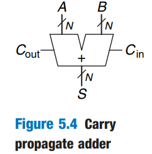

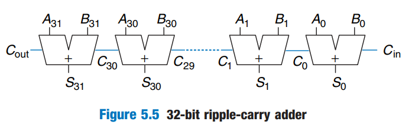

### 3.6 并行加法器与减法器

**n 位并行加法器**：使用 n 个全加器实现 n 位二进制数的加法。

**n 位并行减法器**：利用补码将减法转换为加法：$A - B = A + (-B)_{补}$

**补码计算**：对于 n 位二进制数：
- $(-B)_{补} = \overline{B} + 1$（取反加 1）

**4 位并行减法器**：
- 将减数 B 的每一位取反
- 最低位的进位输入设为 1（实现加 1）
- 使用加法器进行运算
- 结果：$S = A + \overline{B} + 1$
- 若 A > B，Cout=0，结果正确
- 若 A < B，Cout=1，结果为补码形式

**加法/减法器**：可以使用控制信号切换加法或减法模式，通过异或门控制是否取反。

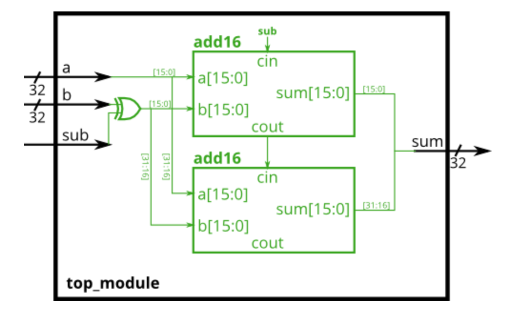

**有符号加法**：二进制补码表示下的有符号数加法运算。

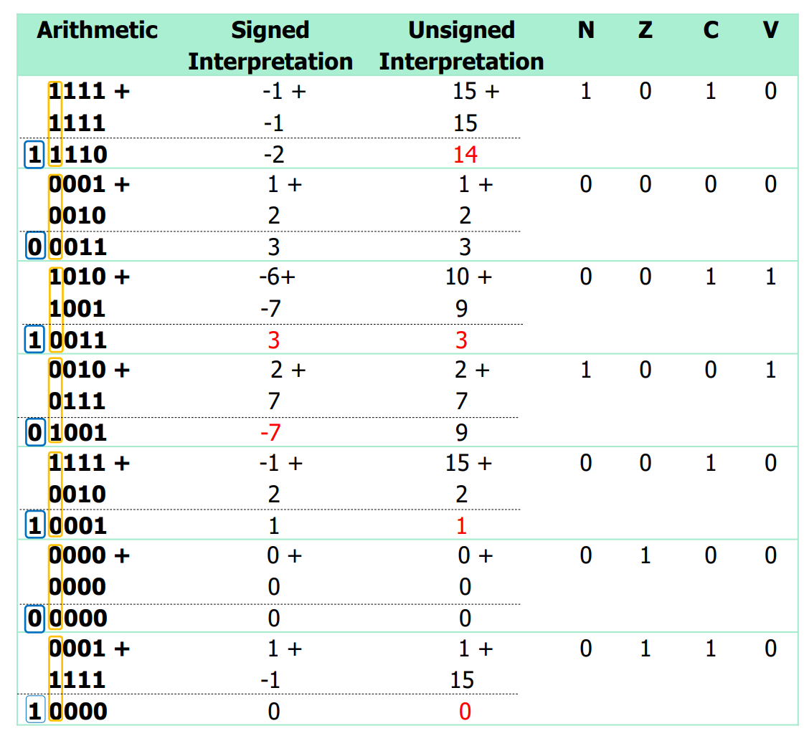

**有符号减法**：二进制补码表示下的有符号数减法运算。

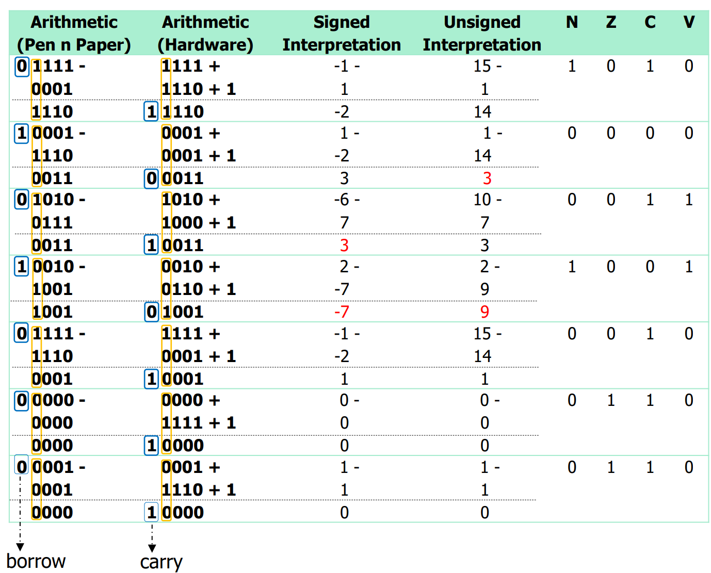

**n 位减法器**：利用补码将减法转换为加法的 n 位减法器结构。

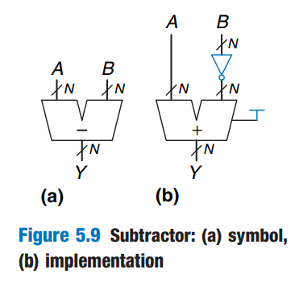

### 3.7 超前进位加法器（Carry Lookahead Adder）

传统行波进位加法器中，进位信号逐级传递，延迟较大。超前进位加法器通过并行计算进位信号来提高速度。

**进位生成函数**：$G_i = A_i \cdot B_i$（若 A_i 和 B_i 均为 1，则必须产生进位）
**进位传递函数**：$P_i = A_i \oplus B_i$（若 A_i 和 B_i 中有一个为 1，则传递进位）

**进位公式**：
$$C_i = G_i + P_i \cdot C_{i-1}$$

展开后：
$$C_0 = G_0 + P_0 \cdot C_{-1}$$
$$C_1 = G_1 + P_1 \cdot G_0 + P_1 \cdot P_0 \cdot C_{-1}$$
$$C_2 = G_2 + P_2 \cdot G_1 + P_2 \cdot P_1 \cdot G_0 + P_2 \cdot P_1 \cdot P_0 \cdot C_{-1}$$
$$\vdots$$

**特点**：
- 所有进位信号可同时计算，延迟与位数无关
- 实际中受扇入限制，通常 4 位为一组
- 标准芯片：7483/74283（4 位超前进位加法器）

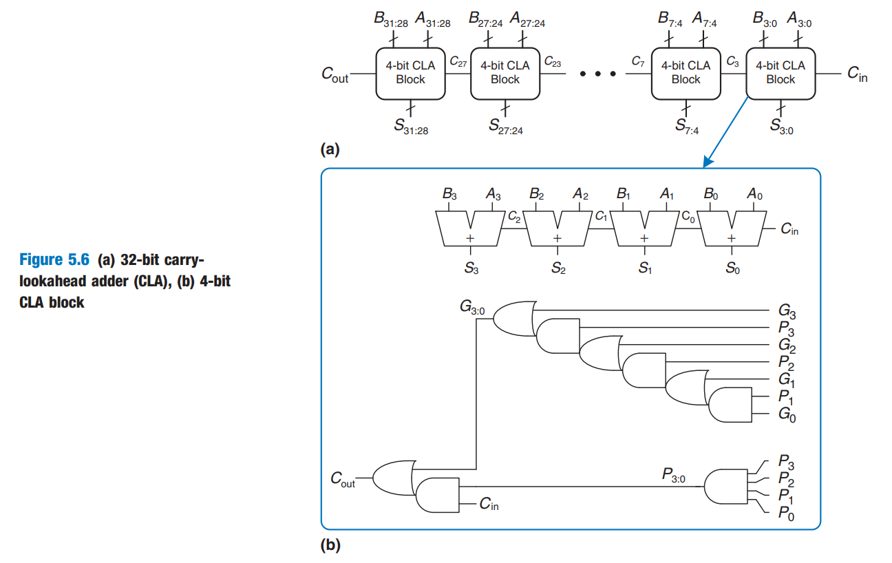

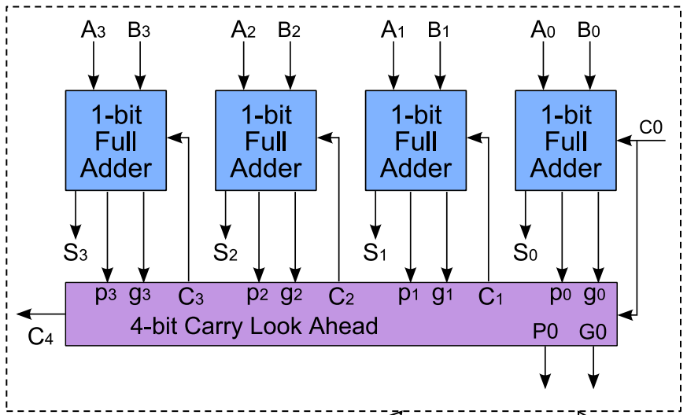

### 3.8 加法器延迟分析

**波纹进位加法器（Ripple Carry Adder）的延迟**：
- 关键路径：从最低位到最高位的进位传递路径
- 进位链延迟：$T_{CRA}(n) = n \cdot 2D$，其中 $D$ 为单位门延迟
- 和输出延迟：$T_{CRA}(n) = (n+2) \cdot 2D$

**超前进位加法器（Carry Look-ahead Adder）的延迟**：
- 超前进位加法器的延迟约为 $4D$，与位数 n 无关，但扇入问题限制了位数（通常 4 位一组）

**标准加法器芯片**：
- 7483 / 74283：4 位超前进位加法器

### 3.9 加法器的应用

加法器是数字系统的核心组件，广泛应用于：
- **算术逻辑单元（ALU）**：CPU 中的核心运算部件
- **数字计算器**：执行加、减、乘、除等基本运算
- **地址计算**：在存储器访问中计算地址偏移
- **数据处理**：在数字信号处理（DSP）中进行数据运算

## 4. 数值比较器

### 4.1 1 位比较器

比较两个 1 位二进制数 $A$ 和 $B$：

$$F_{A>B} = A \cdot \overline{B}$$
$$F_{A=B} = A \odot B = \overline{A \oplus B}$$
$$F_{A<B} = \overline{A} \cdot B$$

### 4.2 多位比较器

从高位到低位逐位比较：
- 若高位 $A_i > B_i$，则 $A > B$
- 若高位 $A_i < B_i$，则 $A < B$
- 若高位相等，比较次高位，以此类推

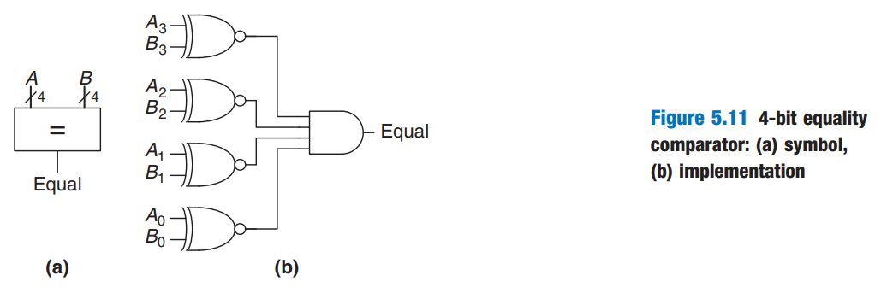

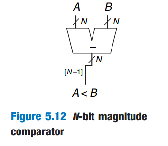

## 5. 编码器

### 5.1 编码器概述

编码器是一种组合逻辑电路，执行与译码器相反的功能。编码器有 n 条输入线和 m 条输出线，将 n 位输入数字字转换为 m 位二进制编码。

**常见编码器类型**：
- 优先编码器
- 十进制-BCD 编码器
- 八进制-二进制编码器
- 十六进制-二进制编码器

### 5.2 普通编码器

将输入信号转换为二进制代码。例如 8 线-3 线编码器，输入 $I_0 \sim I_7$ 中只有一个为 1，输出 $Y_2Y_1Y_0$ 为对应的二进制编码。

**8 线-3 线编码器真值表**：

| $I_7$ | $I_6$ | $I_5$ | $I_4$ | $I_3$ | $I_2$ | $I_1$ | $I_0$ | $Y_2$ | $Y_1$ | $Y_0$ |
|------|------|------|------|------|------|------|------|------|------|------|
| 0 | 0 | 0 | 0 | 0 | 0 | 0 | 1 | 0 | 0 | 0 |
| 0 | 0 | 0 | 0 | 0 | 0 | 1 | 0 | 0 | 0 | 1 |
| 0 | 0 | 0 | 0 | 0 | 1 | 0 | 0 | 0 | 1 | 0 |
| 0 | 0 | 0 | 0 | 1 | 0 | 0 | 0 | 0 | 1 | 1 |
| 0 | 0 | 0 | 1 | 0 | 0 | 0 | 0 | 1 | 0 | 0 |
| 0 | 0 | 1 | 0 | 0 | 0 | 0 | 0 | 1 | 0 | 1 |
| 0 | 1 | 0 | 0 | 0 | 0 | 0 | 0 | 1 | 1 | 0 |
| 1 | 0 | 0 | 0 | 0 | 0 | 0 | 0 | 1 | 1 | 1 |

**逻辑表达式**：
$$Y_2 = I_4 + I_5 + I_6 + I_7$$
$$Y_1 = I_2 + I_3 + I_6 + I_7$$
$$Y_0 = I_1 + I_3 + I_5 + I_7$$

**限制**：普通编码器要求任意时刻只有一个输入有效，否则输出混乱。

### 5.3 优先编码器

优先编码器允许同时有多个输入有效，但仅对优先级最高的输入进行编码。

**4 线-2 线优先编码器**（示例）：
- 输入：$I_0 \sim I_3$，$I_3$ 优先级最高，$I_0$ 最低
- 输出：$Y_1Y_0$，为最高优先级输入的编码

**4 线-2 线优先编码器真值表**：

| $I_3$ | $I_2$ | $I_1$ | $I_0$ | $Y_1$ | $Y_0$ |
|------|------|------|------|------|------|
| 1 | × | × | × | 1 | 1 |
| 0 | 1 | × | × | 1 | 0 |
| 0 | 0 | 1 | × | 0 | 1 |
| 0 | 0 | 0 | 1 | 0 | 0 |

**74LS148**：8 线-3 线优先编码器，$I_7$ 优先级最高，$I_0$ 最低。低电平有效输入，低电平有效输出。

## 6. 译码器

### 6.1 译码器概述

译码器是一种组合逻辑电路，有 n 条输入线，最多有 $2^n$ 条输出线。译码器与数据分配器类似（但没有数据输入），执行与编码器相反的功能。

**常见译码器类型**：
- 代码转换器
- BCD-七段显示译码器
- 数码管译码器
- 继电器驱动器

### 6.2 二进制译码器

将二进制代码转换为对应的输出信号。例如 2 线-4 线译码器、3 线-8 线译码器等。

**2 线-4 线译码器**：

**真值表**：

| A | B | $Y_3$ | $Y_2$ | $Y_1$ | $Y_0$ |
|---|---|-------|-------|-------|-------|
| 0 | 0 | 0 | 0 | 0 | 1 |
| 0 | 1 | 0 | 0 | 1 | 0 |
| 1 | 0 | 0 | 1 | 0 | 0 |
| 1 | 1 | 1 | 0 | 0 | 0 |

**逻辑表达式**：
$$Y_0 = \overline{A} \cdot \overline{B}$$
$$Y_1 = \overline{A} \cdot B$$
$$Y_2 = A \cdot \overline{B}$$
$$Y_3 = A \cdot B$$

**3 线-8 线译码器（74LS138）**：

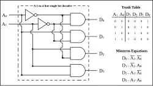

**输出表达式**：
$$Y_i = \overline{A_2 \cdot A_1 \cdot A_0 \cdot \text{使能条件}}$$

其中 $i$ 对应输入二进制数。

**使能条件**：
- 74LS138 有 3 个使能端：$G_1$，$\overline{G_2A}$，$\overline{G_2B}$
- 当 $G_1=1$，$\overline{G_2A}=0$，$\overline{G_2B}=0$ 时，译码器正常工作

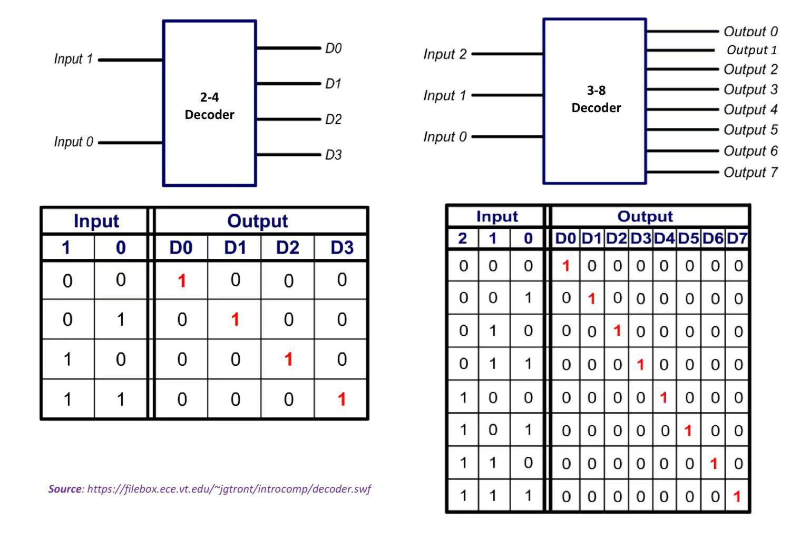

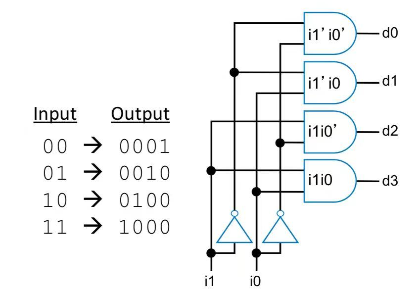

### 6.3 显示译码器

显示译码器将 BCD 码转换为七段数码管显示所需的驱动信号。

**七段数码管**由 a~g 七个 LED 段组成，有共阴极或共阳极两种连接方式。

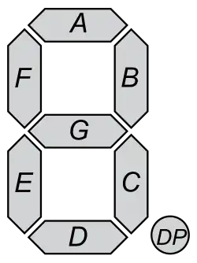

**共阴极显示译码器**（如 74LS48）：
- 输入为 4 位 BCD 码
- 输出为 7 位段选信号（a~g），高电平有效
- 当输入为 0000 时，输出 1111110（显示 0）

**七段显示真值表**：

| 十进制 | BCD输入 | a | b | c | d | e | f | g | 显示 |
|------|--------|---|---|---|---|---|---|---|----|
| 0 | 0000 | 1 | 1 | 1 | 1 | 1 | 1 | 0 | 0 |
| 1 | 0001 | 0 | 1 | 1 | 0 | 0 | 0 | 0 | 1 |
| 2 | 0010 | 1 | 1 | 0 | 1 | 1 | 0 | 1 | 2 |
| 3 | 0011 | 1 | 1 | 1 | 1 | 0 | 0 | 1 | 3 |
| 4 | 0100 | 0 | 1 | 1 | 0 | 0 | 1 | 1 | 4 |
| 5 | 0101 | 1 | 0 | 1 | 1 | 0 | 1 | 1 | 5 |
| 6 | 0110 | 1 | 0 | 1 | 1 | 1 | 1 | 1 | 6 |
| 7 | 0111 | 1 | 1 | 1 | 0 | 0 | 0 | 0 | 7 |
| 8 | 1000 | 1 | 1 | 1 | 1 | 1 | 1 | 1 | 8 |
| 9 | 1001 | 1 | 1 | 1 | 1 | 0 | 1 | 1 | 9 |

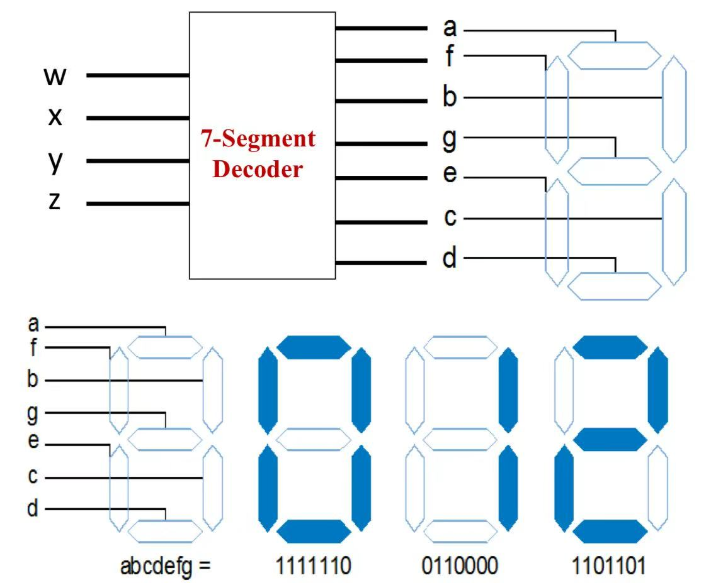

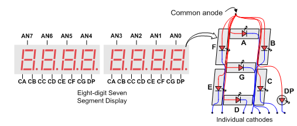

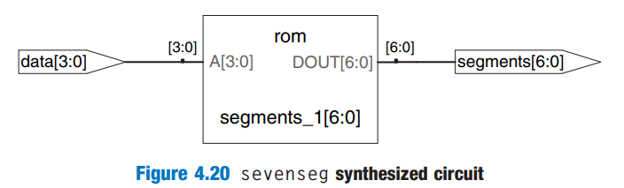

### 6.4 译码器的应用

译码器除了解码外，还广泛用于：
- **数据分配器**：将一路数据分配到多路输出
- **组合逻辑函数实现**：利用译码器加或门可以实现任意组合逻辑函数
- **存储器寻址**：在存储器系统中作为地址译码器
- **信号选择**：在多路复用系统中选择特定信号

## 7. 多路选择器与数据分配器

### 7.1 多路选择器（Multiplexer, MUX）

多路选择器是一种组合逻辑电路，它有 n 个数据输入、m 个选择输入（控制输入），以及 1 个数据输出。根据选择输入的值，从多路输入中选择一路输出。

**功能**：根据选择信号，从多个输入数据中选择一个输出，相当于一个多输入的单刀多掷开关。

**分类**：
- 2 选 1 多路选择器
- 4 选 1 多路选择器
- 8 选 1 多路选择器
- 16 选 1 多路选择器

#### 2 选 1 多路选择器

**真值表**（使能 E=1）：

| S | Y |
|---|---|
| 0 | I0 |
| 1 | I1 |

**逻辑表达式**：
$$Y = \overline{S} \cdot I0 + S \cdot I1$$

#### 4 选 1 多路选择器

**真值表**（使能 E=1）：

| S1 | S0 | Y |
|---|---|---|
| 0 | 0 | I0 |
| 0 | 1 | I1 |
| 1 | 0 | I2 |
| 1 | 1 | I3 |

**逻辑表达式**：
$$Y = \overline{S1} \cdot \overline{S0} \cdot I0 + \overline{S1} \cdot S0 \cdot I1 + S1 \cdot \overline{S0} \cdot I2 + S1 \cdot S0 \cdot I3$$

#### 8 选 1 多路选择器

**真值表**（使能 E=1）：

| S2 | S1 | S0 | Y |
|---|---|---|---|
| 0 | 0 | 0 | I0 |
| 0 | 0 | 1 | I1 |
| 0 | 1 | 0 | I2 |
| 0 | 1 | 1 | I3 |
| 1 | 0 | 0 | I4 |
| 1 | 0 | 1 | I5 |
| 1 | 1 | 0 | I6 |
| 1 | 1 | 1 | I7 |

**扩展**：可以用多个 4 选 1 多路选择器级联实现 8 选 1、16 选 1 等。

#### 16 选 1 多路选择器

16 选 1 多路选择器可以用：
- 两个 8 选 1 多路选择器
- 五个 4 选 1 多路选择器

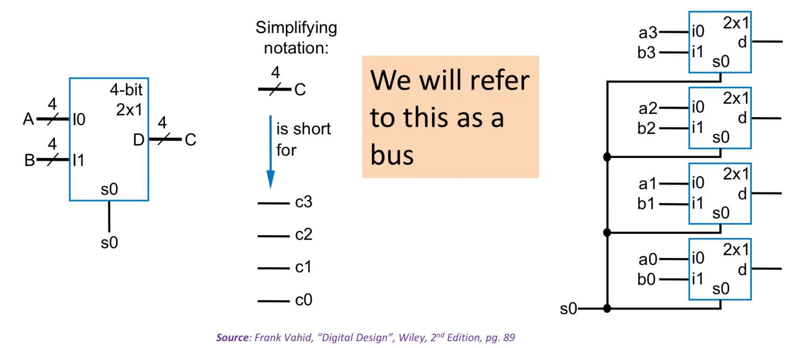

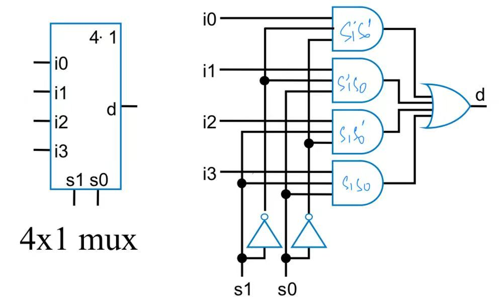

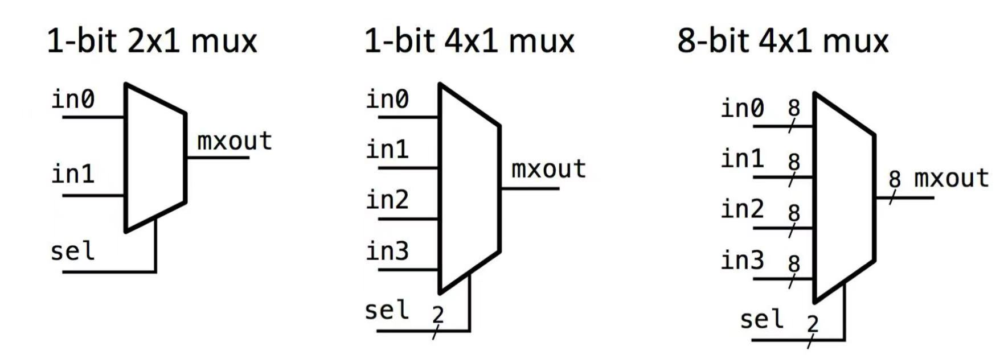

### 7.2 多路选择器的应用

**应用场景**：
1. **数据传输**：在计算机或卫星系统中，用多路选择器传输多路数据到一个输出
2. **计算机存储器**：多路选择器用于连接存储器与其他部件，减少线路数量
3. **电话网络**：多路电话信号通过多路选择器合并到一条线路上传输
4. **组合逻辑函数实现**：用多路选择器实现任意布尔函数

### 7.3 数据分配器（Demultiplexer, DEMUX）

数据分配器是多路选择器的反向操作，它有 1 个数据输入、m 个选择输入，以及 n 个数据输出。根据选择输入的值，将输入数据分配到指定的输出。

**功能**：将一路输入数据分配到多个输出之一，相当于一个单输入的单刀多掷开关。

**分类**：
- 1 分 2 数据分配器
- 1 分 4 数据分配器
- 1 分 8 数据分配器
- 1 分 16 数据分配器

#### 1 分 2 数据分配器

**真值表**：

| S | Y1 | Y0 |
|---|----|----|
| 0 | 0 | D |
| 1 | D | 0 |

#### 1 分 4 数据分配器

**真值表**：

| S1 | S0 | Y3 | Y2 | Y1 | Y0 |
|---|---|----|----|----|----|
| 0 | 0 | 0 | 0 | 0 | D |
| 0 | 1 | 0 | 0 | D | 0 |
| 1 | 0 | 0 | D | 0 | 0 |
| 1 | 1 | D | 0 | 0 | 0 |

### 7.4 数据分配器的应用

**应用场景**：
1. **算术逻辑单元（ALU）**：ALU 输出作为数据分配器输入，输出连接到多个寄存器
2. **串并转换**：串行数据输入到数据分配器，计数器控制选择输入，并行读取输出
3. **信号分发**：将一个控制信号分发到多个模块

### 7.5 多路选择器与数据分配器对比

| 特性 | 多路选择器（MUX） | 数据分配器（DEMUX） |
|------|------------------|---------------------|
| 输入 | n 个数据输入，m 个选择输入 | 1 个数据输入，m 个选择输入 |
| 输出 | 1 个数据输出 | n 个数据输出 |
| 功能 | 多中选一 | 一分多 |
| 相当于 | 单刀多掷开关（多投一） | 单刀多掷开关（一投多） |
| 典型应用 | 数据选择、总线复用 | 数据分发、串并转换 |

## 8. 算术逻辑单元（ALU）

### 8.1 ALU 概述

算术逻辑单元（Arithmetic Logic Unit, ALU）是一种数字电路，用于执行算术和逻辑运算。它是计算机中央处理器（CPU）的基本构建模块。

**功能**：
- **算术运算**：加法、减法、乘法、除法等
- **逻辑运算**：AND、OR、XOR、NOR、NOT 等
- **比较运算**：等于、大于、小于等
- **移位运算**：左移、右移、循环移位等

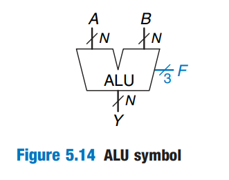

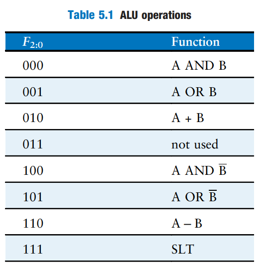

### 8.2 简单 1 位 ALU

**结构**：
- 输入：A、B（数据输入），M0、M1（功能选择）
- 输出：F（运算结果）
- 使用多路选择器选择运算功能

**功能表**：
| M0 | M1 | 功能 |
|:----:|:----:|:------:|
| 0 | 0 | 加法（SUM）|
| 0 | 1 | 与运算（AND）|
| 1 | 0 | 或运算（OR）|
| 1 | 1 | 异或运算（XOR）|

**内部实现**：
- 并行执行多个运算单元（加法器、与门、或门、异或门等）
- 使用多路选择器根据功能选择输出

### 8.3 4 位 ALU

**扩展方法**：
- 将 1 位 ALU 作为基本模块
- 级联多个 1 位 ALU 构成 n 位 ALU
- 输入 A 和 B 都是 4 位
- 输出也是 4 位

**特点**：
- 功能选择线 M0、M1 控制所有位的运算选择
- 所有位并行执行，提高运算速度
- 可进一步扩展为 8 位、16 位、32 位等

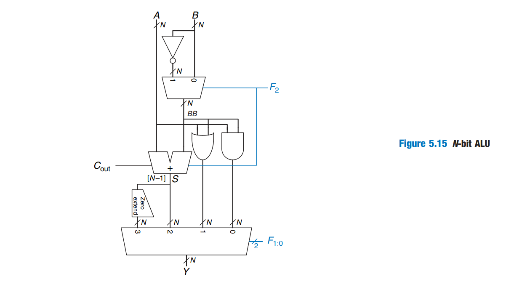

### 8.4 ALU 在计算机系统中的作用

**与其他部件的关系**：
- **指令集**：选择线 M0、M1 加上输入参数和功能，构成指令集
- **内部寄存器**：输入数据 A、B 常存储在内部寄存器中
- **ROM**：指令可以存储在 ROM 中
- **RAM**：ROM 速度较慢，常用高速 RAM 作为中间存储
- **控制单元**：关键时序、指令解码由独立的控制和时序单元处理
- **I/O 端口**：提供外部接口
- **附加功能**：中断、通信协议、EEPROM、定时器/计数器、调试接口等

**重要思想**：
- 单个模块可递归使用
- 选择线决定 ALU 执行的功能
- 所有运算单元并行工作，多路选择器选择输出

### 8.5 典型集成 ALU 芯片

**74LS181**：4 位算术逻辑单元/函数发生器
- 功能：16 种算术运算、16 种逻辑运算
- 输入：A0-A3，B0-B3（4 位），S0-S3（功能选择），M（算术/逻辑模式）
- 输出：F0-F3（4 位结果），Cn+4（进位），P、G（超前进位）

**74LS381**：4 位算术逻辑单元
- 功能：8 种运算
- 输入：A0-A3，B0-B3，S0-S2（功能选择）
- 输出：F0-F3，Cn+4

**74LS382**：4 位 ALU/函数发生器
- 类似 74LS381，带内部进位

### 8.6 乘法器

乘法器是数字系统中实现乘法运算的核心部件。

**4×4 乘法器**：由与门阵列和加法器阵列组成，实现两个 4 位二进制数的乘法。

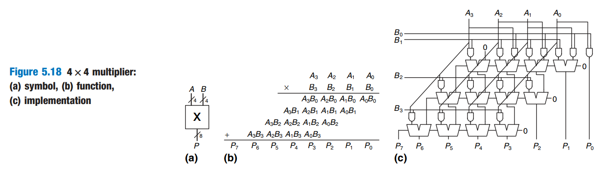

**时序乘法器**：通过移位和加法操作逐位计算乘法，硬件资源较少但速度较慢。

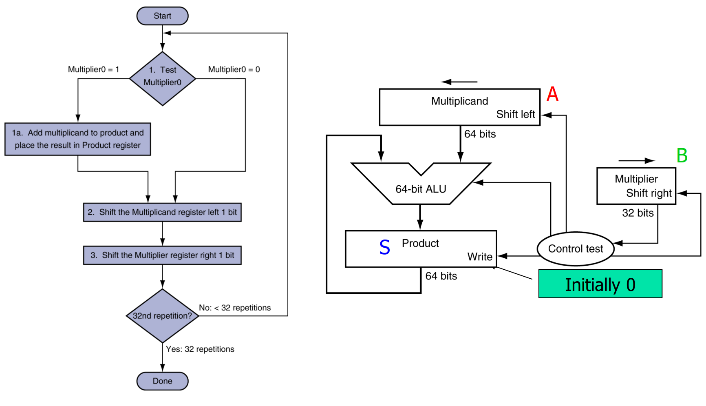

**改进时序乘法器**：通过优化加法操作和移位控制，减少时钟周期数，提高乘法效率。

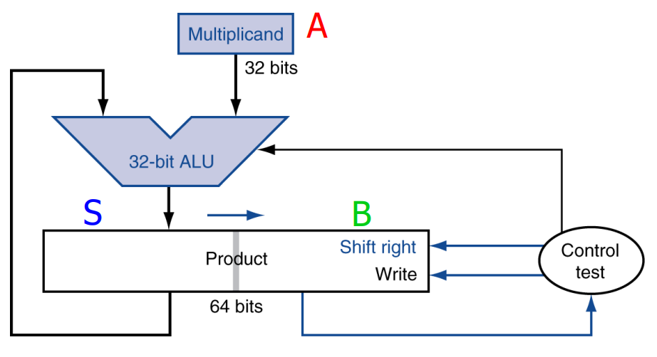

### 8.7 除法器

除法器实现两个二进制数的除法运算。

**阵列除法器**：由可控加/减单元和移位寄存器组成的阵列结构，实现二进制除法。

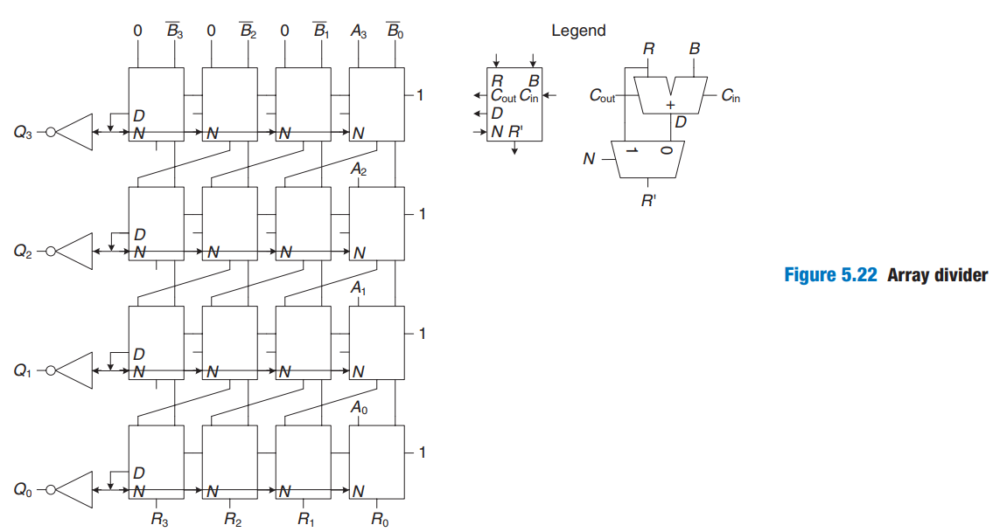

**除法示例**：二进制除法的计算过程示意。

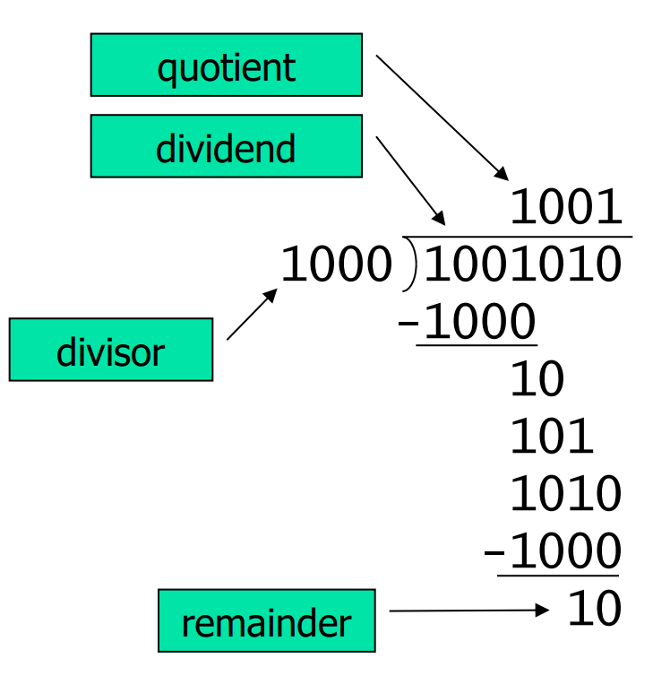

**时序除法器**：通过重复执行减法和移位操作实现除法，硬件结构简单。

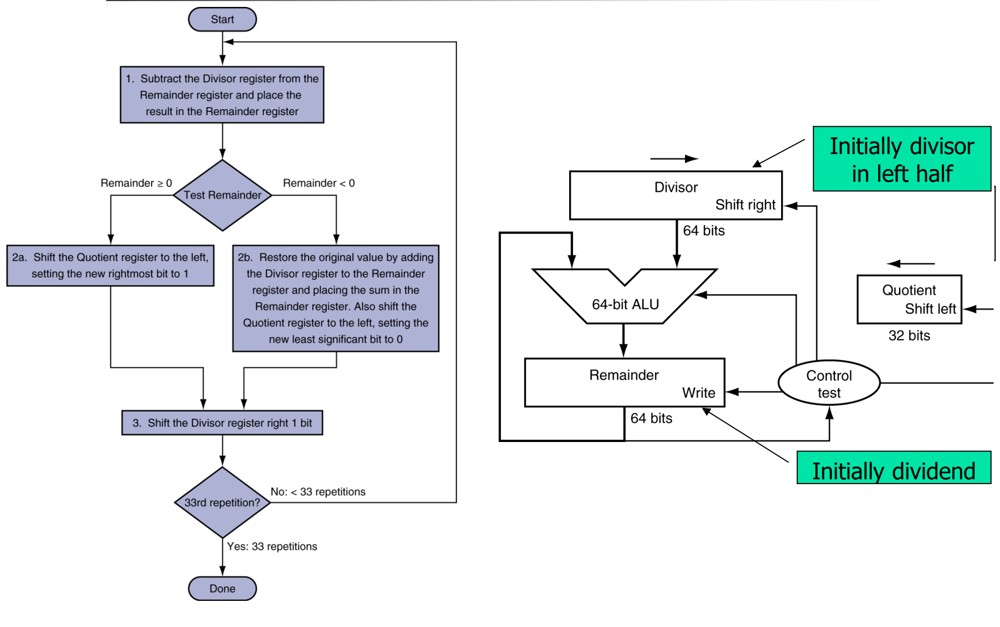

**时序除法器示例**：时序除法器的具体计算过程演示。

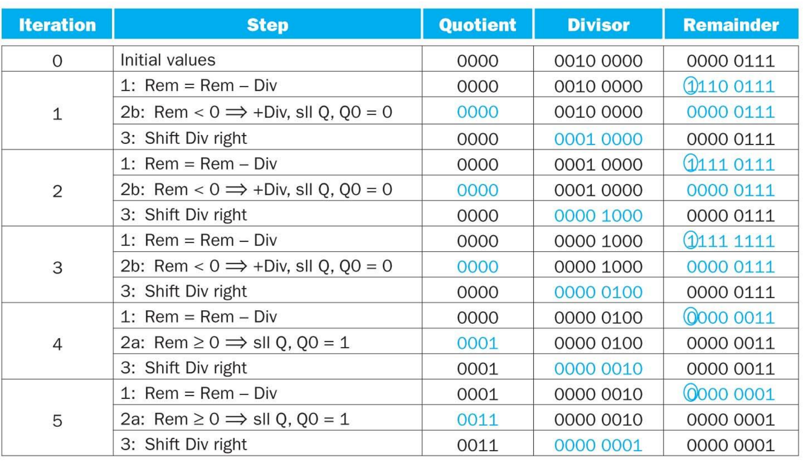

### 8.8 移位器

移位器实现二进制数的左移、右移和循环移位等操作，是 ALU 的重要组成部分。

**4 位移位器**：可实现逻辑左移、逻辑右移、算术右移、循环移位等多种移位操作。

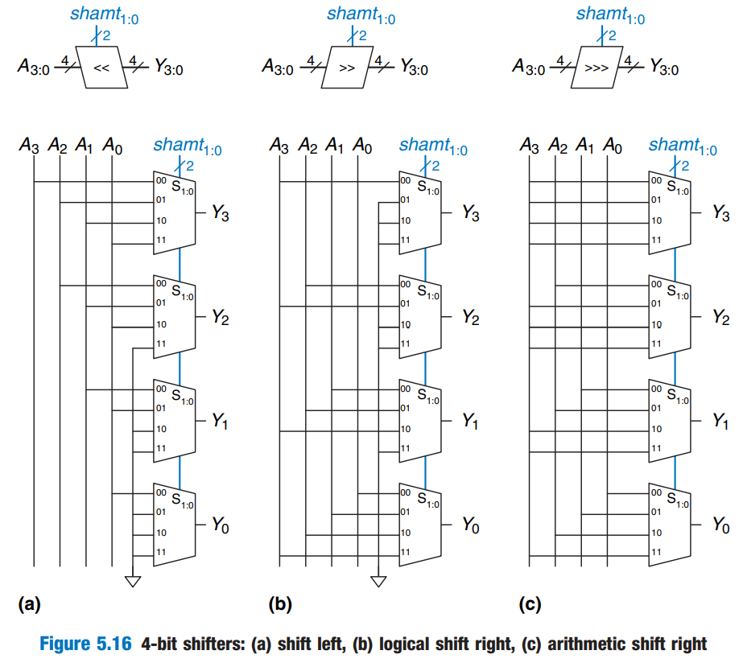

**硬件高效移位器**：通过桶形移位器（Barrel Shifter）结构，可在单个时钟周期内完成任意位数的移位。

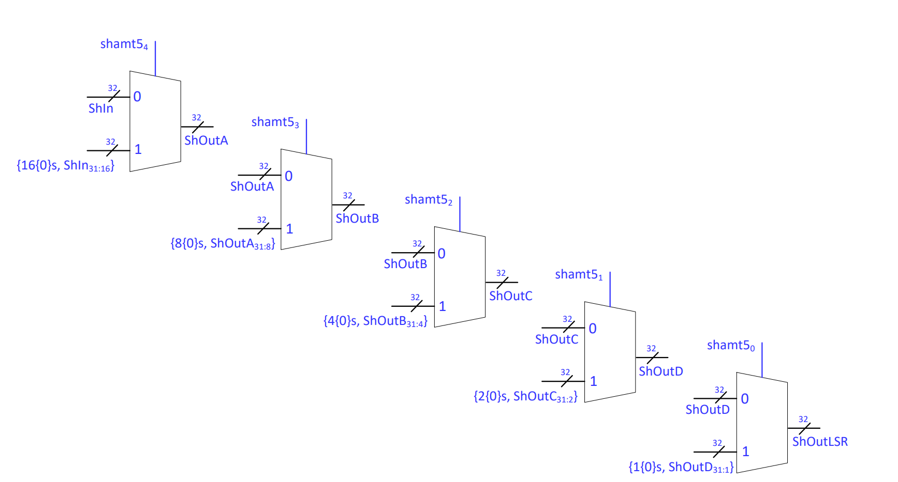

## 9. 加法器架构进阶

### 9.1 行波进位加法器（Ripple Carry Adder, RCA）

行波进位加法器是结构最简单的加法器，由多个全加器级联构成。

**延迟分析**：RCA 的关键路径是从最低位进位到最高位进位的传递路径：
$$t_{add} = (N-1) \cdot t_{carry} + t_{sum}$$

其中 N 为位数，t_carry 为每位进位传播延迟，t_sum 为产生和输出的延迟。

**优化技巧**：全加器的反相特性可用于优化。注意到全加器进位输出的反相特性，可以设计交替使用正相和反相输出的全加器，从而节省 N 个反相器（每级进位不需要额外反相）。

### 9.2 进位旁路加法器（Carry Bypass Adder）

进位旁路加法器（也称为 Carry-Skip Adder）通过添加旁路路径来加速进位传播。

**结构**：将 N 位加法器分为 N/M 个 M 位块，每个块添加旁路逻辑。

**工作原理**：
- 当块内所有位的进位传递信号 P_i = 1 时（即 A_i ≠ B_i），进位可以直接跳过整个块
- 旁路路径使用多路选择器选择：进位来自前一级的进位输出或旁路进位
- 进位传递信号：P_i = A_i ⊕ B_i

**延迟分析**：
$$t_{add} = t_{setup} + M \cdot t_{carry} + (N/M - 1) \cdot t_{bypass} + (M-1) \cdot t_{carry} + t_{sum}$$

其中 t_setup 为产生 P_i 和 G_i 的时间，t_bypass 为旁路路径的延迟。

**最优块大小**：通过选择最优的 M 值（通常 M ≈ √N），可以最小化总延迟。

### 9.3 进位选择加法器（Carry Select Adder, CSA）

进位选择加法器通过预计算两个可能的进位结果，然后选择正确的输出来加速加法。

**线性结构**：
- 将 N 位加法器分为 N/M 个 M 位块
- 每个块同时预计算进位输入为 0 和 1 两种情况下的结果
- 使用多路选择器根据实际进位选择正确结果

**线性结构延迟**：
$$t_{add} = t_{setup} + M \cdot t_{carry} + (N/M) \cdot t_{mux} + t_{sum}$$

**平方根结构**：
- 不同块的大小不同，从 1 递增到 √N
- 后级块的计算与前级进位传播并行进行
- 所有块的计算时间相近，提高并行度

**平方根结构延迟**：
$$t_{add} = t_{setup} + M \cdot t_{carry} + \sqrt{2N} \cdot t_{mux} + t_{sum}$$

### 9.4 三种加法器架构对比

| 架构 | 延迟 | 面积 | 功耗 |
|------|------|------|------|
| 行波进位（RCA） | O(N) | 最小 | 最低 |
| 进位旁路（Bypass） | O(√N) | 中等 | 中等 |
| 进位选择（Select） | O(√N) | 较大 | 较高 |

**选择指南**：
- 位宽较小（N ≤ 8）时，RCA 足够
- 中等位宽（8 < N ≤ 32）时，进位旁路或进位选择较好
- 高位宽（N > 32）时，考虑超前进位（CLA）或树形加法器

## 9. 数据选择器

数据选择器（Multiplexer, MUX）从多路输入中选择一路输出。

**2 选 1 MUX**：
$$Y = S \cdot D_1 + \overline{S} \cdot D_0$$

**4 选 1 MUX**：
$$Y = \overline{S_1}\overline{S_0}D_0 + \overline{S_1}S_0D_1 + S_1\overline{S_0}D_2 + S_1S_0D_3$$

**8 选 1 MUX**（如 74LS151）：由三个地址选择端 $A_2A_1A_0$ 从 8 路数据中选择一路。

## 8. 数据分配器

数据分配器（Demultiplexer, DEMUX）将一路输入数据分配到多路输出中的一路。

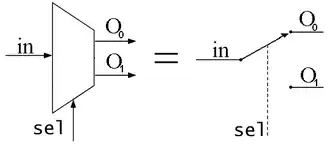

**1 路-4 路 DEMUX**：
$$Y_0 = D \cdot \overline{S_1}\overline{S_0}$$
$$Y_1 = D \cdot \overline{S_1}S_0$$
$$Y_2 = D \cdot S_1\overline{S_0}$$
$$Y_3 = D \cdot S_1S_0$$

## 9. 奇偶校验器

奇偶校验器用于检测数据中 1 的个数是否为奇数或偶数。

**奇偶产生/校验原理**：
- 奇校验：数据位加上校验位后，1 的总数为奇数
- 偶校验：数据位加上校验位后，1 的总数为偶数

**8 位奇偶校验器**：
$$P = B_0 \oplus B_1 \oplus B_2 \oplus B_3 \oplus B_4 \oplus B_5 \oplus B_6 \oplus B_7$$

## 10. 竞争与冒险

### 10.1 竞争现象

当逻辑门的输入信号经过不同路径到达时，由于各路径延迟不同，导致输入信号到达的时间有先后，这种现象称为"竞争"。

### 10.2 冒险现象

竞争可能导致输出出现不应有的尖峰脉冲，称为"冒险"（Hazard）。

**静态冒险**：输出本应保持不变，但出现短暂毛刺。
- **静态 1 冒险**：输出本应为 1，出现 0 毛刺
- **静态 0 冒险**：输出本应为 0，出现 1 毛刺

**动态冒险**：输出本应变化一次，但变化过程中出现多次跳变。

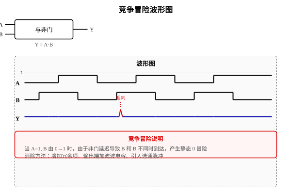

### 10.3 冒险的判断方法

**代数法**：检查逻辑表达式是否满足 $Y = A + \overline{A}$（产生 1 冒险）或 $Y = A \cdot \overline{A}$（产生 0 冒险）。

**卡诺图法**：若卡诺图中存在两个相邻的 1（或 0）没有被同一个圈覆盖，则存在冒险。

### 10.4 冒险消除方法

1. **增加冗余项**：在逻辑表达式中增加冗余乘积项，覆盖所有相邻项
2. **输出端加滤波电容**：利用电容的充放电特性滤除窄脉冲
3. **引入选通脉冲**：在输出稳定后再读取
4. **采用同步设计**：使用时钟同步信号

## 11. 组合逻辑设计示例

### 11.1 三个 1 检测器

三个 1 检测器是一个典型的组合逻辑电路设计示例，用于检测输入中 1 的个数是否为 3 的倍数。

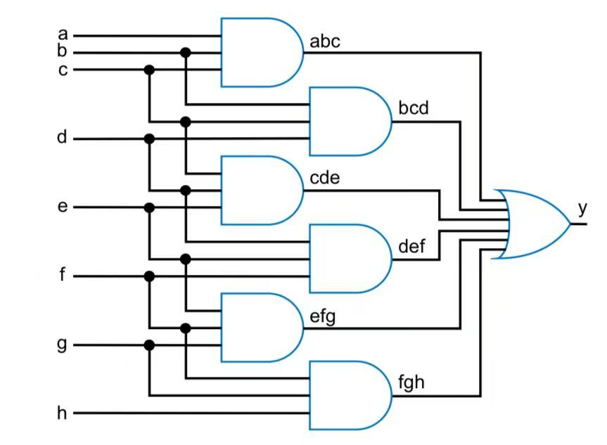